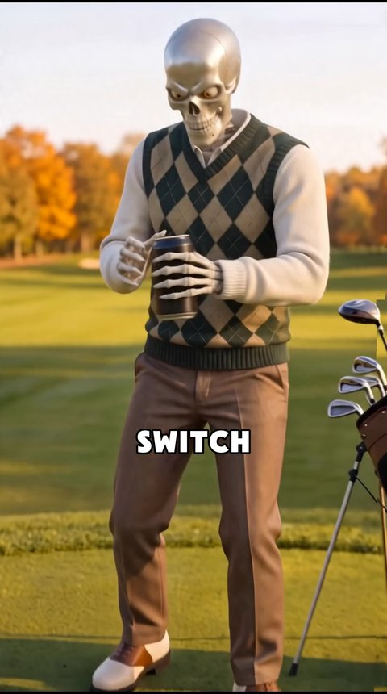
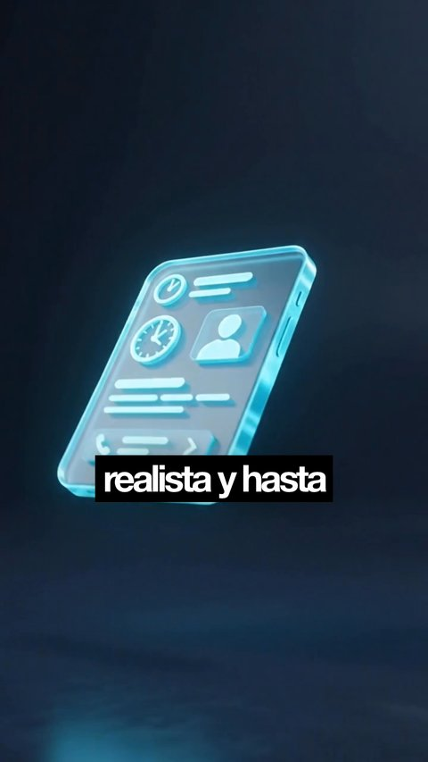

# 43. Hall of Fame - Skeleton Ads
> Course-completion page: export your skeleton ad, post it in the "Ad Reviews" channel with specific questions, and learn from three member skeleton ads shown below it.

## 🤖 Agent use
- **Use when:** closing the skeleton workflow; preparing an ad for community or internal review; looking for real member skeleton ads to compare.
- **Inputs → outputs:** your exported ad + a specific question → feedback; for agents, three example posts as visual references only.
- **Rules:**
  - **DO** "Export your ad. Done beats perfect." and post it for review (page).
  - **DO** ask specific questions: "Is my hook strong enough? Are my visuals easy to follow? How are my transitions?" (page).
  - **DON'T** copy a member ad's look or script; reuse structure only ("copy the mechanism, not the asset").
  - **IF** you cannot judge a language (one example is in Spanish) **THEN** say so and ask for feedback on the visuals/pacing only (as the poster did).
- **See also:** [042. Editing the video](042-skeleton-editing-the-video.md) · [036. The ads we're making](036-skeleton-the-ads-we-re-making.md) · [037. Install skill](037-install-skill-generate-script.md)

## Key ideas
- Page copy: after the Skeleton course "the questions start"; the community offers real feedback from "Camilo, the coaches, or any member who has already nailed it". Levels unlock "The Arena" (annual free credits, brand deals), "The Test Lab" (early access to private agency tests) and "The Inner Circle" (page text).
- Instructions on page: 1 Export your ad; 2 Post it in "Ad Reviews", ask specific questions; 3 Learn from feedback on yours and the posts below.
- The posts' comments are not included in the saved page (only comment counts). The linked videos are not available as files; only thumbnails were captured.

## Examples
Member posts shown (member names withheld here):

| Post (date shown) | Poster's words | What the thumbnail shows | Notes |
|---|---|---|---|
| "Skeleton Ad Review" (Jul 4) | "Just made this skeleton ad for a client, let me know if there's anything I can improve on." | Metallic-skull skeleton in an argyle vest on a golf course holding a drink can, bold white caption "SWITCH" | Client ad; product category not shown |
| "Skelton Ad Review" (Jun 27) | "Im going away today for a week so had to rush through editing... I tried to make the test hook more congruent and native also had to add in some extra clips because my voice over was quite long. But let me know what you think of script as well!" | Female skeleton with long hair and cream cable-knit sweater looking up, caption "and choose to" | Asks for script feedback; tags the coach |
| "Skeleton Ad" (25 days before page capture) | "Hey guys just made this skeleton ad in omni, it's in spanish so if you speak spanish plz roast it. if you don't speak spanish still roast what you can lol" | Glowing translucent phone/app-UI card on a dark blue background, Spanish caption "realista y hasta" | Software-style visual, not a character shot; tool "omni" unspecified |

## Structured units
### Ad teardowns (from thumbnails only)
| Brand / product (niche) | Format | Hook / opening | What works | What fails | Fix suggested | Principle | Source |
|---|---|---|---|---|---|---|---|
| Client drink (unspecified) | Skeleton, golf setting | not visible | Distinct themed world; single bold caption word | Hook and script not available | — | Theme dramatises product (skill rule) | page thumbnail |
| Unspecified | Skeleton with human hair and sweater | not visible | Warm, cosy, friendly skeleton (human-like hair/outfit) | Differs from the four skill styles (Dressed style) | — | Dressed Skeleton style | page thumbnail |
| Software / app (Spanish) | UI hologram visuals, no character in thumbnail | not visible | Different visual language for a tech offer | Poster flags language limits | — | — | page thumbnail |

- No scripts, metrics or coach replies are on the saved page, so no what-works verdicts beyond the thumbnails.

## Screenshots

*Member client ad: metallic-skull skeleton on a golf course with a drink can, caption "SWITCH".*

*Skeleton with hair and a cream cable-knit sweater: a Dressed-style variation on the format.*

*Spanish-language ad using a glowing app-UI card instead of a character.*

## How to apply
- [ ] Export your first version and post it with 2–3 specific questions (hook, visual clarity, transitions).
- [ ] Compare your ad to the three examples for theme, outfit and caption style.

## Related
- Previous: [042. Editing the video](042-skeleton-editing-the-video.md) · Next: [044. Crochet: the ad we are making](044-crochet-the-ad-we-are-making.md)

## Sources and limitations
- [Lesson page text](<../../../../../raw/ad-creators-lab/ai-ads-ugc-animations/_extracted/Ad Creators Lab - Create Viral AI Ads, UGC & Animations That Convert Into Sales(September 2026)/4. AI Animated Ads/1. 🔥NEW🔥 Skeleton Ads/8. Hall of Fame - Skeleton Ads.html.md>) plus images extracted from the saved HTML (thumbnails). No video, transcripts, comments or metrics. Poster names are omitted for privacy.
- Compliance: none of the scripts are visible, so health or results claims cannot be audited; run any adopted structure through the [claim audit](../../../stefan-georgi/rmbc-ii/rubrics/llm-output-claim-audit.md).
