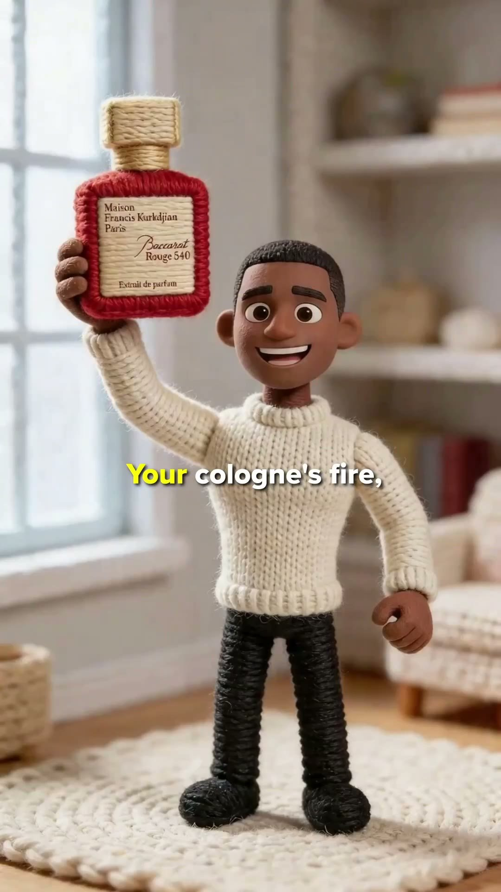
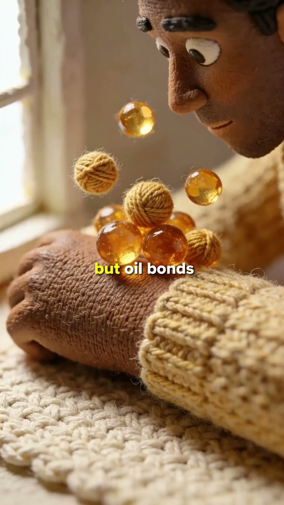
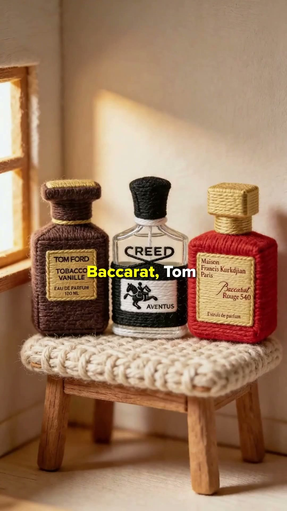
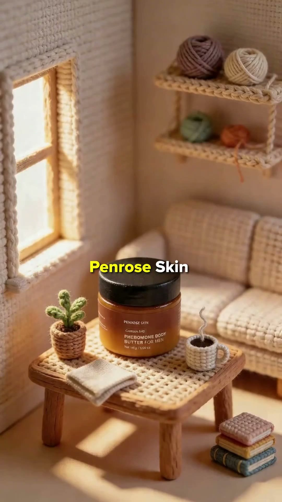

# 44. The Ad We Are Making (Crochet ad)
> A 47-second finished example: a yarn-textured diorama world with one consistent character, narrated by an AI rap track, selling a body butter by contrasting it with fading cologne.

## 🤖 Agent use
- **Use when:** you need the reference output for the crochet format (knit/yarn diorama + song/rap voiceover) before running [045](045-claude-skill-setup-explanation.md) and [046](046-script-visualisation-image-creation.md).
- **Inputs → outputs:** none; output is a reference script and shot sequence. Structure to copy: problem hook → mechanism → solution → price/proof → social payoff → CTA, each line a distinct yarn-world shot.
- **Rules:**
  - **DO** build the hook on a relatable failure: "Your cologne's fire but it's dead by noon" [00:00].
  - **DO** explain the mechanism in one line ("alcohol hits the air and the scent doesn't last. But oil bonds the skin") then give the fix [00:00].
  - **DO** show the invisible benefit as character action and simple yarn-ball orbs, not particle clouds (see skill rules in [045](045-claude-skill-setup-explanation.md)).
  - **DON'T** reuse real competitor brands on props or in captions: the example shows named fragrance houses on bottle labels (compliance flag below).
  - **DON'T** copy unsupported claims: "$35 last eight hours straight", "Used to spend $1,200 every single year", "smell like money" are asserted without evidence.
- **See also:** [045. Claude skill setup](045-claude-skill-setup-explanation.md) · [046. Script visualisation and image creation](046-script-visualisation-image-creation.md) · [047. Editing final video](047-crochet-editing-final-video.md) · [AI song-ad pipeline (Loom)](../../../../resources/ai-song-ad-pipeline-loom.md)

## Key ideas
### Script structure (rap lyrics, machine-transcribed) [00:00–00:46]
- Problem: "Your cologne's fire but it's dead by noon. What if one thing made it last the whole night through?"
- Mechanism: "cologne on its own just evaporates fast. Alcohol hits the air and the scent doesn't last. But oil bonds [to] the skin. That's the mood that they miss."
- Solution + usage: layer the body butter first, then spray as usual: "Put the butter on first and spray what you usually do. The scent locks to your skin like it's part of you now."
- Social payoff and price: "She gets close at the bar and she's wondering how. Used to spend $1,200 every single year. Cologne gone by noon, homie. That's what I fear. $35 last eight hours straight. She asked what I was wearing on the very first date."
- CTA: product name, "link below go grab it don't wait on this one", "smells so good she's texting you before the night's done".

### Visual sequence (frames) [00:00–00:35]
| Time | Caption | Shot |
|---|---|---|
| 00:00 | "Your cologne's fire," | Character in cream knit sweater holds a red fragrance bottle (label shows a real fragrance brand) |
| 00:01 | "Your cologne's fire," | Sniffs collar, disappointed face |
| 00:02 | "but it's dead by noon" | Standing in a lamp-lit room, amber yarn-ball orbs drifting away |
| 00:05 | "See cologne" | Sprays at a bathroom mirror |
| 00:07 | "fast alcohol" | Red sweater, sniffing wrist |
| 00:10 | "but oil bonds" | Close-up of amber orbs sticking on the wrist |
| 00:12 | "layer Penrose" | Holds a body-butter jar |
| 00:15 | "Baccarat, Tom" | Three named fragrance bottles on a knit stool |
| 00:17 | "Put" | Applies butter to arm |
| 00:20 | "the scent" | Walks a street; orbs persist around him |
| 00:23 | "you now she" | At a bar with a woman, orbs around them |
| 00:25 | "i used to" | Pays a cashier; shelves of fragrance bottles |
| 00:28 | "cologne gone" | Sad at the bathroom mirror |
| 00:30 | "$35" | Holds banknotes, smiling |
| 00:33 | "She asked what I" | Candlelit dinner with a woman |
| 00:35 | "Penrose Skin" | Jar on a knit table (end card) |

## Examples
| Brand / product (niche) | Format | Hook / opening | What works | What fails | Fix suggested | Principle | Source |
|---|---|---|---|---|---|---|---|
| Penrose body butter (men's fragrance layering) | Crochet diorama + rap song, 9:16 | "Your cologne's fire but it's dead by noon" | Clear problem → mechanism → fix; "before" orbs vanish, "after" orbs stay (visual proof of the mechanism); price anchor $1,200 vs $35 | Unsupported performance and price claims; named competitor brands on props; "link below" | Substantiate "8 hours" with testing; blur or replace brand labels; use platform-allowed CTA | Mechanism + contrast (derived) | [00:00–00:46] |

## Structured units
### Hooks
| Hook (verbatim or near) | Heuristic(s) | Emotion / zone | Self targeted | Why it works | Source |
|---|---|---|---|---|---|
| "Your cologne's fire but it's dead by noon. What if one thing made it last the whole night through?" | problem agitation + curiosity gap (derived) | frustration → hope (derived) | man who wears cologne and dates (character profile in [046](046-script-visualisation-image-creation.md)) | Names a daily failure then opens a question | [00:00] |

- **DO** prefer character-reaction storytelling over trying to render evaporating particles (skill rule; see [045](045-claude-skill-setup-explanation.md)).
- **DON'T** state results as fact without proof: "$35 last eight hours straight" (instructor-ad claim).

## Screenshots

*Hook: character holding a fragrance bottle in a knit room. [00:00]*

*"but oil bonds": amber yarn orbs stay on the wrist, the mechanism shown visually. [00:10]*

*Three named fragrance bottles as props. Real brand labels are a trademark/comparison risk. [00:15]*

*End card: the product jar on a knit table. [00:35]*

## How to apply
- [ ] Map your product's problem → mechanism → fix → social payoff in six lines.
- [ ] Decide the character (from research) before visuals.
- [ ] Replace real brands in props with generic or your own labelled bottles.
- [ ] Get substantiation for every claim and price comparison.

## Related
- Previous: [043. Hall of fame, skeleton ads](043-hall-of-fame-skeleton-ads.md) · Next: [045. Claude skill setup and explanation](045-claude-skill-setup-explanation.md)

## Sources and limitations
- [Transcript](<../../../../../raw/ad-creators-lab/ai-ads-ugc-animations/_transcripts/Ad Creators Lab - Create Viral AI Ads, UGC & Animations That Convert Into Sales(September 2026)/4. AI Animated Ads/2. Crochet Style Ads/1. The Ad We Are Making.txt>) (ends 0:46 of 0:47) · [Lesson page](<../../../../../raw/ad-creators-lab/ai-ads-ugc-animations/_extracted/Ad Creators Lab - Create Viral AI Ads, UGC & Animations That Convert Into Sales(September 2026)/4. AI Animated Ads/2. Crochet Style Ads/1. The Ad We Are Making.htm.md>) (empty; the next lesson says two example ads are linked "down below", but only this one is in the files).
- Lyrics are Whisper output from a sung track and contain errors (e.g. "Pinro", "Penrose", "Baccarat time for Creed Aventus 2" is partly unintelligible).
- Compliance: unsupported product claims; real fragrance trademarks shown; the rap-voice track's source is Suno per [045 [00:00]](045-claude-skill-setup-explanation.md).
