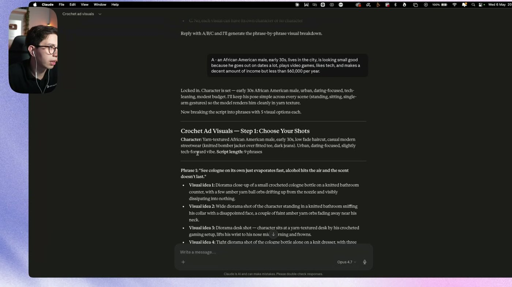
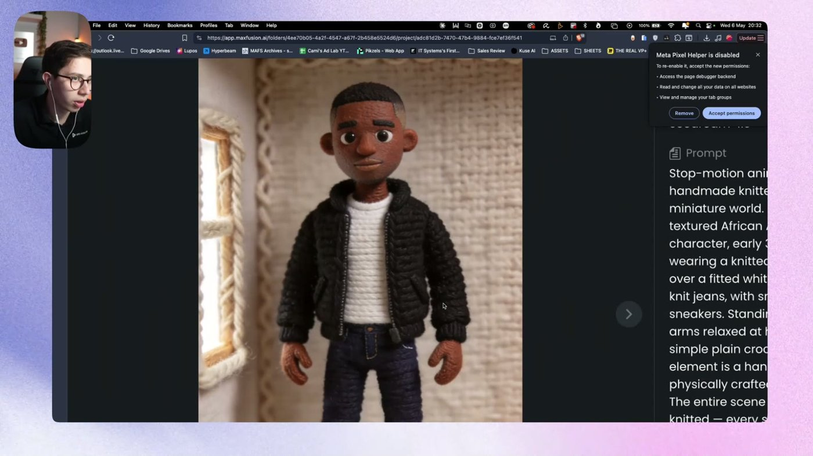
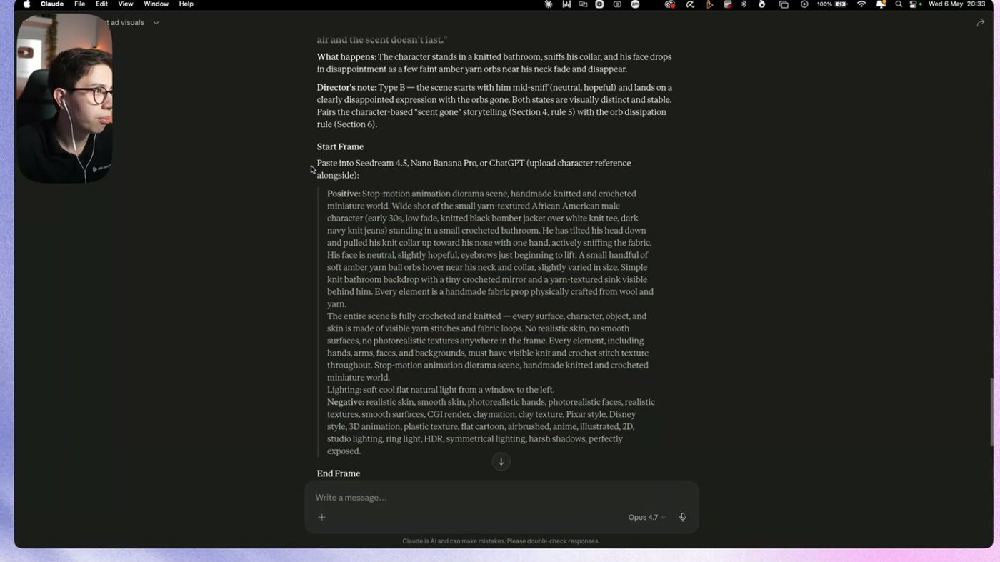
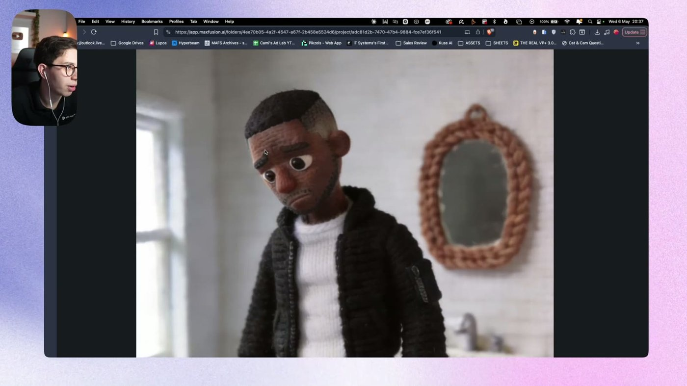

# 46. Script Visualisation & Image Creation (Crochet ads)
> Live demo of the Crochet Ad Visuals skill: define one consistent character, pick one of five visual ideas per script phrase, generate character, start and end frames in Seedream, then run image-to-video in Seedance and Kling and compare.

## 🤖 Agent use
- **Use when:** turning a song or script into character-consistent crochet storyboard frames and clips.
- **Inputs → outputs:** script/lyrics + character description + product photo → character reference image → per phrase: start frame (and end frame) + I2V prompt → test clips.
- **Rules:**
  - **DO** install the skill from the lesson's zip (same zip as [045](045-claude-skill-setup-explanation.md); the skill text is reproduced there): Customize → Skills → plus → Create skill → Upload skill [00:00].
  - **DO** check it ran: Claude must show "reading the crochet ad visuals skill"; "If it's not doing that, it's not working" [01:31].
  - **DO** run it via three dots → Try in chat, or `/crochet add visuals` [01:31].
  - **DO** pick the character answer A (you describe) and base it on your research avatar: "Make sure don't make things up" [01:31].
  - **DO** generate the character image first and save it as the reference: "we can use it as a reference later" [02:37].
  - **DO** always attach the character reference (and the product image) when generating later frames, "otherwise it will change" [07:15, 09:03].
  - **DO** start with the cheapest models: Seedream for images, Seedance 1.5 Pro for video, move up if quality is poor [03:28, 06:16].
  - **DO** work ahead: storyboard the next phrase while renders process [07:15].
  - **DON'T** paste the skill's character description as a prompt: "This isn't a prompt. Don't use it as a prompt. It doesn't work." [01:31]
  - **DON'T** forget the product in prompts when the scene depends on it; he forgot once and had to redo it [08:14].
  - **IF** a frame is close but not right **THEN** edit it conversationally ("make him look even more sad") rather than re-prompting from scratch [05:18].
- **See also:** [045. Skill setup and the full skill file](045-claude-skill-setup-explanation.md) · [044. The ad we are making](044-crochet-the-ad-we-are-making.md) · [047. Editing final video](047-crochet-editing-final-video.md) · [038. Skeleton images (same consistency mechanic)](038-skeleton-generating-images.md)

## Key ideas
### What the skill asks and returns [00:00–01:31]
- First it asks whether you want a consistent character and offers a character prompt [00:00]. Then it breaks the script into phrases with several visual suggestions each; "based on fundamentals of attention ... trained on breakthrough advertising" (instructor claim) [00:00–00:48]. Ideas are one to two sentences each, a mix of shot styles [00:48].
- You answer with a phrase and visual number and it returns a "full storyboard image with prompts": scene explanation, prompts, whether you need in and out frames or one in-frame, and the video prompt [00:48].

### Run it on the cologne rap script [01:31–02:37]
- Upload the script (the cologne rap from [044](044-crochet-the-ad-we-are-making.md)) and run; character answer A: "an African-American male, early 30s, late 20s, lives in the city, is looking to smell good because he goes out on dates a lot, plays video games, likes tech, makes a decent amount of income" [01:31].
- Output: a "Locked in" character summary plus per-phrase ideas, e.g. phrase 1 "cologne's on its own just evaporates fast, alcohol hits the air and the scent doesn't last": visual idea 1 is "a close-up of a small crochet bottle or a knitted bathroom counter with a few balls orbiting, drifting out from the nozzle" [02:37]. He picks phrase 1, visual 2 ("he's sniffing") [02:37].

### Generate character, start frame, end frame [02:37–05:55]
- Order of outputs: character generation prompt (do first), then the scene: what happens ("the character stands in a knitted bathroom, sniffs his collar, and his face drops in disappointment as a few faint amber yarn orbs near his neck fade and disappear"), Director's note "Type B ... start with him mid-sniff and lands on a clearly disappointed expression with the orbs gone", start frame prompt, end frame prompt, I2V prompt [03:28].
- Character image: Max Fusion → Images → Seedream (Nano Banana also works) because it is "just the cheapest ... you can get pretty good results" [03:28]. Result "looks like proper ... the exact style that we wanted" [04:24].
- Start frame: paste the start-frame prompt, upload the chosen character image as reference, generate 3 [04:24]. Mirror, window and room stay the same because the previous frame is referenced: "If I was to just reference the initial character, we might get some changes behind" [05:18].
- End frame: reference the start frame, then edit: "make him look even more sad" → eyebrows lower [05:18].

### Video: compare models [05:55–07:15]
- Videos tab → Seedance 1.5 Pro (cheapest), paste the video prompt, start frame = sniffing, end frame = saddest, 5 s [06:16].
- Also tested: Seedance 2.0 with references (select both images; "@image1 is the yarn-textured character, sniffing his pulled-up collar once, then his hand lowers as his face shifts from hopeful to disappointed, like in image two", 5 s) and Kling [06:16–07:15]. Quote is near-verbatim from machine transcription.
- Results [09:03]: Seedance 1.5 clip good (smile then sad, orbs disappear) and "Seedance 1.5 was better" than 2.0; Kling "way nicer" and no music; Seedance "always tends to add music".

### Next phrases and product shots [07:15–10:10]
- Phrase 2 (about butter's oil bonding to skin) offers product options: holds the jar, butter on arm, dresser shirt; decide "do you want to show the product early or later?" He picks visual 2 [07:15].
- Phrase 2 output is only a start frame plus a video prompt (no end frame): that suits motion that continues from an initial image with changes during the clip [08:14].
- Mistakes: forgot the product reference in one frame; forgot the character reference "and it didn't look as good" [08:14–09:03].
- Final tip: talk to the AI, change your mind ("go back to phrase 2 visual 1") [10:10].

## Steps / framework
| # | Step | Tool / setting | Check |
|---|---|---|---|
| 1 | Install skill | Claude → Customize → Skills → upload zip | "reading the skill" shows |
| 2 | Run skill with script | `/crochet add visuals` or Try in chat | Step 0 question appears |
| 3 | Describe character (A) | from research avatar | no invented traits |
| 4 | Pick visual per phrase | "Phrase 1: 2, Phrase 2: 4" | one visual per phrase |
| 5 | Character image | Max Fusion Images, Seedream, 3 variants | save as reference |
| 6 | Start frame | Seedream + character ref (+ product) | scene continuity |
| 7 | End frame (Type B) | start frame as reference | final landed state |
| 8 | Video | Seedance 1.5 Pro, 5 s, start/end frame | compare Seedance 2.0 refs, Kling |
| 9 | Repeat per phrase | work ahead while rendering | reference character each time |

## Examples
| Attempt | What changed | Result | Source |
|---|---|---|---|
| Phrase 1 visual 2, Seedance 1.5 | start sniff → end sad | good, but music added | [09:03] |
| Same, Seedance 2.0 refs | two image references | worse than 1.5 | [09:03] |
| Same, Kling | same frames | nicer, no music | [09:03] |
| Phrase 2 with forgotten product | product omitted | "forgot to include the product" | [08:14] |
| Phrase 3 with forgotten character ref | character not attached | "didn't look as good" | [09:03] |

## Structured units
- **DO** pick end frames as final landed states; if action resolves back to start use Type A (skill).
- **DO** use one motivated light source per scene and the skill's lighting templates (skill).
- **DON'T** try dense particle clouds; use a handful of yarn-ball orbs (skill).
- **IF** a model adds unwanted music **THEN** compare models; Kling produced none in this test [09:03].

## Prompts / templates (verbatim)
All prompt templates (universal positive, negative, I2V closing line, 5-part image structure, 4-part I2V structure, Step 0/1/2 output formats) are in the skill file in [045](045-claude-skill-setup-explanation.md). On screen in this lesson the Step 1 output reads "Crochet Ad Visuals — Step 1: Choose Your Shots" with "Reply with A/B/C" for the character question (frame [02:22]).

## Screenshots

*Claude after the character question: Step 1 with five visual ideas for phrase 1. [02:22]*

*Seedream character image with the prompt panel open: the character reference for every later frame. [04:23]*

*Claude's Step 2 output: what happens, Director's note, start frame prompt. [04:27]*

*End frame after "make him look even more sad": same bathroom, mirror and character. [05:55]*

## How to apply
- [ ] Define the character from research, not imagination.
- [ ] For each phrase: choose a visual, generate start and end frames with the character reference.
- [ ] Test Seedance 1.5 Pro first, then compare Kling and Seedance 2.0.
- [ ] Include the product reference whenever the product is in frame.
- [ ] Submit the finished videos for review ([048](048-hall-of-fame-crochet-ads.md)).

## Related
- Previous: [045. Skill setup](045-claude-skill-setup-explanation.md) · Next: [047. Editing final video](047-crochet-editing-final-video.md)

## Sources and limitations
- [Transcript](<../../../../../raw/ad-creators-lab/ai-ads-ugc-animations/_transcripts/Ad Creators Lab - Create Viral AI Ads, UGC & Animations That Convert Into Sales(September 2026)/4. AI Animated Ads/2. Crochet Style Ads/3. Script Visualisation Image Creation.txt>) (ends 10:35 of 10:36) · [Lesson page](<../../../../../raw/ad-creators-lab/ai-ads-ugc-animations/_extracted/Ad Creators Lab - Create Viral AI Ads, UGC & Animations That Convert Into Sales(September 2026)/4. AI Animated Ads/2. Crochet Style Ads/3. Script Visualisation & Image Creation.htm.md>) (14-step SOP with Loom timestamps; screenshots on the page are not reliable in the raw folder) · zip skill file (identical to 045).
- Whisper wrote "Camillo", "seed dream", "cling". The page's Loom timestamps run a few seconds ahead of the video. Max Fusion link is an affiliate link.
- Compliance: the character is fictional (yarn character) which avoids real likeness; claims in the demo ad itself are flagged in [044](044-crochet-the-ad-we-are-making.md). Model results (Seedance 1.5 better than 2.0) are one test (instructor claim).
