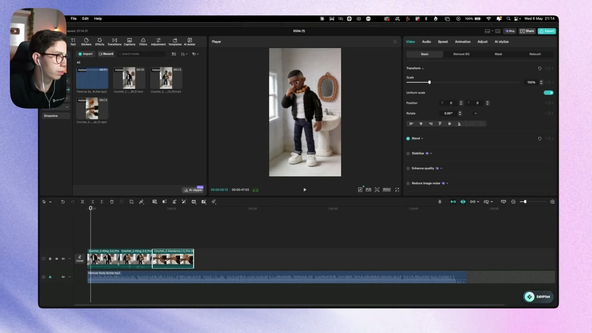
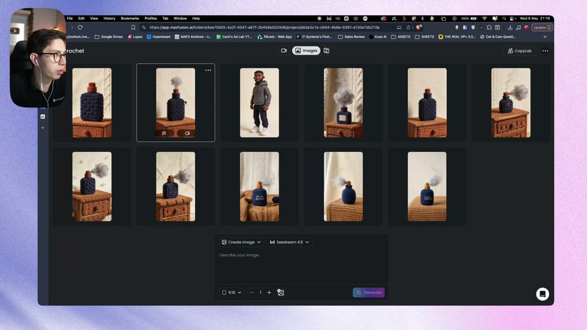
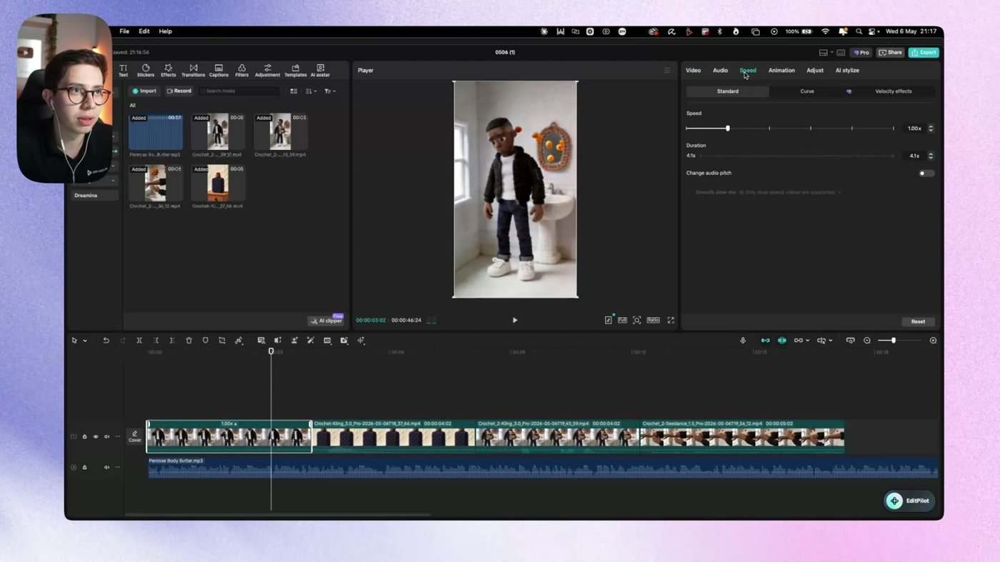

# 47. Editing Final Video (Crochet ads)
> Cut the crochet clips to the song lyrics, fill gaps by asking the skill for extra shots, speed-ramp and keyframe motion so the result feels like a music video.

## 🤖 Agent use
- **Use when:** editing or briefing an editor for a song-driven crochet ad.
- **Inputs → outputs:** the song/rap track + one clip per phrase → an assembled ad where cuts follow lyrics.
- **Rules:**
  - **DO** start the video at the first lyric, not the song intro: "it's an ad ... don't let that whole intro play" [00:00].
  - **DO** lock the song track before adding clips [00:00].
  - **DO** go back to the Claude skill when a lyric is under-covered: ask for new visual ideas for that part of the phrase [01:13].
  - **DO** generate the extra shot, speed it up/down to fit [02:21].
  - **DO** keyframe movement on stills and clips (left to right, with slight zoom out or in) so it "literally looks like a music video" [03:27].
  - **DO** give enough time to an editor for better quality [04:08].
  - **DON'T** overcomplicate: "nothing too crazy" [04:08].
- **See also:** [046. Script visualisation and image creation](046-script-visualisation-image-creation.md) · [042. Skeleton editing](042-skeleton-editing-the-video.md) · [044. The ad we are making](044-crochet-the-ad-we-are-making.md)

## Key ideas
### Assemble to lyrics [00:00–01:13]
- Cut the start at the first lyric; the first spoken phrase is the first phrase of the script. Place the clips that exist (he uses three) and trim [00:00].

### Fill missing coverage [01:13–02:21]
- Example: the second half of phrase 1 ("alcohol hits the air and the scent doesn't last") is too short. Return to the Claude skill, ask for visual ideas for that part ("the current clip is too short"), receive "five fresh ideas" and pick a spray-into-mist shot [01:13].
- Generate it, download, add to the edit, speed it up [02:21] (frame at [02:00] shows ten generated variants of a perfume bottle with mist).

### Motion polish [03:27–04:51]
- Add keyframes: start at the sniff, drift right with a slight zoom out; zoom in and move left on another [03:27]. The edit becomes music-video-like [03:27].
- Done; hand to an editor for more polish; "please leave it down below" for review [04:08].

## Steps / framework
1. Import song and clips; cut from the first lyric; lock the song.
2. Place each clip against its phrase.
3. Identify short phrases and generate extra shots with the skill.
4. Adjust speed; add keyframed push/pull.
5. Export and submit for review.

## Examples
- Clip placements: sniff (hook), sad end, butter shot, application shot from [046](046-script-visualisation-image-creation.md); generated "spray mist" insert for "alcohol hits the air" [01:13–02:21].

## Structured units
- **DO** cut start on the first lyric [00:00].
- **IF** a lyric is longer than its clip **THEN** generate an insert shot or retime [01:13, 02:21].
- **DON'T** leave the song intro in a performance ad [00:00].

## Prompts / templates (verbatim)
Not included in the course files beyond the skill file ([045](045-claude-skill-setup-explanation.md)). The page has no text. The spoken request to the skill is approximately "go back to phrase one, generate some visual ideas for this part" [01:13].

## Screenshots

*Editor timeline with the song track and the first crochet clips. [00:30]*

*Ten generated variants of the extra spray-mist shot in Max Fusion. [02:00]*

*Speed adjustment panel and the assembled timeline. [02:30]*

## How to apply
- [ ] Cut to lyrics; no intro.
- [ ] List lyrics with no matching shot; generate inserts.
- [ ] Add keyframed drifts for motion; export.

## Related
- Previous: [046. Script visualisation and image creation](046-script-visualisation-image-creation.md) · Next: [048. Hall of fame, crochet ads](048-hall-of-fame-crochet-ads.md)

## Sources and limitations
- [Transcript](<../../../../../raw/ad-creators-lab/ai-ads-ugc-animations/_transcripts/Ad Creators Lab - Create Viral AI Ads, UGC & Animations That Convert Into Sales(September 2026)/4. AI Animated Ads/2. Crochet Style Ads/4. Editing Final Video.txt>) (ends 4:50 of 4:51) · [Lesson page](<../../../../../raw/ad-creators-lab/ai-ads-ugc-animations/_extracted/Ad Creators Lab - Create Viral AI Ads, UGC & Animations That Convert Into Sales(September 2026)/4. AI Animated Ads/2. Crochet Style Ads/4. Editing Final Video.htm.md>) (empty). Editing software is not named in the audio; the timeline UI resembles CapCut (unverified).
- No captions, loudness or export settings are shown.
