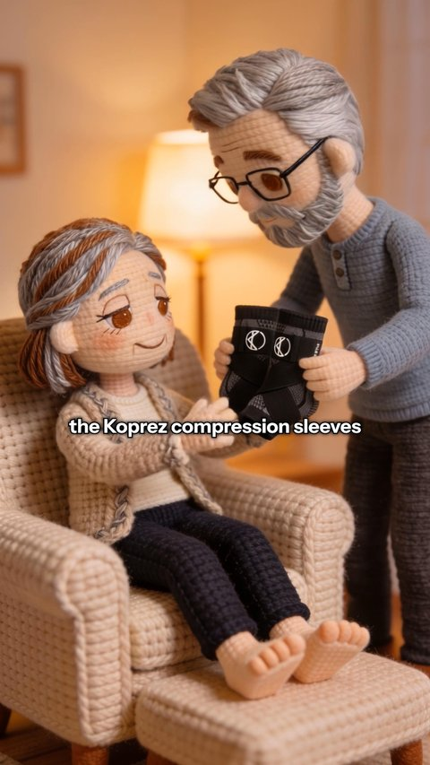
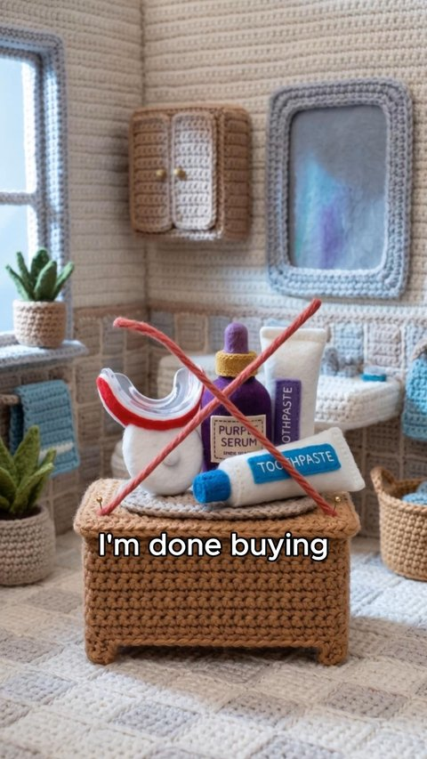
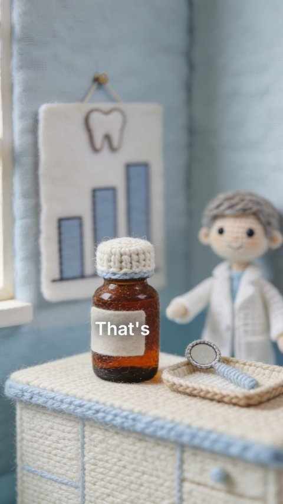
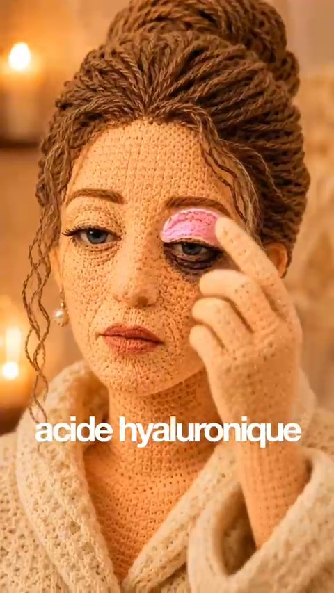
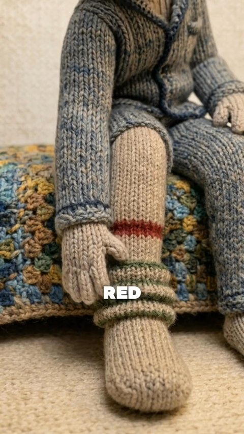

# 48. Hall of Fame - Crochet Ads
> Course-completion page for the crochet module: post your ad in "Ad Reviews" with specific questions and study five member crochet ads shown below.

## 🤖 Agent use
- **Use when:** finishing the crochet workflow; wanting niche examples (activewear, oral care, skincare, socks) of the format.
- **Inputs → outputs:** exported ad + specific questions → feedback; five example thumbnails as visual references.
- **Rules:**
  - **DO** "Export your ad. Done beats perfect." then post it and ask specific questions (page).
  - **DO** target feedback at the hook: two posters ask explicitly about the hook.
  - **DON'T** copy member ads; reuse structure and style only.
  - **DON'T** adopt health or skincare claims from these ads without evidence; scripts are not in the files, but the categories (compression sleeves, dental, hyaluronic skincare) are claim-sensitive.
  - **IF** you are a beginner and feel overwhelmed **THEN** note the poster's own reflection: they questioned whether crochet is "easy for a beginner" and asked whether UGC or recreating viral ads is a better start (page).
- **See also:** [046. Script visualisation and image creation](046-script-visualisation-image-creation.md) · [047. Editing final video](047-crochet-editing-final-video.md) · [043. Skeleton hall of fame](043-hall-of-fame-skeleton-ads.md)

## Key ideas
- Page instructions mirror [043](043-hall-of-fame-skeleton-ads.md): export, post in "Ad Reviews", learn from feedback; levels unlock "The Arena", "The Test Lab" and "The Inner Circle".
- Comments are not in the saved page; only post text and thumbnails.

## Examples
Member posts (names withheld):

| Post (date shown) | Poster's words (verbatim or near) | Thumbnail shows | Notes |
|---|---|---|---|
| "Crochet ad for a health/activewear brand" (15d) | "would love some feedback on how you would improve this ad overall, but also specifically in the hook. This is also my first post in here" | Older couple in a crochet living room; the man hands over black compression sleeves; caption names a real compression-sleeve brand | Real brand name in caption; health-adjacent claims unknown |
| "My first AI ad (Crochet style)" (26d) | First AI ad; made a Reddit research and quick brand brief for a sample product; "I feel that hook, script and some visuals could be better"; asks whether to start with UGC or recreate existing viral ads | Crochet bathroom counter with whitening tray, serum and toothpaste crossed out with red yarn; caption "I'm done buying" | Uses the "Research protocol" module; poster asks for next steps |
| "First Crochet AD (feedback appreciated)" (Jul 29) | "Would appreciate any tips and tricks you guys have." | Dental-themed diorama: amber bottle, crochet doctor doll, tooth chart; caption "That's" | Oral-care category; dental claims unverified |
| "Roast My Ad" (Jun 22) | "made this crochet ad, plz tell me everything that's wrong with it... it's also in French" | Fully knitted human face applying an eye pad, caption "acide hyaluronique" | Skincare, French; face rendered in yarn |
| "Crochet Ads - Reviews" (Jun 29) | "this is my crochet ads I just edited Looking for reviews/feedback" | Knitted figure on a patchwork blanket pulling up a knit sock with a red stripe, caption "RED" | Product not identifiable |

## Structured units
### Ad teardowns (from thumbnails only)
| Brand / product (niche) | Format | Hook / opening | What works | What fails | Fix suggested | Principle | Source |
|---|---|---|---|---|---|---|---|
| Compression sleeves (health/activewear) | Crochet diorama, couple scene | not visible | Warm living-room storytelling; product in hand | Poster doubts the hook; real brand name in caption | Test hook variants; check claims | Hook testing (derived) | page |
| Oral-care sample product | Crochet bathroom "I'm done buying" | "I'm done buying" (caption) | Strikethrough on competing products is a clear visual | Beginner uncertainty; hook/script weak per poster | Research first, then script | Problem agitation (derived) | page |
| Dental product | Crochet clinic | not visible | Themed dental world | no data | — | — | page |
| Skincare (French) | Fully knitted face close-up | not visible | Striking texture; unusual face treatment | Claims around hyaluronic acid unverified | Verify claims, subtitle in market language | — | page |
| Unidentified | Knit figure, sock close-up | not visible | Macro texture close-up | product unclear | — | — | page |

- No metrics or coach feedback in the saved page.

## Screenshots

*Activewear/health member ad: couple, black compression sleeves, caption names a real brand.*

*"I'm done buying": competing products crossed out with red yarn on a bathroom counter.*

*Dental-themed crochet diorama with a doctor doll.*

*Knitted face applying an eye pad, French caption "acide hyaluronique".*

*Macro close-up of a knit figure and sock, caption "RED".*

## How to apply
- [ ] Export your crochet ad and post it with a hook-specific question.
- [ ] Compare texture, framing and caption styles to the five examples.
- [ ] Audit any health/skincare claims before launching a similar ad.

## Related
- Previous: [047. Editing final video](047-crochet-editing-final-video.md) · Next: [049. Singing animation: the ads we're making](049-singing-animation-the-ads-we-re-making.md)

## Sources and limitations
- [Lesson page text](<../../../../../raw/ad-creators-lab/ai-ads-ugc-animations/_extracted/Ad Creators Lab - Create Viral AI Ads, UGC & Animations That Convert Into Sales(September 2026)/4. AI Animated Ads/2. Crochet Style Ads/5. Hall of Fame - Crochet Ads.html.md>) plus thumbnails extracted from the saved HTML. No video, scripts, comments or results. Poster names omitted for privacy.
- Compliance: health, dental and skincare categories present; no scripts, so unsupported-claim review is not possible here; one caption names a real consumer brand.
