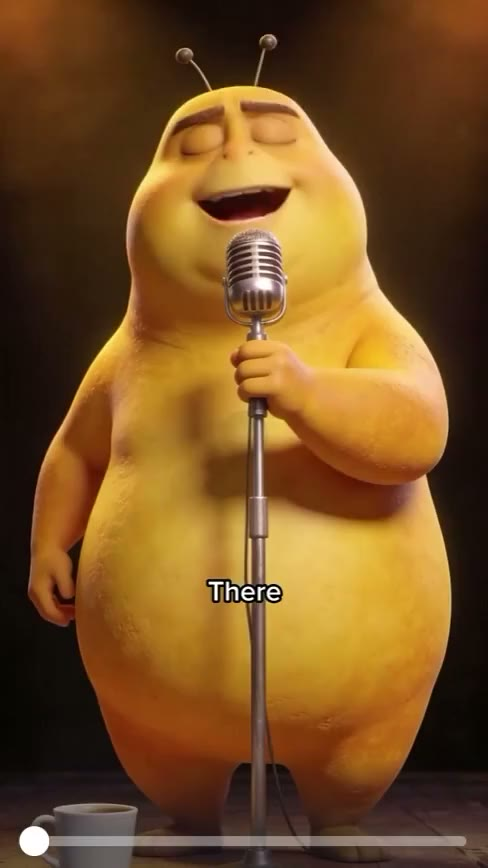
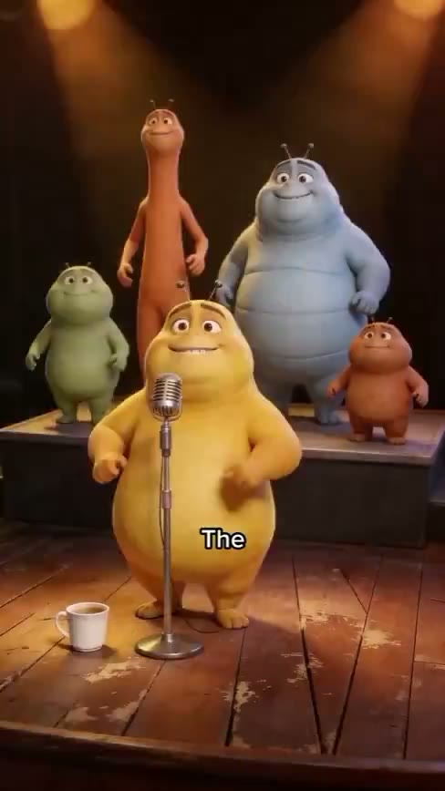

# 49. The Ads We're Making (Singing Animation Ads)
> A 48-second preview of the finished "singing character" ad format: Pixar-style animated creatures sing a short story-song that ends in a product, with word-by-word captions.

## 🤖 Agent use
- **Use when:** deciding whether a product suits a song-style animated ad, or needing a reference for what the finished singing ad looks like before running lessons 50-51.
- **Inputs → outputs:** none (preview lesson). Reference output: vertical video, 3D-animated characters on a stage or in a bright location, lyrics as large captions, product shown in-hand.
- **Rules:**
  - **DO** treat the song as the ad script: the lyric tells a problem story first and reaches the product last [00:00-00:35] (derived from the sample).
  - **DO** use captions that follow each sung word; the sample burns in one-to-three-word captions ("There", "once were", "The healing") [00:00-00:38] (frames).
  - **DO** keep a recurring cast (a lead singer and a small group on a stage) so cuts feel like one music video [00:35] (frame).
  - **DON'T** copy this sample's claims. The lyric says coffee causes "jitters and anxiety" and "blocking their way": that is an unverified health claim; run it through the claim audit before reuse (derived).
  - **IF** you want the full process **THEN** follow [50. Song-style scripts](050-create-song-style-ad-scripts-with-ai.md) then [51. AI songs](051-how-to-generate-ai-songs-for-your-brand.md); the visual build uses the animated-ad method in [53-58](053-the-ads-we-are-making-claymation-style.md) and [63-66](063-what-we-are-making-zack-d-films-style.md).
- **See also:** [Automated song-ad pipeline (Loom)](../../../../resources/ai-song-ad-pipeline-loom.md) · [LLM output claim audit](../../../stefan-georgi/rmbc-ii/rubrics/llm-output-claim-audit.md) · [ElevenLabs](../../../../tools/elevenlabs.md)

## Key ideas
### What the sample ad is [00:00-00:35]
- No narration from the instructor: the clip is the finished ad. A round, yellow Pixar-style creature sings into a vintage microphone [00:00]; cuts to a brown, armoured-looking creature holding a pink pack labelled "AWAKE" [00:30]; back to the yellow lead with four other creatures on a wooden stage with a coffee cup in frame [00:35]; then a sunlit outdoor shot of the brown creature [00:38].
- Sung lyric (machine transcript, ends at 00:35 of a 00:48 file): "There once was a soul who had done all the work, the therapy, the healing, but something still hurt. They brewed up their coffee and drank it down fast, but the jitters and anxiety just couldn't last. More coffee they drank, but the fog wouldn't clear. The tiredness and tension just stayed year to year. They thought something was wrong with the way they were made, not knowing the coffee was blocking their way. So they switched to [product name unclear] on a cold winter's morning, whispering."
- Structure visible in the sample: rhymed couplets, problem escalation, reveal that the problem was the old habit, switch to the product (derived).

## Steps / framework
Not taught in this clip. The production chain across the module is:

| # | Step | Lesson |
|---|---|---|
| 1 | Research doc or website to song script (lyrics + Suno style prompt + visual idea) | [50](050-create-song-style-ad-scripts-with-ai.md) |
| 2 | Lyrics to a finished song in Suno | [51](051-how-to-generate-ai-songs-for-your-brand.md) |
| 3 | Animated visuals (character, start/end frames, video model), captions, edit | method in [54-58](054-prompts-frames-chatgpt.md), [64-66](064-workflow-breakdown.md) |

## Examples
| Ad | Format | Hook / opening | What works | What fails | Fix suggested | Principle | Source |
|---|---|---|---|---|---|---|---|
| Unnamed coffee-alternative ad (brand not legible; page has no text) | Singing 3D-animated creatures, stage + sunlit outdoors | "There once was a soul who had done all the work, the therapy, the healing, but something still hurt." | Story-song opening names an identity ("done all the work") and an open loop (what still hurts) | Health-adjacent claim about coffee causing anxiety and "fog" is unsupported in the file | Source the claim or soften to the customer's experience; claim audit | Story hook, identity (derived) | [00:00] |

## Structured units
### Hooks
| Hook (verbatim or near) | Heuristic(s) | Emotion / zone | Self targeted | Why it works | Source |
|---|---|---|---|---|---|
| "There once was a soul who had done all the work, the therapy, the healing, but something still hurt." | story opening, "I tried everything" identity (derived) | sad / hopeful (derived) | people on a wellness or healing path | Names effort already spent, so the problem feels unfair and unresolved | [00:00] |

## Prompts / templates (verbatim)
_None in this lesson (preview only; the page has no text)._

## Screenshots

*Opening frame: lead singer, vintage mic, coffee cup, word-level caption. [00:00]*

*The group shot: recurring cast on a stage, warm spotlights. [00:35]*

## How to apply
- [ ] Watch the sample once with the sound on and note the structure: problem couplets, escalation, product last.
- [ ] Pick a product with a clear before/after story that can be told in 30-45 seconds.
- [ ] Move to lesson 50 and run the script prompt on your research.

## Related
- Previous: [48. Hall of Fame - Crochet Ads](048-hall-of-fame-crochet-ads.md) · Next: [50. Create Song-Style Ad Scripts with AI](050-create-song-style-ad-scripts-with-ai.md)
- [AI song-ad pipeline (Loom)](../../../../resources/ai-song-ad-pipeline-loom.md)

## Sources and limitations
- [Transcript](<../../../../../raw/ad-creators-lab/ai-ads-ugc-animations/_transcripts/Ad Creators Lab - Create Viral AI Ads, UGC & Animations That Convert Into Sales(September 2026)/4. AI Animated Ads/3. Singing Animation Ads/1. The Ads We're Making.txt>): the file is 48.32 s but the transcript stops at 34.96 s (last words "whispering"), so the last ~13 s of the song are not transcribed. The singing was machine-transcribed from music; product name is unreadable ("vibe" in the transcript, "AWAKE" on the pack in the frame) and the brand is `unverified`.
- [Lesson page](<../../../../../raw/ad-creators-lab/ai-ads-ugc-animations/_extracted/Ad Creators Lab - Create Viral AI Ads, UGC & Animations That Convert Into Sales(September 2026)/4. AI Animated Ads/3. Singing Animation Ads/1. The Ads We're Making.htm.md>): "no lesson text on page".
- No performance data is given for this ad.
