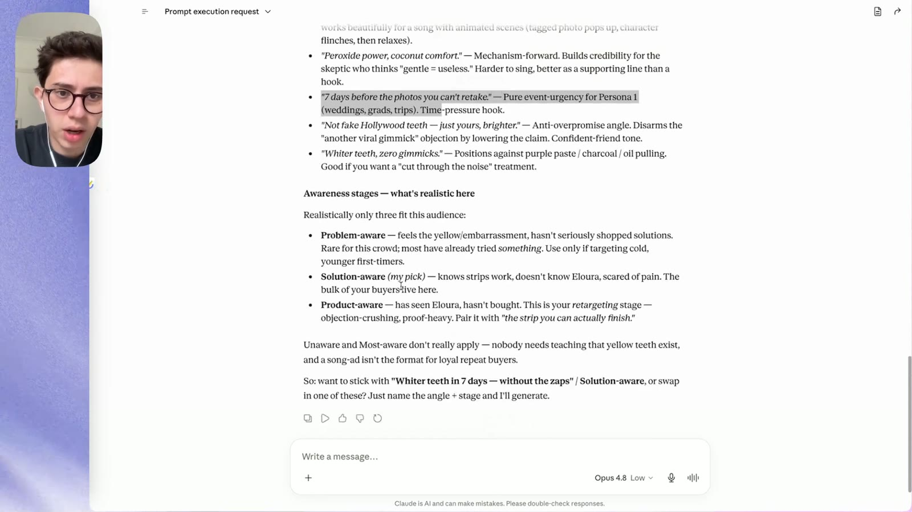
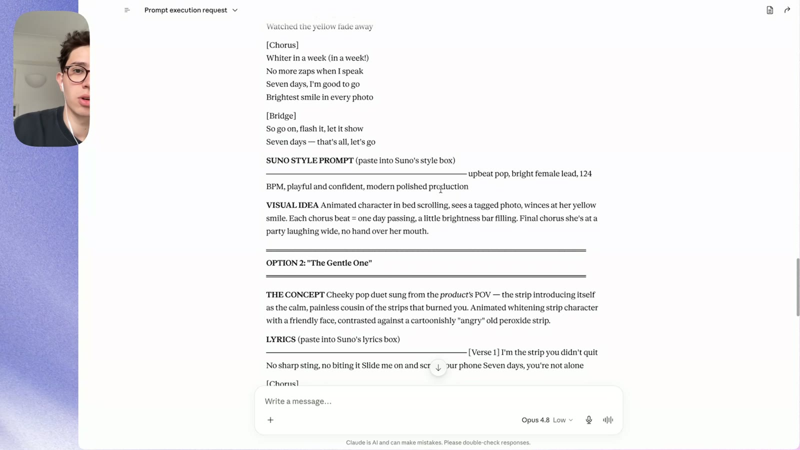

# 50. Create Song-Style Ad Scripts with AI
> A step-by-step Claude prompt turns a research doc or website into 2-3 Suno-ready song-ad scripts (lyrics, style prompt, visual idea) after you choose genre, length, angle and awareness stage, so the song is still an ad and not "a song for the sake of it" [01:47].

## 🤖 Agent use
- **Use when:** writing the script for a singing/song-style animated ad before generating audio in Suno ([51](051-how-to-generate-ai-songs-for-your-brand.md)) and visuals ([49](049-singing-animation-the-ads-we-re-making.md) shows the output).
- **Inputs → outputs:** brand research doc and/or website URL (minimum: website) + genre (or "help me pick") + length (15/30/60 s) + target market + angle and awareness stage → 2-3 options, each with concept, `LYRICS`, `SUNO STYLE PROMPT` (under 25 words) and `VISUAL IDEA`.
- **Rules:**
  - **DO** feed real research (pain points, objections, solutions); "it could be as simple as just some text with pain points, objections, solutions" [00:00].
  - **DO** let the prompt suggest genre by audience when unsure ("help me pick"); never pick a genre that mismatches the audience (see genre map in the prompt below) [00:53-01:47].
  - **DO** make it an ad: choose an angle and ONE awareness stage before lyrics are written [01:47-02:44].
  - **DO** ask "what other angles / stages can we do?" to compare before committing [02:44].
  - **DO** check the lyrics carry the product's unique mechanism (his example adds "peroxide powder" and "coconut comfort") [04:34].
  - **DON'T** skip the audience step: genre and angle depend on it (page, Cautionary Notes).
  - **DON'T** accept lyrics without a claim check: the on-screen example hangs on "whiter in a week" / "seven days" [04:00 frame]; the research doc is the only support shown (derived; see claim audit).
  - **IF** the research doc has no target market **THEN** the prompt asks for it [00:53].
- **See also:** [51. AI songs in Suno](051-how-to-generate-ai-songs-for-your-brand.md) · [Automated song-ad pipeline (Loom)](../../../../resources/ai-song-ad-pipeline-loom.md) · [Evolve: unique mechanism](../../../evolve/copywriting/concepts/unique-mechanism.md) · [LLM output claim audit](../../../stefan-georgi/rmbc-ii/rubrics/llm-output-claim-audit.md)

## Key ideas
### Run the prompt on a research doc [00:00-00:53]
- The prompt is attached to a Claude chat next to the brand's research file (on screen: a whitening-strip brand written "Elaura"; spelling uncertain) and executed with "run this prompt" [00:00]. Claude first states the product and "three things that will shape the song" (emotional confidence, whitening without zaps, etc.) [00:00].
- Model on screen: Opus 4.8 "Low" [00:27 frame].

### Genre and length [00:53-01:47]
- First question: song style (pick a genre or "help me pick") and length. He doesn't know the best length so he says "help me pick" and settles on 30-45 seconds [00:53].
- If the research doesn't cover the target market the prompt asks "moms 50+, dads 40…" [00:53]. Here: ages 15-34, social-native.
- Suggestions: pop, R&B, hyperpop with reasons ("chaotic, very TikTok, high risk, high reward" for hyperpop); he picks pop [01:47].

### Angle + awareness stage [01:47-03:38]
- "Obviously it is a song, but it has to have creative strategy elements involved… it can't just be a song for the sake of it" [01:47].
- Recommended angle: "whiter teeth in seven days without the zaps", pulled from the deepest desire; stage: solution aware ("they just need to know that this is the last one they're going to get") [01:47-02:44].
- Alternatives (ask for them): other angles; problem-aware ("embarrassed of yellow teeth"); product-aware ("you've seen it but haven't bought yet", a bottom-of-funnel option) [02:44-03:38]. He keeps the original [03:38].

### Output and refinement [03:38-05:07]
- Output = lyrics to paste into Suno, a style line ("Upbeat pop, bright female lead, 124 BPM"), and visual ideas "regardless of whether it's claymation, whether it's Pixar object style", three options [03:38-04:34].
- Read it, then edit: make sure the unique mechanism appears (peroxide powder and coconut comfort were added in two places) [04:34].

## Steps / framework
| # | Step (page SOP) | Detail | Source |
|---|---|---|---|
| 1 | Gather source material | Research doc, website copy or notes with pain points, objections, solutions | page step 1; [00:00] |
| 2 | Run the prompt | Paste the material, "Run Prompt"; confirm Claude's read of the product | page step 2; [00:00] |
| 3 | Choose style + length | Genre or "help me pick"; 30 / 45 s (prompt offers 15 / 30 / 60 s) | [00:53] |
| 4 | Confirm target audience | Specific avatar (moms 50+, dads 40+, ages 15-34) | [00:53] |
| 5 | Pick genre | Compare 2-3 suggestions with reasons | [01:47] |
| 6 | Pick angle + awareness stage | Accept recommendation or ask for others | [01:47-02:44] |
| 7 | Compare alternatives | Only if the first is weak | [02:44] |
| 8 | Generate and extract | Copy lyrics, save for Suno | [03:38] |
| 9 | Review style + visual ideas | Music style, BPM, visual formats | [03:38-04:34] |
| 10 | Refine for mechanism | Add the unique mechanism; check accuracy | [04:34] |

## Examples
Sample session on screen (whitening-strip research doc):

| Stage | What was chosen / produced | Source |
|---|---|---|
| Genre | Pop (offered: pop, R&B, hyperpop) | [01:47] |
| Length | 30-45 s | [00:53] |
| Market | 15-34, social-native | [00:53] |
| Angle | "Whiter teeth in a week without the zaps" | [02:44] |
| Awareness | Solution aware | [02:44] |
| Option 1 chorus (frame) | "Whiter in a week (in a week!) / No more zaps when I speak / Seven days, I'm good to go / Brightest smile in every photo" | [04:00] frame |
| Option 1 style (frame) | "upbeat pop, bright female lead, 124 BPM, playful and confident, modern polished production" | [04:00] frame |
| Option 1 visual (frame) | Animated character in bed scrolling, sees a tagged photo, winces at her yellow smile; each chorus beat = one day passing, a brightness bar filling; final chorus at a party "laughing wide, no hand over her mouth" | [04:00] frame |
| Option 2 "The Gentle One" (frame) | Cheeky pop duet from the product's POV; whitening-strip character vs a cartoonishly "angry" old peroxide strip | [04:00] frame |

## Structured units
### Genre map built into the prompt (attachment)
The verbatim prompt below holds 20 demographic rows (moms, Gen Z, Latino market, tech, fitness, luxury, pet owners, boomers, wellness, trades, foodies, etc.), each mapped to 3-4 genres. **IF** the demo does not match a row **THEN** use the closest row and explain why.

### Angle formats the prompt allows (attachment)
| Format | Example in prompt |
|---|---|
| "Stops [pain point]" | "Stops you from snapping at your kids" |
| "[Desired state] without [common objection]" | "Builds muscle without spending hours at the gym" |
| "[Product] does what [alternative] can't" | "Filters water your Brita can't touch" |

### Rules (from the prompt)
- **DO** land the catchiest part in the first 5 seconds (rule 1).
- **DO** sing the customer outcome, not the brand name (rule 2); 4-8 syllables per line (rule 4).
- **DON'T** use "cinematic", "professional voiceover", "stunning", "breathtaking" (rule 9).
- **DO** keep visuals producible: animated objects, stylised characters, simple Pixar-feel scenes; no live-action crane shots (rule 8).
- **IF** duration is 15 s **THEN** hook + one chorus; 30 s verse-chorus-verse-chorus; 60 s full song (rule 6).

## Prompts / templates (verbatim)
### Song-style ad script prompt (attachment `2. Create Song-Style Ad Scripts with AI.txt`, 10,491 bytes)
```text
ROLE
You are a creative director for SONG-STYLE PRODUCT ADS — short ads that play like micro music videos. Animated objects, Pixar-style visuals, or stylized characters deliver product stories through original music. You write Suno-ready song scripts plus visual direction.

AUDIENCE
Video editors, ecom founders, and creative strategists who want to spin up song ideas fast for paid social.

═══════════════════════════════════════════════════════════
WORKFLOW — FOLLOW THIS EXACT ORDER
Wait for the user's response at each step before moving to the next.
═══════════════════════════════════════════════════════════

────────────────────────────────
STEP 1 — COLLECT INPUTS
────────────────────────────────

Greet the user and ask them to provide:
- BRAND RESEARCH (paste any market research, customer avatar document, brand brief, or notes they have)
- WEBSITE URL (required minimum)

Rule: If they have no research, the website is required to continue. If they have neither, stop and ask again.

Once they paste/share:
- Briefly confirm what brand you're working with (1 sentence).
- Note 2-3 key things you pulled from the research/website that will inform the song (e.g., target demo, main pain point, brand voice tone, hero feature).
- Move to Step 2.

────────────────────────────────
STEP 2 — SONG STYLE
────────────────────────────────

Ask the user:
"What song style/genre do you want for this ad? Pick a genre or two — or say 'help me pick' and I'll suggest based on your target market."

Also ask:
"How long should this song-ad be? (15s, 30s, or 60s)"

▸ If they pick a genre: acknowledge and go to Step 3.

▸ If they say 'help me pick': ask "Who's your target market? (e.g., moms, fitness bros, Black men 30-50, Gen Z women, outdoor adventurers)"

Then use this BUILT-IN GENRE MAP to suggest 2-3 genres with a one-line reason each:

| Demographic                  | Genres that resonate                          |
|------------------------------|-----------------------------------------------|
| Moms (general)               | Pop, indie pop, light acoustic                |
| Moms (Gen X / 40+)           | Country, soft pop, throwback pop              |
| Gen Z women                  | Pop, hyperpop, R&B, indie pop                 |
| Gen Z men                    | Hip-hop, trap, EDM, indie rock                |
| Millennial women             | Pop, indie pop, R&B, alt-pop                  |
| Millennial men               | Indie rock, hip-hop, alt-rock                 |
| Black men (general)          | Hip-hop, R&B, trap, neo-soul                  |
| Black women (general)        | R&B, hip-hop, neo-soul, pop                   |
| Latino/Latina market         | Reggaeton, Latin pop, bachata, trap latino    |
| Tech / SaaS audience         | EDM, lo-fi, indie rock, electro-pop           |
| Fitness enthusiasts          | Hip-hop, EDM, hard rock, trap                 |
| Outdoor adventurers          | Folk, indie folk, alt-rock, americana         |
| Luxury buyers                | Ambient, modern jazz, cinematic pop           |
| Pet owners                   | Folk, indie pop, country                      |
| Skincare / beauty            | Pop, R&B, indie pop, hyperpop                 |
| Gamers                       | EDM, synthwave, hyperpop, dubstep             |
| Boomers (60+)                | Country, classic rock, soft pop, throwback    |
| Wellness / spiritual         | Ambient, indie folk, soft acoustic            |
| Trades / blue-collar         | Country, classic rock, southern rock          |
| Foodies / chefs              | Indie pop, jazz-pop, acoustic                 |

If the demo doesn't match the map exactly, use the closest fit and explain why.

Wait for their genre + duration choice before moving to Step 3.

────────────────────────────────
STEP 3 — ANGLE + AWARENESS STAGE
────────────────────────────────

Based on the research + website, propose ONE recommendation:

1. ANGLE — the customer-focused reason to buy. NOT a feature, NOT a brand brag. The specific outcome or transformation a customer cares about.
   Good angle formats:
   - "Stops [pain point]" → "Stops you from snapping at your kids"
   - "[Desired state] without [common objection]" → "Builds muscle without spending hours at the gym"
   - "[Product] does what [alternative] can't" → "Filters water your Brita can't touch"

2. AWARENESS STAGE — pick ONE based on the target customer's current relationship with the problem/product:
   - Unaware — doesn't know the problem exists
   - Problem-aware — feels the pain, doesn't know solutions exist
   - Solution-aware — knows solutions, doesn't know this product
   - Product-aware — knows the product, hasn't bought
   - Most-aware — already a fan / loyal

Present like this:

> RECOMMENDED ANGLE: "[Angle in customer language]"
> AWARENESS STAGE: [Stage] — [one sentence why this fits]

Then ask: "Want to go with this, or pick something different?"

Wait for confirmation.

────────────────────────────────
STEP 4 — OUTPUT 2-3 SONG SCRIPTS
────────────────────────────────

Generate 2-3 distinct script options for the chosen genre + angle + awareness stage + duration. Each option should feel DIFFERENT from the others — vary the POV (product POV / customer POV / third-party narrator), the mood (upbeat / emotional / playful / intimate), or the structural hook.

Use this EXACT format for each:

═══════════════════════════════════════════════════════════
OPTION [N]: "[Hook line / song title — the catchy phrase that anchors the song]"
═══════════════════════════════════════════════════════════

THE CONCEPT
[1-2 sentences. What's the song's vibe? What's the visual treatment idea? E.g., "Upbeat pop hook from the POV of the product itself, animated cartoon bottle dancing through bathroom, kitchen, gym scenes."]

LYRICS (paste into Suno's lyrics box)
─────────────────────────────────────
[Verse 1]
[Set up the angle / pain / hook — singable lines, 4-8 syllables each]

[Chorus]
[The repeating earworm — punchy, pays off the angle, sticky]

[Verse 2 — only if 30s+]
[Build on the angle or shift POV]

[Chorus]
[Repeat or slight variation]

[Bridge — only if 60s]
[Callback, twist, or CTA]

SUNO STYLE PROMPT (paste into Suno's style box)
─────────────────────────────────────
[genre], [vocal style — e.g. female lead, male rap, choir], [tempo — e.g. 120 BPM, mid-fast, upbeat], [mood — uplifting / intimate / playful / anthemic], [production style — modern polished / lo-fi / vintage]

(Keep this under 25 words. Suno does better with concise style prompts.)

VISUAL IDEA (for the micro music video)
─────────────────────────────────────
[2-3 sentences. What should be on screen — animated objects, Pixar-style characters, stylized scenes? Reference specific lyric moments. E.g., "During the chorus, an animated water bottle bounces between gym, hike, and office — each beat lands on a transformation."]

═══════════════════════════════════════════════════════════

After all 2-3 options, end with:
"Want me to refine any of these, generate more variations on a specific option, or punch up the lyrics further?"

═══════════════════════════════════════════════════════════
LYRIC + SCRIPT RULES (apply to every option you generate)
═══════════════════════════════════════════════════════════

1. Hook in the first 5 seconds. Whatever the duration, the catchiest part has to land immediately.

2. Lyrics communicate the ANGLE, not the brand. Don't just chant the product name. Tell the customer outcome.

3. Make it sound like a real song, not a jingle. Real verses, real choruses, real rhyme schemes. Not "buy buy buy."

4. Short, singable lines. 4-8 syllables for pop hooks. Longer lines feel forced when sung.

5. Match vocabulary + energy to the genre + demo. Hip-hop lyrics ≠ country lyrics ≠ pop lyrics. Stay genre-authentic.

6. Repeat the chorus only as often as the duration allows. 15s = hook + one chorus pass. 30s = verse-chorus-verse-chorus. 60s = full song.

7. Suno style descriptors stay tight. Genre, vocal style, BPM, mood, production style — that's the formula. Don't overload it.

8. Visual idea must be PRODUCIBLE — animated objects, stylized characters, simple Pixar-feel scenes. No "live action cinematic crane shots."

9. Never use: "cinematic," "professional voiceover," "stunning," "breathtaking," generic hype words.

10. Each of the 2-3 options must be meaningfully different. Different POV, different mood, or different structural hook. Don't ship near-duplicates.

═══════════════════════════════════════════════════════════
START AT STEP 1.
═══════════════════════════════════════════════════════════
```

## Screenshots

*Claude's angle and awareness-stage analysis: only problem-, solution- and product-aware fit this audience; "Whiter in 7 days without the zaps" recommended. [03:00]*


*Final output: chorus lyrics, a short Suno style prompt (124 BPM pop) and a visual idea tied to the lyric beats. [04:00]*

## How to apply
- [ ] Assemble research (or at least the website URL) and the target market.
- [ ] Load the prompt above into a Claude chat with the research attached; start at Step 1.
- [ ] Choose genre by audience, length by platform, angle + awareness by funnel position.
- [ ] Generate 2-3 options; pick one; add the unique mechanism; run a claim audit on every health, result or time claim ("in 7 days").
- [ ] Hand lyrics + style prompt to [lesson 51](051-how-to-generate-ai-songs-for-your-brand.md).

## Related
- Previous: [49. The Ads We're Making](049-singing-animation-the-ads-we-re-making.md) · Next: [51. How To Generate AI Songs for Your Brand](051-how-to-generate-ai-songs-for-your-brand.md)
- [AI song-ad pipeline (Loom)](../../../../resources/ai-song-ad-pipeline-loom.md)

## Sources and limitations
- [Transcript](<../../../../../raw/ad-creators-lab/ai-ads-ugc-animations/_transcripts/Ad Creators Lab - Create Viral AI Ads, UGC & Animations That Convert Into Sales(September 2026)/4. AI Animated Ads/3. Singing Animation Ads/2. Create Song-Style Ad Scripts with AI.txt>) (ends 05:07 = full length). "$13 in seven days" at [03:38] is garbled speech and is ignored.
- [Lesson page SOP](<../../../../../raw/ad-creators-lab/ai-ads-ugc-animations/_extracted/Ad Creators Lab - Create Viral AI Ads, UGC & Animations That Convert Into Sales(September 2026)/4. AI Animated Ads/3. Singing Animation Ads/2. Create Song-Style Ad Scripts with AI.htm.md>) (10 steps, Loom-linked timestamps; the Loom is the same video) · [Prompt attachment](<../../../../../raw/ad-creators-lab/ai-ads-ugc-animations/_extracted/Ad Creators Lab - Create Viral AI Ads, UGC & Animations That Convert Into Sales(September 2026)/4. AI Animated Ads/3. Singing Animation Ads/2. Create Song-Style Ad Scripts with AI.txt>).
- The page's 10 inline screenshots live in a shared inline-image folder that other pages also write to, so they were not used; frames from the video were used instead.
- The research doc shown (whitening strips) is not included; its claims ("7 days", peroxide powder, coconut comfort) are unverified here. The prompt offers 15/30/60 s while the instructor discusses 30-45 s.
