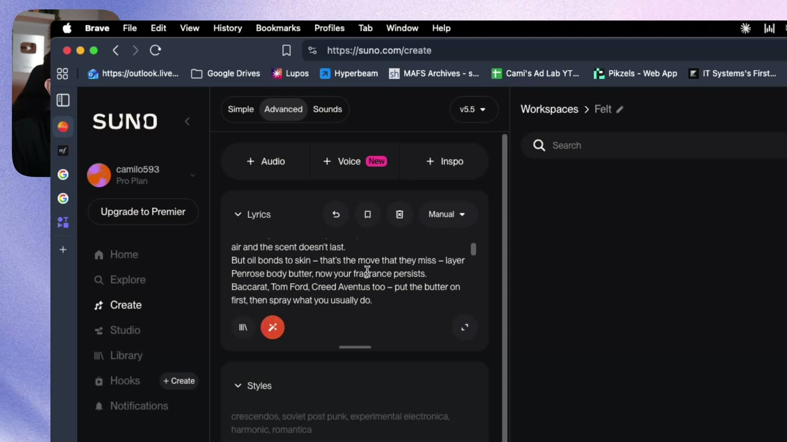
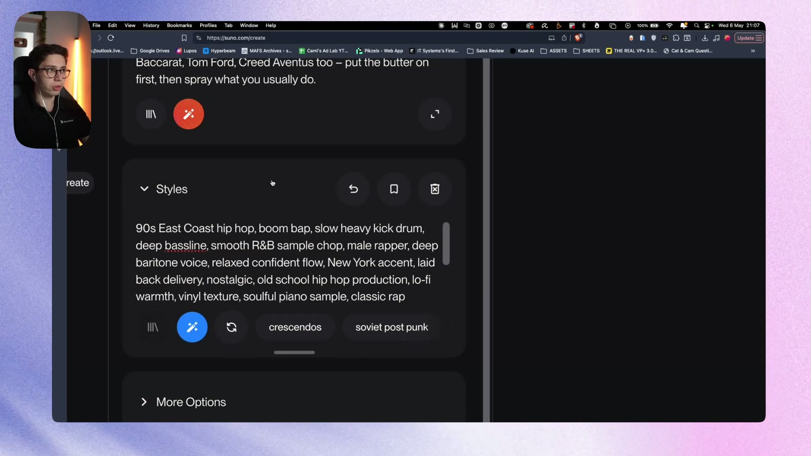

# 51. How To Generate AI Songs for Your Brand
> Paste the lyrics from lesson 50 into Suno's Advanced tab, add a Claude-written style prompt that matches the audience, generate, check every word's pronunciation, and download the MP3.

## 🤖 Agent use
- **Use when:** turning approved song-ad lyrics into audio for an animated or singing ad.
- **Inputs → outputs:** lyrics + style prompt (from [lesson 50](050-create-song-style-ad-scripts-with-ai.md)) → several Suno songs → one downloaded MP3 that matches the audience and pronounces the product and ingredients correctly.
- **Rules:**
  - **DO** use the paid Suno plan: "pro plan… like $10 a month… better results than the free plan. The free plan is very limiting" [00:00] (instructor claim; prices at recording, Aug-Sep 2026). Page: 2,500 credits vs ~50 on free, and the best model is paid-only.
  - **DO** work in Create → **Advanced**: a Lyrics box, a Styles box, results on the right [00:00].
  - **DO** have Claude write the style prompt from your inspiration, "since I personally often lack the musical vocab that the model understands well" (page) [00:58].
  - **DO** match genre to the audience; "I wouldn't do hip-hop or dubstep for like 50 year old moms… old-school pop or old school R&B for an older generation" [00:58-01:39].
  - **DO** test several genres on the same lyrics (he plans R&B, then pop) and see what performs [00:58].
  - **DO** listen to the whole song and verify the product and ingredient names are pronounced right and the lyrics make sense [01:39]; the page warns the model struggles with "ashwagandha".
  - **DON'T** name real artists or songs in the style box: "One thing you can definitely not do is give it music that sounds like a certain rapper… you're just gonna reject it" [01:39]; describe the style instead (page: copyright rejection).
  - **DON'T** over-formalise: "Don't try to be so formulaic with it. Just have fun" [00:00].
  - **IF** you like a result **THEN** upvote, Remix it for variations; **IF** not, downvote [02:44].
- **See also:** [AI song-ad pipeline (Loom)](../../../../resources/ai-song-ad-pipeline-loom.md) · [ElevenLabs](../../../../tools/elevenlabs.md) · [53. Claymation ads](053-the-ads-we-are-making-claymation-style.md) (visual method)

## Key ideas
### Suno setup [00:00-00:58]
- suno.com → sign up → Pro plan → Create → Advanced tab. Page steps: lyrics box gets "your copy from the brief"; styles box gets the style; optional negative style; click Generate and iterate prompts and settings.
- Frame: Suno v5.5 selector, Advanced / Simple / Sounds tabs, Audio / Voice / Inspo inputs, Lyrics and Styles panels [00:30].
- He promises example lyrics and songs "down below" (not in the course files).

### Style prompt [00:58-01:39]
- Ask Claude: "I want to have a hip-hop song… it's gonna give you a prompt for it" [00:58]. The style box on screen reads: "90s East Coast hip hop, boom bap, slow heavy kick drum, deep bassline, smooth R&B sample chop, male rapper, deep baritone voice, relaxed confident flow, New York accent, laid back delivery, nostalgic, old school hip hop production, lo-fi warmth, vinyl texture, soulful piano sample, classic rap" [01:30 frame].
- Suno also shows a "personalized prompt enhancer" button that expands the prompt [01:39].

### Generate, check, export [01:39-03:40]
- First test: the lyrics name a body-butter product; "he said Penrose Body Butter perfectly" [01:39]. A second take is auditioned.
- Change the song or pick recommended styles from the right-hand list; download as MP3; Remix pulls a song back in "as a remix or inspo or a mashup" [02:44].
- Final test: "make sure it sounds good and make sure that it's something that your ICP will probably want to consume" [02:44].

## Steps / framework
| # | Step | Detail | Source |
|---|---|---|---|
| 1 | Sign up, Pro plan | Page: 2,500 credits vs ~50 free | page; [00:00] |
| 2 | Create → Advanced | Lyrics / Styles / results columns | [00:00] |
| 3 | Paste lyrics | From the brief / lesson 50 output | page; [00:00] |
| 4 | Write style prompt with Claude | Genre + vocal + tempo + mood + production; no artist names | [00:58-01:39] |
| 5 | (Optional) negative style, settings | Not required | page |
| 6 | Generate | Several takes; try other genres | [01:39] |
| 7 | Review lyrics aloud | Product name, ingredients, sense | [01:39] |
| 8 | Download MP3 | Up/down vote; Remix for variants | [02:44] |

## Examples
| Attempt | Lyrics / style | Result | Source |
|---|---|---|---|
| 1 | Fragrance-layering body-butter lyric (frame: "But oil bonds to skin - that's the move that they miss - layer Penrose body butter, now your fragrance persists. Baccarat, Tom Ford, Creed Aventus too - put the butter on first, then spray what you usually do.") + 90s East Coast hip-hop style | Song generated; brand name pronounced correctly | [00:30]; [01:39] frames |
| 2 | Same lyrics, other take | "Okay, you get the point" | [02:44] |
| Planned | R&B, then pop on the same brief; pick the best performer | Not shown | [00:58] |

## Structured units
### Rules
- **DO** buy the paid tier for better model access (instructor claim) [00:00].
- **DON'T** name real artists in styles; describe sound instead [01:39].
- **DO** pronunciation-check every brand/ingredient word; re-spell phonetically in lyrics if Suno mispronounces (derived).
- **IF** the audience is older **THEN** pick old-school pop or old-school R&B, not hip-hop/dubstep [01:39].

## Prompts / templates (verbatim)
Only prompt shown on screen (style box):
```text
90s East Coast hip hop, boom bap, slow heavy kick drum, deep bassline, smooth R&B sample chop, male rapper, deep baritone voice, relaxed confident flow, New York accent, laid back delivery, nostalgic, old school hip hop production, lo-fi warmth, vinyl texture, soulful piano sample, classic rap
```
Claude request pattern (spoken, not a saved prompt): "hey, I want to have a hip-hop song. I want it to sound like [artist]…" then paste the style it returns, minus any artist names [00:58].

## Screenshots

*Suno Create → Advanced (v5.5): Lyrics box holding the body-butter lyric, Styles box below. [00:30]*


*The Claude-written style prompt pasted into Styles; note it names a genre and sound, not an artist. [01:30]*

## How to apply
- [ ] Take approved lyrics + style prompt from lesson 50 (style prompt under 25 words per that prompt; the on-screen example here is longer and still worked).
- [ ] Generate 2-4 takes per genre; compare against the audience.
- [ ] Listen end to end; fix pronunciation by editing lyrics; regenerate.
- [ ] Export MP3 and hand it to the visual/edit stage.
- [ ] Do not mimic a named artist's voice or a real singer's persona (derived compliance rule); keep the style prompt descriptive.

## Related
- Previous: [50. Create Song-Style Ad Scripts with AI](050-create-song-style-ad-scripts-with-ai.md) · Next: [52. Hall of Fame - Singing Ads](052-hall-of-fame-singing-ads.md)
- [AI song-ad pipeline (Loom)](../../../../resources/ai-song-ad-pipeline-loom.md)

## Sources and limitations
- [Transcript](<../../../../../raw/ad-creators-lab/ai-ads-ugc-animations/_transcripts/Ad Creators Lab - Create Viral AI Ads, UGC & Animations That Convert Into Sales(September 2026)/4. AI Animated Ads/3. Singing Animation Ads/3. How To Generate AI Songs for Your Brand.txt>) (ends 03:40 = full length) · [Lesson page](<../../../../../raw/ad-creators-lab/ai-ads-ugc-animations/_extracted/Ad Creators Lab - Create Viral AI Ads, UGC & Animations That Convert Into Sales(September 2026)/4. AI Animated Ads/3. Singing Animation Ads/3. How To Generate AI Songs for Your Brand.htm.md>). Suno link on the page is an invite/referral link.
- Compliance flags: the example lyric names third-party perfumes (Baccarat, Tom Ford, Creed Aventus); naming competitors in an ad is a comparative-claim and trademark risk, so replace with generic wording ("designer perfume") unless counsel clears it. Credit and price figures are as stated at recording.
- The promised example lyrics/songs "down below" are not in the course files. Page inline images (`img01-img04`) share a folder with other pages and were not used.
