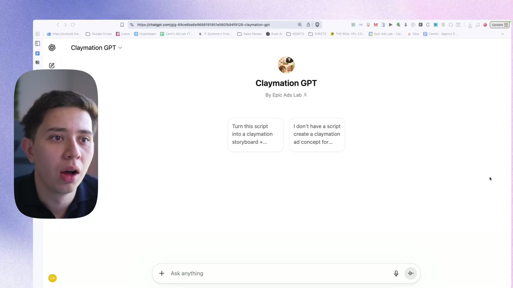
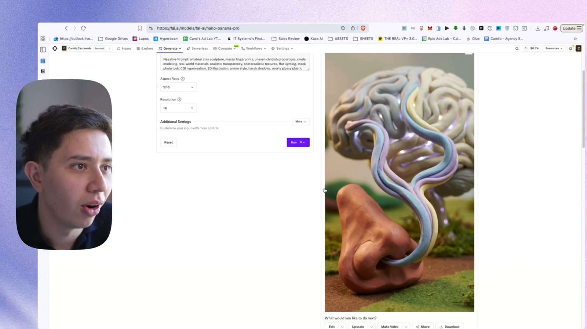
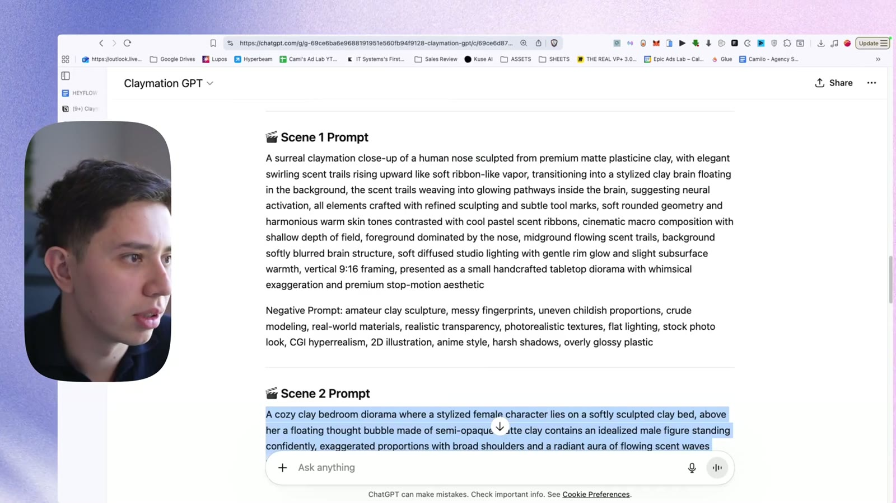

# 54. Prompts + Frames - ChatGPT
> Drop an ad script into the "Claymation GPT", get one claymation image prompt (plus negative prompt) per scene, generate stills in Nano Banana 2, and keep a character consistent by editing from a reference image instead of regenerating.

## 🤖 Agent use
- **Use when:** turning a finished ad script into claymation scene stills without Poppy ([55](055-prompts-frames-poppy-method.md) is the stronger method).
- **Inputs → outputs:** script (or an idea) → scene breakdown + prompt per scene → 9:16 stills → fixed/edited stills ready for start/end-frame video ([56](056-claymation-generating-videos-transitions.md)).
- **Rules:**
  - **DO** match scenes to the script's line lengths: the GPT "decomposes" each part of the script into scenes "so that in length it works" [00:00].
  - **DO** generate in Nano Banana 2 at 9:16; "it works a lot better than Nano Banana Pro and is the most recent model" [00:55] (instructor claim, at recording).
  - **DO** duplicate the generation block and paste the next scene prompt to run many scenes fast [00:55].
  - **DO** keep one character across scenes by saving the first image, then switching to image **editing** with it as a reference and pasting the scene prompt: "you just want to change it to editing so that you get the same consistency" [02:26-02:56].
  - **DO** remove effect elements before animating (he removes the scent trail and brain from the nose image so they can be animated in later) [01:54].
  - **DON'T** regenerate a person from text alone: "the character will change" [02:26].
  - **IF** there's no script **THEN** use the GPT's second starter ("I don't have a script, create a claymation ad concept for…") to get ideas [00:00 frame].
  - **IF** you use another LLM **THEN** the prompt is in the course's Canva doc "but you're going to miss some tools" [00:00] (link on page; not in files).
- **See also:** [55. Poppy method](055-prompts-frames-poppy-method.md) · [59. Swipe file](059-swipe-file-claymation-ad-scripts.md) · [ChatGPT tool page](../../../../tools/chatgpt.md) · [AI UGC tools](../../../../tools/ai-ugc-tools.md)

## Key ideas
### The Claymation GPT [00:00-00:55]
- Custom GPT "Claymation GPT by Epic Ads Lab"; starters: "Turn this script into a claymation storyboard +…" and "I don't have a script create a claymation ad concept for…" [00:00 frame].
- He drags in a script and clicks the storyboard starter; it breaks the script into scenes and writes a prompt for each, e.g. a "surreal claymation close-up of a human nose" for the line about smell [00:00-00:55].

### Generate stills [00:55-01:54]
- Image generator of choice (Fal, Higgsfield or Max Fusion named); he uses Nano Banana 2, text-to-image, 9:16 [00:55].
- With people you may need a reference image of the person [00:55].
- Result: the nose "looks literally like claymation, you can see the fingerprints" [00:55-01:54].

### Edit, then keep the character [01:54-03:32]
- Image editing mode: "remove the scent and brain" from the nose still, then animate scent later [01:54].
- Same woman in a new room: save the first image, open image editing, drag her in as reference, paste the scene prompt, get her in the living room [02:26-02:56].
- Transitions come in the next video ([56](056-claymation-generating-videos-transitions.md)) [02:56].

## Steps / framework (page, 7 steps)
| # | Step | Detail |
|---|---|---|
| 1 | Add script | Drop into GPT; click "turn into claymation storyboard"; no script → ask for ideas |
| 2 | Get scenes + prompts | GPT breaks script into scenes and writes claymation image prompts |
| 3 | Generate images | Copy prompts into the image tool (Nano Banana 2), one image per scene |
| 4 | Repeat fast | Duplicate the prompt block, run many scenes |
| 5 | Fix images (optional) | Remove elements (e.g. effects); edit for animation |
| 6 | Keep same character | Save image → use as reference → image *editing*, not generation |
| 7 | Prepare for animation | Download; separate elements for transitions |

Needs (page): script or idea; GPT (custom GPT / ChatGPT / Claude); image generator (Nano Banana 2); image editor; reference images.

## Examples
| Scene | Prompt / result | Fix | Source |
|---|---|---|---|
| Scene 1, nose and brain | See verbatim prompt below; clay nose with fingerprint texture, scent ribbons into a clay brain | Removed scent trail and brain to animate them separately | [00:55-01:54]; frame [02:32] |
| Scene 2, bedroom | "A cozy clay bedroom diorama where a stylized female character lies on a softly sculpted clay bed, above her a floating thought bubble made of semi-opaque matte clay contains an idealized male figure standing confidently, exaggerated proportions with broad shoulders and a radiant aura of flowing scent waves…" (frame, cut off) | Character changed when regenerated; fixed by editing from reference | [02:26-02:56] |

## Prompts / templates (verbatim)
Scene 1 output from the GPT (frame at [02:32]):
```text
A surreal claymation close-up of a human nose sculpted from premium matte plasticine clay, with elegant swirling scent trails rising upward like soft ribbon-like vapor, transitioning into a stylized clay brain floating in the background, the scent trails weaving into glowing pathways inside the brain, suggesting neural activation, all elements crafted with refined sculpting and subtle tool marks, soft rounded geometry and harmonious warm skin tones contrasted with cool pastel scent ribbons, cinematic macro composition with shallow depth of field, foreground dominated by the nose, midground flowing scent trails, background softly blurred brain structure, soft diffused studio lighting with gentle rim glow and slight subsurface warmth, vertical 9:16 framing, presented as a small handcrafted tabletop diorama with whimsical exaggeration and premium stop-motion aesthetic

Negative Prompt: amateur clay sculpture, messy fingerprints, uneven childish proportions, crude modeling, real-world materials, realistic transparency, photorealistic textures, flat lighting, stock photo look, CGI hyperrealism, 2D illustration, anime style, harsh shadows, overly glossy plastic
```
Pattern visible in every scene prompt: subject + clay material + composition layers (foreground / midground / background) + lighting + "vertical 9:16" + "handcrafted tabletop diorama… stop-motion aesthetic" + a fixed negative prompt. Note this image prompt uses "cinematic macro composition", while the video prompts in [56](056-claymation-generating-videos-transitions.md) require "Non cinematic" (different stage).

The GPT's own system prompt is not in the course files (the "other LLMs" version is behind a Canva link).

## Screenshots

*Custom "Claymation GPT by Epic Ads Lab" with "Turn this script into a claymation storyboard" and "I don't have a script" starters. [00:00]*


*Generated still: fingerprint-textured clay nose and brain. [01:50]*


*Scene 1 and 2 prompts with the shared negative prompt; Scene 2 highlighted for copying. [02:32]*

## How to apply
- [ ] Write or reuse the ad script; open the GPT (or Poppy board, lesson 55).
- [ ] Generate one still per script beat in Nano Banana 2 at 9:16.
- [ ] Save the approved hero character and re-use it as an editing reference for every later scene.
- [ ] Strip effect elements you plan to animate; export stills named in script order for lesson 56.
- [ ] Run the final script through the claim audit before building visuals around any health or result claim.

## Related
- Previous: [53. The Ads We Are Making - Claymation Style](053-the-ads-we-are-making-claymation-style.md) · Next: [55. Prompts + Frames - Poppy Method](055-prompts-frames-poppy-method.md)

## Sources and limitations
- [Transcript](<../../../../../raw/ad-creators-lab/ai-ads-ugc-animations/_transcripts/Ad Creators Lab - Create Viral AI Ads, UGC & Animations That Convert Into Sales(September 2026)/4. AI Animated Ads/4. Claymation Ads/2. Prompts Frames - ChatGPT.txt>) (ends 03:31 = full length). Whisper garbled "Fal"/"Higgsfield" ("foul", "Hicksfield") and "Nano Banana" ("Nana banana"); fixed in prose.
- [Lesson page](<../../../../../raw/ad-creators-lab/ai-ads-ugc-animations/_extracted/Ad Creators Lab - Create Viral AI Ads, UGC & Animations That Convert Into Sales(September 2026)/4. AI Animated Ads/4. Claymation Ads/2. Prompts + Frames - ChatGPT.htm.md>) (7 steps + "what you need"). The Canva link for other LLMs and the GPT's instructions are not in the files. The ChatGPT GPT is public-link only on the page (not included).
