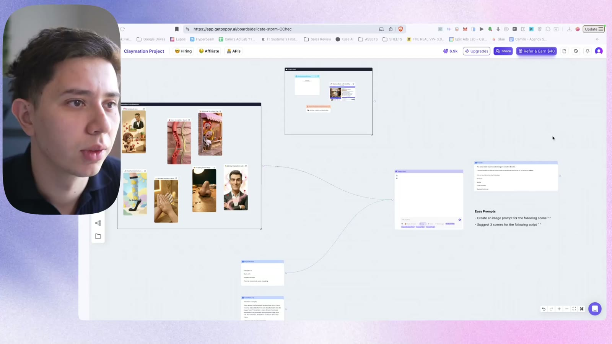
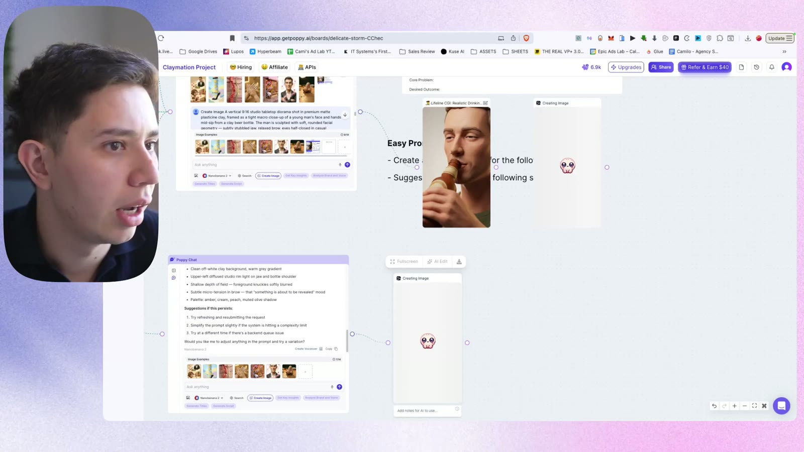
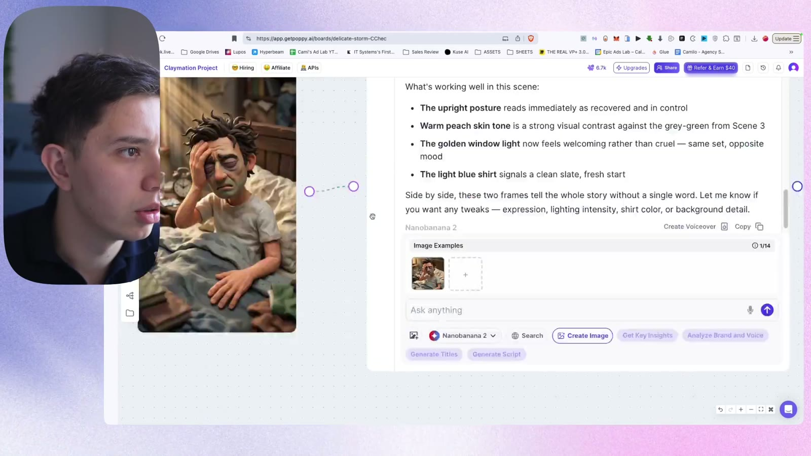
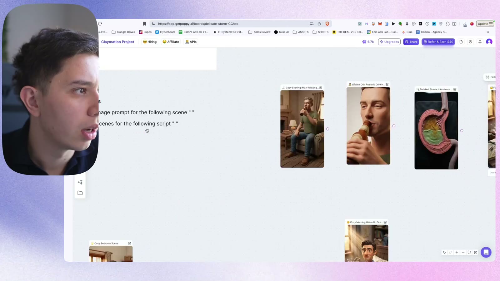

# 55. Prompts + Frames - Poppy Method
> The instructor's preferred claymation workflow: a Poppy board holding style references, a project prompt, a transition tip and product info turns a script into a scene-beat sheet, then one image prompt per scene, with all generation, editing and ordering on one canvas.

## 🤖 Agent use
- **Use when:** producing claymation stills at scale across many products or avatars; need one consistent style and character.
- **Inputs → outputs:** ad script + product info (website, screenshots, research doc) + claymation style reference group → scene beat sheet (script line, visual intention, emotion, complexity) → image prompts → stills ordered in script sequence.
- **Rules:**
  - **DO** load maximum product info: research doc, website screenshot, the website itself [00:00-00:57].
  - **DO** link the style references, the project prompt, and product info to the chat so the AI "gets that style" [02:17].
  - **DO** run Prompt 1 first (strategist/director: extract scenes from the script, visual intention, emotion to evoke), then ask "create an image prompt for the following scene" per scene [00:57-02:17].
  - **DO** generate in Nano Banana 2 ("Nano Banana Pro is not the best… Nano Banana 2 is way better for this") [02:17].
  - **DO** run several scene chats at once: new chat, paste prompt, repeat [04:06].
  - **DO** fix identity drift by disconnecting the reference, connecting the first character image, copying the scene prompt and adding "Keeping the character the same" [05:02-05:50].
  - **DO** reorder stills on the canvas to match the script before animating (wide shot, man drinks, stomach, wakes rough, …) [05:50].
  - **DON'T** need a Poppy subscription for the method: ChatGPT/Claude version in [54](054-prompts-frames-chatgpt.md) works but "you're going to miss some tools".
- **See also:** [54. ChatGPT method](054-prompts-frames-chatgpt.md) · [56. Videos + transitions](056-claymation-generating-videos-transitions.md) · [59. Swipe file](059-swipe-file-claymation-ad-scripts.md) · [AI UGC tools](../../../../tools/ai-ugc-tools.md)

## Key ideas
### What is on the board [00:00-00:57]
- Claymation style reference group (many image references); project prompt (all the knowledge on how claymation should look); a transition tip; product info (research doc, website screenshot, website) [00:00]. Frames: product info for a hangover-recovery supplement with a "customer audience analysis" file [00:57 frame].
- Why Poppy: "a lot more flexibility with what the AI sees", works "at scale with loads of different products or different avatars" (instructor claim) [00:00].

### Script to scene beats [00:57-02:17]
- He pastes Prompt 1 ("you are a direct response strategist and creative director… I provided you with a script as well as resources for my product"), names the product, and asks it to extract scene information [00:57-01:27].
- Output = a scene beat sheet: script line, visual intention, emotion to evoke, complexity. Example: script line "alcohol is actually not toxic compared to what it turns into in your body" → visual "close up of man taking a slow sip from a beer" [01:27-02:17; frame 02:16].

### Scene to prompt to image [02:17-04:06]
- In "easy prompt": "create an image prompt for the following scene", e.g. scene 1; it reads the knowledge base on how to build a good claymation prompt [02:17].
- Paste the prompt into the image node set to Nano Banana 2 (or use Fal / Higgsfield outside Poppy) [03:10].
- AI Edit → "zoom out" to see the full body; "in and out frame" variants for later transitions [03:10-04:06].

### Consistency and order [04:06-06:41]
- Compare two generators side by side; ask Claude (Sonnet) to write prompts for all scenes at once [04:06].
- Shot-to-shot consistency: the hungover man and the "restored" man didn't match; reconnect the first character image and re-run with "Keeping the character the same" to also hold the bedroom [05:02-05:50].
- Download clips; arrange in script order, then generate videos next [05:50].

## Steps / framework (page, 7 steps)
| # | Step | Detail |
|---|---|---|
| 1 | Add inputs | Script, product info, style references |
| 2 | Script to scenes | "Break script into scenes; describe what each looks like" |
| 3 | Scenes to prompts | Image prompt per scene |
| 4 | Generate images | One per scene in the image tool |
| 5 | Fix consistency | Same character looks the same; re-use references |
| 6 | Organise scenes | Order images; check the story flows |
| 7 | Animate (next) | [Lesson 56](056-claymation-generating-videos-transitions.md) |

Needs (page): the script; product info (website link, product screenshots, key benefits); the Poppy board (copy to your own account; requires a Poppy subscription; affiliate link on page).

## Examples
| Scene | Script line | Visual | Source |
|---|---|---|---|
| 1 | "Alcohol is actually not toxic compared to what it turns into in your body." | Close-up, man takes a slow sip from a beer bottle | [01:27-02:17] |
| Wide variant | same | AI Edit "zoom out" gives full-body; wide → close in the video | [04:06] |
| Hangover vs recovered | hangover / restored | First pass: two different-looking men; fix: reference-connected re-run keeps face and bedroom | [05:02-05:50] |

Script behind the demo is the NextDay swipe-file script in [59](059-swipe-file-claymation-ad-scripts.md).

## Prompts / templates (verbatim)
The board's full prompts (Prompt 1, project prompt, transition tip) are not in the course files; only fragments are spoken. Verbatim fragments from the transcript:
```text
[00:57] "you are direct response as strategist and create a director I provided you with a script as well as resources for my product" ... "extract the following information"
[02:17] "create an image prompt for the following scene" (then the scene, e.g. "scene one")
[05:02] "Keeping the character the same" (added to the original scene prompt when re-running)
```
The scene beat sheet Prompt 1 returns has the columns: scene #, script line, visual intention, emotion to evoke, complexity (frame at [02:16]).

## Screenshots

*Claymation project board: style reference images, project prompt, transition tip, product info nodes. [00:00]*


*Several scene chats and generated stills on one canvas; wide-to-close variants. [04:25]*


*Re-running the hungover scene with the character reference so face and bedroom match the recovered shot. [05:55]*


*Stills arranged in script order before video generation. [06:30]*

## How to apply
- [ ] Copy the Poppy board (if subscribed) or assemble style references + product info + script in your own tool.
- [ ] Generate a scene beat sheet from the script; approve it line by line.
- [ ] Create one prompt per scene; generate in Nano Banana 2; re-run drifting characters with a reference.
- [ ] Order the stills; export for lesson 56.

## Related
- Previous: [54. Prompts + Frames - ChatGPT](054-prompts-frames-chatgpt.md) · Next: [56. Generating Videos & Transitions](056-claymation-generating-videos-transitions.md)

## Sources and limitations
- [Transcript](<../../../../../raw/ad-creators-lab/ai-ads-ugc-animations/_transcripts/Ad Creators Lab - Create Viral AI Ads, UGC & Animations That Convert Into Sales(September 2026)/4. AI Animated Ads/4. Claymation Ads/3. Prompts Frames - Poppy Method.txt>) (ends 06:41 = full length). Whisper errors: "Nana banana" = Nano Banana, "easy prompt" may be a Poppy feature name, "Claude 5 Sonnet" as spoken.
- [Lesson page](<../../../../../raw/ad-creators-lab/ai-ads-ugc-animations/_extracted/Ad Creators Lab - Create Viral AI Ads, UGC & Animations That Convert Into Sales(September 2026)/4. AI Animated Ads/4. Claymation Ads/3. Prompts + Frames - Poppy Method.htm.md>). Poppy board link and subscription link are affiliate/referral links. The board's prompts and references are not exported to the files.
- The sample ad is a hangover-prevention supplement; its claims need verification (see [59](059-swipe-file-claymation-ad-scripts.md)).
