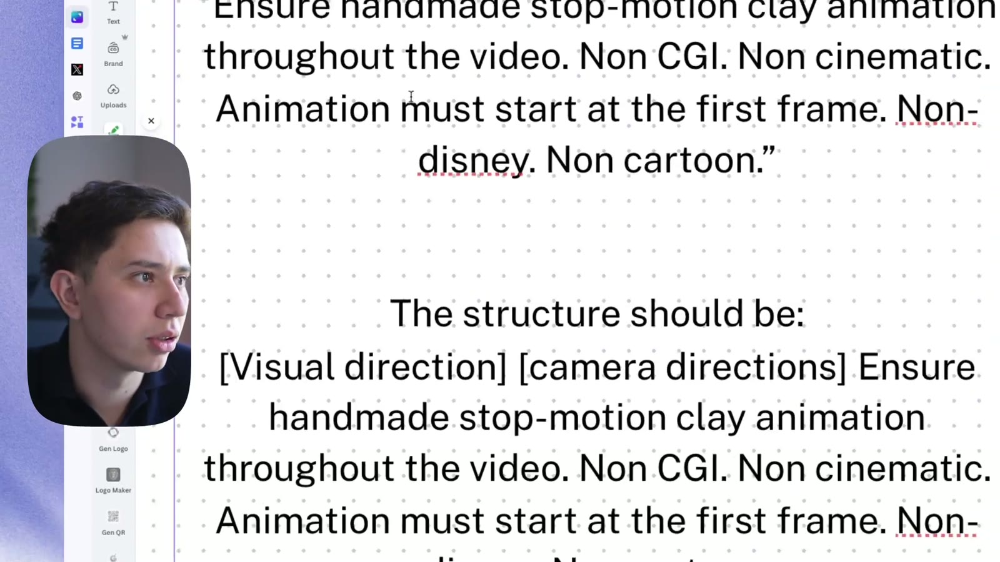
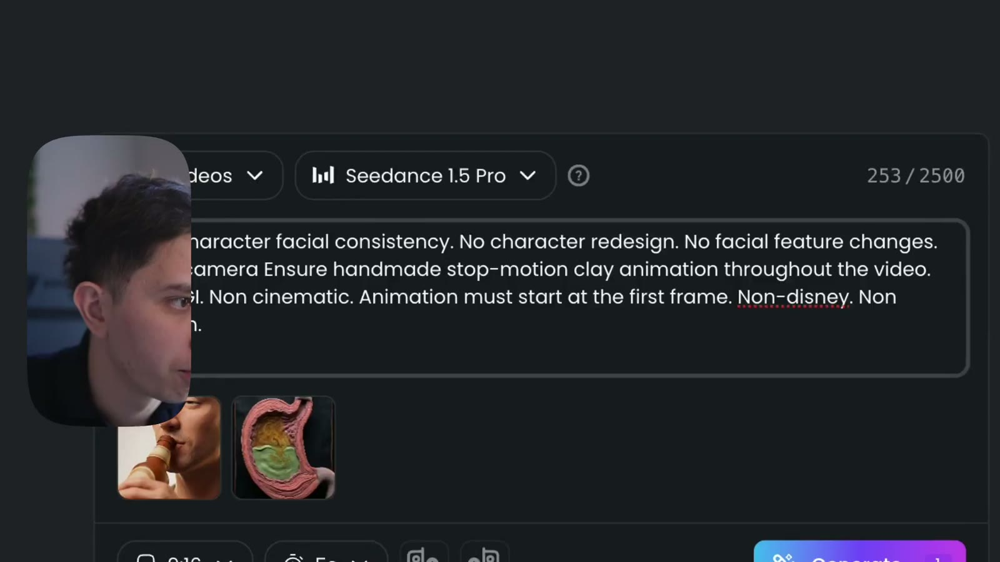
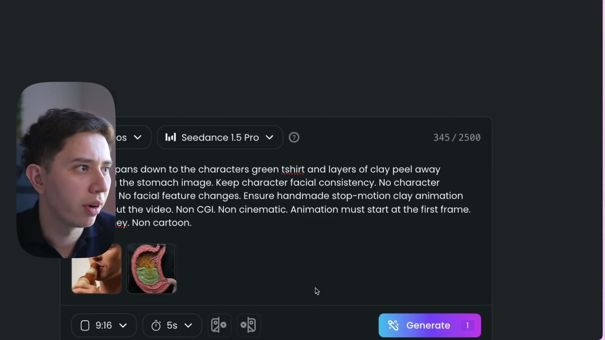
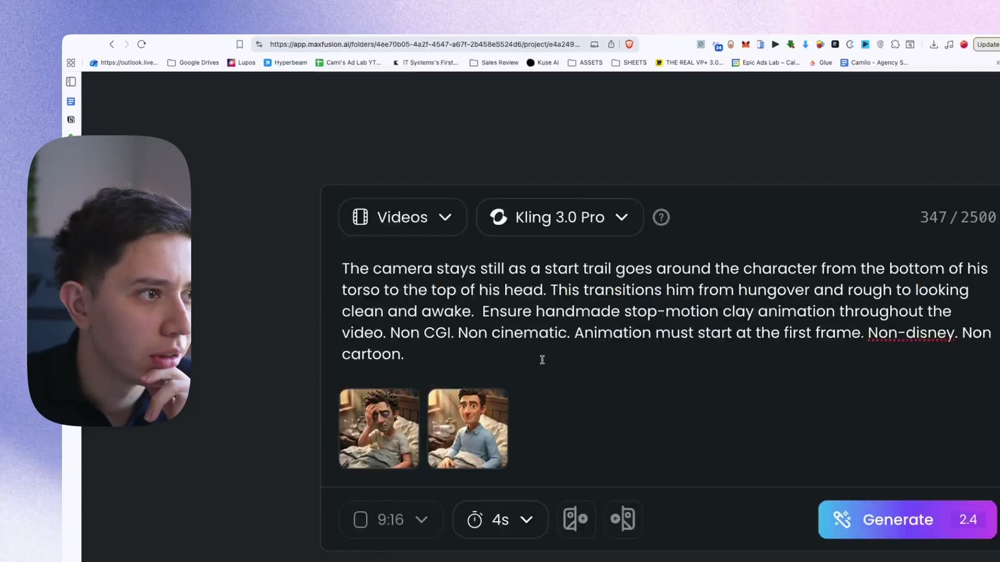

# 56. Generating Videos & Transitions (Claymation)
> Animate claymation stills by giving a video model a start frame (this scene) and an end frame (next scene), a 4-second duration, and a prompt built as [visual direction] + [camera direction] + a fixed "handmade stop-motion clay" suffix; test cheap on Seedance first, finalise on Kling.

## 🤖 Agent use
- **Use when:** turning ordered claymation stills ([54](054-prompts-frames-chatgpt.md) / [55](055-prompts-frames-poppy-method.md)) into transition clips.
- **Inputs → outputs:** ordered stills + script timing → one 3-4 s clip per scene pair (start = scene N, end = scene N+1) → clips for the CapCut edit ([58](058-editing-claymation-step-by-step.md)).
- **Rules:**
  - **DO** put scene N as start frame and scene N+1 as end frame: "This creates the transition between them" (page) [00:00-02:57].
  - **DO** keep clips short, 3-4 s: "we don't need to have anything like 10 seconds long, especially for Kling because it can be quite expensive"; 4 s ≈ 2.4 credits on Kling 3.0 Pro at recording [01:00].
  - **DO** build every prompt as `[Visual direction] + [camera direction] + Ensure handmade stop-motion clay animation throughout the video. Non CGI. Non cinematic. Animation must start at the first frame. Non-disney. Non cartoon.` (page; mandatory) [01:58].
  - **DO** add "Keep character facial consistency. No character redesign. No facial feature changes." whenever a character appears [01:00].
  - **DO** name a camera move: static / slight push-in / slow pan left / arc right [01:00].
  - **DO** test on Seedance first: "just generate something with Seedance first before Kling just because the costs everywhere are a lot, a lot cheaper" (Seedance 1.5 ≈ 1 credit vs 2.4) [05:07]. Use Kling 3.0 Pro for the final when quality matters (instructor claim) [06:10].
  - **DO** give the model an action for what happens between frames when it's more than a zoom ("vines around the frame pull back… layers of clay peel away") [02:57-04:29].
  - **DON'T** pay for audio or Pro tier when generating clips: audio off, quality 720 ("don't bother doing Pro") [07:12-08:13]; sound effects are added in the edit.
  - **DON'T** say "Disney" or "cartoon" as a positive; they are in the negative suffix.
  - **IF** you only need a normal clip **THEN** give just a start frame, input your directions and generate (Canva tip card) [01:57 frame].
  - **IF** you don't know what to say **THEN** keep it simple: replace the bracketed parts of the example prompt and you "will probably get a good result" [02:57].
- **See also:** [57. Voice-over](057-claymation-generating-voice-over.md) · [58. Editing](058-editing-claymation-step-by-step.md) · [66. Zack D Films scenes + transitions](066-zack-d-films-generating-scenes-transitions.md) (same start/end idea) · [AI UGC tools](../../../../tools/ai-ugc-tools.md)

## Key ideas
### Setup in Max Fusion [00:00-01:00]
- Max Fusion → Videos → Kling 3.0 Pro; select the "in and out frame" mode; scenes kept in a "scenes folder… to keep everything organized" [00:00]. Others: Fal, OpenArt "whatever makes sense in your budget" [00:00].
- Settings in the Kling box on screen: 9:16, 4 s, Generate shows 2.4 [07:36 frame].

### Prompt anatomy [01:00-02:57]
- He pastes the cheat sheet in three pieces: consistency line → camera direction → must-include animation direction; "at the end I want to add… if there's anything crazy happening in the animation" [01:00-01:58].
- First clip: wide shot to close-up of the man drinking, slight push-in, 4 s, generated on both Kling 3.0 and Seedance 1.5 for comparison [01:58].

### Prompting a real transition [02:57-04:29]
- Scene: drinking → open stomach. Example prompt on the cheat sheet: "Vines around the frame pull back and out of the frame. Hovenia dulcis falls from the vine attached into the mug of beer. The camera is static…" + suffix [02:57; frame 04:09].
- His own: camera pans down to the character's green T-shirt, "layers of clay peel away revealing the stomach image" + consistency + suffix [03:54-04:29].
- Reminder for restricting the model: keep the "must include" sentence in every prompt (cheat sheet slide: "What if I don't know what to say?") [04:09].

### Compare models [04:29-08:53]
- Kling: "I like how things kind of like shed away like layers" [05:38]. Seedance: "wasn't too bad", slight delay, a weird stain [06:10]; "Seedance always adds these weird songs" when audio is on [05:07].
- Nose still: "brain and trail come out of the nose, camera stays still" [05:07-05:38].
- Next transition: stomach → man waking: "camera zooms out from the stomach and out the T-shirt of the man in the bed as the man is waking up and the sun is rising from behind" [06:10].
- Hungover → recovered: "camera stays still as a star trail goes around the character from the bottom of his torso to the top of his head. This transitions him from hungover and rough to looking clean and awake" [07:12; frame 07:36]. Verdict: "it did okay… kind of wanted it to spin around a bit better" [08:53].
- Other tools: OpenArt (start/end frame, duration 5/10 s, audio on/off) shown at [08:08 frame].

## Steps / framework (page)
| # | Step | Setting |
|---|---|---|
| 1 | Upload images | Claymation stills into Max Fusion (or Fal, OpenArt) |
| 2 | Pick model | Kling 3.0 ("best quality") or cheaper Seedance |
| 3 | Start + end frame | Start = current scene, end = next scene |
| 4 | Duration | 3-4 s, don't waste credits |
| 5 | Add animation prompt | Structure below; camera direction list |

## Examples
| Transition | Prompt idea | Result | Source |
|---|---|---|---|
| Wide → man drinks | slight push-in + consistency + suffix | Both models fine; Kling nicer | [01:58; 05:38-06:10] |
| Nose → scent/brain | "brain and trail come out of the nose; camera stays still" | "that's so cool" | [05:38; 07:12] |
| Drink → stomach | pan down, clay layers peel, reveal stomach | Kling: layers shed away; Seedance: delayed + stain | [05:38-06:10] |
| Stomach → man waking | zoom out of stomach; sun rises behind | good, slightly fast | [06:10; 08:13] |
| Hungover → recovered | yellow star trail circles the character | "okay"; wanted a better spin | [07:12; 08:53] |

## Structured units
### Rules
- **DO** use cheap model first for timing, expensive model for final.
- **DO** keep audio off in the video model and add SFX in the edit [07:12; see lesson 58].
- **IF** the character's face drifts **THEN** repeat the consistency sentence and use the same character reference in both frames (derived).

## Prompts / templates (verbatim)
### Structure (page)
```text
[Visual direction] + [camera directions] + Ensure handmade stop-motion clay animation throughout the video. Non CGI. Non cinematic. Animation must start at the first frame. Non-disney. Non cartoon.
```
### Character consistency line (page)
```text
Keep character facial consistency. No character redesign. No facial feature changes.
```
### Camera directions (page)
```text
1. Static (stays still)
2. Slight push-in (camera moves towards subject, often confused with zoom in)
3. Slow pan left (stationary camera that horizontally rotates to the left)
4. Arc right (example link on page: an Instagram reel; not in files)
```
### Must-include animation directions (page)
```text
"Ensure handmade stop-motion clay animation throughout the video. Non CGI. Non cinematic. Animation must start at the first frame. Non-disney. Non cartoon."
```
### Example prompts on screen
```text
Vines around the frame pull back and out of the frame. Hovenia Dulcis falls from the vine attached into the mug of beer. The camera is static. Ensure handmade stop-motion clay animation throughout the video. Non CGI. Non cinematic. Animation must start at the first frame. Non-disney. Non cartoon.   [04:09 frame; typo "Dulcis falls from the vine it attached into" in the original]

The camera pans down to the character's green tshirt and layers of clay peel away revealing the stomach image. Keep character facial consistency. No character redesign. No facial feature changes. Ensure handmade stop-motion clay animation throughout the video. Non CGI. Non cinematic. Animation must start at the first frame. Non-disney. Non cartoon.   [04:43 frame]

The camera stays still as a star trail goes around the character from the bottom of his torso to the top of his head. This transitions him from hungover and rough to looking clean and awake. Ensure handmade stop-motion clay animation throughout the video. Non CGI. Non cinematic. Animation must start at the first frame. Non-disney. Non cartoon.   [07:36 frame; Kling 3.0 Pro, 9:16, 4 s]
```

## Screenshots

*Cheat sheet: consistency line, camera directions, "must include animation directions" and the prompt structure. [02:04]*


*Worked example: "Vines around the frame pull back…" with the mandatory suffix. [04:09]*


*Seedance 1.5 Pro, 9:16, 5 s, drink still + stomach still, 1 credit. [04:43]*


*Kling 3.0 Pro: two clay frames, star-trail prompt, 9:16, 4 s, 2.4 credits. [07:36]*

## How to apply
- [ ] Number stills in script order; keep them in one folder.
- [ ] For each adjacent pair: start = N, end = N+1, 9:16, 4 s, audio off, 720p.
- [ ] Prompt = what happens + camera move + consistency line + suffix. Generate on Seedance first, then Kling for keepers.
- [ ] Time each clip to its script line (≈3 s per line here) so the edit needs little trimming.
- [ ] Download and hand to the editor ([58](058-editing-claymation-step-by-step.md)).

## Related
- Previous: [55. Prompts + Frames - Poppy Method](055-prompts-frames-poppy-method.md) · Next: [57. Generating Voice Over](057-claymation-generating-voice-over.md)

## Sources and limitations
- [Transcript](<../../../../../raw/ad-creators-lab/ai-ads-ugc-animations/_transcripts/Ad Creators Lab - Create Viral AI Ads, UGC & Animations That Convert Into Sales(September 2026)/4. AI Animated Ads/4. Claymation Ads/4. Generating Videos Transitions.txt>) (ends 09:04 = full length). Whisper wrote "cling" (Kling), "seed dance/c dance" (Seedance), "Hovenia Dulcis" correctly only in the frame; "Max Fusion" is correct.
- [Lesson page](<../../../../../raw/ad-creators-lab/ai-ads-ugc-animations/_extracted/Ad Creators Lab - Create Viral AI Ads, UGC & Animations That Convert Into Sales(September 2026)/4. AI Animated Ads/4. Claymation Ads/4. Generating Videos & Transitions.htm.md>); the Canva cheat-sheet link and the Instagram reel example are not in the files (the cheat sheet is visible in frames).
- Credit costs (2.4 Kling 3.0 Pro 4 s; 1 Seedance 1.5) are as shown at recording (Aug-Sep 2026) and change.
- Hovenia dulcis / DHM and "hangover cure" content in the sample comes from a supplement ad with unverified claims; see [59](059-swipe-file-claymation-ad-scripts.md).
