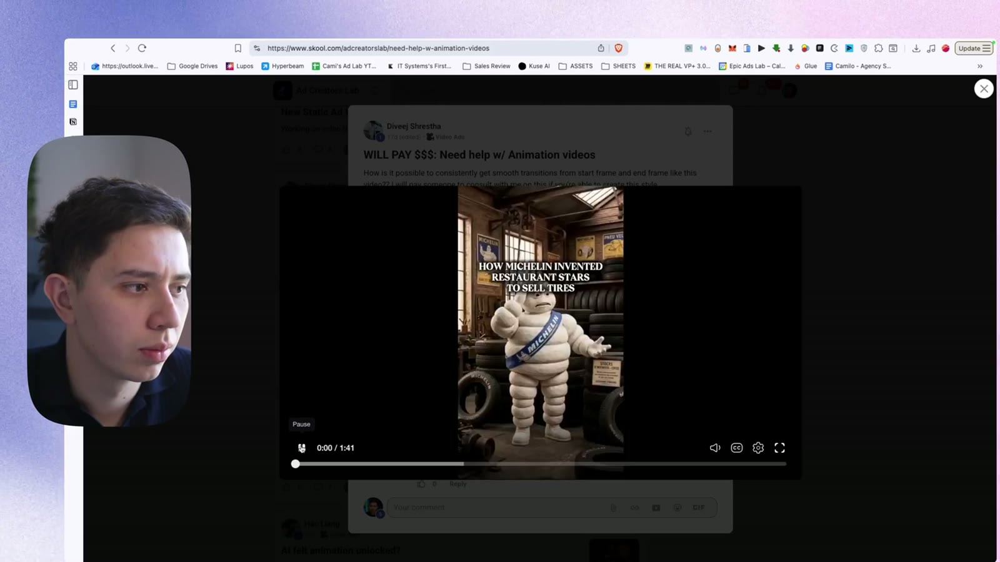
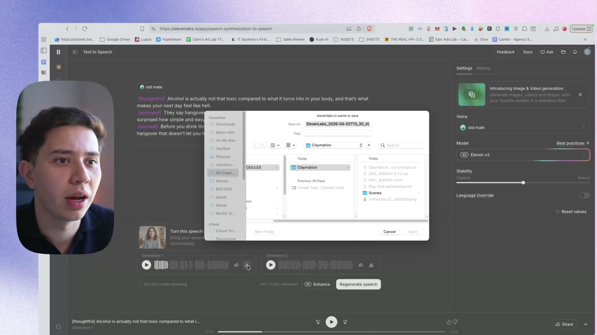

# 57. Generating Voice Over (Claymation)
> Claymation ads that perform use a calm, slightly serious documentary-style voice, not an energetic one; design it in ElevenLabs "Voice Design" with a prompt, test before enhancing, then paste the script and download.

## 🤖 Agent use
- **Use when:** making the narration for claymation (and other storytelling-style) animated ads.
- **Inputs → outputs:** final script + a voice description (age, accent, tone, pacing) → saved ElevenLabs voice → downloaded voiceover audio.
- **Rules:**
  - **DO** keep the voice "calm, simple, not over-the-top"; "best ads = calm, slightly serious, storytelling tone" (page).
  - **DO** sanity-check: "If it sounds like a YouTuber shouting → it's wrong. If it sounds like a documentary → you're close." (page)
  - **DO** generate a sample first and listen before adding enhancements [01:02].
  - **DO** use Enhance if it sounds robotic: the raw read was "a bit robotic"; enhanced gave "a bit of tonality" [01:02-01:58].
  - **DO** name and label the saved voice for reuse [01:02].
  - **DON'T** make it "overly charismatic" or "so animated, not so crazy" [00:00-01:02].
  - **IF** you want a female voice **THEN** the same rules apply ("not so overly charismatic") [01:02].
- **See also:** [ElevenLabs](../../../../tools/elevenlabs.md) · [58. Editing](058-editing-claymation-step-by-step.md) · [67. Voice clone (flagged)](067-zack-d-films-voice-clone-song.md)

## Key ideas
- Why a particular voice: "if we look at some of the best claymation ads that we have done they all have a very particular sounding voice"; a documentary example plays: "One day in 1900 the Michelin brothers had a problem…" [00:00]; another: "They build quietly through friction points" [00:00]. (Instructor claim: "best ads we've done"; no results shown.)
- Workflow: ElevenLabs → create a voice → Voice Design → prompt "a soft, older British male speaking in a calm, assured way"; sample line "Good morning, everyone. I trust you all slept well." [00:00-01:02]. Then save with a name and label; paste script; Generate speech; Enhance; download [01:02-01:58].
- The script voiced: "Alcohol is actually not that toxic compared to what it turns into in your body. And that's what makes your next day feel like hell." [01:02]

## Steps / framework (page)
| # | Step | Detail |
|---|---|---|
| 1 | Open a voice generator | e.g. ElevenLabs → Voice Design |
| 2 | Create a voice | Describe age, tone, style; calm, not over-the-top |
| 3 | Test | Generate a sample; listen before enhancing |
| 4 | Improve | Enhance if robotic |
| 5 | Script | Paste, generate full voiceover |
| 6 | Download | Save audio for the edit |

## Examples
| Voice | Result | Source |
|---|---|---|
| "a soft, older British male speaking in a calm, assured way" | "sounds pretty cool" | [00:00-01:02] |
| Same, script read without Enhance | "sounds a bit robotic" | [01:02-01:58] |
| Same, with Enhance | "way better… a bit of tonality" | [01:58] |

## Prompts / templates (verbatim)
### 10 voice prompts (page)
```text
1. Classic documentary
"Soft British male, mid-40s, calm and authoritative, documentary narration style, slow and measured delivery"

2. Older trusted expert
"Older British male, 60s, warm, calm, slightly gravelly voice, reassuring and knowledgeable tone"

3. Calm female narrator
"Soft British female, 30s, calm and clear, neutral tone, gentle and informative delivery"

4. Subtle luxury tone
"Refined British male, 40s, smooth and polished, understated confidence, premium brand feel"

5. Scientific explainer
"Neutral British voice, 30s, precise and clear, slightly analytical tone, calm and factual delivery"

6. Storytelling narrator
"Warm British male, 40s, relaxed pacing, slightly emotional but controlled, storytelling tone"

7. Modern minimal ad voice
"Young British male, late 20s, calm, slightly monotone, minimal expression, clean ad style"

8. Soft persuasive female
"British female, 30s, soft and reassuring, slightly warm tone, persuasive but subtle delivery"

9. Serious problem-solution tone
"British male, 40s, serious and grounded, calm but slightly concerned tone, clear emphasis on key words"

10. High-end brand voice
"Deep British male, 40s, slow, confident, luxurious tone, very controlled delivery, premium feel"
```

## Screenshots

*One of the reference claymation ads used to explain the "documentary" voice (caption: "How Michelin invented restaurant stars to sell tires"). The ad uses a real brand's mascot; reuse the mechanism, not the character. [00:12]*


*ElevenLabs Text to Speech with the saved voice, the script pasted, Enhance and Generate speech. [01:59]*

## How to apply
- [ ] Pick one prompt from the list that fits the brand's authority level; generate a short sample.
- [ ] Voice the full script; Enhance only if robotic; download.
- [ ] Use only voices you designed or licensed; never clone a real person (see [67](067-zack-d-films-voice-clone-song.md)).

## Related
- Previous: [56. Generating Videos & Transitions](056-claymation-generating-videos-transitions.md) · Next: [58. Editing Claymation Step-By-Step](058-editing-claymation-step-by-step.md)

## Sources and limitations
- [Transcript](<../../../../../raw/ad-creators-lab/ai-ads-ugc-animations/_transcripts/Ad Creators Lab - Create Viral AI Ads, UGC & Animations That Convert Into Sales(September 2026)/4. AI Animated Ads/4. Claymation Ads/5.Generating Voice Over.txt>) (ends 02:01 of 02:02). "11 labs" = ElevenLabs.
- [Lesson page](<../../../../../raw/ad-creators-lab/ai-ads-ugc-animations/_extracted/Ad Creators Lab - Create Viral AI Ads, UGC & Animations That Convert Into Sales(September 2026)/4. AI Animated Ads/4. Claymation Ads/5.Generating Voice Over.htm.md>). The page lists 10 voice prompts ("suggestions down below"). ElevenLabs plan/credit costs are not shown.
- No results data for the claimed "best claymation ads".
