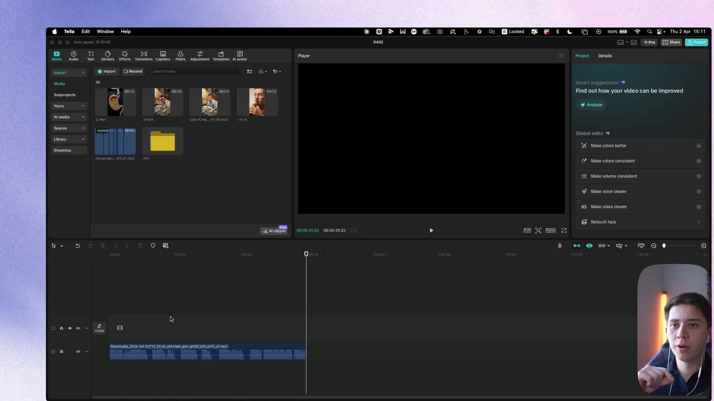

# 58. Editing Claymation Step-By-Step
> Assemble the claymation ad in CapCut: lay the voiceover first, cut each clip to the spoken line, use speed curves ("flash out" / "flash in") to hide transitions, then layer sound effects, which carry most of the claymation feel.

## 🤖 Agent use
- **Use when:** editing AI-generated clay clips with an ElevenLabs voiceover into a finished ad.
- **Inputs → outputs:** numbered transition clips ([56](056-claymation-generating-videos-transitions.md)) + voiceover ([57](057-claymation-generating-voice-over.md)) + SFX → timed, speed-ramped video.
- **Rules:**
  - **DO** import the voiceover first and label clips 1, 2, 3 in order [00:00].
  - **DO** time each clip's transition to the spoken phrase: the transition into the stomach starts on "compared to what it turns into in your body" [00:59-03:33].
  - **DO** lock the audio layer and cut audio tight before editing clips [00:00-00:59].
  - **DO** use speed curves: Speed → Curve → "flash out" on the outgoing clip (ends faster) and "flash in" on the next; drag the ramp point so the clip starts speeding up exactly at the word you want [01:29-03:33].
  - **DO** add sound effects at every physical action: drinking, cloth hits when the T-shirt opens, liquid [04:39-05:44]; in CapCut: Audio → Sound effects, search "drinking".
  - **DO** add a thick liquid-pour SFX for transitions: "one sound effect you definitely want… it just always works" (a stock "thick liquid pouring" clip) [03:33].
  - **DON'T** rely on model audio: Kling/Seedance audio costs credits and needs audio descriptions; "might as well just put the effects in there because we have full control" [05:44].
  - **DON'T** download from YouTube rippers without checking the licence (derived; he says "use some kind of YouTube downloader" [03:33]). Use licensed or CapCut/library SFX.
  - **IF** you want it simple **THEN** "no sound effects or whatever comes out of Kling or Seedance if you leave the audio on" [05:44].
- **See also:** [56. Videos + transitions](056-claymation-generating-videos-transitions.md) · [57. Voice-over](057-claymation-generating-voice-over.md) · [59. Swipe file](059-swipe-file-claymation-ad-scripts.md)

## Key ideas
### Voiceover-first timeline [00:00-00:59]
- Drag in the ElevenLabs voiceover ("Alcohol is actually not that toxic compared to what it turns into in your body") then clip 1 (man drinking), clip 2 on the phrase "compared to what it does to your body" [00:00].
- Cut the audio around the line so it stays tight [00:59].

### Speed curves hide the AI seams [01:29-03:33]
- "Flash out" on clip 1 makes the ending faster; "flash in" on clip 2 does the reverse; adjust the ramp so the maximum speed sits where the transition happens [01:29-02:30].
- Move the ramp start to the right to lengthen the clip and delay the speed-up; move it left if it starts too fast; fine-tune against "toxic… compared… to what" [02:30-03:33].

### Sound effects [03:33-05:44]
- The sample SFX in the original clip disappears when you cut the model audio, so add one: thick liquid pouring (YouTube "UH Sound" clip seen at [03:48 frame]) [03:33].
- Clip 3 on "and that's what makes your next day feel like hell", liquid effect at "hell", drinking SFX for the beer shot, cloth hit when the T-shirt opens [04:06-05:44].
- Close: "Then you add your next scenes and… before you know it you have a really cool looking ad that just transitions between different shots" [05:44].

## Steps / framework
| # | Step | Tool detail | Source |
|---|---|---|---|
| 1 | Import voiceover, then clips | Label 1-N; lock audio layer | [00:00] |
| 2 | Cut voice tight; place clip per spoken line | Clip 2 begins on "compared to what it turns into" | [00:00-00:59] |
| 3 | Speed curve on seams | Speed → Curve → flash out (A) / flash in (B) | [01:29] |
| 4 | Align ramp to the word | Drag ramp point; check clip length changes | [02:00-03:33] |
| 5 | Add SFX | Liquid, drinking, cloth hit; CapCut Audio → Sound effects | [03:33-05:44] |
| 6 | Add next scenes, repeat | | [05:44] |

## Examples
Edit of the sample script (NextDay hangover ad, first two lines):

| Spoken line | Clip | Edit move | Source |
|---|---|---|---|
| "Alcohol is actually not that toxic" | 1: man sips beer | plain start | [00:00] |
| "compared to what it turns into in your body" | 2: stomach | flash out on clip 1 + flash in on clip 2; ramp starts at "compared" | [02:00-04:06] |
| "and that's what makes your next day feel like hell" | 3: waking up | liquid SFX, cloth-hit SFX on shirt opening | [04:06-05:44] |

## Prompts / templates (verbatim)
None (editing walkthrough).

## Screenshots

*CapCut timeline at the start: media bin with clay clips and the voiceover track. [00:00]*

## How to apply
- [ ] Voiceover on the timeline first; mark where each script line ends.
- [ ] Trim each clip to its line; apply flash out/in on every seam and align the ramp to the key word.
- [ ] Layer licensed SFX per action (pour, drink, cloth, whoosh); mix below the voice.
- [ ] Export; log which seams looked bad and regenerate only those clips.

## Related
- Previous: [57. Generating Voice Over](057-claymation-generating-voice-over.md) · Next: [59. Swipe File - Claymation Ad Scripts](059-swipe-file-claymation-ad-scripts.md)

## Sources and limitations
- [Transcript](<../../../../../raw/ad-creators-lab/ai-ads-ugc-animations/_transcripts/Ad Creators Lab - Create Viral AI Ads, UGC & Animations That Convert Into Sales(September 2026)/4. AI Animated Ads/4. Claymation Ads/6. Editing Claymation Step-By-Step.txt>) (ends 06:23 = full length). Whisper wrote "capcot" = CapCut.
- [Lesson page](<../../../../../raw/ad-creators-lab/ai-ads-ugc-animations/_extracted/Ad Creators Lab - Create Viral AI Ads, UGC & Animations That Convert Into Sales(September 2026)/4. AI Animated Ads/4. Claymation Ads/6. Editing Claymation Step-By-Step.htm.md>): no lesson text. An `.mp3` attachment exists in the originals (448,639 bytes); it is audio only and its contents were not transcribed or analysed here.
- The sound-effect source is a third-party YouTube video; check licensing before use.
