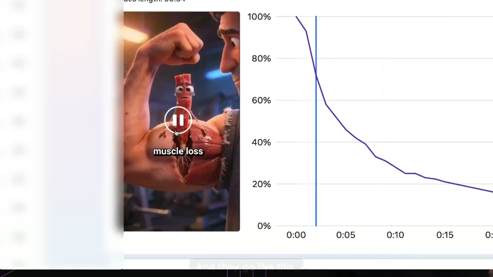
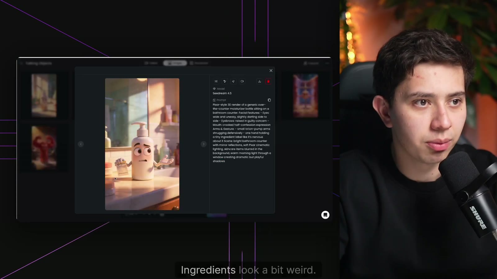
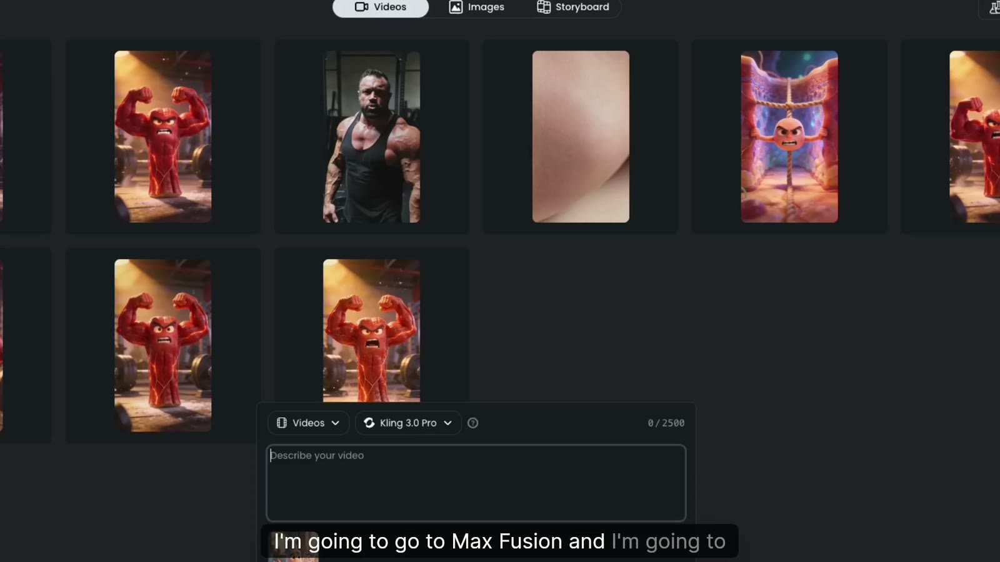
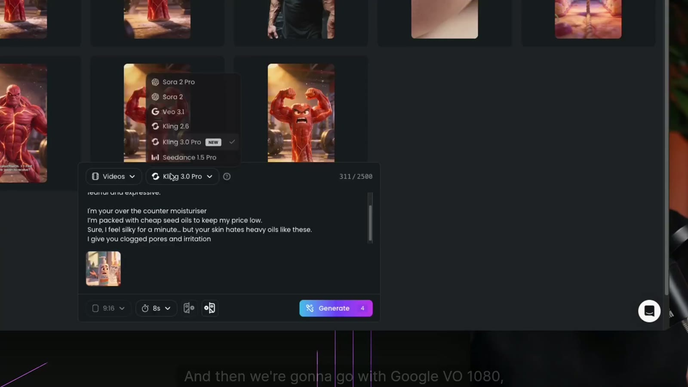

# 62. Talking Objects Tutorial
> Make the "failed solution" a Pixar-style talking character: find what customers tried before, have a GPT write the object's 10-second monologue and image prompt, generate the character in Seedream or Nano Banana, then animate with lip sync, testing cheap models first.

## 🤖 Agent use
- **Use when:** you need a scroll-stopping, educational "talking product/object" ad for cold or problem-aware traffic.
- **Inputs → outputs:** list of failed/competing solutions + the misconception to attack → object monologue (~10 s) + character image prompt (Object Talk GPT) → 4-6 character images → talking video with lip sync (Kling 3.0 / Veo 3.1 / Sora 2 Pro / Seedance 1.5) → ad.
- **Rules:**
  - **DO** start with strategy: "What failed solutions did customers try before your product?" The angle becomes "I'm the failed solution explaining why I suck." (page) [00:00-00:48]
  - **DO** target "potential misconceptions people have or things they don't understand simply about a product" [00:00]; he also used it for a funnel builder with a PDP/landing page/quiz-funnel talking each other down [00:48].
  - **DO** research the failed solutions with AI (his example: tallow skincare → drugstore moisturisers, coconut oil, plant butters); choose one ("over-the-counter moisturizer") and brief the GPT in a sentence: object + what you want to say (seed oils bad for skin) [00:48-01:40].
  - **DO** generate 4-6 image variations and pick the most expressive (page) [02:31].
  - **DO** use Seedream for the cheap character look and Nano Banana (Pro) when specific text (an ingredients list) must be legible; "Seedream - cheap but not good with text; Nano Banana - pricier but elite at text" (page) [02:31-03:21]. If text is tiny, regenerate a variation with "make the ingredients sheet bigger" and fix the text [03:21].
  - **DO** describe the scene and speech in the third person ("she is doing this") rather than commanding ("have her do this"): "Speaks as an American female in an agitated/threatened way" [05:52] (instructor tip).
  - **DO** test timing on the cheapest model before the final: "Cheap model → test timing; better model → final version" (page) [08:10-09:04].
  - **DO** match script length to clip length: Veo cut the line off because the script was too long for 8 s; "increase the length or shorten the script" [07:39]; Kling at 10 s likely needed [06:48].
  - **DON'T** expect perfect lip sync ("it's fine if it's a little off", page); Veo is the best but pricier (page; [07:39]).
  - **DON'T** claim results as proven: "starting to crush… a four-x [Whisper: 'forex'] rise and some limited spend but some really good initial signs" [00:00] (instructor claim; limited spend).
  - **IF** you need legible product text **THEN** use Nano Banana Pro for that image only [02:31].
- **See also:** [66. Zack D Films scenes and transitions](066-zack-d-films-generating-scenes-transitions.md) · [AI UGC tools](../../../../tools/ai-ugc-tools.md) · [Evolve: market awareness](../../../evolve/start-here/lessons/010-market-awareness.md) · [LLM output claim audit](../../../stefan-georgi/rmbc-ii/rubrics/llm-output-claim-audit.md)

## Key ideas
### Why it works (page) [00:00-00:48]
- Three triggers: (1) pattern interrupt, "objects talking = scroll stopping"; (2) educational, "explains why the old solution sucks"; (3) product positioning, "your product becomes the obvious upgrade" (instructor claim; no test data).
- Frames: a talking red muscle-character ad with a retention curve overlay "muscle loss" [00:17] and an Ads Manager table (numbers not read, not used) [00:05].

### The GPT [00:00-01:40]
- "Object Talk" custom GPT ("I found online, I didn't make this"): turns any object into a talking character with an expressive face and a quick ~10-second educational monologue [00:00; 05:04 frame]. Link on the page.
- He dictates with a voice tool, e.g. "the object I want to show is an over-the-counter moisturizer, and I want to talk about how it uses seed oils and is bad for your skin" [01:40]. GPT returns an image prompt, the script, and other related objects [01:40; 04:59].

### Image generation [01:40-03:21]
- Max Fusion (alternatives: OpenArt, Arcads) → Create image → Seedream 4.5, many variations at once [01:40-02:31].
- "Generic moisturizer" with ingredients: Seedream text looked weird; switched to Nano Banana Pro; first result tiny text; fixed via "generate variation… make the ingredients sheet bigger… fix the text" [02:31-03:21].

### Video generation, four models, same prompt [04:02-09:04]
- Date on screen: "as of today, March the 6th" new options incl. Sora 2 Pro with a reference image [04:02] (at recording).
- Prompt: the GPT's 10 s script split by line breaks (Shift+Enter runs generation; plain Enter makes a new line), plus direction "speaks as an American female in an agitated/threatened way" [04:59-05:52]. He drops to 8 s: cost 4.8 → 4 credits on Kling [05:52].
- Credits for the same job (Max Fusion, at recording): Kling 3.0 Pro 4; Veo 3.1 7; Seedance 1.5 Pro 1 [05:52-06:48; 04:02]. "100 credits you can do 100 videos with Seedance" (instructor claim) [04:02].
- Results: Kling: good animation, lip sync "isn't as good", timing too short [06:48]. Veo: "probably the better one", but script too long for the audio so speech is rushed [07:39]. Sora 2 Pro: became "almost like a movie", very quiet audio, animations "alright but not really what we wanted" [08:10]. Seedance: hands broke, voice decent, "to be honest the better one that we had was actually these two, the Kling and the Google Veo" [08:10-09:04].
- Next: he points to an "AI prompt super doc" with image/video prompt examples (work in progress; link not in files) [09:04].

## Steps / framework
| # | Step | Detail | Source |
|---|---|---|---|
| 1 | Strategy | List failed solutions; pick the misconception to attack | page; [00:00-01:40] |
| 2 | Brief the GPT | One sentence: object + what it says | [01:40] |
| 3 | Character image | Seedream (cheap) or Nano Banana (text); 4-6 variations; pick the most expressive | page; [02:31] |
| 4 | Fix text | Variation prompt: bigger, corrected ingredients | [03:21] |
| 5 | Talking video | Image + script (+ direction, third-person) → model; 8-10 s | [04:02-05:52] |
| 6 | Test cheap, then final | Seedance first; Veo or Kling for lip sync | page; [08:10-09:04] |

## Examples
Quick ecom ideas from the page:

| Niche | Object | Says |
|---|---|---|
| Skincare | Drugstore moisturizer | seed oils clog pores, irritate skin |
| Coffee brand | Supermarket coffee | why it's stale |
| Mattress | Cheap Amazon mattress | why it sinks |
| Supplements | Generic multivitamin | low absorption |

Demo script (tallow skincare niche): "I'm your over-the-counter moisturizer. I'm packed with cheap seed oils to keep my price low. Sure, I feel silky for a minute, but your skin hates heavy oils like these. I give you clogged pores and irritation." [05:04; 06:48]. Then a cut to "I'm also…" and an ending "I'm something that's a lot better" [05:52].

| Model | Credits (8 s, at recording) | Lip sync | Visual | Verdict | Source |
|---|---|---|---|---|---|
| Kling 3.0 Pro | 4 | weaker | animation "really nice" | timing too short | [06:48] |
| Veo 3.1 | 7 | best | good | script too long, speech rushed | [07:39] |
| Sora 2 Pro | not stated | ok | cinematic, movie-like | audio quiet, off-brief | [08:10] |
| Seedance 1.5 Pro | 1 | decent voice | hands broke | use only for timing | [08:10-09:04] |

## Structured units
### Angle
| Angle | Core desire / pain | Heuristic(s) | Best format | Example line | Source |
|---|---|---|---|---|---|
| "I'm the failed solution explaining why I suck" | Wants a solution that works; frustrated with what they tried | Education, pattern interrupt, positioning as upgrade (page) | Talking object, ~10 s, cold/problem-aware traffic | "I'm your drugstore moisturizer… packed with cheap seed oils to keep my price low…" | page; [00:48] |

### Rules
- **DO** make the object the antagonist, never your own product (page).
- **DO** keep each ad to one misconception.
- **DON'T** state ingredient harms as fact without evidence: "seed oils… your skin hates heavy oils… clogged pores and irritation" is an unsupported cosmetic/health claim; source it or soften (derived).
- **IF** the object is a competitor's branded product **THEN** use a generic version, not their logo (derived).

## Prompts / templates (verbatim)
No full prompt is shown; the Object Talk GPT's instructions are not in the files. On-screen/spoken pieces:
```text
[brief to GPT, spoken] "the object I want to show is an over-the-counter moisturizer. And I want to talk about how it uses seed oils and is bad for your skin."

[video prompt, typed at 05:52] I'm your over the counter moisturiser
I'm packed with cheap seed oils to keep my price low.
Sure, I feel silky for a minute... but your skin hates heavy oils like these.
I give you clogged pores and irritation.
+ direction: "speaks as an American female in an agitated / threatened way… She is doing this, she is doing that" (describe the scene in the third person)

[variation prompt, 03:21] make the ingredients sheet bigger and also fix the text
```

## Screenshots

*Opening example: an object-character ad with its audience-retention curve beside it (curve values are not readable or stated). [00:17]*


*Generated "generic moisturizer" character; the ingredient text looks malformed, which sends him to Nano Banana Pro. [02:44]*


*Image gallery and the video panel with the monologue pasted. [05:21]*


*Model dropdown while the same prompt is run on Veo (8 s, 1080p, 9:16). [06:48]*

## How to apply
- [ ] List 3-5 failed solutions your customer tried; pick the one with the clearest misconception.
- [ ] Brief the Object Talk GPT (or a Claude prompt of your own) with object + message; get script + image prompt.
- [ ] Generate 4-6 character images; fix text on the winner.
- [ ] Generate the video on Seedance for timing; fix script length vs clip length; finalise on Veo or Kling.
- [ ] Claim-check the script and any ingredient statements; add captions in the edit.

## Related
- Previous: [61. Hall of Fame - Talking Objects Ads](061-hall-of-fame-talking-objects-ads.md) · Next: [63. What we are making - Zack D Films Style](063-what-we-are-making-zack-d-films-style.md)

## Sources and limitations
- [Transcript](<../../../../../raw/ad-creators-lab/ai-ads-ugc-animations/_transcripts/Ad Creators Lab - Create Viral AI Ads, UGC & Animations That Convert Into Sales(September 2026)/4. AI Animated Ads/5. Talking Objects Ad Style/Talking Objects Tutorial - AI Animated Ads · Ad Creators Lab.txt>) (ends 09:39 = full length). Whisper errors: "forex rise" (likely "4x ROAS", unverified), "cling" = Kling, "seed dance"/"c dance" = Seedance, "Whisper Flow" = Wispr Flow (voice dictation), "google video/veal" = Veo, "Soro" = Sora, "oxygen" is unclear (the screens show Max Fusion), "Arcades" = Arcads.
- [Lesson page](<../../../../../raw/ad-creators-lab/ai-ads-ugc-animations/_extracted/Ad Creators Lab - Create Viral AI Ads, UGC & Animations That Convert Into Sales(September 2026)/4. AI Animated Ads/5. Talking Objects Ad Style/Talking Objects Tutorial.htm.md>); Object Talk GPT link on page is a public ChatGPT link and the "AI prompt super doc" link isn't in the files.
- The "crushing it" results are unspecified: no spend, ROAS or CTR values readable. Model prices and availability date from March 2026 recording as stated; they change. Sora 2 Pro with reference image availability is claimed at that date.
