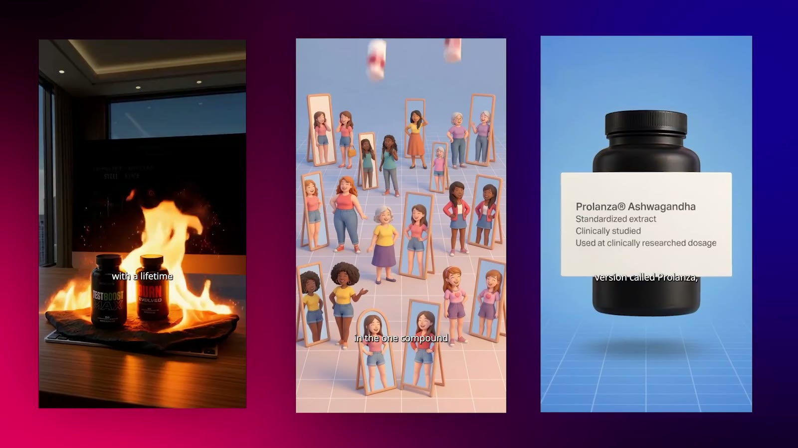

# 63. What we are making - Zack D Films Style
> A 48-second preview of the "Zack D Films" ad style (short 3D cartoon explainer scenes with an infographic-like look) that the instructor says needs no animation skills or crazy prompts, "just a good eye for detail and knowing what to put into the videos" [00:00].

## 🤖 Agent use
- **Use when:** choosing a visual style for a script-driven animated ad where each line gets a clean 3D cartoon shot ([64](064-workflow-breakdown.md) onward).
- **Inputs → outputs:** none (preview). Reference: vertical shots with a bright flat background, one hero object or character per shot, kinetic captions, product card with ingredient/spec text.
- **Rules:**
  - **DO** copy the style (pacing, one-subject-per-shot, 3D soft cartoon, clean grids/backgrounds), which is a visual approach any creator may reproduce.
  - **DON'T** use the real creator's name, logo, channel branding, or his voice or likeness to make the ad look endorsed by or made by him; lesson [67](067-zack-d-films-voice-clone-song.md) clones his voice and must not be followed (see flag).
  - **DON'T** reuse the sample's claims: the spoken ad says a branded ashwagandha extract is "clinically studied to support healthy testosterone levels in men over 40" and offers a "lifetime money-back guarantee" [00:00]. Neither is evidenced in the files.
- **See also:** [64. Workflow Breakdown](064-workflow-breakdown.md) · [65. Script-to-prompt generator](065-script-to-prompt-generator.md) · [LLM output claim audit](../../../stefan-georgi/rmbc-ii/rubrics/llm-output-claim-audit.md)

## Key ideas
- Promise: "videos that look like this in the Zack Films style as quickly as possible without having to learn loads of animations or loads of crazy prompts" [00:00].
- Sample (spoken, partially transcribed) [00:00]: "…called ashwagandha. But most ashwagandha found in stores are full of fillers and low dosages. So you need to get a clinical-grade version called Prolanza, which is clinically studied to support healthy testosterone levels in men over 40. Pairing that with a thermogenic fat burner, you have created what high-performing family men are calling the Steel and Fire Stack, which you can try with a lifetime money-back guarantee by tapping the link."
- Frames [00:30]: a fire-lit pair of supplement tubs on a table, a grid of small cartoon women each in a mirror, and a black supplement bottle with a card "Prolanza® Ashwagandha - Standardized extract - Clinically studied - Used at clinically researched dosage" on a blue grid floor.
- Page: "Examples by other students 👇", embedded and not saved.

## Examples
| Ad | Format | Hook / opening | What works | What fails | Fix suggested | Principle | Source |
|---|---|---|---|---|---|---|---|
| Steel and Fire Stack (men 40+ supplement) | 3D cartoon scene sequence + voiceover | Opens mid-script on "ashwagandha… full of fillers and low dosages" (hook not in clip) | Villain ("fillers, low dosages") then a "clinical-grade" fix; product card on a clean grid | Testosterone and "clinically studied" claims, "lifetime" guarantee: unverified | Back with the actual study and dose or remove; state the real guarantee | Mechanism + proof card (derived) | [00:00-00:30] |

## Prompts / templates (verbatim)
None.

## Screenshots

*Style sample: flat saturated backgrounds, one subject, a technical grid floor under the product, ingredient card with a "clinically studied" label. [00:30]*

## How to apply
- [ ] Decide if the product benefits from one-idea-per-shot explainer visuals; then move to lesson 64.
- [ ] Write your own script and claims; reuse only the visual grammar.

## Related
- Previous: [62. Talking Objects Tutorial](062-talking-objects-tutorial.md) · Next: [64. Workflow Breakdown](064-workflow-breakdown.md)

## Sources and limitations
- [Transcript](<../../../../../raw/ad-creators-lab/ai-ads-ugc-animations/_transcripts/Ad Creators Lab - Create Viral AI Ads, UGC & Animations That Convert Into Sales(September 2026)/4. AI Animated Ads/6. Zack D Films Ad Style/1. What we are making - Zack D Films Style.txt>) (ends 00:48 = full length; starts with the instructor, then the sample's voiceover). [Lesson page](<../../../../../raw/ad-creators-lab/ai-ads-ugc-animations/_extracted/Ad Creators Lab - Create Viral AI Ads, UGC & Animations That Convert Into Sales(September 2026)/4. AI Animated Ads/6. Zack D Films Ad Style/1. What we are making - Zack D Films Style.htm.md>): one line.
- "Zack D Films" is a real creator's name (spelled "Zack Films" / "Zak Films" on screen and in the transcript). The course teaches imitating his visual style; that is fine. His name, face, voice and brand are not ours to use.
- The Prolanza brand name is quoted from the sample; its claims are the sample advertiser's, not verified here.
