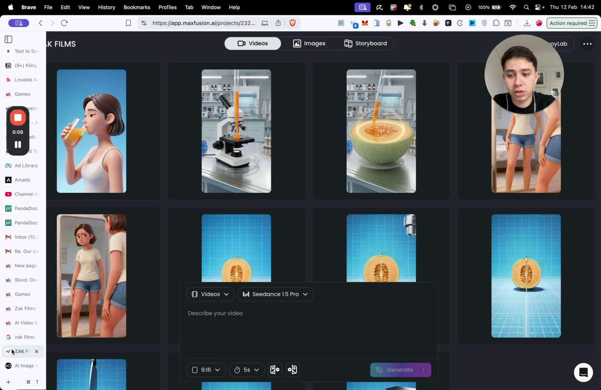
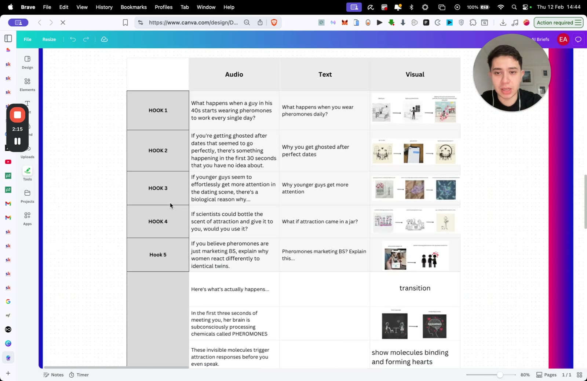
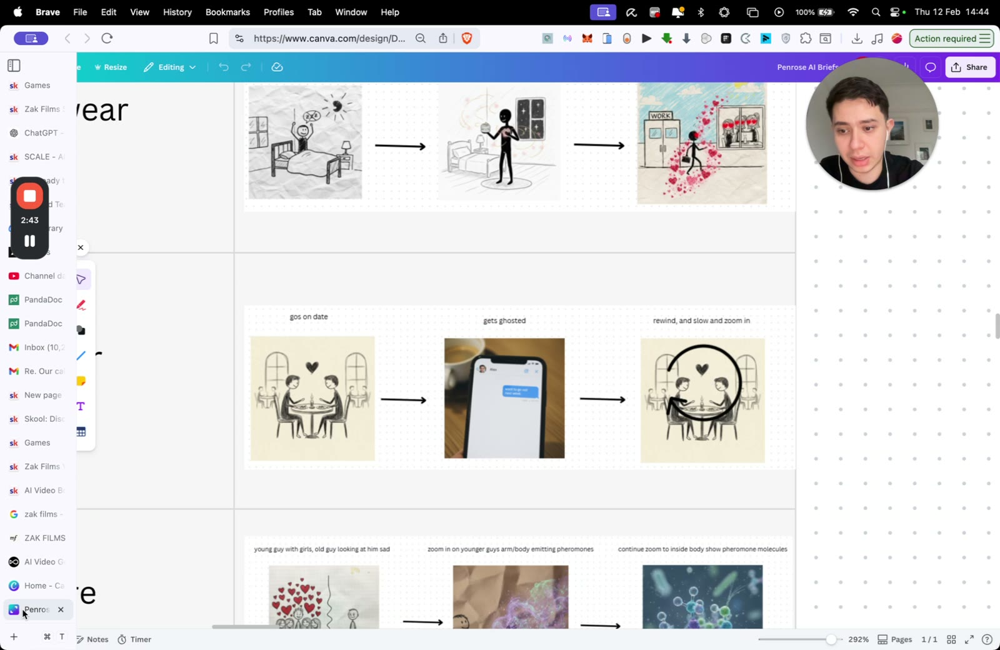

# 64. Workflow Breakdown (Zack D Films Style)
> Tool-agnostic recipe: write a solid script, add one visual per line, generate Pixar-style stills for each, then let a video model (Kling / Seedance) animate between start and end frames; the hard part is deciding what shots to show.

## 🤖 Agent use
- **Use when:** planning a Zack-style animated explainer ad in Max Fusion, OpenArt or any tool with start/end frames.
- **Inputs → outputs:** finished script (hooks + body) → script table with a Visual column → stills (start/end per shot) → clips via start/end-frame video → stitched ad.
- **Rules:**
  - **DO** "have a solid script" first: "the number one thing you want to do" [00:45].
  - **DO** write the script in an Audio / Text / Visual table: spoken line, on-screen text, and the visual for each (5 hooks, then body) [01:52].
  - **DO** treat shot ideation as the real work: "the real difficulty… is knowing what to come up with for the shots… everything else kind of takes care of itself once you start animating" [00:45].
  - **DO** use start and end frames in the video model; "almost every software has it" [00:00].
  - **DO** use the [script-to-prompt generator](065-script-to-prompt-generator.md) to get image ideas and prompts "based on a massive document… of different scenes that are typical in the Zack Films style" [01:52].
  - **DON'T** over-engineer prompts: "you don't have to be super detailed; the first video I ever made with this I just was imagining what it would look like for every part of the scene" [02:52].
  - **IF** the tool is OpenArt **THEN** Kling 2.6 start/end frame, 5 s, audio on/off settings are available (frames [00:37]).
- **See also:** [65. Script-to-prompt generator](065-script-to-prompt-generator.md) · [66. Scenes + transitions](066-zack-d-films-generating-scenes-transitions.md) · [56. Claymation start/end frames](056-claymation-generating-videos-transitions.md)

## Key ideas
- Made in Max Fusion and in OpenArt; "the model doesn't really matter. In fact, I think they're all great" [00:00].
- Ingredients: Pixar-style soft 3D cartoon images that match the script → a video model with start and end frames [00:00].
- Example ad: a video about a fruit whose extract helps cellulite; "coming up with these images… was the biggest task" [00:45]. Within the first three clips "the AI model takes care of the animation part" [00:45].
- Scripting format "these days": write the script, then add visuals; "these visuals end up becoming what we turn into 3D models" [01:52].
- Tool: "Script to prompt generator" in the course's Video Ads module: input script lines (e.g. "getting ghosted after dates") → image ideas → pick → exact prompt to paste [01:52-02:52]. "This image… was this prompt. I didn't think of it myself, the prompt did" [02:52].

## Steps / framework
| # | Step | Detail | Source |
|---|---|---|---|
| 1 | Write the script | Hooks + body, as usual | [00:45] |
| 2 | Add a visual per line | Table: Audio / Text / Visual | [01:52]; frame |
| 3 | Generate stills | Script-to-prompt GPT → image tool | [01:52] |
| 4 | Animate | Start frame + end frame → Kling / Seedance | [00:00] |
| 5 | Stitch | Transitions between scenes ([66](066-zack-d-films-generating-scenes-transitions.md)) | [00:45] |

## Examples
### Script table (frame at 01:51): pheromone ad hooks, each with a three-image storyboard
| # | Audio (hook) | On-screen text | Visual (3-step sketch) |
|---|---|---|---|
| Hook 1 | "What happens when a guy in his 40s starts wearing pheromones to work every single day?" | "What happens when you wear pheromones daily?" | three-thumbnail sketch sequence (too small to read) |
| Hook 2 | "If you're getting ghosted after dates that seemed to go perfectly, there's something happening in the first 30 seconds that you have no idea about." | "Why you get ghosted after perfect dates" | three-thumbnail sketch sequence |
| Hook 3 | "If younger guys seem to effortlessly get more attention in the dating scene, there's a biological reason why…" | "Why younger guys get more attention" | three-thumbnail sketch sequence |
| Hook 4 | "If scientists could bottle the scent of attraction and give it to you, would you use it?" | "What if attraction came in a jar?" | three-thumbnail sketch sequence |
| Hook 5 | "If you believe pheromones are just marketing BS, explain why women react differently to identical twins." | "Pheromones marketing BS? Explain this…" | phone image then group with hearts |
| Body start | "Here's what's actually happening… In the first three seconds of meeting you, her brain is subconsciously processing chemicals called PHEROMONES. These invisible molecules trigger attraction responses before you even speak." | (none) | transition; show molecules binding and forming hearts |

Another worked example: a cantaloupe-for-cellulite ad (see [65](065-script-to-prompt-generator.md), [66](066-zack-d-films-generating-scenes-transitions.md)).

## Structured units
### Hooks
| Hook (verbatim or near) | Heuristic(s) | Emotion / zone | Self targeted | Why it works | Source |
|---|---|---|---|---|---|
| "What happens when a guy in his 40s starts wearing pheromones to work every single day?" | curiosity gap, age-specific (derived) | curiosity | men 40+ | Specific persona + unknown outcome | frame [01:51] |
| "If you're getting ghosted after dates that seemed to go perfectly…" | problem identification (derived) | embarrassment | dating men | Names a lived frustration with a hidden cause | frame [01:51] |
| "If scientists could bottle the scent of attraction and give it to you, would you use it?" | hypothetical question (derived) | desire | dating men | Invites yes/no engagement | frame [01:51] |
| "If you believe pheromones are just marketing BS, explain why women react differently to identical twins." | skeptic challenge (derived) | defensiveness | skeptics | Pre-empts the main objection | frame [01:51] |

### Rules
- **DO** give each hook its own on-screen text and 3-image visual sequence so variants can be filmed/generated separately.
- **DON'T** assert pheromone science as fact in the ad copy without sources; the sample's "women react differently to identical twins" and "chemicals… trigger attraction responses" are unsubstantiated (derived).

## Prompts / templates (verbatim)
None on screen; the generator prompts are in [65](065-script-to-prompt-generator.md).

## Screenshots

*Generated 3D cartoon stills (woman drinking juice, lab microscope, cantaloupe) ready to be used as start/end frames. [00:06]*

*The scripting format: five hooks, each with on-screen text and a three-thumbnail sketch row, then the body. [01:51]*

*Sketch storyboard showing each beat as a start-to-end image pair. [02:19]*

## How to apply
- [ ] Draft script; convert to Audio / Text / Visual table (5 hooks + body).
- [ ] Use the generator ([65](065-script-to-prompt-generator.md)) for start/end frame prompts per beat.
- [ ] Animate each pair; assemble and caption.
- [ ] Replace the sample claims with your own substantiated ones.

## Related
- Previous: [63. What we are making - Zack D Films Style](063-what-we-are-making-zack-d-films-style.md) · Next: [65. Script-To-Prompt Generator](065-script-to-prompt-generator.md)

## Sources and limitations
- [Transcript](<../../../../../raw/ad-creators-lab/ai-ads-ugc-animations/_transcripts/Ad Creators Lab - Create Viral AI Ads, UGC & Animations That Convert Into Sales(September 2026)/4. AI Animated Ads/6. Zack D Films Ad Style/2.Workflow Breakdown.txt>) (ends 03:31 = full length). [Lesson page](<../../../../../raw/ad-creators-lab/ai-ads-ugc-animations/_extracted/Ad Creators Lab - Create Viral AI Ads, UGC & Animations That Convert Into Sales(September 2026)/4. AI Animated Ads/6. Zack D Films Ad Style/2.Workflow Breakdown.htm.md>): no text.
- The script table is read from a screen frame (text at that moment only; the rest of the doc is not visible). The module's "Video Ads" generator link is on lesson 65's page.
- Some frames show a Skool feed with member names; none are reproduced.
