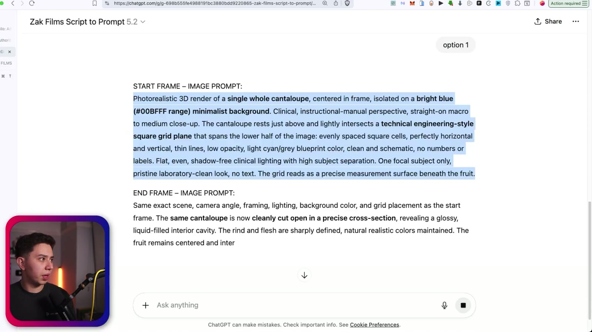
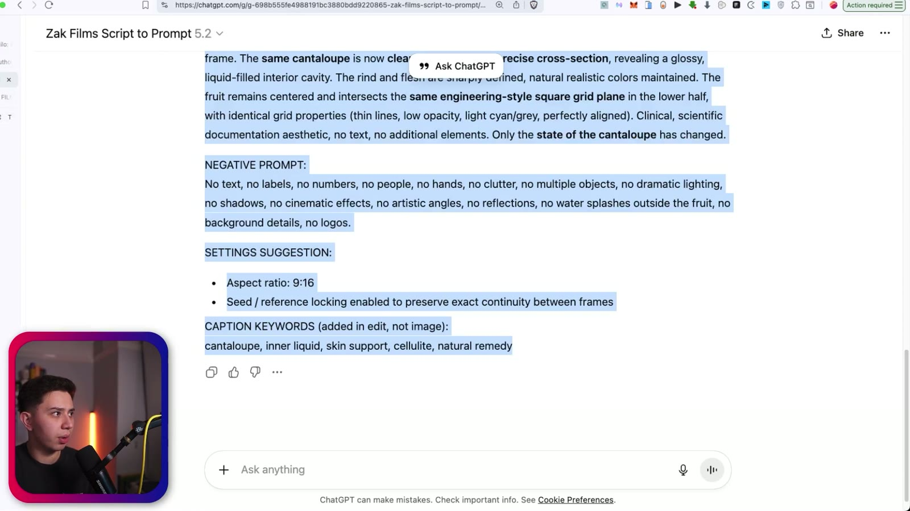
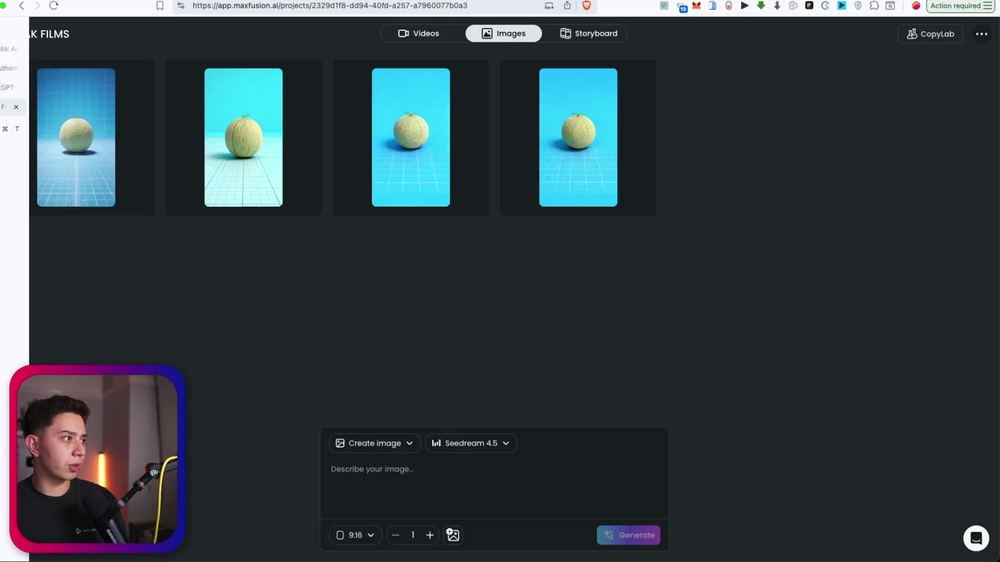

# 65. Script-To-Prompt Generator
> Paste lines from your ad script plus one line of context into the "Zak Films Script to Prompt" GPT; it proposes 2-3 image ideas, you pick one, and it returns an exact start-frame prompt, end-frame prompt, negative prompt, settings and caption keywords for your image model.

## 🤖 Agent use
- **Use when:** generating the stills for a Zack-style 3D cartoon ad ([63](063-what-we-are-making-zack-d-films-style.md), [64](064-workflow-breakdown.md)).
- **Inputs → outputs:** a few script lines + context ("this is a cantaloupe fruit that helps with cellulite") → options → chosen option → START FRAME prompt, END FRAME prompt, NEGATIVE PROMPT, SETTINGS SUGGESTION, CAPTION KEYWORDS → two images that differ only by the object's state.
- **Rules:**
  - **DO** give only the lines for the shot you want, plus product context; the GPT consults a large document of Zack-style scenes [00:00].
  - **DO** generate the start frame first, then the end frame, because the video model animates between them [00:52].
  - **DO** paste the negative prompt too [01:48].
  - **DO** fix issues by conversing with the same GPT (it holds the style document): "the grid doesn't fill the whole floor" → corrected prompt [01:48].
  - **DO** make the end frame by referencing the start frame image: three-dot menu → Generate variation (so the image is attached), then paste the end-frame prompt [01:48-02:45].
  - **DO** ask for the next shot in the same chat ("the next image after the cantaloupe open will be a woman drinking the juice, can you write a prompt for that image") so style carries over [02:45].
  - **DO** use Seedream for speed and low credits (Seedream 4.5 chosen) [00:52-01:48].
  - **DON'T** change the end frame except for the state change: "Only the state of the cantaloupe has changed" (prompt).
  - **IF** the grid/background drifts **THEN** restate it in conversation and regenerate; keep reference/seed locking on where the tool offers it (settings suggestion).
- **See also:** [66. Scenes + transitions](066-zack-d-films-generating-scenes-transitions.md) · [64. Workflow](064-workflow-breakdown.md) · [ChatGPT tool page](../../../../tools/chatgpt.md)

## Key ideas
### Run [00:00-00:52]
- Input example: "if you cut open this fruit and drink what's inside, your skin will never look the same again", context "cantaloupe fruit that helps you with cellulite" [00:00].
- Output: option 1 "The hidden reservoir" (single cantaloupe centred on bright blue with a technical square grid plane; end = clean cross-section, hollow full of liquid) [00:52]. He picks option 1.

### Generate and fix [00:52-02:45]
- Max Fusion → Images → Create image → Seedream (4.5 after a re-run) → paste start prompt and negative prompt [00:52-01:48].
- The grid looked wrong; ask the GPT to correct; it returns a stricter grid spec (see revised prompt) [01:48-02:32].
- Reference the first image via Generate variation and paste the end-frame prompt: cantaloupe now cut open [02:45].

### Continue the sequence [02:45-03:24]
- Do the whole script this way; ask the GPT for the next shot (woman drinking the juice) and it keeps the style [02:45].

## Steps / framework
| # | Step | Detail | Source |
|---|---|---|---|
| 1 | Open GPT | Link on the lesson page | page |
| 2 | Paste script lines + context | | [00:00] |
| 3 | Pick an option | e.g. "The hidden reservoir" | [00:52] |
| 4 | Generate START frame | Image tool, 9:16, include negative prompt | [00:52-01:48] |
| 5 | Fix via the GPT | Describe the problem, regenerate | [01:48] |
| 6 | Generate END frame | Variation of the start image + end prompt | [01:48-02:45] |
| 7 | Next shot | Ask GPT for the following image prompt | [02:45] |

## Examples
| Attempt | Prompt change | Result | Source |
|---|---|---|---|
| 1 | GPT start-frame prompt (grid partly filling floor) | "this grid is a bit weird" | [01:48] |
| 2 | "Grid doesn't fill the whole floor" → full-width, wall-to-wall grid | Used (Seedream 4.5) | [01:48-02:32] |
| End frame | Reference start image + end prompt | Cantaloupe open, same background | [02:45] |

## Prompts / templates (verbatim)
Output of the GPT for "option 1" (frames [01:44], [02:02], [02:32]).

First start-frame prompt:
```text
Photorealistic 3D render of a single whole cantaloupe, centered in frame, isolated on a bright blue (#00BFFF range) minimalist background. Clinical, instructional-manual perspective, straight-on macro to medium close-up. The cantaloupe rests just above and lightly intersects a technical engineering-style square grid plane that spans the lower half of the image: evenly spaced square cells, perfectly horizontal and vertical, thin lines, low opacity, light cyan/grey blueprint color, clean and schematic, no numbers or labels. Flat, even, shadow-free clinical lighting with high subject separation. One focal subject only, pristine laboratory-clean look, no text. The grid reads as a precise measurement surface beneath the fruit.
```
Revised start-frame prompt (after the grid fix):
```text
Photorealistic 3D render of a single whole cantaloupe, perfectly centered, isolated in a bright blue (#00BFFF-#87CEEB) clinical void background. Straight-on, instructional-manual perspective, medium close-up.
The cantaloupe rests directly on a full-width technical engineering grid floor that extends edge-to-edge horizontally and deep into the frame, filling the entire lower half of the image.
Grid specifications:
- blueprint-style square grid, evenly spaced cells
- perfectly horizontal and vertical, no perspective distortion
- thin, precise lines
- low opacity
- light cyan / light grey color
- spans wall-to-wall with no visible edges or borders
- reads as a continuous measurement plane, not a cutting mat
Flat, even, shadow-free clinical lighting. High separation between subject and background. One object only. No text. Laboratory-clean realism. The cantaloupe clearly intersects the grid plane, visually grounded on it.
```
End-frame prompt (first version, assembled from two frames):
```text
Same exact scene, camera angle, framing, lighting, background color, and grid placement as the start frame. The same cantaloupe is now cleanly cut open in a precise cross-section, revealing a glossy, liquid-filled interior cavity. The rind and flesh are sharply defined, natural realistic colors maintained. The fruit remains centered and intersects the same engineering-style square grid plane in the lower half, with identical grid properties (thin lines, low opacity, light cyan/grey, perfectly aligned). Clinical, scientific documentation aesthetic, no text, no additional elements. Only the state of the cantaloupe has changed.
```
Negative prompt and settings:
```text
NEGATIVE PROMPT:
No text, no labels, no numbers, no people, no hands, no clutter, no multiple objects, no dramatic lighting, no shadows, no cinematic effects, no artistic angles, no reflections, no water splashes outside the fruit, no background details, no logos.

SETTINGS SUGGESTION:
- Aspect ratio: 9:16
- Seed / reference locking enabled to preserve exact continuity between frames

CAPTION KEYWORDS (added in edit, not image):
cantaloupe, inner liquid, skin support, cellulite, natural remedy
```
The GPT's own instructions are not in the course files (link only).

## Screenshots

*GPT output after choosing option 1: START FRAME and END FRAME prompts. [01:44]*


*The remainder of the output: negative prompt, 9:16, seed/reference locking, caption keywords. [02:02]*


*Variants after the fix; consistent blue background and grid, cantaloupe grounded on the plane. [02:35]*

## How to apply
- [ ] Take one script beat at a time; add one line of product context.
- [ ] Choose the option whose visual you can explain in one sentence; generate start frame then end frame (variation of start).
- [ ] Keep the negative prompt; correct drift through the GPT conversation.
- [ ] Add caption keywords as on-screen text in the edit (not in the image).
- [ ] Do not keep the "cellulite / natural remedy" wording unless your claim is substantiated.

## Related
- Previous: [64. Workflow Breakdown](064-workflow-breakdown.md) · Next: [66. Generating Scenes & Transitions](066-zack-d-films-generating-scenes-transitions.md)

## Sources and limitations
- [Transcript](<../../../../../raw/ad-creators-lab/ai-ads-ugc-animations/_transcripts/Ad Creators Lab - Create Viral AI Ads, UGC & Animations That Convert Into Sales(September 2026)/4. AI Animated Ads/6. Zack D Films Ad Style/3.Script-To-Prompt Generator.txt>) (ends 03:24 = full length). Whisper: "Zax film", "Zach Film", "C dream" = Seedream, "Cdream 4.5" as Seedream 4.5.
- [Lesson page](<../../../../../raw/ad-creators-lab/ai-ads-ugc-animations/_extracted/Ad Creators Lab - Create Viral AI Ads, UGC & Animations That Convert Into Sales(September 2026)/4. AI Animated Ads/6. Zack D Films Ad Style/3.Script-To-Prompt Generator.htm.md>): one link to the GPT (ChatGPT public link). The GPT's instructions and its scene document are not in the files.
- The sample claims (cantaloupe juice affects skin/cellulite) are the instructor's demo, unverified.
