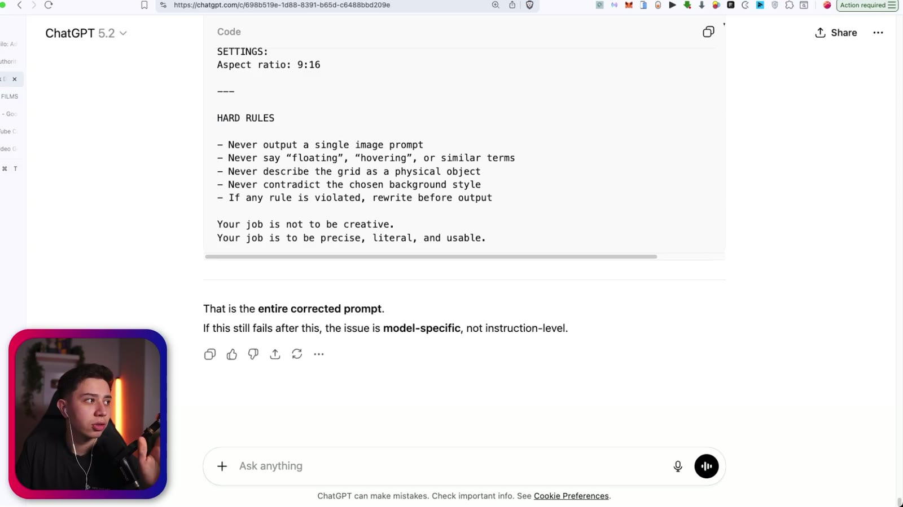
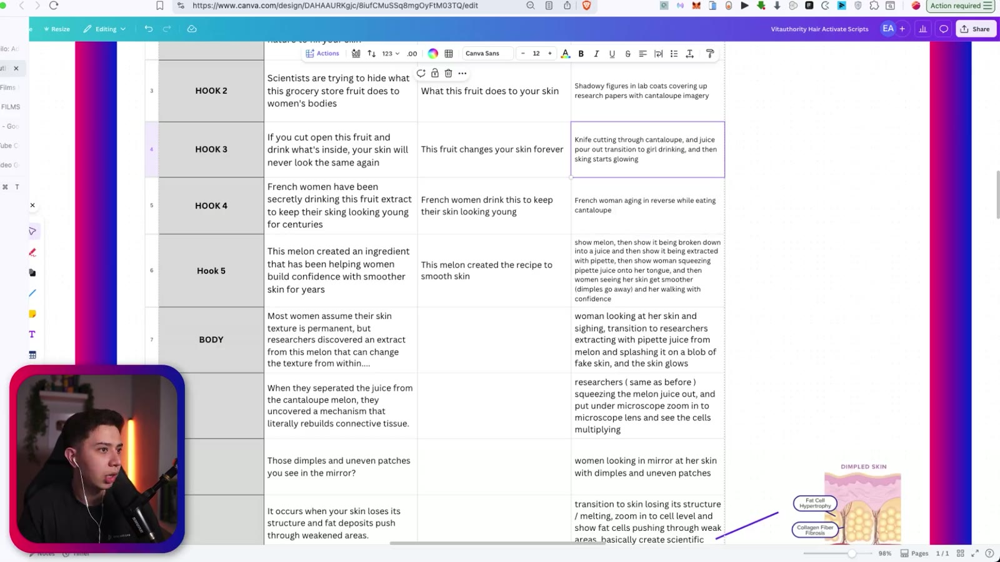
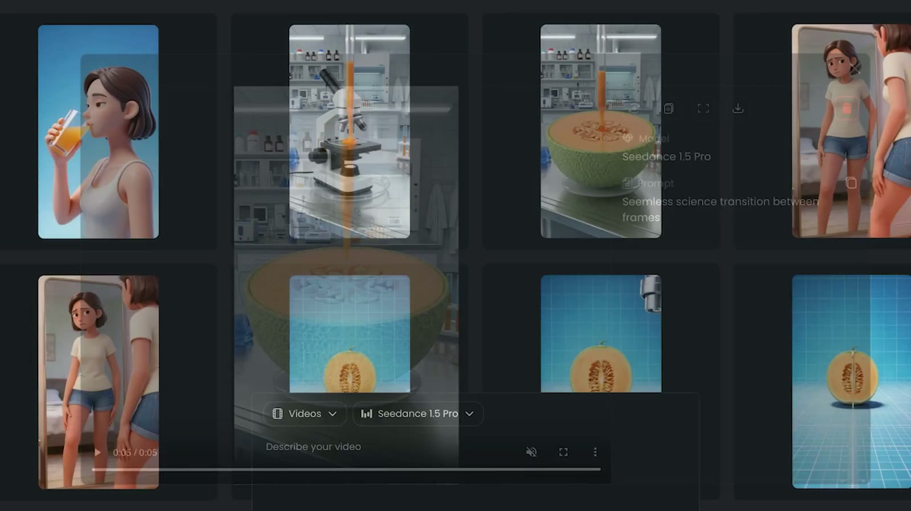

# 66. Generating Scenes & Transitions (Zack D Films Style)
> Chain scenes by describing only the next state: generate the next still from the previous one, then run a Seedance start/end-frame video with a "smooth sciencey transition" prompt, and stitch the clips.

## 🤖 Agent use
- **Use when:** animating the stills from [65](065-script-to-prompt-generator.md) into transitions between scenes.
- **Inputs → outputs:** scene images in order (each a variation of the previous) → one transition clip per pair → clips for the final edit.
- **Rules:**
  - **DO** ask the GPT for the next image prompt, then make it from the previous image: drag it in, or three-dots → Generate variation, and "just describe what the next stage is going to be" (e.g. "make the woman look like she's drinking the juice, the juice touching her lips and the level empty") [00:00].
  - **DO** keep the same character: "using the same woman, show a shot of her thigh skin, the shot is a close-up" [00:55].
  - **DO** run Seedance 1.5 Pro with one scene image as the start frame and the other as the end frame (he adds the drinking image as the second), prompt "smooth sciencey transition where the juice from the fruit goes down to fill her glass" [00:55; frame 01:59].
  - **DO** chain: every clip's end frame is the next clip's start [01:58].
  - **DON'T** over-prompt: transitions are described in one sentence (the model handles motion).
  - **IF** a body shot should look real **THEN** ask for visible texture: the close-up skin showed "the texture" the story needs [00:55].
- **See also:** [65. Script-to-prompt generator](065-script-to-prompt-generator.md) · [56. Claymation transitions](056-claymation-generating-videos-transitions.md) · [64. Workflow](064-workflow-breakdown.md)

## Key ideas
- Sequence in the demo: cantaloupe whole → cantaloupe open (from lesson 65) → woman starts to drink → empty glass → close-up of thigh skin texture [00:00-00:55].
- Video: Seedance 1.5 Pro start/end frames; the clip "goes from section to section"; later you "piece together smooth transitions from scene to scene" in the final video [00:55-01:58].
- Frames also show the Canva script table: Hook 2 "Scientists are trying to hide what this grocery store fruit does to women's bodies", Hook 3 "If you cut open this fruit and drink what's inside, your skin will never look the same again", Hook 4 "French women have been secretly drinking this fruit extract to keep their skin looking young for centuries", Hook 5 "This melon created an ingredient that has been helping women build confidence with smoother skin for years" [01:12 frame].
- The GPT's output ends with HARD RULES (frame [00:22]): the fix rule text is visible when he asks it to correct the prompt.

## Steps / framework
| # | Step | Detail | Source |
|---|---|---|---|
| 1 | Make scene N+1 image | Ask GPT for prompt; make as variation of scene N | [00:00] |
| 2 | Describe the state change | "make the woman look like she's drinking the juice…" | [00:00] |
| 3 | Make the next scene | e.g. camera down to her thighs, same woman | [00:55] |
| 4 | Video | Seedance 1.5 Pro; start = scene N, end = N+1; "smooth sciencey transition…" | [00:55] |
| 5 | Review and chain | Repeat; assemble | [01:58] |

## Examples
| Pair | Prompt idea | Result | Source |
|---|---|---|---|
| Drinking → glass empty | "juice touching her lips and the level empty" | accepted | [00:00] |
| Glass → thigh close-up | "using the same woman, show a shot of her thigh skin, close-up" | skin texture visible | [00:55] |
| Skin close-up ↔ drinking image | "smooth sciencey transition where the juice from the fruit goes down to fill her glass" | "Here is a result, perfect" | [00:55] |

### Teardown: cantaloupe-for-skin hooks (frame [01:12])
| Brand / product (niche) | Format | Hook / opening | What works | What fails | Fix suggested | Principle | Source |
|---|---|---|---|---|---|---|---|
| Unnamed cantaloupe extract (women's skin / cellulite) | 3D cartoon with real-science visuals | "If you cut open this fruit and drink what's inside, your skin will never look the same again" | Concrete action visual (cut open, pour, skin glow) | "never look the same again", "connective tissue rebuilt", "French women secretly…" are unsupported claims and a "secret" trope | Source or cut; show the actual product and a verifiable ingredient claim | Visual hook; curiosity (derived) | [01:12 frame] |

## Structured units
### Hooks (read from the on-screen table)
| Hook (verbatim or near) | Heuristic(s) | Emotion / zone | Self targeted | Why it works | Source |
|---|---|---|---|---|---|
| "Scientists are trying to hide what this grocery store fruit does to women's bodies" | conspiracy / hidden-knowledge (derived) | curiosity | women | Everyday item + forbidden-knowledge framing | [01:12 frame] |
| "If you cut open this fruit and drink what's inside, your skin will never look the same again" | action + result promise (derived) | desire | women | Easy to visualise; short | [01:12 frame] |
| "French women have been secretly drinking this fruit extract to keep their skin looking young for centuries" | cultural-secret trope (derived) | aspiration | women | Borrowed authority; unverifiable | [01:12 frame] |
| "This melon created an ingredient that has been helping women build confidence with smoother skin for years" | benefit + identity (derived) | hope | women | Softer, confidence angle | [01:12 frame] |

### Rules
- **DO** use one-sentence transition prompts and let the video model handle motion.
- **DON'T** copy these hooks without evidence; they are demo hooks with unverified claims.

## Prompts / templates (verbatim)
```text
[image edit] make the woman look like she's drinking the juice, so the juice touching her lips and the level empty
[image edit] using the same woman show a shot of her thigh skin. The shot is a close-up.   (typed at [00:55])
[video, Seedance 1.5 Pro] smooth sciencey transition where the juice from the fruit goes down to fill her glass
```
GPT hard rules visible at [00:22] (excerpt of the "entire corrected prompt"):
```text
SETTINGS:
Aspect ratio: 9:16

---

HARD RULES

- Never output a single image prompt
- Never say "floating", "hovering", or similar terms
- Never describe the grid as a physical object
- Never contradict the chosen background style
- If any rule is violated, rewrite before output

Your job is not to be creative.
Your job is to be precise, literal, and usable.
```

## Screenshots

*The generator's HARD RULES block after the grid correction. [00:22]*


*Hooks 2-5 and the start of the body, with a visual per line. Product/brand not named in the visible rows. [01:12]*


*Seedance 1.5 Pro start/end-frame panel with candidate images behind it; the history panel shows a "Seedance science transition" entry. [01:59]*

## How to apply
- [ ] Number your stills; for each pair write one transition sentence.
- [ ] Generate on Seedance 1.5 Pro; keep clips short; chain the end frame to the next start.
- [ ] Keep face/body consistent via variations of the same image.
- [ ] Review claims in the script table before generating visuals.

## Related
- Previous: [65. Script-To-Prompt Generator](065-script-to-prompt-generator.md) · Next: [67. Zack D Films Voice Clone & Song](067-zack-d-films-voice-clone-song.md)

## Sources and limitations
- [Transcript](<../../../../../raw/ad-creators-lab/ai-ads-ugc-animations/_transcripts/Ad Creators Lab - Create Viral AI Ads, UGC & Animations That Convert Into Sales(September 2026)/4. AI Animated Ads/6. Zack D Films Ad Style/4. Generating Scenes Transitions.txt>) (ends 02:03 = full length). [Lesson page](<../../../../../raw/ad-creators-lab/ai-ads-ugc-animations/_extracted/Ad Creators Lab - Create Viral AI Ads, UGC & Animations That Convert Into Sales(September 2026)/4. AI Animated Ads/6. Zack D Films Ad Style/4. Generating Scenes & Transitions.htm.md>): only the Max Fusion affiliate credit.
- Hook table is read from a screen frame; rows beyond those visible are not recorded.
- Product claims (collagen/skin) are unverified.
