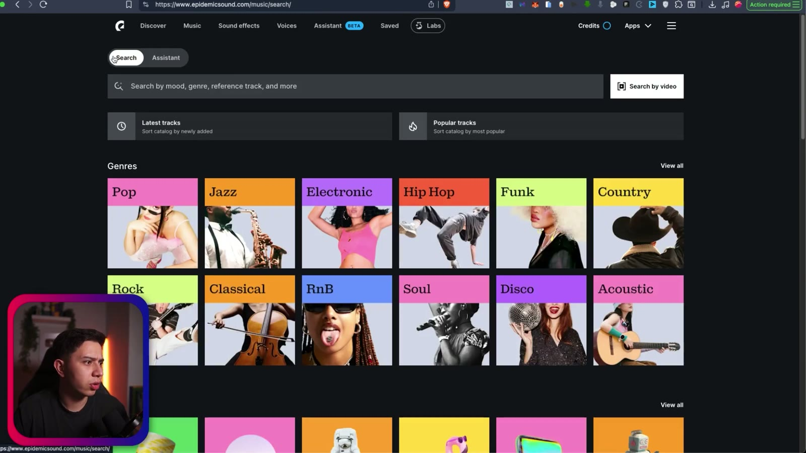

# 67. Zack D Films Voice Clone & Song
> COMPLIANCE FLAG: the lesson shows cloning the voice of a real YouTube creator (Zack D Films) from audio ripped off YouTube to narrate ads in his style. Do not do this. Match the style with a designed voice instead.

## 🤖 Agent use
- **Use when:** you need the narration voice and background track for a Zack-style ad, and you need to know what NOT to copy from this lesson.
- **Inputs → outputs:** script → a designed (not cloned) ElevenLabs voice + a licensed "sneak"-genre music bed → narration audio under music.
- **Rules:**
  - **DON'T** clone Zack D Films' voice, or any real person's voice, without that person's written consent. A cloned voice of an identifiable creator in a paid ad implies endorsement and creates right-of-publicity, platform-policy and ElevenLabs terms-of-use risk (derived compliance rule).
  - **DON'T** rip audio from YouTube with converter sites; it breaches YouTube's terms and uses someone else's recording without permission (derived).
  - **DON'T** present the ad as made by, or endorsed by, the real creator (name, logo, channel look-alike).
  - **DO** mimic the style legitimately: calm, fast, slightly conspiratorial male explainer; get it with ElevenLabs Voice Design ([57](057-claymation-generating-voice-over.md)) using a text description of age, tone and pacing, or hire a voice actor / UGC creator with a signed release (derived).
  - **DO** use the Eleven v3 model if you want more tonality: "I like to use the v3 model just because I get a bit more of that tonality" [00:00-00:57].
  - **DO** license the music: Epidemic Sound → music → genre "sneak" (a track "that they usually use") [00:57]. Use your own licence; the file he mentions is in the description (not in the course files).
  - **IF** background noise appears in generated speech **THEN** "once you put the actual song in the background, it's all good" [00:57].
- **See also:** [57. Voice-over (designed voice)](057-claymation-generating-voice-over.md) · [ElevenLabs tool page](../../../../tools/elevenlabs.md) · [AI UGC tools](../../../../tools/ai-ugc-tools.md) · [63. Style overview](063-what-we-are-making-zack-d-films-style.md)

## Key ideas
- What the lesson shows [00:00-00:57]: takes audio from a YouTube video of the creator via a YouTube-to-MP3 site, converts to MP3, uploads it to ElevenLabs "instant voice clone" (leaving "remove background noise" unchecked), and generates narration; "you might need two videos to get it right" [00:00]. Sample line generated: "If you're sleeping eight hours, but still can't drag yourself out of bed, your body…" [00:57].
- Music [00:57-01:31]: Epidemic Sound, search genre "sneak", pick the track the style "usually" uses.
- The `.crdownload` file in the originals is an unfinished download that is actually an MP3 (3.9 MB), the music or voice sample; it was not transcribed.

## Steps / framework
Compliant version (derived from the lesson's structure):

| # | Step | Compliant approach |
|---|---|---|
| 1 | Pick a voice character | Describe it in Voice Design (see [57](057-claymation-generating-voice-over.md)) |
| 2 | Generate narration | Eleven v3 for tonality; enhance if robotic |
| 3 | Music bed | Licensed track, "sneak"/tension style, mixed under voice |
| 4 | Mix | Voice over music; check background noise |

## Examples
| What was done | Result | Source |
|---|---|---|
| Cloned voice reads a sleep/energy script | Slight background sounds, "it's fine" under music | [00:57] |
| Epidemic Sound "sneak" track | Used as the bed | [00:57-01:31] |

## Prompts / templates (verbatim)
None. (The cloned-voice text sample is quoted above.)

## Screenshots

*Epidemic Sound music search: genres (Pop, Jazz, Electronic, Hip Hop, Funk, Country, Rock, Classical, R&B, Soul, Disco, Acoustic) before he types "sneak". [01:16]*

## How to apply
- [ ] Do not clone or imitate a named creator's voice. Write a voice description and generate with Voice Design.
- [ ] Buy or confirm a music licence that covers paid ads; keep the receipt/licence.
- [ ] Mix narration over music; keep captions burned in.

## Related
- Previous: [66. Generating Scenes & Transitions](066-zack-d-films-generating-scenes-transitions.md) · Next: [68. Hall of Fame - Zack D Films Ads](068-hall-of-fame-zack-d-films-ads.md)

## Sources and limitations
- [Transcript](<../../../../../raw/ad-creators-lab/ai-ads-ugc-animations/_transcripts/Ad Creators Lab - Create Viral AI Ads, UGC & Animations That Convert Into Sales(September 2026)/4. AI Animated Ads/6. Zack D Films Ad Style/5.Zack D Films Voice Clone Song.txt>) (ends 01:32 = full length). "11 labs" = ElevenLabs. [Lesson page](<../../../../../raw/ad-creators-lab/ai-ads-ugc-animations/_extracted/Ad Creators Lab - Create Viral AI Ads, UGC & Animations That Convert Into Sales(September 2026)/4. AI Animated Ads/6. Zack D Films Ad Style/5.Zack D Films Voice Clone & Song.htm.md>): no text.
- Audio attachments (a `.crdownload` that is actually an MP3, ~3.9 MB, in the originals folder) were not transcribed or analysed.
- Major flag: this lesson teaches voice cloning of a real, named creator. It is recorded here for completeness; our brands must not use cloned real voices or third-party likeness. See also the course's other voice flags in the knowledge base.
