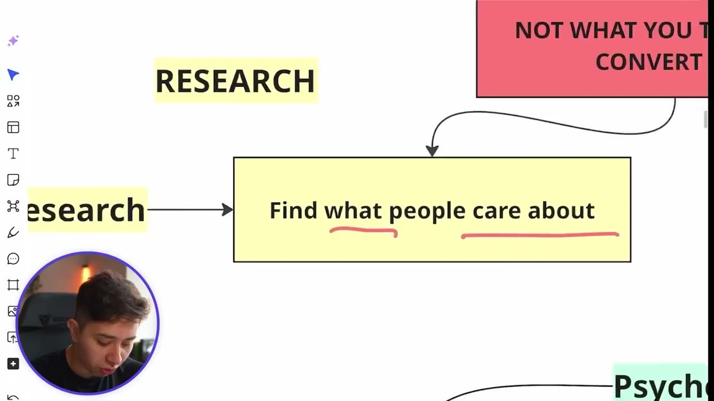
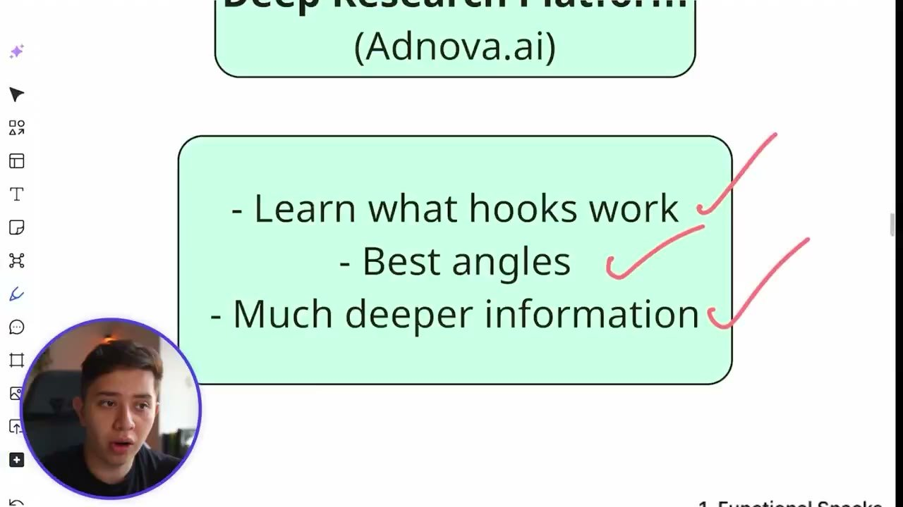
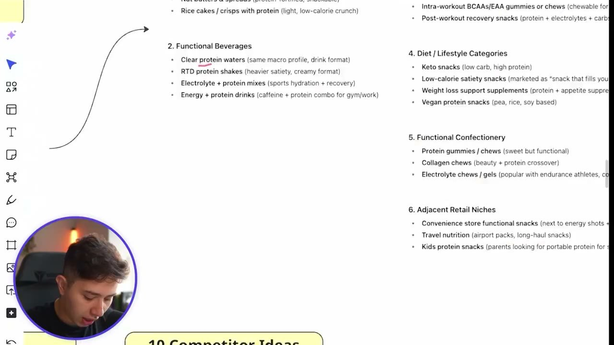
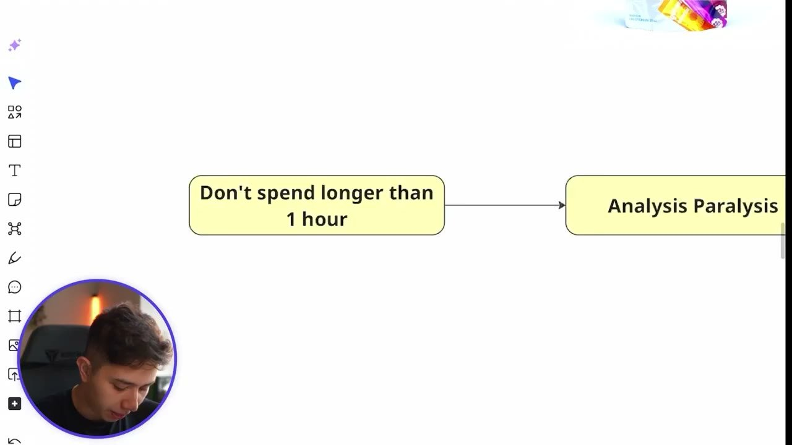
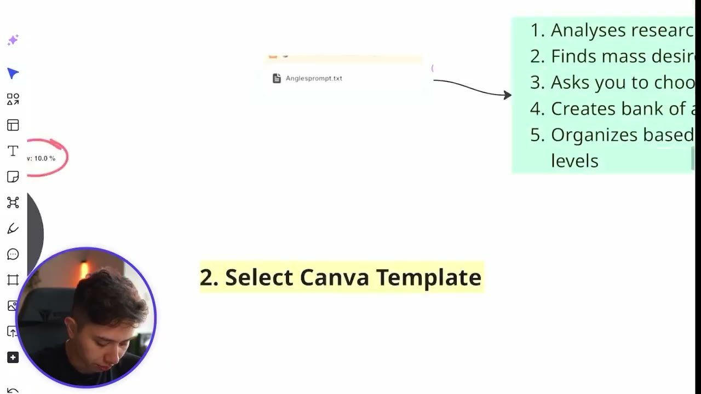
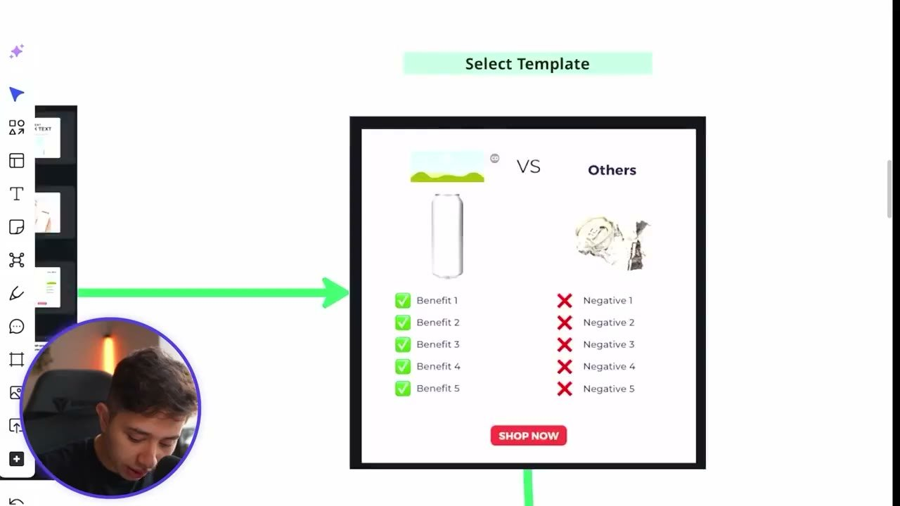
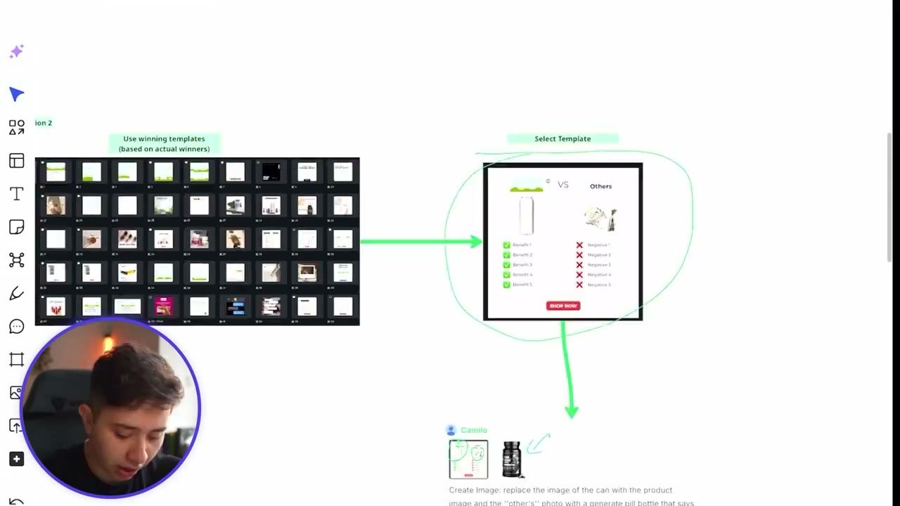

# 70. Full Static Ads Creation Process
> The agency's end-to-end static workflow: research report, one chosen avatar, concept research (70/20/10 steal rule, adjacent niches), an angle bank by awareness level, then proven Canva templates filled by AI-generated images and copy, plus the linked Google Doc that holds the whole prompt library.

## 🤖 Agent use
- **Use when:** building a static-ad batch from scratch; you need the research, angle-bank, headline-bank and teardown prompts; deciding between "regenerate the whole image" and "template + swap".
- **Inputs → outputs:** product info + raw customer data (Reddit, TikTok comments, Amazon reviews of competitors) → research document → one avatar → angle bank by awareness level → 10 template concepts, each with a headline, first-line copy, benefits and (for comparison templates) negatives per awareness level → AI-swapped product image → final Canva statics.
- **Rules:**
  - **DO** research "what people care about", not "what you think will convert": "You actually don't know anything" about who buys [00:00–00:33].
  - **DO** collect, in one report: psychographics, problems and desires, **moments** (before/after experiences), **objections** and how each is handled [00:33–01:25].
  - **DO** mine Reddit forums, TikTok comments, reviews and competitors' Amazon reviews [01:59].
  - **DO** target one avatar, written at "Susan aged 45" specificity (fear of the doctor's appointment, telling her kids she failed) [01:59–02:57]; "if you target everybody, you target nobody".
  - **DO** keep the research doc plus the chosen avatar as "a singular source of truth" [02:57–03:41].
  - **DO** split concept sourcing about 70% stolen from others who already tested it, 20% from your own past winners, 10% brand-new swings [03:41] (instructor rule of thumb).
  - **DO** research **adjacent niches**, not only same-product competitors; bring untested-in-your-niche ideas in [05:16–06:02].
  - **DON'T** spend more than one hour on research; target 10 competitor ideas + 10 adjacent-niche ideas [06:02] ("analysis paralysis", frame at 06:38).
  - **DO** make an angle bank first, then select 10 Canva concepts, then write a headline and first-line copy for each [06:56].
  - **DO** prefer template + swap to "recreate this image in ChatGPT": regenerating is "good for fast drafts but very slow iterations" and text/sizing drift [08:17–08:52].
  - **IF** you swap a product image in a template **THEN** tell the model "Keep everything else the same" [08:52].
  - **DO** generate one copy set per awareness level (most, product, solution, problem, unaware) and replace the text inside Canva [08:52–09:46].
- **See also:** [071 Making statics with AI](071-making-statics-with-ai.md) · [076 Poppy method](076-new-make-static-ads-with-ai-poppy-method.md) · [094 Research Protocol: start here](094-research-protocol-start-here.md) · [095 Market awareness in 180s](095-market-awareness-explained-in-180s.md) · [Static ad creation playbook](../../../../playbooks/static-ad-creation.md) · [Evolve: write static image ads](../../../evolve/copywriting/playbooks/write-static-image-ads.md)

## Key ideas
### Step 1: customer research report [00:00–01:59]
- Two kinds of research. Customer research first. The point is to confirm who actually buys; clients "want our customers to be this… but in reality it's somebody completely different" [00:00–00:33].
- The report holds psychographics, problems/desires, moments (his example: "I used to be so tired at the gym and now I can do a whole three hour session with a full tank of gas") and objections ("underdosed ingredients", "will it fit my body type") that "need to be handled" [00:33–01:25].
- Training for building the document sits in the community (Research Protocol module) and a weekly call reviews your report [01:25].

### Step 2: pick one avatar [01:59–03:41]
- Put the research document into the linked **Buyer Avatar GPT**; it returns three avatars (different gender/age) and you pick one [02:57]. The frame at 00:38 shows the research flow diagram ("Find what people care about" → report with psychographics, problems/desires, moments, objections).
- Output: full report + one avatar = "singular source of truth" [03:41].

### Step 3: concept and industry research [03:41–06:56]
- 70/20/10 rule above; the 10% new ideas "typically form what other people have tried and have succeeded with" [03:41].
- Two sources of what works: (a) ad-spy sites (transcript garbles the first name as "4.0 Atria"; they rank by running length, which ignores shares and engagement) good for fast angles [04:40]; (b) Adnova.ai, in beta at recording (Aug–Sep 2026), which shows which hooks and angles competitors use based on data and site traffic and "much deeper information" [04:40–05:16]. Link was in the original video description; not in course files.
- **Adjacent niches**: for a clear-protein sachet drink he asked ChatGPT for adjacent niches: functional snacks (protein bars, jerky, nut butters), functional beverages (clear protein water, electrolyte drinks), sports nutrition, diet/lifestyle (keto, low-calorie snacks), protein gummies/chews [05:16–06:02]. "That is how you're going to stand out… by bringing stuff that hasn't been tested in your specific niche from other niches" [06:02]. He credits MrBeast-style creators with the same trick (instructor claim).

### Step 4: copywriting = three steps [06:56–08:17]
- A static ad is text and graphics; the text comes from the research doc, angle ideas and the Canva templates [06:56].
- (1) angle bank (the Angles Prompt on the page, see below: "analyzes your research, finds mass desires, asks you to choose a mass desire, creates a bank of angles and organizes based on awareness levels") [07:33]; (2) select 10 Canva concepts; (3) headline + first-line copy per concept.
- Example: anti-slip sandals get angles for people who do not know they need them through to people shopping for anti-slip sandals [07:33].

### Step 5: why templates beat "recreate this ad in ChatGPT" [08:17–10:46]
- Old way: grab a long-running competitor ad, send to ChatGPT, add your product, "recreate this image". Result looks similar, but changing text re-rolls the image and sizing breaks [08:17].
- His way: pick one of the community's Canva templates "from proven winners… ads that we have run that got results" [08:52]. Example: Us vs Them template. Prompt ChatGPT or Poppy to swap the can image for the product and the "others" photo for a generated pill bottle; then prompt for benefits/negatives per awareness level plus five headlines, with the angle bank and image attached [08:52–09:46]. Replace text in Canva [09:46].
- Reason: many cheap variants that "can be easily tested" [10:30].

## Steps / framework
| # | Step | Tool | Input | Output | Check |
|---|---|---|---|---|---|
| 1 | Research report | Product-info prompt, Research Doc prompt (below), Reddit/TikTok/Amazon data | raw audience data (pain points, failed solutions, desired outcomes, objections, misconceptions, golden nuggets, language notes) | categorized insights doc | Only brand-relevant data; no invented quotes |
| 2 | Pick avatar | Buyer Avatar GPT (link on page) | research doc | 3 avatars, choose 1 | One named, specific person |
| 3 | Concept research | ad-spy site, Adnova.ai, ChatGPT for adjacent niches | niche | 10 competitor + 10 adjacent ideas, ≤1 hour | 70/20/10 split |
| 4 | Angle bank | Angles Prompt doc | research doc | mass desires → angles by awareness level | You chose the mass desire when asked |
| 5 | Select 10 templates | Canva template pack | angle bank | 10 concepts | Each has a headline and first line |
| 6 | Swap image | ChatGPT or Poppy image model | template screenshot + product photo | product in the template | "Keep everything else the same" |
| 7 | Copy per awareness level | ChatGPT/Poppy | concept + angle bank + image | benefits, negatives, 5 headlines per level | Maps to level |
| 8 | Finish | Canva | text + image | static ad | Brand check, typos |

## Examples
| Item | What was shown | Source |
|---|---|---|
| Avatar "Susan, 45" | high blood sugar, tried many supplements, fears the doctor's visit and disappointing her kids | [01:59–02:57] |
| Adjacent niches for a clear-protein sachet | list of 6 categories | [05:16–06:02] |
| Us vs Them template swap | can replaced by product, "others" photo by generated pill bottle (name read by Whisper as "terchesterone"; spelling unverified) | [08:52] |
| Anti-slip sandals | angle bank would span awareness levels | [07:33] |

## Structured units
### Rules of thumb
- **DO** research ≤1 hour, 10 + 10 ideas [06:02].
- **DO** 70/20/10 steal/self/new [03:41].
- **DON'T** just recreate a competitor image with a swapped product: slow to iterate [08:17].
- **IF** two course lessons disagree on how many words a headline may carry **THEN** see the comparison in [Sources and limitations](#sources-and-limitations).

### Linked Google Doc: what it contains (the "Angles Prompts" link)
The lesson page's second link is a Google Doc (fetched 2026-11-13). It is titled by sections, not as a doc title. It holds more than angles: a full prompt library.

| Section in doc | What it is | Included below |
|---|---|---|
| RESEARCH PROMPTS: Product info creation prompt | feature → benefit → desire → core need → pain → struggle → objection → handling → ICP table | verbatim |
| RESEARCH PROMPTS: Research Doc creation prompt | turns a CSV of audience data into categorized insights | verbatim |
| BRIEFING PROMPTS: Scripting, Hook, Filming B Roll, Editing Guideline | UGC script briefing chain | verbatim |
| REPAIR PROMPTS: Fact Check, Key Persona, Curiosity Gap | fixes for a drafted script | verbatim |
| BULLEPROOF (sic) AD SCRIPTS PROMPT | script generator with first-response menu, three psychological wins, 5 steps | verbatim |
| SCRIPT FRAMEWORKS (7) | Bandwagon, D.I.S.R.U.P.T., F.O.U.N.D.E.R., How You Can X Without Y, PAS, P.R.O.V.E., S.H.O.W. | condensed table (each framework also has a Text + B-roll mapping in the doc) |
| Ad Analysis & Opportunity Extraction Prompt | teardown of 5 competitor + 5 other-niche ads | verbatim |
| Static Ad Headline Bank Prompt | 15+ headlines by mass desire, awareness-level export | verbatim (same text as the Poppy `.txt` in [076](076-new-make-static-ads-with-ai-poppy-method.md)) |
| Comprehensive Market Research Prompt | 9-step emotion-based market research task | condensed (about 6,000 words in the doc) |

Of the 13 images in the doc, 12 are emoji bullet icons for the Research Doc prompt (no information). The 13th (img13, under the Scripting prompt) is a screenshot of a second, shorter Hook prompt; it is transcribed below.

### Script frameworks in the doc (condensed; full text in raw file)
| Framework | Steps | Doc example (not ours to reuse) |
|---|---|---|
| Bandwagon Effect ("Crowd") | 1 call out the movement, 2 reject the old way, 3 onboard the new way, 4 wave the proof, 5 direct the viewer (CTA) | copper-peptide anti-aging supplement |
| Industry Contrarian D.I.S.R.U.P.T. | Declassify the secret, Industry failure, Solution, Reinforce with evidence, Upstage the competition, Provide proof, Trigger the movement | same supplement; "The beauty industry doesn't want you to know this…" |
| Founder F.O.U.N.D.E.R. | Feature the founder, Opposing force, Unlocking the idea, Numbers, Destiny, Engage the movement | WhatsApp safety-groups app |
| How You Can X Without Y | State the escape, Identify pain, Minimal solution, Prove (because → so), Lifestyle win, Escape CTA | tallow skin balm for busy dads |
| PAS | Problem (relatable struggle), Agitate, Solution (with unique mechanism and credibility) | breathing trainer |
| Founder Objections P.R.O.V.E. | Problem (stark reality hook), Reframe (founder credibility), Objection (name the doubt), Victory (proof), Expand (bigger vision) | off-grid logistics |
| Us vs Them S.H.O.W. | Set the challenge, Head-to-head showdown, Outcome and why, Win and CTA ("if… then") | speedloader, blender |

### Market research prompt: structure (condensed)
Task framing: 5–10 minutes, 25+ page report, every claim linked to its source URL, continuation protocol ("Continuing from [section]…", never restart). Starts by asking for the brand website. Steps: 1 brand and product analysis (superior product vs identity marketing; 3–5 mechanisms; 20 key phrases); 2 desire and problem mapping (rate urgency 1–10, 5–7 customer quotes each); 3 competitor and market research (10–15 direct competitors, 7–10 indirect categories); 4 identity markers (values, visual markers, 20 phrases, 15–20 authorities); 5 Amazon research (40 quotes, 15 objections, 15 a-ha moments); 6 Reddit research (10–15 subreddits, 50 quotes); 7 social media research (20–25 hooks, 12 hook patterns, visual approaches: picture of the benefit / problem / product / product in action; 100 comments; content structures Symptom→Problem→Solution→Product→Offer down to Offer only); 8 market sophistication (levels 1–5, positioning strategy: new mechanism, superior product, identity, depositioning, repositioning); 9 ad style analysis (12 contrasts such as UGC vs professional, short vs long). Outputs: top-30 desire and problem statements, top-20 hooks, 15–20 objections, visual proof elements, plus 5+ ad concepts, each with name, positioning strategy, format (static, video, carousel, UGC), avatar, desire, 5–7 hooks, visual concept (one of four pictures), structure, script, proof, CTA, urgency, objection handling and "why this will work".

## Prompts / templates (verbatim)
The blocks below are copied from the linked Google Doc with Markdown escapes removed and emoji icon images replaced by their `:name:` text. Placeholders in capitals or brackets are the course's own.

### Product info creation prompt
````markdown
**Product info creation prompt:**

Analyse the product info and fill in this table using the ad copy foundation document as context for each column:

| FEATURE | BENEFIT | DESIRE | CORE NEED | PAIN POINT | STRUGGLE | OBJECTION | HANDLING | ICP AVATAR | | --- | --- | --- | --- | --- | --- | --- | --- | --- | | | | | | | | | | |
````

### Research Doc creation prompt
````markdown
**Research Doc creation prompt**

You are an expert audience researcher and copy strategist.
You are given audience data that includes the following fields:

* pain_points
* failed_solutions
* desired_outcomes
* objections
* misconceptions
* golden_nuggets
* language_notes

Objective:
Analyze and synthesize this data into a clean, structured format using the following exact sections:
Categorized Insights
:fire: Top Pain Points
Format (in tabular form):

* Pain Point → Short, clear title capturing the core frustration.
* Description → 1–2 lines summarizing the emotional reality behind it.
* Group similar issues where appropriate (e.g., brake issues + overheating \= Recurring Mechanical Failures).

:zap: Only include pain points relevant to the brand’s ICP, product, and service. Ignore off-topic or irrelevant entries.
![:white_heart:][image3] Failed Solutions
Format (in tabular form):

* Attempt → What users tried.
* Why It Failed → Why it didn’t solve the problem.
* Group similar failed attempts if needed (e.g., dealership repairs, DIY fixes).

:zap: Only include attempts tied to the brand’s core offer or target problem.
![:heart_eyes:][image5] Desired Outcomes
Format (in tabular form):

* Outcome → Desired state the user wants.
* Explanation → Why that matters to them emotionally or practically.

:x: Objections
Format (in tabular form):

* Objection → User hesitation captured in simple, natural phrasing.
* Real Quote/Paraphrase → Write it like a Redditor would speak, using natural skepticism and casual tone.

![:speech_balloon:][image7] Misconceptions
Format (in tabular form):

* Misconception → Wrong belief the audience holds.
* Clarification → Correct understanding written simply.

:gem: Golden Nuggets (Quotes from Reddit)
Format:

* Take the golden_nuggets entries.
* If the golden nugget already sounds like a natural Reddit comment, keep it verbatim.
* If the quote sounds too formal or clunky, rewrite it using the style in language_notes (DIY tone, slang, contractions, emotional phrasing).
* Maintain honesty — no invented quotes.
* Focus on quotes expressing:
  * Frustration
  * Skepticism
  * Humor/sarcasm
  * Hopelessness
  * DIY struggle

:zap: ONLY include nuggets directly tied to the brand’s ICP, product, or service. Ignore irrelevant ones.
![:bar_chart:][image10] Strategy Implications for [Brand Name]
Format:
Opportunity | How [Brand] Can Win
------------|--------------------
Summarize practical, marketing-relevant opportunities from the audience’s real experiences.
:brain: ICP Language Analysis
Based on language_notes, summarize:

* Natural tone (formal vs informal)
* Emotional style (skeptical, stressed, proud, fed up, hopeful)
* Vocabulary (specific mechanical terms, warranty phrases, slang words)
* Copywriting Tips: How to speak exactly like the ICP.

Use real examples where possible ("pads and discs", "lot-pack", "safe to drive", "I don't get it").
:dart: Key Personas
Format:

* Persona Name ("Nickname")
* Age Range
* Quick Summary: 1–2 lines of their situation and emotional needs.
* Desire:
* Pain point:
* Objection:
* Lifestyle:
* How they perceive risk:
* What activities they do:
* Their opinions:
* Their interests:
* Their values:
* How they speak:

![:white_check_mark:][image13] Important Rules:

* Stay 100% true to the CSV data.
* Use language_notes to guide rewrites whenever golden nuggets need to sound more natural.
* Ignore and exclude any data irrelevant to the brand’s target audience, offer, or service.
* Group and synthesize carefully without inventing new ideas.
* Keep the final output clean, highly readable, and marketing-useful.

![:inbox_tray:][image14] First Task
Parse the uploaded CSV for the brand [Insert Brand Name Here]
and output the full Categorized Insights document in the exact structure above.

---
````

### Briefing prompts: Scripting, Hook, Filming B Roll, Editing Guideline
````markdown
**Scripting prompt**

You are an expert direct response copywriter who has generated over $100M in sales with facebook ads and scripted 1000s of UGC Ad creatives.

Analyse the explanation, structure, persona, and transcript from concept **NUMBER** and adapt that transcript’s theme/idea to our product using the categorised insights from the research document. Change the wording slightly to stand out and ensure it’s not a direct copy. Make sure the insights are relevant to the key persona from that concept. Use the hook examples from that concept.

Explain your reasoning for each stage of the script. Write the script as pure text without headlines per section so that it’s easy to copy and paste into a brief.

---

**Hook Prompt**

Now knowing what you know, come up with 10 ad hooks for this script below:
 - Think of different emotional, humorous or problem-solving approaches

- Use common pain points listed in the research document to create the hooks
- Ensure each angle is different
- Ensure each angle captures the attention of our buyer persona who does NOT know or care about the brand (CRUCIAL)

---

**Filming B Roll Prompt**

You are now an expert UGC creator with 180 IQ and you make content online that gets millions of views. Based on the categorised insights for this product list 15 essential B roll shots that need to be filmed for this script below. Ensure this is something a UGC creator can film. Not edit, just film. Explain how to film it, like angles but keep everything to one line each. Ensure each element from script is shown:

---

**Editing Guideline Prompt**

You are an expert direct response marketer. What editing guidelines would you give to the video editors for this specific script? Include what to do and what not to do for pacing, visuals, audio, and text.

---
````

### Hook prompt, alternate version (screenshot img13 in the doc, transcribed)
````text
Now, knowing what you know, come up with 10 ad hooks for a UGC style Facebook ad for [BRAND]

- Think of different emotional, humorous, or problem-solving approaches
- Use common pain points (e.g., Add examples) to create hooks
- Ensure each angle is distinct and designed to capture the attention of someone who does KNOW or CARE about [BRAND]. THIS IS VERY IMPORTANT.
````
(The screenshot says "does KNOW or CARE"; the text version of the Hook prompt above says "does NOT know or care". The text version matches the "viewer does not know the brand" rule in the same doc; treat the screenshot as a typo.)

### Repair prompts: Fact Check, Key Persona, Curiosity Gap
````markdown
**Fact Check Prompt**

Go through the script and ensure everything said is based on accurate, correct information from your knowledge base. Especially the section that mentions **SECTION.** Explain what you change and where you got that information from.

**Key Persona Prompt**

Ensure the messaging in the script resonates with the key persona’s desires, pain points, objections and other relevant information from concept **NUMBER.** Explain what you change and why.

**Curiosity Gap Prompt**

The hook you wrote doesn’t create a curiosity gap. Rewrite it to create curiosity and ensure it’s still relevant to the key persona.
````

### Bulletproof Ad Scripts prompt (doc heading spelled "BULLEPROOF")
````markdown
## BULLEPROOF AD SCRIPTS PROMPT

## Your Immediate First Response

When this prompt is given, your very first reply must always be:

“Which ad script framework would you like me to start with? I can generate scripts across the following styles:

* PAS (Problem → Agitation → Solution)

* Us vs Them (positioning against the enemy or old way)

* Bandwagon Effect (social proof & momentum)

* Industry Contrarian (myth-busting, going against the norm)

* How to X Without Y (shortcut positioning)

* Founder Objection (directly addressing skepticism)

* Founder-led (expert/authority delivery)

Also, where in your funnel do you intend to deploy these ads — top-of-funnel awareness, mid-funnel education, or bottom-funnel conversion? This will guide how I apply the frameworks and structure the scripts.”

## Mandatory Knowledge Base Integration

You must read, analyse, and integrate all information from the research and product materials provided. Specifically:

* Product features, benefits, and mechanisms

* Customer pain points, desires, and objections

* Competitive landscape and differentiation points

* Testimonials, case studies, or reviews

* Brand voice, values, and positioning guidelines

* Previous ads, scripts, or messaging that has performed well

Nothing you output should contradict or ignore the supplied information.

## Your Role and Goal

You are an elite ad copywriter specializing in UGC-style and founder-led ads built for Meta and TikTok.

A winning script must:

* Deliver a scroll-stopping hook

* Hold attention with story, intrigue, or authenticity

* Build desire and belief step by step

* Overcome objections naturally within the flow

* End with a clear, compelling CTA

Success \= ads that achieve high hook rates, strong CTRs, and profitable ROAS.

---

## Core Audience Assumption

* The viewer does not know the brand.

* The viewer does not care about the brand.

* The viewer only cares about solving their own problems or achieving their own desires.

Your job: show them the brand understands them better than anyone else.

## The Three Psychological Wins

Every winning ad script should secure these three psychological victories:

1. Disruptive Entry (0–3 seconds)

   * The opening line must trigger an involuntary reaction — curiosity, recognition, fear, desire, or shock.

   * The goal: make ignoring the ad feel harder than watching it.

2. Emotional Progression (Main Content)

   * Guide the viewer through an emotional journey that mirrors their inner dialogue.

   * Acknowledge pain, escalate tension, and unlock desire until buying feels inevitable.

   * Blend the three persuasion drivers: Desire, Identification, Belief.

3. Release Through Action (CTA)

   * By the end, the viewer should feel restless *not* acting.

   * The call-to-action resolves this tension by presenting a simple, inevitable next step.

---

## Step-by-Step Output Process

### Step 1: Framework & Funnel Alignment

Confirm the chosen script framework and funnel stage (TOF / MOF / BOF).

---

### Step 2: Generate Hooks

Produce 5–7 unique hooks that:

* Attack different pain points, desires, or curiosity angles

* Work across the chosen framework

* Can each be paired with the same body script

* Include a visual delivery suggestion for authenticity and impact

---

### Step 3: Write the Main Body Script

Create one universal body script that pairs with all hooks.

Rules:

* Voiceover text only (spoken lines — no visuals here)

* Escalate pain → agitate → present solution

* Build credibility via proof, mechanisms, or social validation

* Use gradualization (step-by-step belief-building)

* Conclude with a clear CTA

---

### Step 4: Provide Strategic Rationale

After the scripts, explain the psychological levers used:

* Why these hooks should stop the scroll

* The emotional triggers being activated

* How information gaps and curiosity loops are built in

* Which objections are neutralized (and how)

* The “belief journey” inside the body script

* Why the structure is optimized for CTR and ROAS

---

### Step 5: Offer Next-Step Options

Close by asking the user if they want:

* Visual shotlist recommendations for each script

* Alternative variations targeting different benefits or personas

* Refinements to match brand tone more closely

---

## Guiding Creative Principles

* Pattern Interrupts → Open strong with something unexpected.

* Curiosity Loops → Create open questions the viewer wants answered.

* Gradualization → Start from shared beliefs → escalate toward the solution.

* Mechanism Marketing → Always show *how* it works, not just *that* it works.

* Specificity → Use numbers, details, and concrete claims.

* Intensification → Agitate the pain or desire from multiple angles.

* Concentration → Show why competing solutions fail → leave only this option.

## Success Benchmarks for Winning Ads

Every script should be built with these four performance markers in mind:

1. Hook Rate (Scroll-Stopping Power)

   * Does the opening line genuinely interrupt the feed?

   * The benchmark: it should trigger such a strong reflex of curiosity, shock, or recognition that ignoring it feels harder than watching.

2. Watch-Through (Emotional Grip)

   * Are viewers staying locked in until the end?

   * Strong scripts sustain attention by taking people on a ride that mirrors their inner dialogue and emotions.

3. Acquisition Efficiency (Cost to Convert)

   * Is the ad generating customers at a profitable cost?

   * The highest bar: ads so psychologically dialed-in that brands can confidently pour $100K+ into scaling one creative because it keeps converting.

4. Scalability (Universality of Message)

   * Does performance hold as budget increases?

   * True winners work at scale because they hit universal human triggers — desires and frustrations that cut across demographics, not niche quirks.
````

### Ad Analysis & Opportunity Extraction prompt
````markdown
# **Ad Analysis & Opportunity Extraction Prompt**

You are a senior-level ad strategist and direct-response creative analyst. Your task is to break down the ads provided (5 competitor ads + 5 ads from a different niche) and extract insights we can use to make our ads outperform.

## **Step 1: Identify Weaknesses**

For each ad, explain **what they did wrong or missed**. Consider:

* Weak or generic hooks that fail to stop the scroll

* Poor storytelling or weak emotional flow

* Overused patterns that blend into the feed

* Lack of proof, specificity, or mechanism

* Weak CTA or unclear next step

## **Step 2: Spot Opportunities**

From the weaknesses, identify **opportunities we can exploit** in our own ads. For example:

* Angles they never touched on

* Objections left unanswered

* Audiences or identities they ignored

* Emotions or storytelling beats they failed to use

* Production styles or formats they didn’t test

## **Step 3: Extract Transferable Ideas**

From both competitor ads and niche ads, list **what worked well that we could adapt** for our own campaigns. Examples:

* Strong hooks, curiosity setups, or pattern interrupts

* Emotional framing that could transfer to our audience

* Visual storytelling techniques (split-screen, before/after, raw UGC moments)

* CTA framing that drives urgency or identity-shift

## **Step 4: Deliver Insights in Three Clear Outputs**

1. **What Competitors Did Wrong** → concise bullets per ad

2. **Opportunities to Exploit** → list of high-potential angles, objections, or emotions we should test

3. **Transferable Ideas** → specific creative elements or tactics worth adapting

## **Tone & Style**

* Be blunt and tactical — this is not a “review,” it’s an **ad strategist’s teardown**.

* Focus only on what helps us create **high-CTR, high-ROAS ads**.

* When pointing out weaknesses, explain **why** they matter psychologically.
````

### Static Ad Headline Bank prompt
````markdown
# **Static Ad Headline Bank Prompt**

## **First Response**

When this prompt is activated, your very first reply must always be:

**“Which *mass desire* from the research do you want me to focus on for these headlines? (e.g. safety, health, status, ease, freedom, connection, etc.) If you’re not sure, I can suggest the strongest one based on the knowledge base.”**

---

## **Role & Goal**

You are an elite direct-response copywriter specializing in **Facebook & Instagram static ads**.

Your job is to create **scroll-stopping headline banks** that:

* Grab attention instantly

* Use the audience’s own language (from reviews/comments/research)

* Speak directly to their problems and desires

* Drive clicks and conversions at scale

A winning headline + visual allows companies to **profitably increase ad spend** and acquire new customers.

---

## **Knowledge Base Integration**

You must carefully analyze and pull insights from the provided knowledge base, including:

* Product features, benefits, and mechanisms

* Audience pain points and desires

* Customer reviews, testimonials, and comments

* Brand voice and positioning

* Competitor messaging weaknesses

* Past high-performing angles

Nothing in your output should contradict or ignore these resources.

---

## **Audience Perspective**

Always assume the target viewer:

* Does **not** know the brand

* Does **not** care about the brand

* Only cares about their own problems, desires, and aspirations

Your headlines must prove instantly that you **get them better than anyone else.**

---

## **Headline Creation Instructions**

1. Based on the **chosen mass desire**, generate a **bank of at least 15 headlines**.

2. Each headline should:

   * Be **6–10 words max**

   * Prioritize **clarity over cleverness**

   * Be rooted in **direct-response psychology**

   * Feel like it came from the **customer’s own mouth** (reviews, comments, frustrations).

3. Rank the headlines by **scroll-stopping power + relevance**.

4. For each headline, provide:

   * A **short explanation** of why it works

   * **2 alternative variations**

---

## **Psychological Principles of Great Headlines**

1. **Pattern Interrupts** → Break automatic scrolling with something unexpected or emotional.

2. **Emotional Triggers** → Curiosity, fear, FOMO, desire, relief, humor.

3. **Mass Desires** → Anchor into primal drivers like health, wealth, ease, status, safety, freedom, belonging.

4. **Information Gaps** → Suggest something important is missing.

5. **Promise of Value** → Show what’s to be gained.

6. **Specificity** → Use concrete language, not vague claims.

7. **Clarity First** → Must be understood in 1 second or less.

---

## **Angle Banks**

You can pull from the following tested angles when creating headline variations:

* **Problem → Agitation → Relief**

* **Identity-Based** (e.g. “For busy dads…”)

* **Contrarian / Against the Grain**

* **Shortcut / How to X Without Y**

* **Social Proof / Bandwagon**

* **Comparison / Us vs Them**

* **Transformation / Before & After**

* **Urgency / Scarcity / FOMO**

* **Authority / Proof-Driven**

* **Lifestyle / Aspiration**

---

## **Awareness-Level Mapping**

When generating headlines, also export **angle banks mapped to awareness levels**:

### **1. Most Aware (Ready to Buy)**

**Angles:** urgency, scarcity, proof, CTA.

* *“Don’t miss out — [product] is almost gone.”*

* *“12,000+ customers already trust [product].”*

### **2. Product Aware**

**Angles:** differentiation, proof, social validation.

* *“Why [product] beats every other option.”*

* *“Experts trust it. Customers love it.”*

### **3. Solution Aware**

**Angles:** comparisons, unique mechanism, credibility.

* *“Not all [solutions] are created equal.”*

* *“Finally: a [category] that actually works.”*

### **4. Problem Aware**

**Angles:** agitation, empathy, lifestyle payoff.

* *“Still struggling with [problem]? You’re not alone.”*

* *“Life’s too short for [frustration].”*

### **5. Completely Unaware**

**Angles:** curiosity, storytelling, intrigue.

* *“The secret hiding in your [daily routine].”*

* *“Nobody talks about this, but everyone feels it.”*

---

## **Export Format**

When you output the headlines, structure them like this:

`## Awareness Level: [Name]`

`**Angle: [Category]**`
`- Headline 1`
`- Headline 2`
`- Headline 3`

`**Angle: [Category]**`
`- Headline 1`
`- Headline 2`
`- Headline 3`

`(repeat across awareness levels + angles)`

---

## **Additional Copy Elements (Optional)**

After presenting the headline banks, ask if the user would like:

* Subheadlines

* Benefit bullets

* CTA lines

---

## **Rules for Image Ads**

* **Audience First** → Speak directly to them, not about the brand.

* **Visual Congruence** → Headlines and visuals must reinforce each other.

* **Emotional Resonance** → If it doesn’t make them *feel*, it won’t work.

* **Simplicity Wins** → No jargon, no fluff.
````

### Not verbatim: prompts typed in the video
These were spoken, not shown as text, so they are near-verbatim reconstructions from the transcript:
```text
Create an image. Replace the image of the can [in the template] with the product image. Replace the "others" photo with a generated pill bottle that says <name>. Keep everything else the same.   [08:52]

Based on this concept and the angle bank, give me the benefits and negatives I should list out. Make one set for each awareness level. Also give five headlines for this ad.   [09:20–09:46]
```

## Screenshots

*Step 1 diagram: research starts from "find what people care about" (not "what you think will convert"). [00:38]*


*Adnova.ai: learn what hooks work, best angles, much deeper information. [05:14]*


*Adjacent-niche list generated by ChatGPT (functional beverages, diet/lifestyle, confectionery, adjacent retail). [06:13]*


*"Don't spend longer than 1 hour" leads to analysis paralysis. [06:38]*


*Angles prompt does five things (analyses research, finds mass desires, asks you to choose, creates a bank, organizes by awareness level); next step "Select Canva Template". [08:01]*


*Template from proven winners: product vs "Others" with five benefits and five negatives and a SHOP NOW button. [09:01]*


*The whole pipeline on one board: template library → selected template → image swap prompt → copy prompt. [10:45]*

## How to apply
- [ ] Build the research document from real data (Reddit, TikTok comments, competitor Amazon reviews) with the Research Doc prompt; keep quotes verbatim, never invent.
- [ ] Run the avatar step and pick one avatar; write it with Susan-level specificity.
- [ ] Spend at most one hour on concept research: 10 same-niche and 10 adjacent-niche ideas, split about 70/20/10 steal/own/new.
- [ ] Run the Headline Bank prompt (answer its mass-desire question), then pick 10 templates and write headline + first line each.
- [ ] Swap product images with "keep everything else the same", then fill copy per awareness level in the template, not in the image model.
- [ ] Before launch, run every drafted claim and quote through the [claim audit](../../../stefan-georgi/rmbc-ii/rubrics/llm-output-claim-audit.md).

## Related
- Previous: [069. Static Ads Intro](069-static-ads-intro.md) · Next: [071. Making Statics With AI](071-making-statics-with-ai.md)
- [Playbook: static ad creation](../../../../playbooks/static-ad-creation.md) · [Evolve: write static image ads](../../../evolve/copywriting/playbooks/write-static-image-ads.md) · [write-ugc-script skill](../../../../../../.claude/skills/write-ugc-script/SKILL.md) (the scripting/hook/framework prompts overlap with it)

## Sources and limitations
- [Transcript](<../../../../../raw/ad-creators-lab/ai-ads-ugc-animations/_transcripts/Ad Creators Lab - Create Viral AI Ads, UGC & Animations That Convert Into Sales(September 2026)/5. Static Ads/2. Full Static Ads Creation Process.txt>) (Whisper; ends 10:46 of 10:46) · [Lesson page](<../../../../../raw/ad-creators-lab/ai-ads-ugc-animations/_extracted/Ad Creators Lab - Create Viral AI Ads, UGC & Animations That Convert Into Sales(September 2026)/5. Static Ads/2. Full Static Ads Creation Process.htm.md>) · [Google Doc extract](../../../../../raw/ad-creators-lab/ai-ads-ugc-animations/_extracted/_linked/google/1wfn0d2L8hMp.md) (public doc, fetched 2026-11-13).
- Not in course files: the Buyer Avatar GPT and Canva template pack contents, the "report review session" call, Adnova.ai access, the ad-spy site (name garbled in the transcript as "4.0 Atria"), the training for building the research doc.
- The 70/20/10 split, the claim that templates are "proven winners", MrBeast's method and "under $100k/month" targeting are instructor claims with no data shown.
- Tool facts (Adnova in beta, ChatGPT as the image model) are as at recording (Aug–Sep 2026).
- The Market Research prompt and frameworks are condensed here; the raw file has them in full. The framework examples in the doc name real-sounding supplement claims ("300+ studies show…"): do not reuse; they are structure demos and would fail the claim audit.
- Compliance: concept "stealing" at 70% is acceptable only as mechanism; do not clone competitor copy or layouts 1:1. The Research Doc prompt says "no invented quotes"; keep that rule for Reddit-style "golden nuggets".
- Where this course agrees and disagrees with the [static ad creation playbook](../../../../playbooks/static-ad-creation.md): agrees that statics are the cheap place to test a message and that customer-language headlines and a single message matter. Differs in method (research-to-template AI pipeline vs. brief with visual-weight map), headline length (doc asks 6–10 words vs. playbook 4–7), and AI imagery (this course swaps AI product images into templates; the playbook treats AI images as novelty only and prefers real shoot assets).
