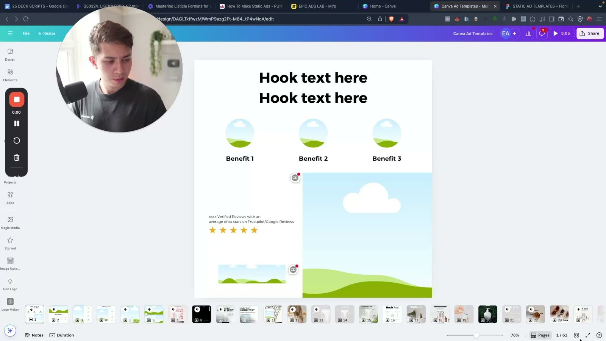
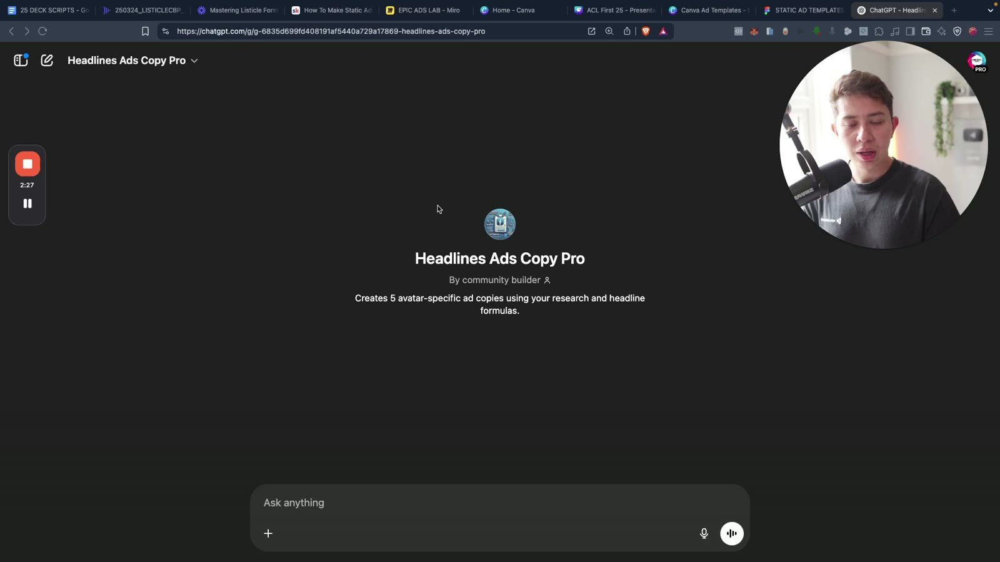
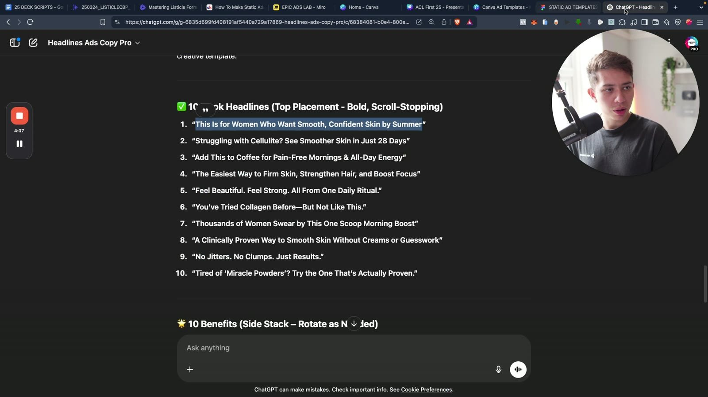
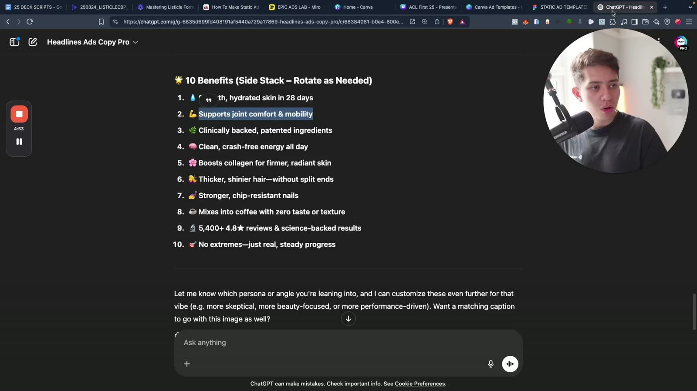
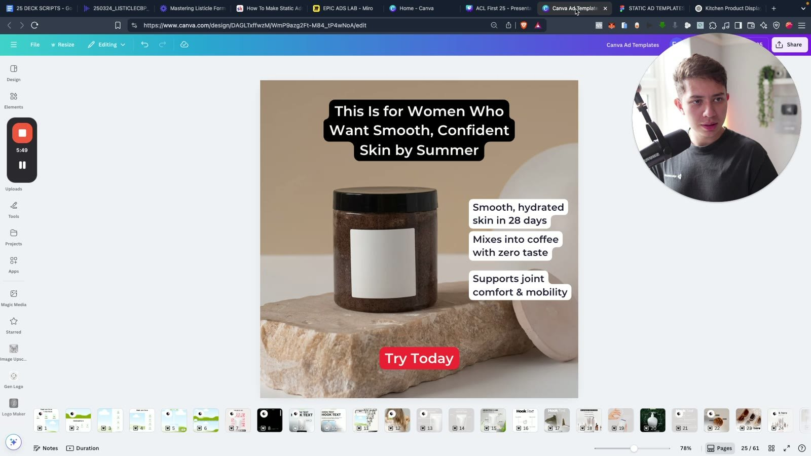
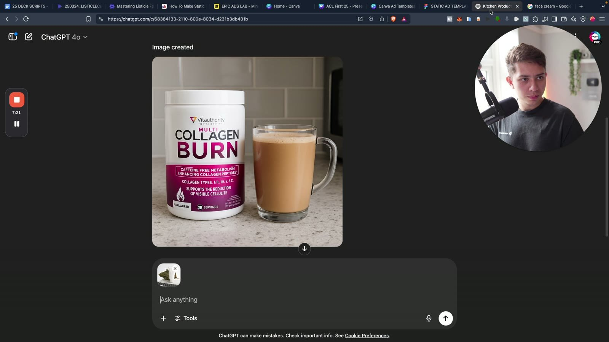

# 71. Making Statics With AI
> Fill a ready-made Canva or Figma static template with ChatGPT-written headlines and benefits and an AI-generated product image, instead of asking an image model to regenerate the whole ad.

## 🤖 Agent use
- **Use when:** you have a winning static layout (template) and need a branded variant fast; one text element in a generated ad is wrong and regenerating would reroll everything.
- **Inputs → outputs:** research document + template screenshot + product photo → 10 headlines + 10 benefits (for the buyer avatar) → product image placed in a scene → populated template exported as PNG/JPG.
- **Rules:**
  - **DON'T** rely on an image model to produce the full ad: once generated, "if there's a slight mistake… you can't easily change it because it will just generate something new completely" [00:00].
  - **DO** work in templates (Canva and Figma packs on the page) so copy, size and colour can be edited without regeneration [00:00–00:53].
  - **DO** load the research document into the copy GPT first, then give it the template screenshot [00:53–01:52].
  - **DO** paste one headline into the hook field and one benefit per benefit slot [01:52–02:36].
  - **DO** generate the product image in a separate chat from the product photo and a scene instruction; ask for a square image [02:36–03:06].
  - **IF** you love an existing ad's background **THEN** unlock it, bring it forward, screenshot it, ask the model to recreate it "keep the same size and style" with your product, then send the new image to back and lower brightness [03:38–04:42].
  - **DO** check every benefit against real product facts: the on-screen GPT output (see Examples) contains claims and review counts that nobody supplied.
- **See also:** [070 Full static ads creation process](070-full-static-ads-creation-process.md) · [076 Poppy method](076-new-make-static-ads-with-ai-poppy-method.md) · [Canva](../../../../tools/canva.md) · [ChatGPT](../../../../tools/chatgpt.md) · [LLM output claim audit](../../../stefan-georgi/rmbc-ii/rubrics/llm-output-claim-audit.md)

## Key ideas
### Templates instead of full-image generation [00:00–00:53]
- The instructor accepts that ChatGPT image generation can produce "really pretty" statics from winning creatives, but says editing is the weakness. The community provides static templates in Canva and Figma (pack shown at 00:40: a large Figma file; Canva page grid of about 40 pages).
- Template anatomy shown: "Hook text here" headline, three "Benefit" call-outs, a product image area, CTA button ("Subscribe Today" on the demo template, "Try Today" after editing) [00:00; 03:38].

### Copy: research doc → GPT → headlines and benefits [00:53–02:36]
- The page names the GPT "Ad Copywriter Pro"; the video calls it the headlines/ad-copy GPT ("Headlines Ads Copy Pro" on screen [00:54]). Load the research doc, press enter: it returns hook and benefit variations for different buying avatars [00:53].
- Then give it the template: screenshot the template, ask for 10 headlines and 10 benefits for your avatar [01:52].
- Demo product: a collagen supplement. Chosen headline: "This Is for Women Who Want Smooth, Confident Skin by Summer" (the page quotes it as "For women who want smooth, confident skin by summer"). Chosen benefits: "Smooth, hydrated skin in 28 days"; "Mixes into coffee with zero taste or texture"; "Supports joint comfort & mobility"; CTA changed to "Try Today" [01:52–02:54].

### Image: product into a scene [02:36–03:38]
- New ChatGPT chat, upload the product photo, instruct: put it on a kitchen counter with a clear mug of coffee; make the image square. Drag the result over the template's image placeholder; resize, recolour [03:06–03:38].

### Style-matching an existing background [03:38–04:42]
- Unlock the template background and bring it to front; screenshot it; in ChatGPT with the product photo (his demo uses a face cream) prompt to recreate the leaf-background image with the product in place, same size and style [03:38–04:42].
- Back in the template: delete the old background, paste the generated one, right-click → Layer → Send to Back, then lower brightness [04:42].

## Steps / framework
| # | Step | Tool | Prompt / action | Check |
|---|---|---|---|---|
| 1 | Open template | Canva or Figma pack | pick a layout | Layout matches the angle |
| 2 | Load research | copy GPT (page: Ad Copywriter Pro) | paste research doc, press enter | Output cites your doc's facts |
| 3 | Generate copy | same GPT | "I am making a creative in this style [paste screenshot of template]. Come up with 10 headlines and 10 benefits I can use for my [avatar]." | Benefits match the real product |
| 4 | Populate | Canva | paste headline into hook field, benefits into slots | Fits the text boxes |
| 5 | Product image | new ChatGPT chat + product photo | "Put this product on a kitchen counter with a clear mug of coffee next to it." (+ "Make the image square" in the video) | Label and shape of the product are correct |
| 6 | Optional style match | ChatGPT | "Create the exact image with the leaf background, but place the product in it. Keep the same size and style." | Not a 1:1 copy of the competitor asset |
| 7 | Adjust | Canva | resize, tweak colour/brightness so the product pops | Brand fonts, colours, spacing |
| 8 | Export | Canva | PNG/JPG, correct dimensions | Typos, no leftover placeholders |

## Examples
| Item | What changed | Source |
|---|---|---|
| Collagen static | placeholder "Hook Text Here / Benefit 1-3 / Subscribe Today" → headline "This Is for Women Who Want Smooth, Confident Skin by Summer", three benefits, "Try Today" | [00:00–02:54] |
| Product shot | product photo → kitchen counter with mug, then dropped in the template | [03:06–03:38] |
| Background clone | leaf-background template + a face-cream product photo → same composition with the cream | [03:38–04:42] |

Claim-check on screen: the GPT's output at [00:54–02:19] includes lines like "Patented ingredients like …" and "5,400+ 4.8-star reviews", "Clinically backed, patented ingredients" and "science-backed results" (partly legible). The demo product is generic, so these are model inventions. Do not carry them into a live ad.

## Structured units
- **DO** keep text editable (template) and let AI generate only the image layer.
- **DON'T** use a model's invented proof numbers; replace with real data or cut.
- **IF** the style-match output copies a competitor's art **THEN** change composition, palette and props before use (copy the mechanism, not the asset).

## Prompts / templates (verbatim)
From the lesson page, step 2:
```text
I am making a creative in this style [paste screenshot of template]. Come up with 10 headlines and 10 benefits I can use for my [avatar].
```
Step 4:
```text
Put this product on a kitchen counter with a clear mug of coffee next to it.
```
Step 5:
```text
Create the exact image with the leaf background, but place the product in it. Keep the same size and style.
```
Spoken variants: "Put this product on a kitchen counter with a clear mug next to it with what looks like coffee… Make the image square." [03:06]; "create the exact image with the leaf, but place the [face cream] in it. Keep the same size and style." [04:12–04:42].

## Screenshots

*The blank template: hook line, three benefit call-outs, product slot and a star-review strip. [00:00]*


*The custom GPT used for headlines and benefits. [00:54]*


*Ten ranked headlines, first one chosen ("This is for women who want smooth, confident skin by summer"). [02:10]*


*Ten benefits "side stack, rotate as needed"; note the unverifiable claims in items 3 and 9. [02:47]*


*Template with headline and the three benefits pasted in and CTA "Try Today". [03:32]*


*ChatGPT "Image created": collagen tub beside a mug of coffee on a counter. [04:20]*

## How to apply
- [ ] Pick one template per angle from the Canva/Figma pack (links on the page; contents not in course files).
- [ ] Run the headline GPT with the real research doc; reject any figure, study or review count not in your product facts.
- [ ] Generate the product scene in a separate chat; compare label and shape with the real pack.
- [ ] Replace placeholders; export PNG/JPG at the placement size; proofread.

## Related
- Previous: [070. Full Static Ads Creation Process](070-full-static-ads-creation-process.md) · Next: [072. Static Ads Mistakes To Avoid](072-static-ads-mistakes-to-avoid-4-17.md)
- [Static ad creation playbook](../../../../playbooks/static-ad-creation.md)

## Sources and limitations
- [Transcript](<../../../../../raw/ad-creators-lab/ai-ads-ugc-animations/_transcripts/Ad Creators Lab - Create Viral AI Ads, UGC & Animations That Convert Into Sales(September 2026)/5. Static Ads/3. Making Statics With AI.txt>) (Whisper; ends 5:16 of 5:16) · [Lesson page](<../../../../../raw/ad-creators-lab/ai-ads-ugc-animations/_extracted/Ad Creators Lab - Create Viral AI Ads, UGC & Animations That Convert Into Sales(September 2026)/5. Static Ads/3. Making Statics With AI.htm.md>).
- Not in course files: Canva and Figma template contents, the Ad Copywriter Pro GPT (link only).
- The demo uses a real third-party cream brand's product shot for the style-match step; use your own product assets.
- The video was recorded in 2025 per the instructor ("we're in 2025"); ChatGPT image behaviour has changed since. The newer approach is [076](076-new-make-static-ads-with-ai-poppy-method.md).
