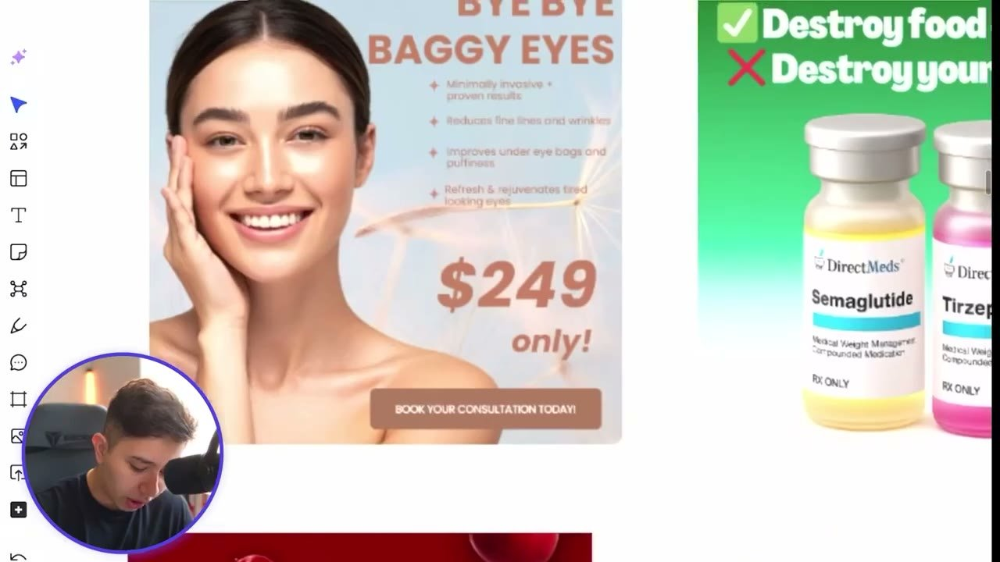
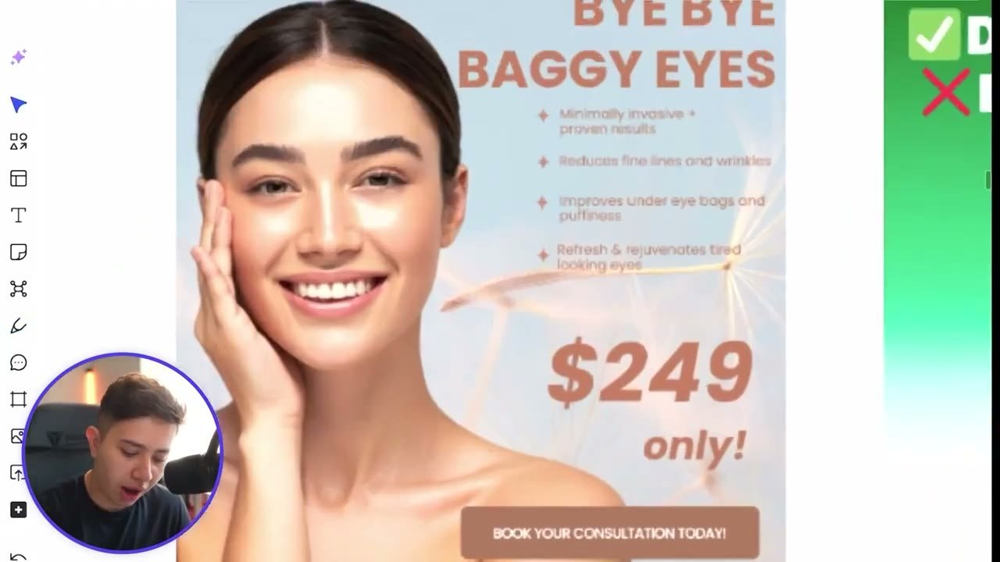
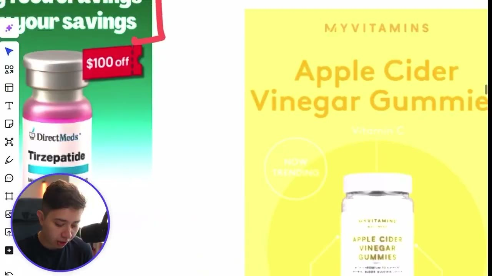
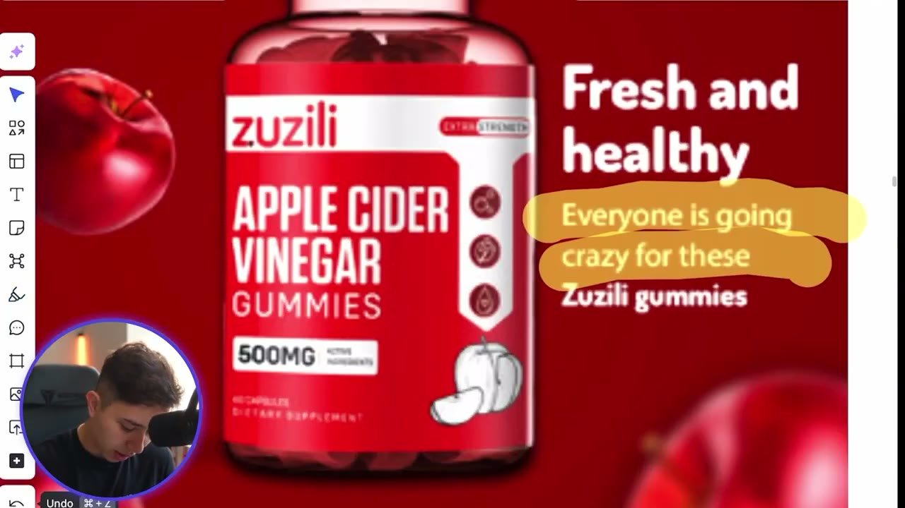
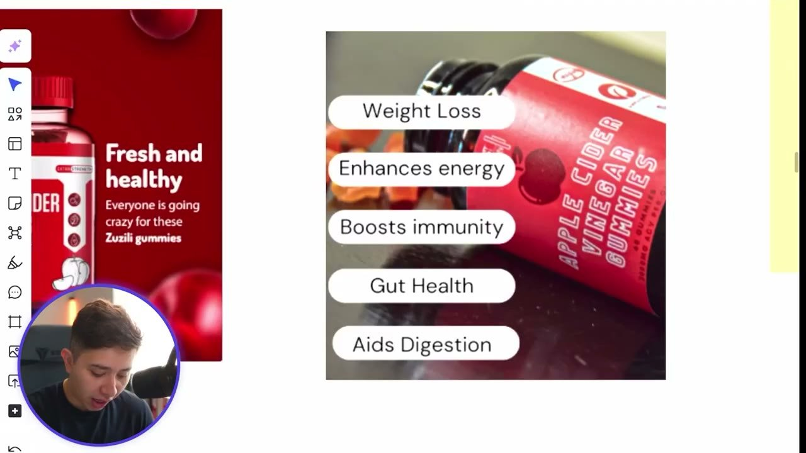

# 72. Static Ads Mistakes To Avoid (4:17)
> Four real Meta static ads critiqued for the mistakes that make statics fail: unreadable or over-designed layouts, price-and-sale-only messaging, claims anyone could make, and shallow first-level benefits.

## 🤖 Agent use
- **Use when:** auditing a static before launch; writing a rewrite brief; scoring competitor statics.
- **Inputs → outputs:** a static (image + headline + offer) → a list of mistakes mapped to the rules below → a rewrite direction (desire, deeper benefit level, something "worthy of remark").
- **Rules:**
  - **DON'T** use tiny text or over-design: "really hard to see, really hard to read… over designed stuff with this flower in the background" [00:00].
  - **DON'T** stop at a first-level benefit headline ("Bye bye baggy eyes"); "target something deeper": their routine, the biggest desire, the event they want to look good for [00:00–00:53].
  - **DON'T** rely on ads that only show a price; prefer statics that "move the sale forward" so people land on the site ready to buy [00:00–00:53] (instructor claim).
  - **DON'T** rely on sale offers plus "cringy" headlines ("Destroy food cravings, destroy your savings") [00:53–01:49].
  - **DO** build headlines from what people actually say, "rather than trying to be some kind of genius copywriter" [00:53–01:49].
  - **DO** design for impulsive scrollers in "waste time mode"; contrast and clarity first (white on yellow is "a crazy combination") [01:49–02:48].
  - **DON'T** say what anyone can say ("everyone is going crazy for these"); make a claim "worthy of a remark", for example a specific ranking or concentration [02:48–03:25].
  - **DO** climb the benefit ladder to level 5 ([structured units](#structured-units)) [03:25–04:13].
  - **IF** you picked a natural, authentic look as the better fit **THEN** avoid the polished, templatized model [00:53].
- **See also:** [073 Fixing bad static ads](073-fixing-bad-static-ads-10-51.md) · [074](074-fixing-bad-static-ads-2.md) · [075](075-fixing-bad-static-ads-3.md) · [Static ad creation playbook](../../../../playbooks/static-ad-creation.md) · [Evolve: write static image ads](../../../evolve/copywriting/playbooks/write-static-image-ads.md)

## Key ideas
### Why statics "didn't work" for most people [00:00]
- Framing: these are "the biggest mistakes that everybody makes", probably the reason the viewer tried statics and failed.

### Mistake 1: unreadable, over-designed, shallow headline, price-led [00:00–00:53]
- Ad shown: an aesthetic-clinic style ad, smiling model, headline "Bye bye baggy eyes", four tiny bullets, "$249 only!", CTA "Book your consultation today!".
- Critique: tiny type; busy background flower; headline surface-level; a price-led ad does not prompt the visit; the model is "highly polished" and the layout "templatized", which he would avoid when trying to scale [00:00–00:53].

### Mistake 2: sale offers and cringe headlines [00:53–01:49]
- Ad shown: a telehealth weight-loss ad with a GLP-1 style vial, "Destroy food cravings / Destroy your savings", "$100 off". Brand name DirectMeds is on screen [00:42–00:53].
- Critique: nothing moves the viewer forward beyond the cravings line; better routes are a "without" promise (without months of dieting) or the real reason people get the drug, taken from customer language [00:53–01:49].

### Mistake 3: design that loses the scroll [01:49–02:48]
- Ad shown: a vitamin brand's apple-cider-vinegar gummies on a yellow field with yellow-white text.
- Critique: low contrast, nothing curious. Mindset: feed users are "zombies… not locked in", so win an impulsive decision; "fancy background, fancy text, fancy image and hope they put enough money behind it" is the mistake [01:49–02:48].

### Mistake 4: claims anyone can make; first-level benefits [02:48–04:13]
- Ad shown: red apple-cider-vinegar gummies, "Fresh and healthy. Everyone is going crazy for these gummies." Fix direction: a claim "worthy of a remark" such as "top 30 in apple cider vinegar concentration" (if the gummy truly has an outrageous amount), or for a beauty clinic "local magazine's number one choice" [02:48–03:25].
- Benefit labels on screen (Weight Loss, Enhances energy, Boosts immunity, Gut Health, Aids Digestion) are all level-1 [03:10–03:30].

## Steps / framework
Audit a static in this order:
1. Readable in one second on a phone? (size, contrast) [00:00; 01:49]
2. Headline depth: is the benefit above level 1? [03:25]
3. Does it say something only we can say? [02:48]
4. Does it show a desire and a next step, not just a price or sale? [00:53; 00:53–01:49]
5. Look: natural/authentic vs polished template? [00:53]

## Examples
All ads are third-party ads from Meta Ad Library as shown on screen; no performance data.

## Structured units
### Ad teardowns
| Brand / product (niche) | Format | Hook / opening | What works | What fails | Fix suggested | Principle | Source |
|---|---|---|---|---|---|---|---|
| Aesthetic clinic, under-eye treatment (beauty clinic) | static, model photo + price | "Bye bye baggy eyes" | Clear topic; the offer is visible | Tiny text; flower background over-designs; surface-level benefit; price-led; polished templated model | Target a deeper desire (faster routine, looking good for an event); use a more natural, authentic person; drive the visit with a message that moves the sale forward | Benefit depth; readability; authenticity | [00:00–00:53] |
| DirectMeds, GLP-1 style weight-loss telehealth (health) | static, green split with vial and checklist | "Destroy food cravings / Destroy your savings" ($100 off) | A clear offer | Cringe headline; sale-focused; nothing that moves the buyer forward | Use real customer reasons: "destroy cravings without spending months dieting"; mine the reasons people actually try the drug | Customer language over genius copy | [00:42–01:49] |
| MyVitamins, apple cider vinegar gummies (supplements) | static, yellow background, product bottle | Product name as the headline | Product visible | White on yellow barely legible; fancy design hoping spend will carry it; no curiosity | Higher contrast and a curiosity hook for impulsive scrollers | Clarity first | [01:39–02:48] |
| Zuzili, apple cider vinegar gummies (supplements) | static, red background with apples | "Fresh and healthy. Everyone is going crazy for these Zuzili gummies" | Bottle shows a specific "500MG" (circled on the board at 03:05; the narration does not comment on it) | The headline is generic and anyone could say it; benefits are first-level | Make a remarkable, checkable claim (e.g. concentration ranking, third-party recognition if true); show higher-level benefits | Worthy of remark; benefit ladder | [02:35–03:25] |

### Rewrites (before → after, as spoken)
| Before | After | What changed | Source |
|---|---|---|---|
| "Enhanced energy" | "No longer tired after 2 pm" | level-1 attribute → level-2/3 lived outcome (specific, timed) | [03:25–04:13] |
| "Boost immunity" | "You don't get sick for the fifth time this year" | generic benefit → concrete everyday outcome | [03:25–04:13] |
| "Bye bye baggy eyes" | headline about the routine or the event (e.g. faster routine, prom night) | surface result → deeper desire | [00:00–00:53] |
| "Everyone is going crazy for these" | "Top 30 in apple cider vinegar concentration" (conditional on being true) | anyone-can-say → remarkable and specific | [02:48–03:25] |

### Benefit levels (his ladder)
| Level | Weight-loss example | Source |
|---|---|---|
| 1 | You lose weight | [03:25] |
| 2 | You have energy | [03:25] |
| 3 | You look better | [03:25] |
| 4 | You are confident | [03:25] |
| 5 | You can finally wear the dress that has hung in your wardrobe for months | [03:25] |

Rule: put level 4–5 benefits in the static, not level 1.

## Prompts / templates (verbatim)
None. The page has no text.

## Screenshots

*Frame as the instructor pans from the clinic ad to the "Destroy food cravings / Destroy your savings" ad. [00:42]*

*Smiling model, "Bye bye baggy eyes", tiny bullets, "$249 only!", booking CTA. [01:08]*

*Yellow-on-yellow low-contrast design. [01:49]*

*"Everyone is going crazy for these Zuzili gummies" highlighted as the anyone-can-say line. [03:02]*

*Weight Loss, Enhances energy, Boosts immunity, Gut Health, Aids Digestion: generic first-level benefits. [03:21]*

## How to apply
- [ ] Run each draft through the five-point audit above.
- [ ] Write the benefit ladder for your product to level 5 from real customer language and put the top rung in the headline.
- [ ] Replace "everyone loves it" lines with a specific, verifiable fact (rank, count, concentration) or delete them.
- [ ] Check contrast on a phone-size preview.

## Related
- Previous: [071. Making Statics With AI](071-making-statics-with-ai.md) · Next: [073. Fixing bad static ads 10:51](073-fixing-bad-static-ads-10-51.md)

## Sources and limitations
- [Transcript](<../../../../../raw/ad-creators-lab/ai-ads-ugc-animations/_transcripts/Ad Creators Lab - Create Viral AI Ads, UGC & Animations That Convert Into Sales(September 2026)/5. Static Ads/4. Static Ads Mistakes To Avoid 4 17.txt>) (Whisper; ends 4:17 of 4:17) · [Lesson page](<../../../../../raw/ad-creators-lab/ai-ads-ugc-animations/_extracted/Ad Creators Lab - Create Viral AI Ads, UGC & Animations That Convert Into Sales(September 2026)/5. Static Ads/4. Static Ads Mistakes To Avoid  417.htm.md>) (empty).
- The critiques are the instructor's opinion; no conversion data is shown. Ads are public third-party Meta ads; the clinic brand is not named on screen, others are named as visible.
- Compliance: the GLP-1 ad category is a restricted health category on Meta; do not reuse "without months of dieting" style claims for such products without checking policy and substantiation. A "top 30 concentration" claim must be true and documented.
- The telehealth ad name is read from the frame (DirectMeds); the vitamin brand names are read from the frames (MyVitamins, Zuzili); Whisper did not transcribe them reliably ("zooli").
