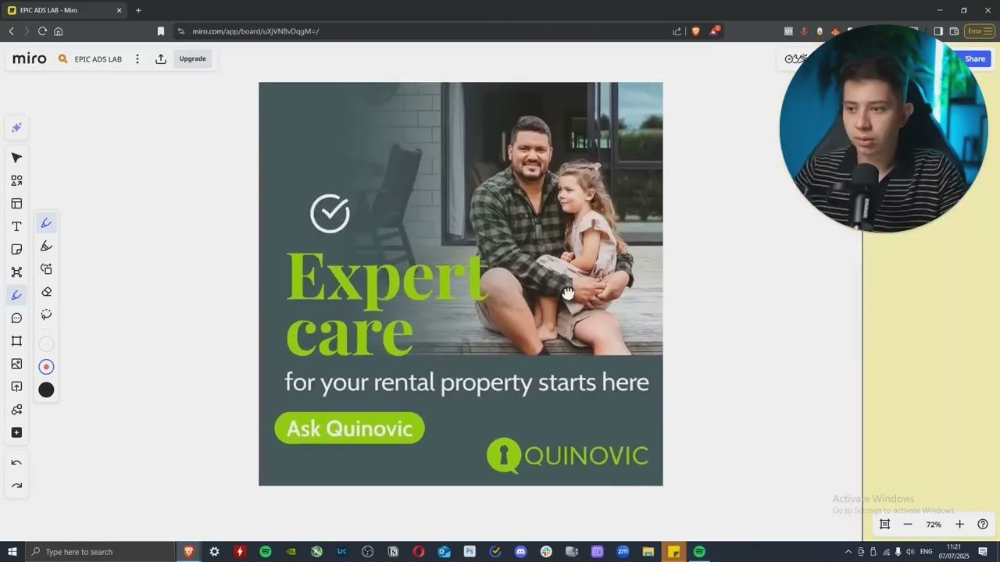
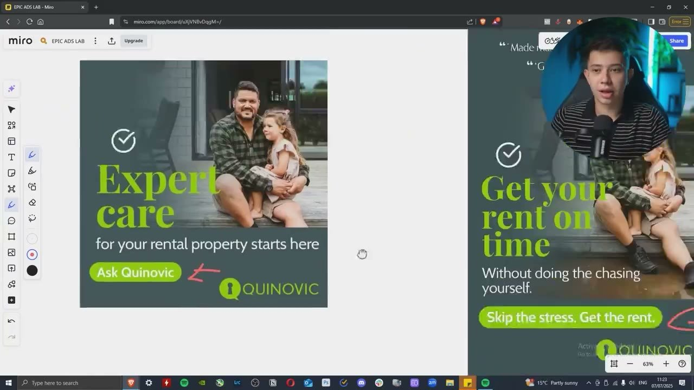
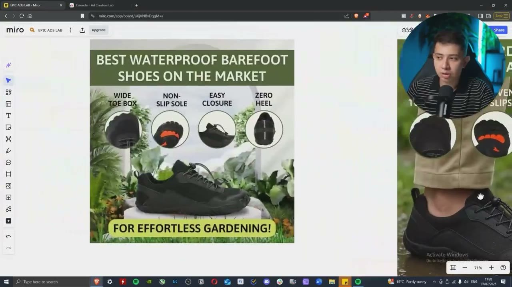
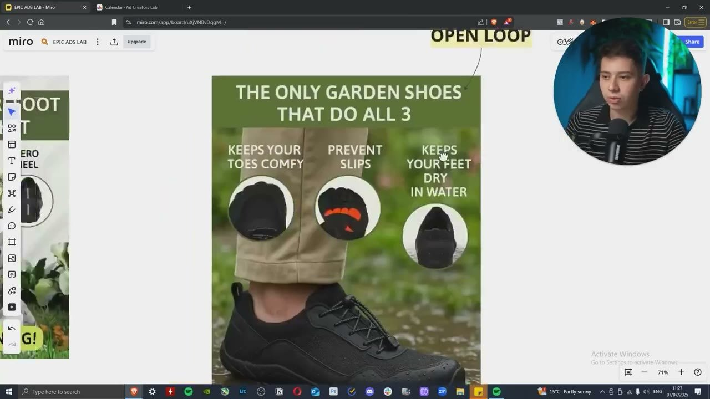
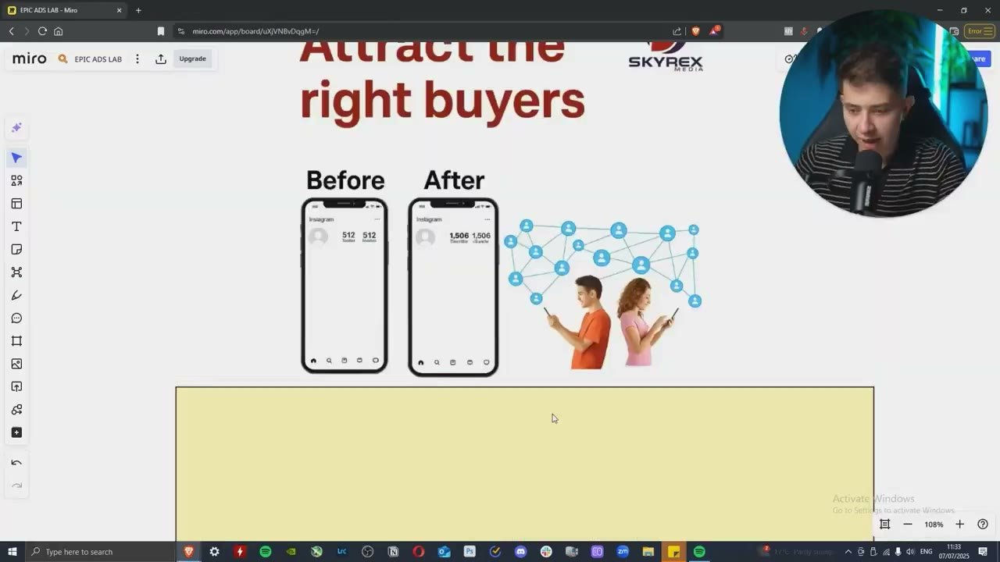
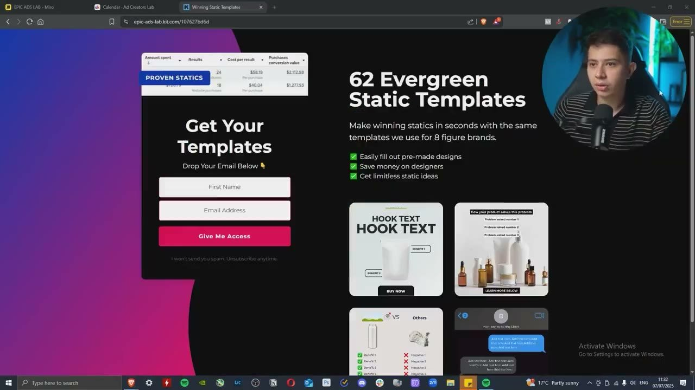
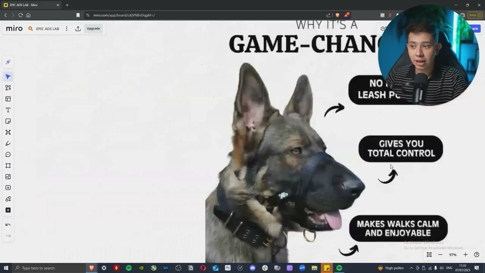
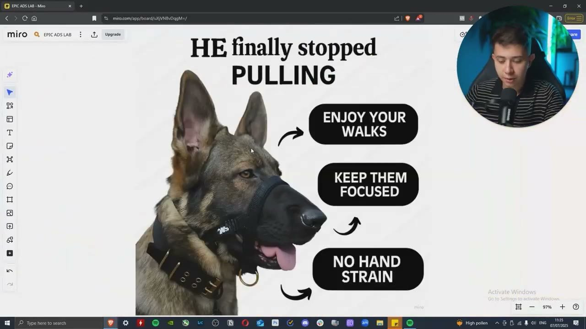

# 73. Fixing bad static ads (10:51)
> Four weak Meta static ads (property rental, garden shoes, social-media agency, dog-walking device) rewritten with ChatGPT in minutes: replace generic or feature-bombing copy with a desire headline, proof, benefits and a CTA that bridges desire to action.

## 🤖 Agent use
- **Use when:** rewriting a weak static; teaching an agent the before→after moves.
- **Inputs → outputs:** weak static + the business's real testimonials/facts → rewritten headline, subhead, 3 benefits, proof element, CTA.
- **Rules:**
  - **DO** make the headline a desire the buyer already has ("Get your rent on time") not a vague category claim ("Expert care") [00:00–01:55].
  - **DO** add a "without" line that removes the pain ("without doing the chasing yourself") [01:27–01:55].
  - **DO** write the CTA as a bridge between a desire and what the business does ("Skip the stress. Get the rent.") not "Ask [brand]" [01:55].
  - **DO** put real social proof on the ad: the instructor lifted actual testimonial quotes from the brand's website [00:58–01:27].
  - **DON'T** claim "best on the market": generic ("anyone selling these shoes can say it") and a regulator risk [02:43–03:10] (see limitations).
  - **DO** create an open loop in the headline when it fits ("The only garden shoes that do all three" invites "all three what?") [04:09–04:35].
  - **DO** show the proof visually instead of listing the feature (shoe in a puddle, sole shown for slip-resistance) [04:35–05:01].
  - **DON'T** feature-bomb. "Selfish features… confusion"; lead with the problem solved and the viewer's gain: "What is in it for me?" [06:25–07:19].
  - **DON'T** pair a price with a pile of features: it associates "cheap" with the offer [06:53].
  - **IF** an ad shows pricing **THEN** it is bottom-of-funnel and only works for people who already know you [05:56].
  - **DON'T** use the word "game changer" (banned at his agency; vague) [09:13–09:40].
  - **DO** lead with the problem the customer actually has ("He finally stopped pulling") then desire and relief [10:08–10:38].
- **See also:** [072 Mistakes to avoid](072-static-ads-mistakes-to-avoid-4-17.md) · [074](074-fixing-bad-static-ads-2.md) · [075](075-fixing-bad-static-ads-3.md) · [Static ad creation playbook](../../../../playbooks/static-ad-creation.md) · [LLM claim audit](../../../stefan-georgi/rmbc-ii/rubrics/llm-output-claim-audit.md)

## Key ideas
### Method [00:00]
- He spent an hour in Meta's Ad Library for "shockingly bad" statics, then rewrote each with ChatGPT "in a few minutes" and names the psychology behind the change. The board layout: four BEFORE/AFTER pairs (frame at 00:00).
- AI limits he admits: text glitches ("yes I know the capital he but that's just ChatGPT"), weak before/after imagery [01:00; 08:15; 10:08]. Fix in practice: build in templates ([071](071-making-statics-with-ai.md); the page offers "62 Evergreen Static Templates", shown at 08:27, free via a link; not in course files).

### Principles named
- **Desire association**: a headline must tie the viewer's desire to the offer [03:39–04:09].
- **Open loop / curiosity** [04:09].
- **Social proof** [01:55].
- **Benefits over features** and the "What is in it for me?" question [07:19].
- **Funnel stage fit**: price-led statics suit only those who know the brand [05:56].

## Steps / framework
Rewrite sequence the instructor repeats: (1) diagnose the missing desire; (2) write a desire headline; (3) add a "without" or relief line; (4) swap features for benefits tied to real research; (5) add proof (real quote, before/after, ranking); (6) write a bridge CTA; (7) rebuild in a template.

## Examples
Four ads follow; times are the segment start in the video.

## Structured units
### Ad teardowns
| Brand / product (niche) | Format | Hook / opening | What works | What fails | Fix suggested | Principle | Source |
|---|---|---|---|---|---|---|---|
| Quinovic, property rental income service (property management) | static, family photo + dark green panel | "Expert care for your rental property starts here" + CTA "Ask Quinovic" | Clear brand block | Headline and subhead say nothing specific ("what does expert care mean?"); CTA does not bridge desire to value; family photo with no proof; ran only six days before being shut off (instructor claim) | See rewrite table row 1 | Desire headline; social proof; bridge CTA | [00:00–02:43] |
| Barefoot garden shoes (footwear, waterproof) | static, shoe on a plinth in plants, 4 feature icons | "Best waterproof barefoot shoes on the market" / "For effortless gardening!" | Straight-to-the-point bottom-of-funnel style for someone already comparing features | Reads like 2019; "best on the market" is generic and a possible FTC/claims issue; features only (wide toe box, non-slip sole, easy closure, zero heel) with no desire; straddles two markets; shopper can compare on Amazon | See row 2 | Open loop; desire over features; show proof | [02:43–05:29] |
| Social media management service (marketing services, logo reads Skyrex in the rewrite) | static, feature list + price | "Hire a social media manager" with a low price ($49 per the narration) | Offers a lot for the price | Feature-bomb; price beside many features anchors "cheap"; no reason to hire vs Fiverr or Upwork; smallest-market (bottom-of-funnel) framing | See row 3 | Benefits over features; the "why anyone buys" test (improve life, solve a problem or make money) | [05:29–09:13] |
| Dog-walking aid, muzzle-style head device (pet) | static, dog photo + three arrows | "Why it's a game changer" + "No more leash pulling / Gives total control / Makes walks calm and enjoyable" | Product is shown on the dog | "Game changer" is banned vague language; benefits are flat; the device does more than that | See row 4 | Problem-first headline; top-3 researched benefits | [09:13–10:51] |

### Rewrites (before → after)
| Before | After | What changed (verb / visual / promise / self / intensity) | Source |
|---|---|---|---|
| "Expert care for your rental property starts here" / "Ask Quinovic" | Headline "Get your rent on time"; sub "Without doing the chasing yourself"; CTA "Skip the stress. Get the rent."; testimonial quotes from the website ("Managing my property so easy… get less headaches now") | vague service → the owner's desire; added without-line; CTA bridges desire to outcome; added real quotes | [00:58–01:55] |
| "Best waterproof barefoot shoes on the market" + 4 feature icons + "For effortless gardening!" | Headline "The only garden shoes that do all three"; three call-outs "Keeps your toes comfy", "Prevents slips" (sole shown), "Keeps your feet dry in water" (puddle); CTA "Get your pair now" | superlative → open loop; features → comfort, safety, dryness; image shows the proof; CTA specific | [04:09–05:29] |
| "Hire a social media manager" + feature list + price | Headline "Attract the right buyers" with an Instagram before/after (few followers → many); benefits "We post content they see", "We grow your pages", "We show the results. We don't hide them from you.", "We handle the stress while you grow", "Save 40 hours a month"; line "We are no longer social media managers. We are growth builders." | service label → business outcome (more buyers); proof-style before/after; features → benefits; repositioned as a growth partner | [07:19–09:13] |
| "Why it's a game changer" / "No more leash pulling / Gives total control / Makes walks calm and enjoyable" | "He finally stopped pulling"; "Enjoy your walks"; "Keep them focused"; "No hand strain" | vague superlative → the owner's lived problem; three researched benefits | [09:40–10:51] |

### Rules
- **DO** pair every benefit with a researched pain ("the top three that we found that people want to fix") [10:38].
- **DON'T** ship AI-generated testimonial or before/after assets as real (see compliance).

## Prompts / templates (verbatim)
No prompts are shown; the lesson page has no text. The instructor says only that he rewrote each ad "by putting it on ChatGPT, doing a little bit of research" [00:00]. Use the Headline Bank and Ad Analysis prompts in [070](070-full-static-ads-creation-process.md#prompts--templates-verbatim).

## Screenshots

*Before: "Expert care for your rental property starts here", "Ask Quinovic". [00:57]*

*After (partly visible): "Get your rent on time / Without doing the chasing yourself. / Skip the stress. Get the rent." with website testimonial quotes at left. [02:10]*

*Before: four feature icons, "Best waterproof barefoot shoes on the market". [05:05]*

*After: open-loop headline "The only garden shoes that do all three" with comfy / prevents slips / dry-in-water call-outs and a puddle shot. [04:35]*

*After: "Attract the right buyers" with before/after phone mock. [08:38]*

*"62 Evergreen Static Templates" sign-up page promoted after the third ad. [08:27]*

*Before: "Why it's a game changer" with three flat benefit arrows. [10:22]*

*After: "He finally stopped pulling" + enjoy your walks, keep them focused, no hand strain. [10:27]*

## How to apply
- [ ] For each weak static, write down which desire the headline should connect to; test with "what is in it for me?"
- [ ] Replace superlatives and "game changer" with the customer's problem sentence from research.
- [ ] Add one real proof element; do not invent quotes, followers or hours saved.
- [ ] Write the CTA as the outcome ("Get the rent", "Get your pair now").

## Related
- Previous: [072. Static Ads Mistakes To Avoid](072-static-ads-mistakes-to-avoid-4-17.md) · Next: [074. Fixing bad static ads 2](074-fixing-bad-static-ads-2.md)

## Sources and limitations
- [Transcript](<../../../../../raw/ad-creators-lab/ai-ads-ugc-animations/_transcripts/Ad Creators Lab - Create Viral AI Ads, UGC & Animations That Convert Into Sales(September 2026)/5. Static Ads/5.Fixing bad static ads 10 51.txt>) (Whisper; ends 10:51 of 10:51) · [Lesson page](<../../../../../raw/ad-creators-lab/ai-ads-ugc-animations/_extracted/Ad Creators Lab - Create Viral AI Ads, UGC & Animations That Convert Into Sales(September 2026)/5. Static Ads/5.Fixing bad static ads  1051.htm.md>) (empty).
- Brand names are read from the frames (Quinovic; the rewritten social-media ad shows Skyrex). "Ran six days" and "ran 10 days before shut off" are the instructor's claims; no ad-library evidence shown. No performance data for any "after".
- Compliance: the rewrites use claims such as "Get your rent on time", "Save 40 hours a month" and before/after follower graphics that the business has not substantiated here; the follower before/after is an AI mock. Only use proof you can document. The Quinovic testimonials are said to be real website quotes; verify before reuse.
- "Best on the market" can breach advertising rules; the instructor flags FTC risk [02:43].
- The speaker's remark about "ChatGPT ruined this" (the before/after image) means the after images are illustrations, not production-ready.
