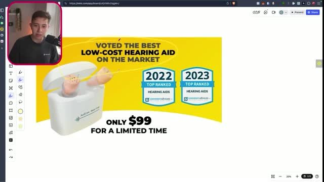
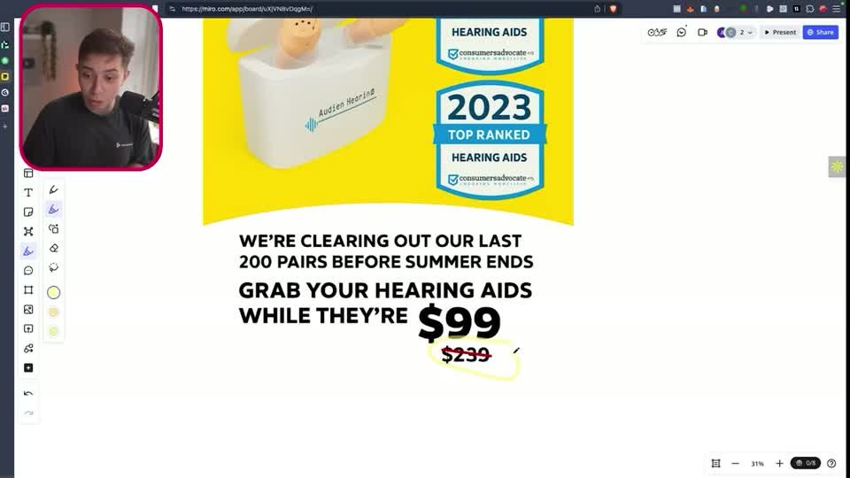
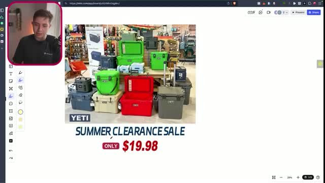
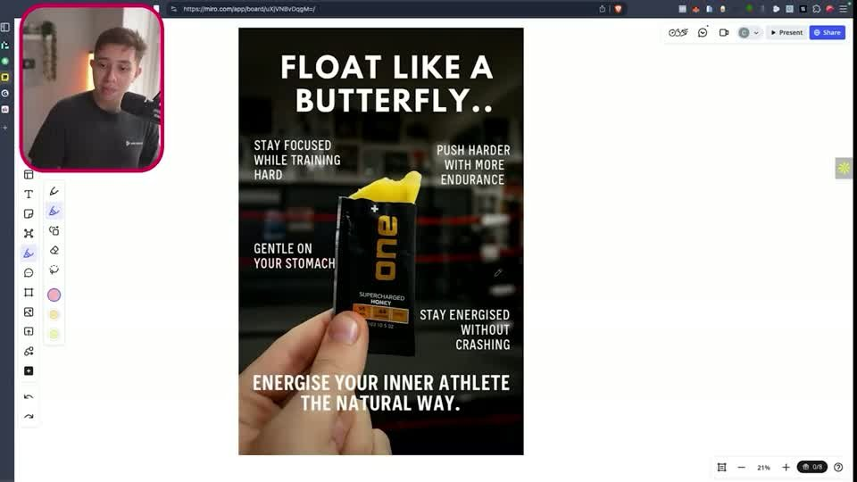
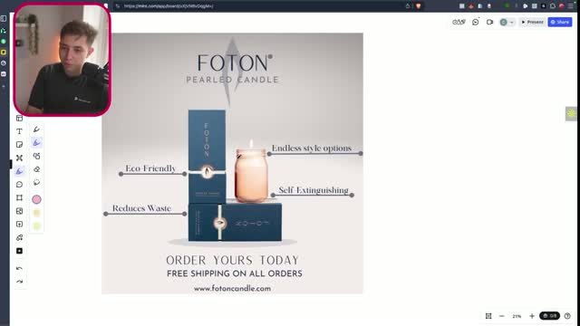
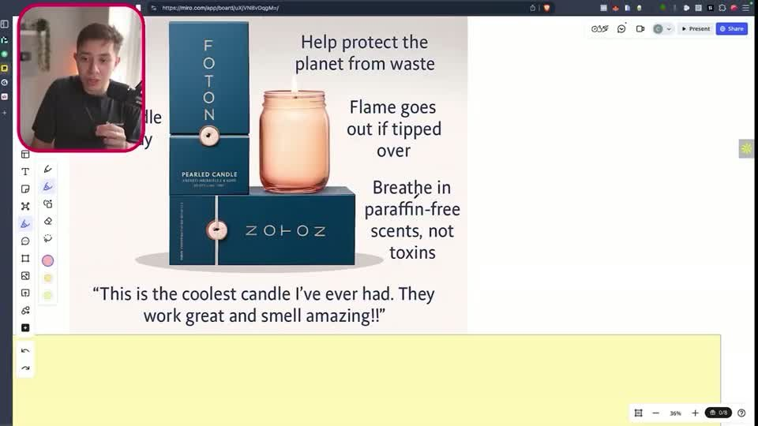
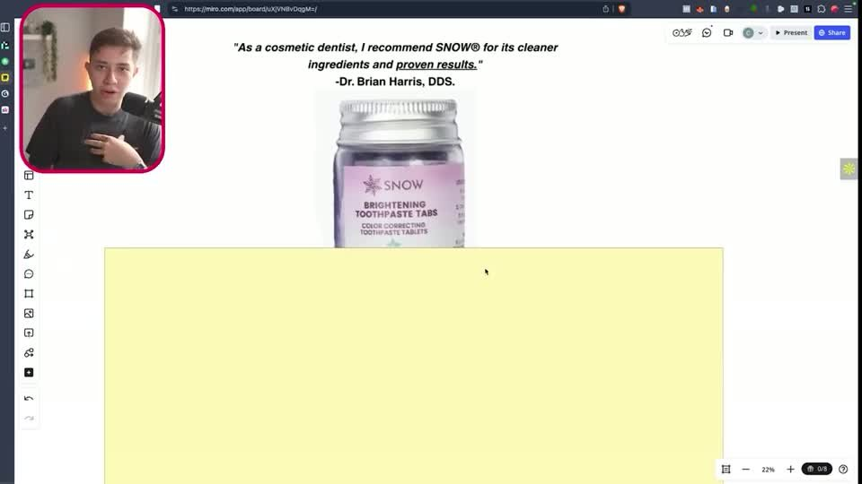

# 74. Fixing bad static ads 2
> Five more weak Meta statics (hearing aids, cooler sale, honey pre-workout, pearl candle, toothpaste tabs) rewritten: swap selfish awards and feature call-outs for a desire plus reduced risk, show the proof, and add real social proof and specific urgency.

## 🤖 Agent use
- **Use when:** rewriting offer-led (bottom-of-funnel) statics; fixing feature call-out ("benefit bubble") layouts; deciding how to open a headline.
- **Inputs → outputs:** weak static + research (questions buyers ask, real testimonials, true price/stock facts) → rewritten headline, 3–5 benefits, proof element, offer line.
- **Rules:**
  - **DON'T** lead with "we're the best" ("Voted the best…"): "nobody actually gives a damn"; make them care about you first [00:25].
  - **DO** pair a desire with reduced risk or removed cost: "Hear the birds outside without spending $5000" [00:52].
  - **DO** show, not tell: display the ranking badges instead of stating "voted best" [01:18].
  - **DO** give urgency a number and a reason ("clearing out our last 200 pairs before summer ends") rather than "limited time", which anyone can say [00:25; 01:18] (instructor example; see compliance).
  - **DO** ask "what can I say that nobody else can say?" [00:25].
  - **DO** make offer ads still earn attention: bottom-of-funnel is no excuse for "zero effort" [02:13–02:42].
  - **DO** put the actual product/price pairing on the ad when several products appear, to avoid ambiguity [02:13; 03:12].
  - **DON'T** rely on a cultural reference alone ("float like a butterfly"): only those who get it respond; add concrete benefits and a visible product name [03:58].
  - **DO** answer the objections buyers actually have (gentle on stomach, no crash) found in research [04:56].
  - **DON'T** list what is on the back of the box ("selfish ad"); lead with the unique selling point demonstrated in the ad [05:25–06:44].
  - **DO** lead with social proof for unfamiliar products [08:28–08:57].
- **See also:** [073](073-fixing-bad-static-ads-10-51.md) · [075](075-fixing-bad-static-ads-3.md) · [072](072-static-ads-mistakes-to-avoid-4-17.md) · [Static ad creation playbook](../../../../playbooks/static-ad-creation.md) · [LLM claim audit](../../../stefan-georgi/rmbc-ii/rubrics/llm-output-claim-audit.md)

## Key ideas
### Selfish vs customer-first [00:00–00:52]
- "Selfish headline": about us (award, price). Reorder: what you do for the buyer, then the credential [00:00–00:52].

### Offer ads can still carry a desire [02:13–03:58]
- The cooler ad is bottom-of-funnel and offer-based; "it doesn't mean you have to put zero effort"; double conversions "in a very simple way" is his claim (instructor claim) [02:42].

### The "brochure effect" [07:23]
- Benefit-dense text works when the opening promise matches a felt need: "If you were really sick and somebody gave you a brochure… would you not read it? Even if it was very long and the text was tiny." Applies to the candle rewrite and also in [075](075-fixing-bad-static-ads-3.md). Contrast with the playbook's short-call-out limits (see limitations).

### Social-proof-first for unfamiliar products [08:28–08:57]
- For a trending but unfamiliar product (toothpaste tabs), lead with an authority testimonial and a clear offer; "very limited with the image" so the rest was minimal [08:57].

## Steps / framework
1. Identify who the ad talks about (us vs them). 2. Rewrite headline = desire + "without" cost/risk. 3. Replace "voted/best/eco-friendly" with shown proof or a specific USP. 4. Convert call-outs to benefits and objection answers from research. 5. Add one proof element. 6. Put the exact offer and a specific, true urgency in the CTA line.

## Examples
Five ads, times are segment spans.

## Structured units
### Ad teardowns
| Brand / product (niche) | Format | Hook / opening | What works | What fails | Fix suggested | Principle | Source |
|---|---|---|---|---|---|---|---|
| Low-cost hearing aid (health devices) | static, yellow burst, earbud case, award badges, price | "Voted the best low-cost hearing aid on the market 2022 2023" / "Only $99 for a limited time" | Award badges are decent social proof ("if you just left this on the right that would be enough") | Selfish headline; credential before care; "limited time" has zero urgency and anyone can say it | See rewrite row 1 | Desire + reduced risk; show don't tell; specific urgency | [00:00–02:13] |
| Yeti-branded cooler sale (outdoor, e-commerce reseller) | static, many coolers in a shop, price | "Summer clearance sale only $19.98" | It is a clear offer | No emotion; unclear which cooler is $19.98; "zero effort"; wastes spend | See row 2 | Desire + saving; show the exact product at the price | [02:13–03:58] |
| "One" supercharged honey sachet (sports nutrition) | static, sachet in hand on a snowy backdrop | "Float like a butterfly.." | Headline referencing Ali's line is on-concept for a honey pre-workout; instructor calls it good | Lazy: only works for those who get the reference; product name ("supercharged honey") unreadable unless zoomed; no reason to want it | See row 3 | Keep a good headline, add benefits and a readable product | [03:58–05:25] |
| Foton pearl candle (home) | static, product with 4 call-out lines, free shipping, CTA | "Eco Friendly / Reduces Waste / Endless style options / Self extinguishing" | Offer (free shipping) good; CTA okay; "self-extinguishing" is interesting | "Selfish ad": copies the back-of-box list; eco-friendly and reduces waste are overused; not persuasive; USP not demonstrated | See row 4 | USP first; vivid benefits; social proof | [05:25–07:52] |
| Whitening toothpaste tabs (oral care) | static, six jars, "Multipack Savings" tag | "Multi-pack savings", "Buy more save more" | Trending product | Copy-pasted look "like your cousin who did one Photoshop class"; no source or proof; no cost comparison; no sense of what the product is | See row 5 | Social proof first; clear offer | [07:52–09:33] |

### Rewrites (before → after)
| Before | After | What changed (verb / visual / promise / self / intensity) | Source |
|---|---|---|---|
| "Voted the best low-cost hearing aid on the market 2022 2023 / Only $99 for a limited time" | "Hear the birds outside without spending $5000" + the 2022/2023 ranking badges + "We're clearing out our last 200 pairs before summer ends. Grab your hearing aids while they're $99" with $239 struck through | selfish credential → desire + cost-avoidance (without $5,000); ranking shown not stated; vague urgency → numbered urgency and reason; real price shown | [00:52–01:44] |
| "Summer clearance sale only $19.98" | "Keep your beer ice cold for days and save over $200" + golden-nugget testimonials + "Grab your cooler for $19.98 before they're gone" + the single exact cooler shown | feature/price → desire + saving; real customer lines as proof; ambiguity removed | [02:42–03:58] |
| "Float like a butterfly.." (product unreadable) | Same headline over a boxing-gym image; call-outs "Stay focused while training hard", "Push harder with more endurance", "Gentle on your stomach", "Stay energized without crashing", "Energize your inner athlete the natural way"; sachet clearly in the middle | kept the hook; added setting and researched benefits that answer the two big objections (stomach, crash) | [04:27–05:25] |
| "Eco Friendly / Reduces Waste / Endless style options / Self extinguishing" | "Turn any container into your candle without wax mess"; logo and product; "Help protect the planet from waste"; "Style your candle your way"; "Flame goes out if tipped over"; "Breathe in paraffin-free scents, not toxins"; two testimonials | label bullets → USP headline and concrete benefits that paint ownership; social proof | [05:58–07:23] |
| "Multi-pack savings / Buy more save more" | Authority quote ("As a cosmetic dentist, I recommend [brand] for its cleaner ingredients and proven results") + a clear multi-pack price (transcribed "get five for 76… $39"; the numbers are unclear in audio) + product | no proof → authority proof; clear offer | [08:28–08:57] |

### Rules
- **IF** a hook is already good **THEN** keep it and fix the surroundings, not the hook [04:27].
- **IF** you must show a price and several products **THEN** pair each price with its product [03:12].

## Prompts / templates (verbatim)
None shown on screen; the lesson page has no text. Related prompts: [070](070-full-static-ads-creation-process.md#prompts--templates-verbatim).

## Screenshots

*Before: "Voted the best low-cost hearing aid on the market", 2022 and 2023 badges, "Only $99 for a limited time". [00:58]*

*After: badges kept, "We're clearing out our last 200 pairs… $99" with the $239 price struck. [01:35]*

*Before: shop shelf of coolers, "Summer clearance sale, only $19.98". [02:20]*

*After: "Float like a butterfly.." in a gym setting with five benefit call-outs around the sachet. [04:50]*

*Before: four call-outs (Eco Friendly, Reduces Waste, Endless style options, Self Extinguishing), "Order yours today, free shipping". [05:30]*

*After: planet, flame-out and paraffin-free benefits plus a testimonial. [07:05]*

*After: dentist-style endorsement above the jar. [09:05]*

## How to apply
- [ ] Rewrite offer ads as "desire + without cost/risk", show the badge/ranking, and attach a true reason for the deadline or stock limit.
- [ ] For feature call-out layouts, list the product's USP in one headline and rewrite bullets as ownership scenes; answer the top 2–3 research objections.
- [ ] Add social proof you can document (named review, rating count, genuine expert).

## Related
- Previous: [073. Fixing bad static ads 10:51](073-fixing-bad-static-ads-10-51.md) · Next: [075. Fixing bad static ads 3](075-fixing-bad-static-ads-3.md)

## Sources and limitations
- [Transcript](<../../../../../raw/ad-creators-lab/ai-ads-ugc-animations/_transcripts/Ad Creators Lab - Create Viral AI Ads, UGC & Animations That Convert Into Sales(September 2026)/5. Static Ads/6. Fixing bad static ads 2.txt>) (Whisper; ends 9:33 of 9:33) · [Lesson page](<../../../../../raw/ad-creators-lab/ai-ads-ugc-animations/_extracted/Ad Creators Lab - Create Viral AI Ads, UGC & Animations That Convert Into Sales(September 2026)/5. Static Ads/6. Fixing bad static ads 2.htm.md>) (empty).
- Brand names are read from frames (cooler logo, candle brand, toothpaste jar); only visible names used.
- Compliance (important): several "after" assets are instructor illustrations with invented elements that must not be reused as-is: the "last 200 pairs" scarcity and $239 reference price (valid only if true), the two candle testimonials, and the dentist endorsement (a named DDS quote the video does not show a source for; fake testimonials or fabricated experts are prohibited by this knowledge base). Health claims ("gentle on your stomach", "no crash", "paraffin-free scents, not toxins", hearing results) need substantiation; hearing aids are a regulated device category.
- The cooler brand is a third-party trademark; a reseller needs permission to use it in an ad.
- Where it differs from the [static ad creation playbook](../../../../playbooks/static-ad-creation.md): that playbook caps call-outs at 3 and enforces one emotion and true badges only; this lesson rewrites with five call-outs and long text ("brochure effect") and uses invented urgency/testimonials in examples.
- The "doubling conversions" and "perform a whole lot better" statements are instructor claims; no tests shown.
