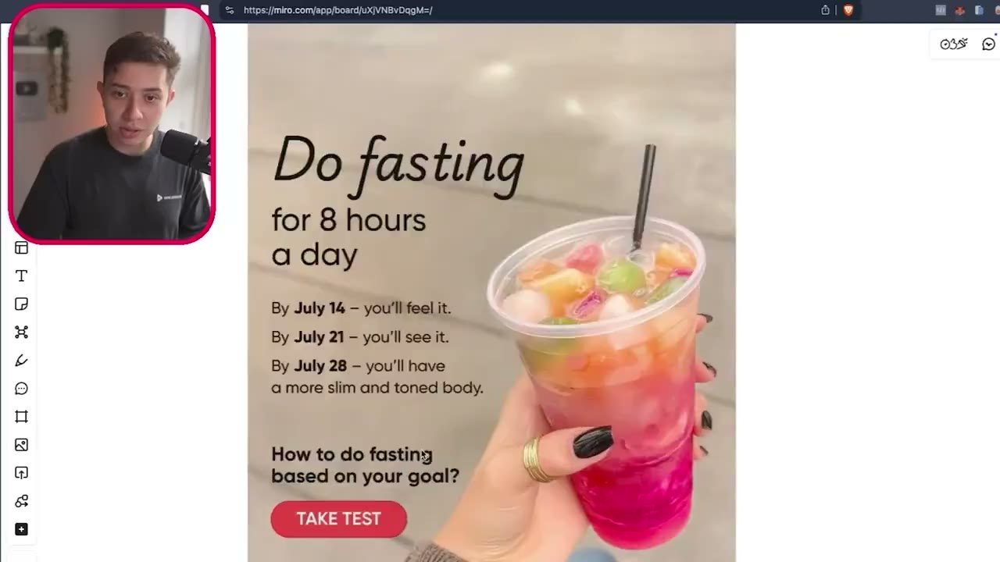
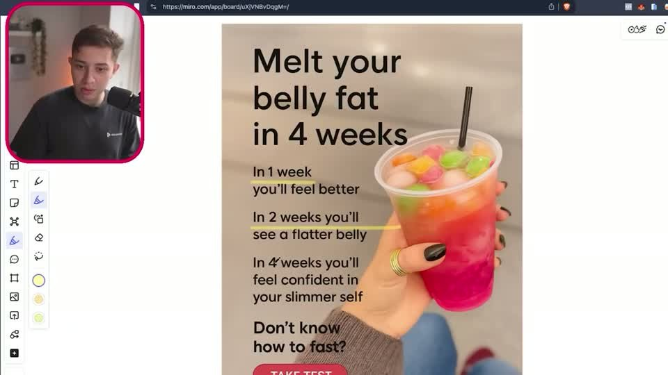
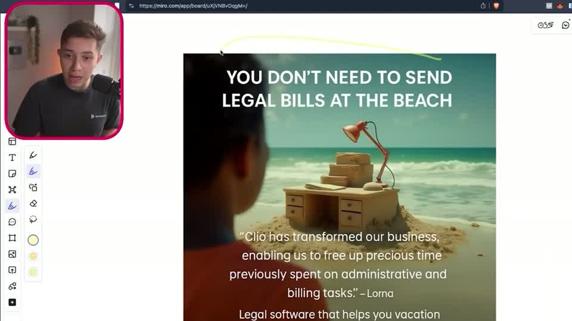
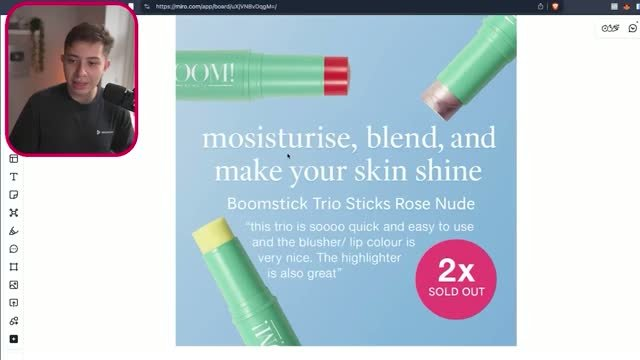
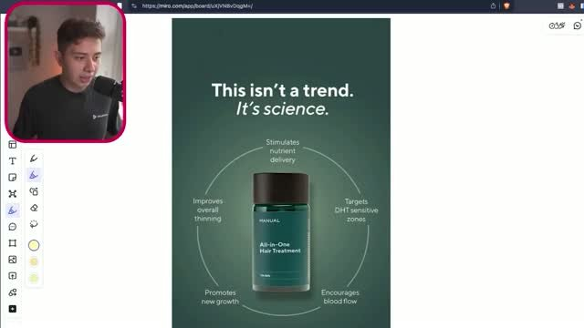
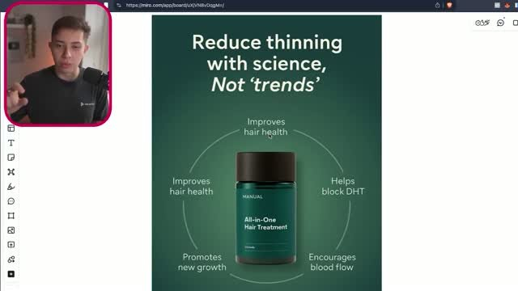
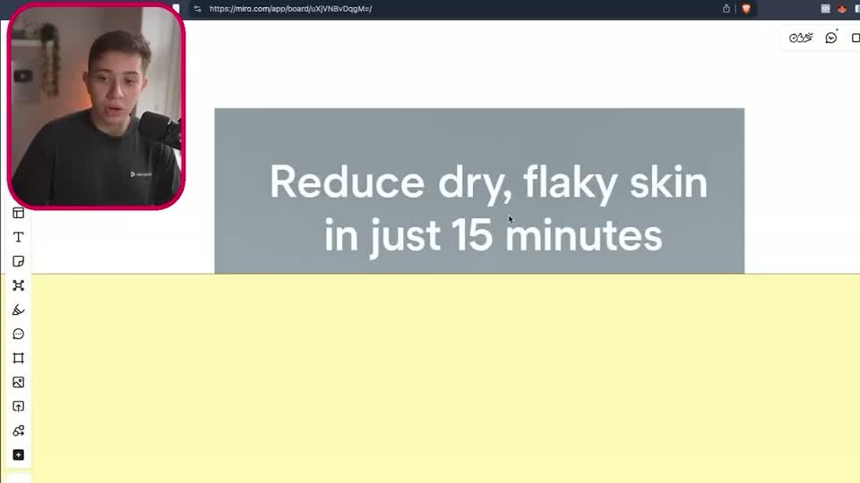

# 75. Fixing bad static ads 3
> Five more weak statics (fasting challenge, legal software, lip/cheek sticks, hair-loss treatment, peel-off mask) rewritten with a relatable headline, a timeframe that makes the result feel achievable, and shown rather than told social proof.

## 🤖 Agent use
- **Use when:** fixing a static whose headline names a product or feature instead of a desire; adding timeframe-based promises; writing for a very aware audience.
- **Inputs → outputs:** weak static + target-market facts + real proof → headline with desire (and timeframe), sharper call-outs, social proof.
- **Rules:**
  - **DO** write a desirable headline and a natural flow of emotions: desire first, then the timeline, then the first question the buyer will have, then the action [00:44–01:10].
  - **DO** attach **time scales** to a benefit: "the actual time scales give you a perceived likelihood of achievement" [01:10; 07:13–07:42].
  - **DON'T** run vague "feel it / see it" milestones on dates ("by July 14 you'll feel it") [00:00–00:44].
  - **DO** make the ad specific to the ideal market; ask "who actually uses this software?" [01:54–02:24].
  - **DO** use a relatable line that makes the target buyer say "yeah, I don't want to do that" ("You don't need to send legal bills at the beach") [02:24–03:27].
  - **DO** add a proof element so the reader thinks "this is legit" [03:02].
  - **DON'T** state "sells out fast"; show it selling out or show social proof [03:56–04:26].
  - **IF** an audience is "very very aware" of the product **THEN** use urgency-based creative to get them over the line, not a features list [05:39].
  - **DO** open with what the product is in the headline; scrollers have just seen unrelated content, so vagueness fails at any awareness level [05:39–06:22].
  - **DON'T** make the headline a product label: "it doesn't create curiosity, it doesn't state a benefit" ("Collagen peel off mask") [06:51–07:13].
- **See also:** [074](074-fixing-bad-static-ads-2.md) · [073](073-fixing-bad-static-ads-10-51.md) · [072](072-static-ads-mistakes-to-avoid-4-17.md) · [Static ad creation playbook](../../../../playbooks/static-ad-creation.md) · [LLM claim audit](../../../stefan-georgi/rmbc-ii/rubrics/llm-output-claim-audit.md)

## Key ideas
### Intro [00:00]
- "This video is going to make you uncomfortable": it is easy to make high-converting ads, yet brands make the same mistakes. Each fix came from "putting it on ChatGPT, doing a little bit of research" [00:00].

### Timeframe + benefit headline [00:44–01:10; 06:51–07:42]
- Two of the five fixes are a benefit plus a time frame ("Melt your belly fat in four weeks", "Reduce dry, flaky skin in just 15 minutes"). He labels the mechanism "perceived likelihood of achievement".

### The brochure effect again [04:26–04:54]
- "If you were terminally ill and somebody gave you the brochure… three pages long… would you not read it?" Dense text is fine once the headline hooks a desire. See [074](074-fixing-bad-static-ads-2.md#key-ideas).

### Show, don't tell [04:26–04:54]
- Rather than "sells out fast", show an on-image "2x SOLD OUT" badge plus a customer quote. (Instructor wording: "Show, not tell. Super easy stuff here.")

## Steps / framework
1. Diagnose: is the headline a label, a vague promise or a desire? 2. Rewrite as desire + (optional) timeframe. 3. Answer the first question the viewer will have. 4. Replace feature lines with plain benefit lines. 5. Add proof. 6. For aware audiences, add real urgency/offer.

## Examples
Five ads; times are segment spans.

## Structured units
### Ad teardowns
| Brand / product (niche) | Format | Hook / opening | What works | What fails | Fix suggested | Principle | Source |
|---|---|---|---|---|---|---|---|
| Fasting challenge app (weight loss) | static, hand holding a bright drink cup, copy list, red "TAKE TEST" button | "Do fasting for 8 hours a day" + "By July 14 you'll feel it. By July 21 you'll see it. By July 28 you'll have a more slim and toned body." | A test CTA; dated milestones | Headline not desirable, no justification for the challenge; bullet points not vivid | See rewrite row 1 | Desire headline; time scales; natural emotional flow | [00:00–01:54] |
| Clio, legal software (B2B SaaS) | static, AI beach scene with a sand desk | "Going away doesn't have to be this stressful" / "Legal software that helps you vacation without hesitation" | Beach image evokes holiday | Hard to tell what the business does; not specific to the ideal user; creates vagueness and questions | See row 2 | Specificity; relatable pain; proof | [01:54–03:27] |
| Boomstick Trio, rose nude (beauty sticks) | static, product on blue | "A favorite that sells out fast is back. 2x sold out." | Bottom-of-funnel restock message | Assumes you know the product; "sells out fast… 2x sold out" confusing; tells instead of showing | See row 3 | Show, not tell; social proof | [03:27–04:54] |
| Manual hair-loss treatment (hair care) | static, dark green panel, bottle ring with five mechanism call-outs | "This isn't a trend. It's science." | Specific mechanisms (instructor: "some of the stuff is good") | Not clear what it does straight away; the reader needs to read all call-outs to know it is about hair; terms like "DHT sensitive zones" and "nutrient delivery to what?" unexplained; feature-led for an aware audience | See row 4 | Immediate clarity; urgency for aware buyers | [04:54–06:51] |
| Collagen peel-off mask (skincare) | static, before/after photos, product photo | headline is just the product name | Before/after and "individual results may vary" compliance line; nice product photo | Headline wasted: no curiosity, no benefit; only searchers know what a collagen peel-off mask is | See row 5 | Benefit + time frame | [06:51–07:55] |

### Rewrites (before → after)
| Before | After | What changed (verb / visual / promise / self / intensity) | Source |
|---|---|---|---|
| "Do fasting for 8 hours a day / By July 14 you'll feel it… July 28 slim and toned body / How to do fasting based on your goal? TAKE TEST" | "Melt your belly fat in four weeks. In 1 week you'll feel better. In 2 weeks you'll see a flatter belly. In 4 weeks you'll feel confident in your slimmer self. Don't know how to fast? Take the test." | method headline → outcome; dates → relative time scales (feel → see → confident); added the first-question line ("Don't know how to fast?") before the CTA | [00:44–01:10] |
| "Going away doesn't have to be this stressful / Legal software that helps you vacation without hesitation" | "You don't need to send legal bills at the beach" + social-proof quote ("[Brand] has transformed our business, enabling us to free up precious time previously spent on administrative and billing tasks.") + "Legal software that helps you vacation without hesitation" | vague → target-specific relatable scene (the instructor's own freelance-laptop-at-the-beach story); added proof | [02:24–03:27] |
| "A favorite that sells out fast is back. 2x sold out." | "Moisturise, blend and make your skin shine. Boomstick Trio Sticks Rose Nude" + customer quote ("this trio is sooo quick and easy to use… the highlighter is also great") + "2x SOLD OUT" badge | told → shown scarcity; benefit headline; social proof | [04:26–04:54] |
| "This isn't a trend. It's science." + five mechanism call-outs | "Reduce thinning with science, not 'trends'" + call-outs "Improves hair health", "Helps block DHT", "Encourages blood flow", "Promotes new growth" | label → what it does in the first line; simpler, benefit-first call-outs; instructor scores it "from a 6 out of 10 to a 9 out of 10" (instructor claim) | [05:39–06:51] |
| Headline "Collagen peel off mask" | "Reduce dry, flaky skin in just 15 minutes" | product label → benefit + time frame; rest unchanged | [06:51–07:55] |

### Rules
- **DO** change one thing at a time where a single headline can carry the fix ("one headline change and the ad is going to do many times better") [07:55] (instructor claim).
- **DO** keep compliance lines such as "individual results may vary" on before/after ads [07:13].

## Prompts / templates (verbatim)
None shown; the lesson page has no text. Use the Headline Bank and Ad Analysis prompts in [070](070-full-static-ads-creation-process.md#prompts--templates-verbatim).

## Screenshots

*Before: "Do fasting for 8 hours a day" with dated milestones and TAKE TEST. [00:53]*

*After: "Melt your belly fat in 4 weeks" with 1, 2 and 4 week outcomes and "Don't know how to fast?". [01:20]*

*Before: "Going away doesn't have to be this stressful", brand logo at foot. [02:35]*

*After: "You don't need to send legal bills at the beach" plus a customer-style quote. [03:10]*

*After: benefit headline, product name, quote and "2x SOLD OUT" badge. [04:30]*

*Before: "This isn't a trend. It's science." and five mechanism call-outs. [05:15]*

*After: "Reduce thinning with science, not 'trends'" and benefit-first call-outs. [06:50]*

*After: "Reduce dry, flaky skin in just 15 minutes" (headline reveal; the rest of the ad unchanged). [07:45]*

## How to apply
- [ ] Rewrite product-label headlines as "benefit + realistic timeframe"; check the timeframe is true and approved for your category.
- [ ] Add a "first question" line before the CTA (what the buyer will ask next).
- [ ] Turn "sells out fast / best seller" into a visible badge or real quote.
- [ ] For aware audiences, test an urgency or offer version against the benefit-led one.

## Related
- Previous: [074. Fixing bad static ads 2](074-fixing-bad-static-ads-2.md) · Next: [076. NEW: Make static ads with AI, Poppy method](076-new-make-static-ads-with-ai-poppy-method.md)

## Sources and limitations
- [Transcript](<../../../../../raw/ad-creators-lab/ai-ads-ugc-animations/_transcripts/Ad Creators Lab - Create Viral AI Ads, UGC & Animations That Convert Into Sales(September 2026)/5. Static Ads/7. Fixing bad static ads 3.txt>) (Whisper; ends 8:05 of 8:05; last sentence is cut after the peel-off mask fix) · [Lesson page](<../../../../../raw/ad-creators-lab/ai-ads-ugc-animations/_extracted/Ad Creators Lab - Create Viral AI Ads, UGC & Animations That Convert Into Sales(September 2026)/5. Static Ads/7. Fixing bad static ads 3.htm.md>) (empty).
- Whisper garbled "Clio" as "Cleo/Larna" in places; brand names are read from frames (the legal-software logo, the hair product jar). The source of the legal-software quote shown in the rewrite is not given in the video.
- Compliance: "Melt your belly fat in four weeks" and the weekly milestones are an unsubstantiated weight-loss claim and would likely breach Meta health-claim rules without substantiation; "Reduce thinning" and "Helps block DHT" need support for a hair-loss product. The legal-software testimonial is shown without a source: do not fabricate one. The instructor mentions using the hair product personally; that is anecdote, not proof.
- "6 out of 10 to a 9 out of 10" and "many times better" are instructor claims.
- Differs from the [static ad creation playbook](../../../../playbooks/static-ad-creation.md): the playbook caps headlines at 4–7 words and prefers one emotion/one headline/one CTA; the fasting rewrite stacks a headline, three timed outcomes and a question. Agrees on customer-language, show-the-promise, true badges only.
