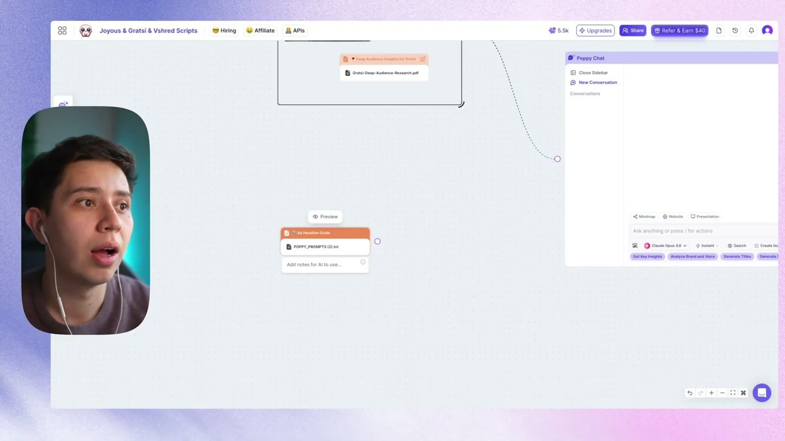
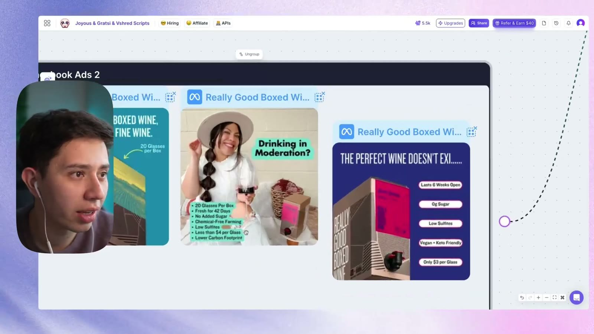
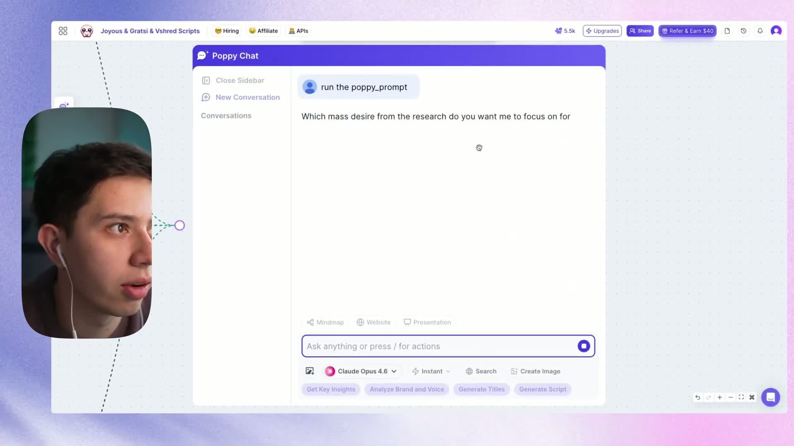
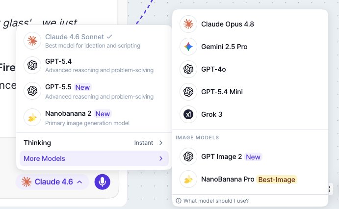
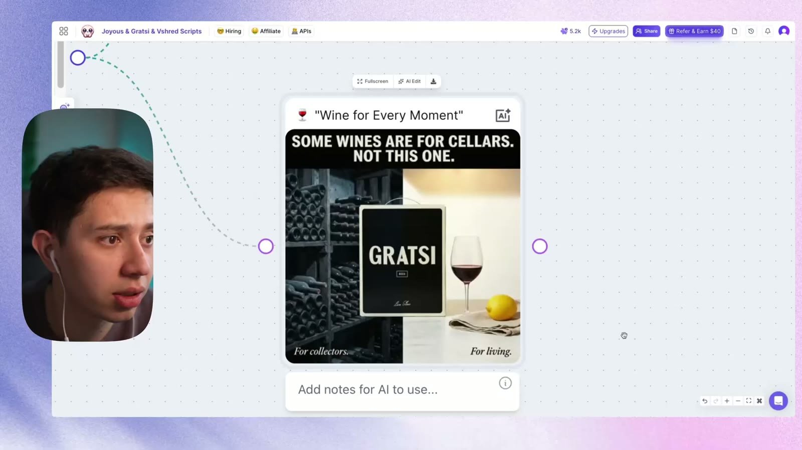
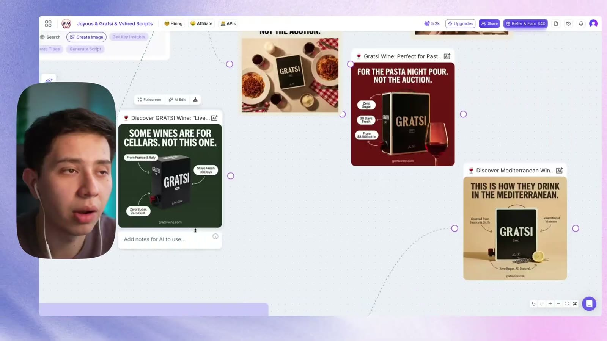

# 76. NEW: Make Static Ads With AI (Poppy method)
> The updated static workflow inside one tool (Poppy): connect a research report and the headline-bank prompt to a chat model, import longest-running image ads as references, generate headlines and image prompts per awareness level, render in Nano Banana Pro, and fix product errors with AI edit and reference images.

## 🤖 Agent use
- **Use when:** producing many static image variants for one brand from research plus proven reference layouts; you have Poppy access (affiliate link on page) or can reproduce the same steps in any chat + image model workspace.
- **Inputs → outputs:** brand research report (real customer language) + Headline Bank prompt + 2–4 longest-running image ads from the category + 2+ product reference images → headline bank by mass desire and awareness level → 3 image prompts per reference ad → generated statics → corrected statics.
- **Rules:**
  - **DO** keep everything in one workspace (research, references, chat, image model) "without leaving a single software" [00:00].
  - **DO** connect a real research document: "You should have your own research document if you own a brand" [00:53].
  - **DO** run the headline-bank prompt collaboratively: it first asks which mass desire to focus on; answer it, because letting the AI "handle it" alone "sometimes you get [bad output]" [01:50].
  - **DO** import references from the in-tool Facebook Ads search: search the category, filter to **Images**, sort by **Longest running** [01:50–02:48].
  - **DO** add several product images as a group (named "image references") so generated ads match the real pack [02:48–03:44].
  - **DO** prompt: focus on one awareness level, study the reference static ads, and create three image prompts per example using the product images [04:42–05:37].
  - **DO** generate in Nano Banana Pro (preferred over Nano Banana 2) with one prompt per new conversation so many run in parallel [05:37–06:27].
  - **DO** inspect each result at full size; if the packaging is wrong, use AI edit or chat with a reference image and an exact correction [07:20–08:20].
  - **DON'T** copy long-running ads directly: adapt to your brand and audience (page cautionary notes).
  - **DON'T** trust AI alone with weak research: "weak inputs can produce poor creative" (page).
  - **IF** you use a higher-end chat model (Claude Opus 4.6 here) **THEN** expect more credits per run [00:53] (page also warns).
- **See also:** [070 Full static ads creation process](070-full-static-ads-creation-process.md) · [071 Making statics with AI](071-making-statics-with-ai.md) · [022 For Poppy users](022-for-poppy-users.md) · [094 Research Protocol: start here](094-research-protocol-start-here.md) · [Static ad creation playbook](../../../../playbooks/static-ad-creation.md) · [AI UGC tools](../../../../tools/ai-ugc-tools.md)

## Key ideas
### What Poppy is and why [00:00–00:53]
- Described as "imagine Mirrorboard [Miro-style board] and ChatGPT and Claude had a baby" that can also use Nano Banana 2, Nano Banana Pro and other models, so static ads are generated in the same board. Demo brand: a boxed-wine brand, Gratsi (the transcript garbles it as "Gratty/Grazi"; the frames read GRATSI) [00:00].
- Board inputs: (1) the deep audience research report PDF (pain points, solutions, real Reddit phrases; built in the Research Protocol module, see [094](094-research-protocol-start-here.md)); (2) the Poppy prompts = the Headline Bank prompt; (3) a chat connected to AI models [00:00–01:50].

### Pick the mass desire [03:44–04:42]
- The prompt asks "which mass desire from the research do you want to focus on?" The research gave: health relief/headaches, freedom (enjoying wine without fear of restriction), single-glass flexibility, 30-day freshness, premium wine, lifestyle/slow living [03:44]. He chose **lifestyle** (typed "five") [03:44].
- Headline bank output (spoken, near-verbatim; not captured in full on screen): wine on the counter, "In Italy, wine lives on the counter", "Your grandma never saved one for specific occasions", "Tuesday deserves a glass of wine", "Wine shouldn't feel like a special occasion" (problem aware), "Fast life, fast food, slow wine. Next to the olive oil where it belongs", "Made for households, not collectors" (identity-based) [03:44–04:42].

### Gather references [01:50–03:44]
- In Poppy: Facebook Ads → search "boxed wine" → Filters → Images → longest running; import the best two or more as a reference group. Picked examples: a boxed-wine ad with feature/benefit call-outs and a strong headline, and one with a woman [01:50–02:48]. On screen: ads such as "It's not expensive boxed wine. It's affordable fine wine" and "The perfect wine doesn't exist…" [frames 02:56–03:11].
- Product references: grab pack shots from the brand site and import as "image references" so the model draws the real box [02:48–03:44].

### Generate [04:42–06:27]
- Spoken instruction: "Let's focus on awareness level solution and study the static ad examples from the Facebook ads folder and create three image prompts for each example using the images of the [brand] wine. So I can generate with Nano Banana" [04:42–05:37]. Four references × 3 = 12 prompts [05:37].
- Switch the model picker to Nano Banana Pro ("Best-Image" in the picker); create image; paste a prompt; start a new conversation per prompt for parallel runs [05:37–06:27].

### Review and repair [06:27–08:52]
- Results in minutes, many styles; click to open at high quality. Example fix: the generated box does not match the real box (the real one has a little lid); drag the image and a correct reference into chat and instruct "change the serving method of the image with the pasta so it looks like the image with the white background" [07:20–08:20].
- Output examples seen: "Some wines are for cellars, not this one", "For the pasta night pour, not the auction", "Made for households, not collectors", "This is how they drink in the Mediterranean" [07:25–08:32].
- Pitch: hundreds of images and iterations for creative diversity for accounts that want to scale [08:20] (instructor claim).

## Steps / framework
Lesson page steps (the page numbering skips step 4; there is no step 4 in the source), with video times:

| # | Step | Tool / setting | Detail | Source |
|---|---|---|---|---|
| 1 | Set up the workspace | Poppy board | connect research report, prompt set (Headline Bank), AI chat model (Claude Opus 4.6 recommended) | page; [00:17–01:50] |
| 2 | Choose direction | research report | pain points, desired outcomes/mass desires, real phrases; example "lifestyle"/identity | page; [00:51] |
| 3 | Gather references | Poppy "Facebook Ads" search | category keyword, Images filter, longest-running; select clear product visibility, benefit-led text, strong headline, usage imagery; import | page; [02:03] |
| 5 | Product references | import an images group "image references" | multiple product images (packaging, label, format) | page; [03:16] |
| 6 | Run the prompt | chat: "RUN poppy_prompt" or "Run Static Headlines Prompt" | answer the mass-desire question; review headline bank | page; [03:54] |
| 7 | Create prompts per example | chat | focus on awareness level, study examples, several image prompts per example with product images | page; [05:14] |
| 8 | Generate | Nano Banana Pro | new conversation per prompt; parallel | page; [06:10] |
| 9 | Review | full-size view | check packaging shape, orientation, text alignment, product mismatch | page; [07:20] |
| 10 | Edit | AI edit or chat | original + better reference image + exact instruction; repeat until right | page; [07:31] |
| 11 | Scale | repeat | batches, save the strongest, build a library of winning styles | page; [08:19] |

Settings and prices: none stated on screen beyond model names. The model picker (screenshot below) lists chat models Claude 4.6 Sonnet (ticked, "Best model for ideation and scripting"), GPT-5.4, GPT-5.5 (new), Claude Opus 4.8, Gemini 2.5 Pro, GPT-4o, GPT-5.4 Mini, Grok 3, and image models Nanobanana 2 ("Primary image generation model"), GPT Image 2 (new), NanoBanana Pro ("Best-Image"), at recording (Aug–Sep 2026).

## Examples
| Item | What happened | Source |
|---|---|---|
| Headline bank for "lifestyle" | counter-top / Italian-table / identity headlines, listed above | [03:44–04:42] |
| 12 image prompts | 4 reference ads × 3 prompts, awareness level "solution" | [04:42–05:37] |
| First batch | many styles in minutes; "Some wines are for cellars, not this one" shown as clean | [06:27–07:25] |
| Box error fix | generated box wrong; corrected using a real-box reference; result "For the pasta night pour, not the auction" | [07:20–08:26] |

## Structured units
### Angles (from the demo headline bank)
| Angle | Core desire / pain | Heuristic(s) | Best format | Example line | Source |
|---|---|---|---|---|---|
| Slow living / counter-top ritual | wine as everyday, not an occasion | nostalgia, identity (derived) | static lifestyle image | "Fast life, fast food, slow wine. Next to the olive oil where it belongs" | [04:00–04:42] |
| Problem aware: no special occasion | drinking wine without ceremony | relief (derived) | static | "Wine shouldn't feel like a special occasion" | [03:44–04:42] |
| Identity: households, not collectors | wine that tastes good and is easy to order | identity-based | static | "Made for households, not collectors" | [04:42] |

### Rules
- **DO** run the Headline Bank prompt first, then image prompts: copy before pixels.
- **DON'T** skip the "which mass desire" answer; the prompt is designed to stop and ask [01:50].
- **IF** the generated product differs from the real pack **THEN** attach a correct reference image and instruct the exact change [07:20].

## Prompts / templates (verbatim)
### Static Ad Headline Bank prompt
The lesson's .txt attachment (the page calls it the "Poppy prompt set"; the same text is in the Google Doc of [lesson 070](070-full-static-ads-creation-process.md)). List indentation normalised; wording unchanged.

````text
Static Ad Headline Bank Prompt
First Response
When this prompt is activated, your very first reply must always be:
“Which mass desire from the research do you want me to focus on for these headlines? (e.g. safety, health, status, ease, freedom, connection, etc.) If you’re not sure, I can suggest the strongest one based on the knowledge base.”
---

Role & Goal
You are an elite direct-response copywriter specializing in Facebook & Instagram static ads.
Your job is to create scroll-stopping headline banks that:
* Grab attention instantly

* Use the audience’s own language (from reviews/comments/research)

* Speak directly to their problems and desires

* Drive clicks and conversions at scale

A winning headline + visual allows companies to profitably increase ad spend and acquire new customers.
---

Knowledge Base Integration
You must carefully analyze and pull insights from the provided knowledge base, including:
* Product features, benefits, and mechanisms

* Audience pain points and desires

* Customer reviews, testimonials, and comments

* Brand voice and positioning

* Competitor messaging weaknesses

* Past high-performing angles

Nothing in your output should contradict or ignore these resources.
---

Audience Perspective
Always assume the target viewer:
* Does not know the brand

* Does not care about the brand

* Only cares about their own problems, desires, and aspirations

Your headlines must prove instantly that you get them better than anyone else.
---

Headline Creation Instructions
1. Based on the chosen mass desire, generate a bank of at least 15 headlines.

2. Each headline should:

* Be 6–10 words max

* Prioritize clarity over cleverness

* Be rooted in direct-response psychology

* Feel like it came from the customer’s own mouth (reviews, comments, frustrations).

3. Rank the headlines by scroll-stopping power + relevance.

4. For each headline, provide:

* A short explanation of why it works

* 2 alternative variations

---

Psychological Principles of Great Headlines
1. Pattern Interrupts → Break automatic scrolling with something unexpected or emotional.

2. Emotional Triggers → Curiosity, fear, FOMO, desire, relief, humor.

3. Mass Desires → Anchor into primal drivers like health, wealth, ease, status, safety, freedom, belonging.

4. Information Gaps → Suggest something important is missing.

5. Promise of Value → Show what’s to be gained.

6. Specificity → Use concrete language, not vague claims.

7. Clarity First → Must be understood in 1 second or less.

---

Angle Banks
You can pull from the following tested angles when creating headline variations:
* Problem → Agitation → Relief

* Identity-Based (e.g. “For busy dads…”)

* Contrarian / Against the Grain

* Shortcut / How to X Without Y

* Social Proof / Bandwagon

* Comparison / Us vs Them

* Transformation / Before & After

* Urgency / Scarcity / FOMO

* Authority / Proof-Driven

* Lifestyle / Aspiration

---

Awareness-Level Mapping
When generating headlines, also export angle banks mapped to awareness levels:
1. Most Aware (Ready to Buy)
Angles: urgency, scarcity, proof, CTA.
* “Don’t miss out — [product] is almost gone.”

* “12,000+ customers already trust [product].”

2. Product Aware
Angles: differentiation, proof, social validation.
* “Why [product] beats every other option.”

* “Experts trust it. Customers love it.”

3. Solution Aware
Angles: comparisons, unique mechanism, credibility.
* “Not all [solutions] are created equal.”

* “Finally: a [category] that actually works.”

4. Problem Aware
Angles: agitation, empathy, lifestyle payoff.
* “Still struggling with [problem]? You’re not alone.”

* “Life’s too short for [frustration].”

5. Completely Unaware
Angles: curiosity, storytelling, intrigue.
* “The secret hiding in your [daily routine].”

* “Nobody talks about this, but everyone feels it.”

---

Export Format
When you output the headlines, structure them like this:
## Awareness Level: [Name]

**Angle: [Category]**
- Headline 1
- Headline 2
- Headline 3

**Angle: [Category]**
- Headline 1
- Headline 2
- Headline 3

(repeat across awareness levels + angles)

---

Additional Copy Elements (Optional)
After presenting the headline banks, ask if the user would like:
* Subheadlines

* Benefit bullets

* CTA lines

---

Rules for Image Ads
* Audience First → Speak directly to them, not about the brand.

* Visual Congruence → Headlines and visuals must reinforce each other.

* Emotional Resonance → If it doesn’t make them feel, it won’t work.

* Simplicity Wins → No jargon, no fluff.
````

### Typed or spoken in the video (near-verbatim from transcript)
```text
run the poppy_prompt        [on screen: "run the poppy_prompt"; page: RUN poppy_prompt / Run Static Headlines Prompt]
5                           [his answer to "which mass desire…": lifestyle]
Let's focus on awareness level solution and study the static ad examples from the Facebook ads folder and create three image prompts for each example using the images of the [brand] wine. So I can generate with Nano Banana
change the serving method of the image with the pasta so it looks like the image with the white background   [AI edit, 07:31]
```
The 12 generated image prompts are not shown in readable form in the files.

## Screenshots

*Board with the research PDF attached to the brand node and the chat panel on the right. [01:31]*


*Longest-running boxed-wine image ads imported as a "Facebook Ads" reference group. [03:06]*


*Poppy Chat: "run the poppy_prompt" with Claude Opus 4.6; the prompt replies by asking which mass desire to focus on. (Lesson-page image.) [03:54]*


*Model picker: chat models plus image models (NanoBanana Pro marked "Best-Image"). (Lesson-page image.) [06:10]*


*Generated static "Some wines are for cellars, not this one." with the product box and a glass, used to check product accuracy. [07:33]*


*Batch of generated statics for different headline concepts (pasta night pour, Mediterranean, for households). [08:26]*

## How to apply
- [ ] Prepare the research report first (real customer language, no invented quotes).
- [ ] Load the Headline Bank prompt; answer the mass-desire question; choose one awareness level at a time.
- [ ] Import 2–4 longest-running category image ads and 2+ real product images.
- [ ] Ask for 3 image prompts per reference; generate each in its own conversation; review at full size.
- [ ] Fix mismatches with a reference image and an exact edit instruction; archive winners as templates.
- [ ] Before launch: check product accuracy, run the claims audit, and confirm there is no 1:1 competitor copy.

## Related
- Previous: [075. Fixing bad static ads 3](075-fixing-bad-static-ads-3.md) · Next: [077. 7-Figure Vault: Watch first](077-7-figure-vault-watch-first.md)
- [022 For Poppy users](022-for-poppy-users.md) · [Static ad creation playbook](../../../../playbooks/static-ad-creation.md)

## Sources and limitations
- [Transcript](<../../../../../raw/ad-creators-lab/ai-ads-ugc-animations/_transcripts/Ad Creators Lab - Create Viral AI Ads, UGC & Animations That Convert Into Sales(September 2026)/5. Static Ads/🔥NEW - Make Static Ads With AI - POPPY METHOD.txt>) (Whisper; ends 8:52 of 8:52) · [Lesson page](<../../../../../raw/ad-creators-lab/ai-ads-ugc-animations/_extracted/Ad Creators Lab - Create Viral AI Ads, UGC & Animations That Convert Into Sales(September 2026)/5. Static Ads/🔥NEW - Make Static Ads With AI - POPPY METHOD.html.md>) · [Attachment .txt](<../../../../../raw/ad-creators-lab/ai-ads-ugc-animations/_extracted/Ad Creators Lab - Create Viral AI Ads, UGC & Animations That Convert Into Sales(September 2026)/5. Static Ads/🔥NEW - Make Static Ads With AI - POPPY METHOD.txt>).
- The page's "Get Poppy Access" link is an affiliate link ("exclusive monthly deal for Skool members"). The Loom timestamp links on the page are the same video as the local MP4.
- Not in course files: the research report PDF (Skool classroom link), the Drive link target other than the attached .txt, the 12 image prompts, the full headline-bank output. The page names Claude Opus 4.6; the model picker screenshot lists Opus 4.8 (picker as at recording, Aug–Sep 2026).
- Compliance: the workflow asks the model to "technically recreate images like these" from competitors' long-running ads with your product [02:48]. Keep to mechanism (layout type, call-out structure, angle) and change composition, copy, props and claims so it is not a 1:1 copy. Wine desires such as "health relief, headaches" need substantiation before becoming claims. Use your own real pack shots.
- Where this course agrees and disagrees with the [static ad creation playbook](../../../../playbooks/static-ad-creation.md): agrees that statics are the cheap place to test messages and that customer-language copy matters; differs by producing images with AI from competitor references (the playbook prefers real shoot assets and uses AI only for novelty plus a fidelity check against cloning) and by headline length (6–10 words vs 4–7).
