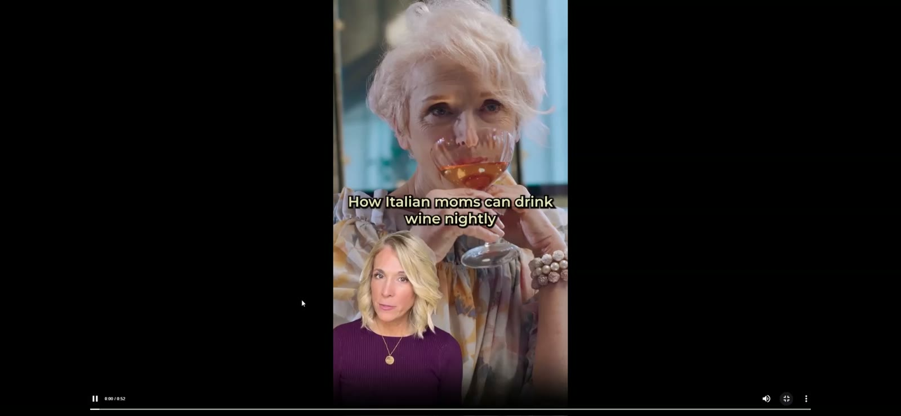
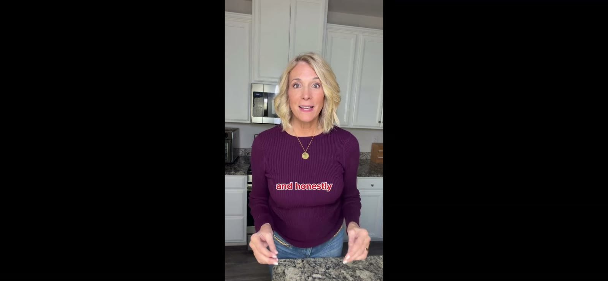
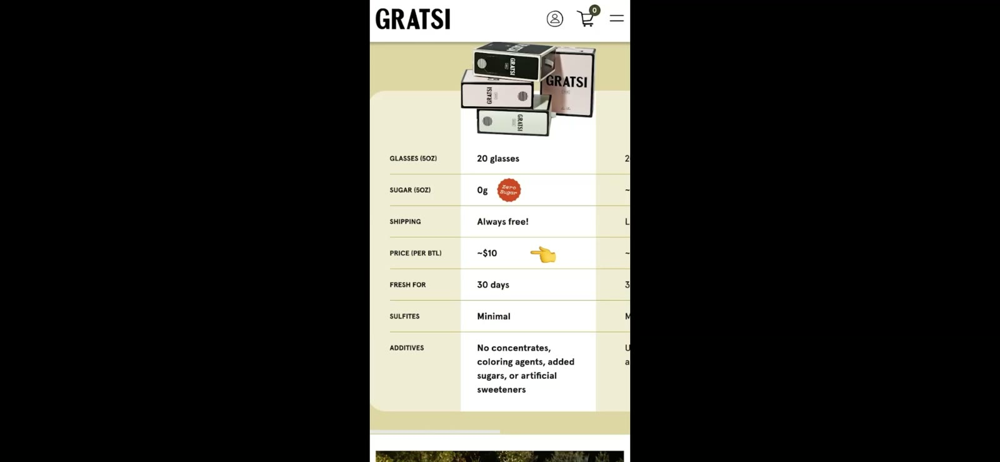
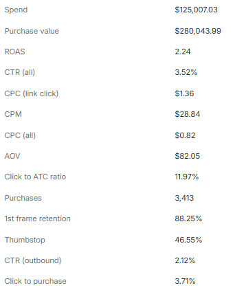

# 78. Wine Brand: $125K at 2.24 ROAS
> Justin tears down a 30-second AI-UGC-style script for Gratsi boxed wine that, per the instructor, spent about $125K on Meta at a 2.24 ROAS with a 46% hook rate, and extracts a reusable seven-beat structure: authority, desire, juxtaposition, mechanism through story, brand as part of the story, "so that" benefits, emotional close.

## 🤖 Agent use
- **Use when:** writing a short-form direct-response script for a solution-aware audience (consumer product with a known category and a known pain) and you need a hook that targets a segment, not everyone.
- **Inputs → outputs:** customer research (desire, linked pains, who the audience treats as an authority, words they use) + one unique mechanism + product facts → a 14-line script following the seven-beat structure below, plus visual notes per line.
- **Rules:**
  - **DO** open with an authority the *target* sees as an authority, then name the desire without naming the pain: "start up with an authority that your audience can relate to and sees as an authority" [20:55] (instructor claim that this structure produced the 46% hook rate).
  - **DO** use juxtaposition (two things that normally do not go together) to open a curiosity loop: drinks wine every night yet wakes at 6 a.m. making focaccia [11:37].
  - **DO** make the desire visual: "try and visualize not having a headache... try and visualize making fresh bread" [10:38]. A visual outcome is easier for the viewer and for the editor to picture.
  - **DO** deliver the new mechanism inside a story ("When I asked how she does it...") and tie it to something the viewer already knows (dry wine, Mediterranean-style winemaking = zero sugar) [13:27–17:06].
  - **DO** introduce the brand as the next step of the buyer's research ("hearing about it from my friend"), not as an announcement [17:37–21:53].
  - **DO** use the "so that" principle for each feature (fresh 30 days, so a glass Wednesday and another Saturday is "still perfect") [18:07].
  - **DO** sell emotion and identity ("no pressure to finish it", "without overthinking it or needing a special occasion"), not the product [19:05–20:00].
  - **DO** match the on-screen person to the buyer: Meta tends to show the creative to the demographic that looks like the person on screen [04:11–04:58] (instructor claim).
  - **DON'T** use CTR (all) as the click metric; use outbound CTR, because "all" counts accidental taps and "see more" clicks [00:52–01:51].
  - **DON'T** copy the script with new nouns: the principles (authority, juxtaposition, mechanism, belief chain) are the asset, not the lines [20:55] (derived from the closing recap).
  - **IF** compliance blocks the claim you want (e.g. "no hangover") **THEN** show the outcome indirectly with a concrete visual, as the Gratsi script did; the instructor says it "actually made the script better" [09:43].
- **See also:** [Market awareness](../../../evolve/copywriting/concepts/market-awareness.md) · [Unique mechanism](../../../evolve/copywriting/concepts/unique-mechanism.md) · [Authority in ads](../../../evolve/copywriting/concepts/authority-in-ads.md) · [Open loops](../../../evolve/copywriting/concepts/open-loops.md) · [Emotional zones](../../../../concepts/emotional-zones.md) · [KPIs and columns](../../../evolve/start-here/frameworks/kpis-and-columns.md) · [Lesson 020 (the Gratsi AI UGC brief)](020-claude-skill-seedance-2-0-ai-ugc.md)

## Key ideas
### The reported numbers [00:00–01:51]
- Spend $125,007 on Meta, purchase value $280,044, ROAS 2.24, purchases 3,413 (doc screenshot; instructor says "$125,000... $280,000" [00:00]).
- Thumbstop (hook rate) 46.55%: "one in almost every two people ended up actually stopping to watch the first three seconds" [00:00]. 1st-frame retention 88.25%.
- CPM $28.84, link CPC $1.36 ("good to get under a dollar, but it's very, very rare") [00:52], CTR (all) 3.52%, CTR (outbound) 2.12%, AOV $82.05, click-to-ATC 11.97%, click-to-purchase 3.71% (doc screenshot).
- "Anything above 2% on the CTR outbound is usually amazing" for the client KPIs [01:51] (instructor claim; see conflict with lesson 79 below).

### Read the demographics to choose the on-screen person [03:41–04:58]
- Purchases skewed female and 35-65+: he reads about 2,000 purchases from women and about 200 from men in the breakdown [03:41] (the screenshot total is 3,413 purchases; the split is read off the on-screen chart, not stated exactly).
- Claim: the on-screen woman looked mid-40s and Meta showed the ad to a matching older female audience; "usually shows the person that's on screen in your creative to that type of demographic" [04:11]. If the person were 20, delivery could shift to 18-44 and "this ad wouldn't have performed as well" [04:58] (instructor claim, no test shown).
- Application he states: when choosing UGC creators "or even AI UGC", the on-screen person should be the ideal buyer [04:58].

### Awareness level and emotional zone [04:58–06:52]
- Solution aware: the viewer knows solutions exist and is not yet convinced which one is best; the ad then moves them to product aware [05:51, 18:07].
- Valence/intensity: positive, warm, aspirational, "not leaning heavy into agitating their pain": zone 1 to zone 2 (doc) [05:51–06:22]. He contrasts this with zone 3/4 pain-led ads.

### Line 1: authority + desire + juxtaposition [06:52–12:32]
- Script line: "My Italian friend's mom drinks wine every single night, and yet she wakes up at 6 a.m. and makes fresh focaccia."
- Authority: the US target sees Italians/Mediterraneans as people who eat and drink freely and stay healthy ("some people from the U.S. go there... even lose weight") [08:46].
- Desire called out without stating it: drink every night without the side effects (headache, hangover, weight) [09:43].
- Compliance forced the indirect version ("we couldn't say she wakes up without a headache or without a hangover"); the viewer infers it from "up at 6 a.m." [09:43–10:38].
- Juxtaposition = wine every night + productive morning. It "creates that curiosity loop... I want to know how they did that" [11:37].
- Visuals: a green-screen older woman (a "Nona") on top of the creator to show who the friend's mom is, then real focaccia footage: "show, not tell"; he notes the focaccia is stock, "not the actual focaccia that happened" [06:52–08:46].
- All of this in about three seconds, "which is why... it had the 46% hook rate" [12:32] (instructor claim).

### Line 2: story + new mechanism [12:32–14:19]
- Script: "When I asked how she does it, she said it's because her mom drinks dry wine, not sweet." (the doc and the video both say "her mom drinks dry wine", i.e. the friend's mom's mom).
- "When I asked" turns information into a story: "like a friend telling you, oh, this is a secret that I learned" [13:27].
- Segmentation: the line speaks to people drinking sweet wine or unaware of dry wine, and raises the question "what is dry wine?" [14:19]; the viewer links dry wine to the desire (drink nightly, feel good).
- Visual: the creator talking to camera like to a friend, which reads as realistic; he contrasts it with someone typing on a computer [12:32].

### Line 3: explain the mechanism in known terms [15:12–17:06]
- Script: "I found out about Mediterranean-style winemaking, where they ferment the wine all the way through, so there's zero sugar left."
- "Mediterranean" adds authority (Italy is Mediterranean) and attaches to the mechanism [16:11].
- Chain: dry wine = Mediterranean-style = zero sugar; "zero sugar" is already a known idea, so the new concept is taught by relating it to something known [17:06, 21:53].
- Visual: old-style, homemade-looking winemaking footage rather than a factory; "this performance would probably be like in half, honestly, if that visual was not there" [15:12] (instructor claim, no test).

### Line 4: brand introduced as part of the research path [17:37–18:07]
- Script: "That's actually how I ended up hearing about Gratsi wine from my friend."
- The sequence (ask a friend, learn the winemaking, learn zero sugar, then the brand) mirrors this buyer's market-sophistication path and gives room to introduce the brand [17:37].
- Shift: solution aware → product aware [18:07].

### Lines 5-6: the product and the "so that" principle [18:07–19:05]
- Script: "Zero sugar, nothing unnecessary. It comes in a box that holds the same as four bottles, and it stays fresh for 30 days. So I can have a glass of wine on Wednesday and then another on Saturday and it's still perfect."
- He says the product is "very easy to sell" because its features map to this avatar's pains [18:07]; the "so that" line converts the 30-day freshness into a lived outcome.

### Lines 7-8: customer language and emotional close [19:05–20:00]
- Script: "There's never any pressure to finish it. No wine going bad in my fridge. It's like $10 a bottle. And honestly, it just fits into real life. It's simply having a glass with dinner on a Tuesday without overthinking it or needing a special occasion."
- Language comes from research: light drinkers who do not want to finish a bottle to avoid waste [19:05].
- "We're selling more of emotions, identity, their desires. We're not just selling our actual product" [20:00].

### The transferable structure (his recap) [20:00–22:48]
1. Open with an authority this audience accepts.
2. Call out the audience's desire.
3. Create juxtaposition: get the desire without the pain linked to it in their head. "Everything has to be based on the customer, not what you think" [20:55].
4. Second line: introduce the new mechanism through storytelling.
5. Third line: explain the mechanism by connecting it to something they already understand (here: zero sugar).
6. Introduce the brand as a step in the research journey ("feels like a friend told me").
7. Plug the unique mechanisms; link features back to the desire with "so that" (real-life scenes).
8. Finish with emotional and identity attachment to the experience.
- Closing ask: apply the structure and post results in the community [22:48].

## Steps / framework
Seven-beat structure adapted for a new brand (derived from the recap above):

| # | Beat | Question to answer from research | Wine example | Source |
|---|---|---|---|---|
| 1 | Authority line | Who does my buyer treat as proof that the desire is achievable? | "My Italian friend's mom..." | [06:52–09:43] |
| 2 | Desire as a visual | What does the outcome look like in a scene (not an absence)? | Wakes at 6 a.m., makes focaccia | [09:43–10:38] |
| 3 | Juxtaposition | Which pain normally comes with this desire? | Nightly wine + productive morning | [11:37] |
| 4 | Mechanism through story | What did the "friend" learn? | "When I asked... dry wine, not sweet" | [13:27] |
| 5 | Mechanism explained in known terms | What familiar word equals the mechanism? | Mediterranean-style = zero sugar | [16:11–17:06] |
| 6 | Brand as the next research step | How did the buyer find the product? | "from my friend" | [17:37] |
| 7 | "So that" feature chain | What life scene does each feature enable? | 30 days fresh → Wednesday and Saturday glass | [18:07] |
| 8 | Emotion and identity | What feeling does the buyer want? | No pressure, no overthinking, Tuesday dinner | [19:05–20:00] |

## Examples
**Ad:** Gratsi boxed wine, solution-aware script, green-screen older woman on top of a kitchen-counter creator; in the frames, the creator talks to camera in a kitchen, subtitles burned in, a product-page comparison card is cut in (glasses per box, sugar 0 g, about $10 per bottle, 30 days fresh, additives list) [03:16].

| Metric (doc screenshot) | Value |
|---|---|
| Spend / purchase value | $125,007 / $280,044 |
| ROAS | 2.24 |
| Hook rate (thumbstop) | 46.55% |
| 1st-frame retention | 88.25% |
| CTR all / outbound | 3.52% / 2.12% |
| CPM / link CPC | $28.84 / $1.36 |
| AOV | $82.05 |
| Click-to-ATC / click-to-purchase | 11.97% / 3.71% |
| Purchases | 3,413 |

## Structured units
### Ad teardown
| Brand / product (niche) | Format | Hook / opening | What works | What fails | Fix suggested | Principle | Source |
|---|---|---|---|---|---|---|---|
| Gratsi boxed wine (alcohol) | Creator talking head with green-screen "Nona" and B-roll, length not stated (played in full at [01:51]-[03:41]) | "My Italian friend's mom drinks wine every single night, and yet she wakes up at 6 a.m. and makes fresh focaccia." | Authority + desire + juxtaposition in 3 s; mechanism told as a story; feature-to-lived-outcome chain; emotional close | Nothing flagged by the instructor | none; he suggests testing the same structure on other brands | authority, open loop, unique mechanism, "so that" | [06:52–22:48] |

### Hooks
| Hook (verbatim or near) | Heuristic(s) | Emotion / zone | Self targeted | Why it works | Source |
|---|---|---|---|---|---|
| "My Italian friend's mom drinks wine every single night, and yet she wakes up at 6 a.m. and makes fresh focaccia." | authority, juxtaposition, show-don't-tell | warm, aspirational; zone 1-2 | adult wine drinkers who suffer next-day effects; women 35-65 | Desire shown as a visual scene; two things that don't go together open a loop | [06:52–12:32] |
| On-screen text: "How Italian moms can drink wine nightly" (frame) | authority, curiosity | zone 1-2 | same | Repeats the hook as text over the green-screen visual | [02:35 frame] |

### Rewrites / possible variants (derived from his notes)
| Before | After | What changed | Source |
|---|---|---|---|
| "wakes up without a headache" (blocked by compliance) | "wakes up at 6 a.m. and makes fresh focaccia" | Outcome expressed as a visual scene; claim implied, not stated | [09:43–10:38] |
| "how Italian moms drink nightly" | "how Nonas can drink wine nightly" (his alternative wording) | Uses a term the audience already knows for Italian grandmothers | [06:52] |

### Rules
- **DO** pair every script line with a concrete visual the editor can source [07:49].
- **DO** choose footage that fits the mechanism's origin story (homemade vs manufacturing plant) [15:12].
- **DON'T** judge the creative by CTR (all) [00:52].
- **IF** the audience is not unaware of the problem **THEN** start at the solution (not the problem) so you do not reset their belief about products they already know [05:51] (derived).

## Prompts / templates (verbatim)
Script as shown in the document (bold = ad transcript), for structure study only:

```text
My Italian friend's mom drinks wine every single night, and yet she wakes up at 6 a.m. and makes fresh focaccia.
When I asked how she does it, she said it's because her mom drinks dry wine, not sweet.
I found out about Mediterranean-style winemaking, where they ferment the wine all the way through, so there's zero sugar left.
That's actually how I ended up hearing about Gratsi wine from my friend.
Zero sugar, nothing unnecessary.
It comes in a box that holds the same as four bottles, and it stays fresh for 30 days.
So I can have a glass of wine on Wednesday and then another on Saturday and it's still perfect.
There's never any pressure to finish it. No wine going bad in my fridge. It's like $10 a bottle. And honestly, it just fits into real life.
It's simply having a glass with dinner on a Tuesday without overthinking it or needing a special occasion.
```

Fill-in template (derived, not from the course):

```text
[Authority the audience trusts] [does the desired thing often] and yet [shows the opposite of the usual pain, as a visual].
When I asked how, [they/she] said it's because [new mechanism, in the audience's words].
I found out about [origin of the mechanism] where [what it means], so [familiar idea they already understand].
That's how I ended up hearing about [Brand] from [friend / source].
[Feature]. [Feature]. So [lived scene].
[Customer-language line from research]. It just fits into real life.
[Identity line: the feeling without the occasion/pressure].
```

## Screenshots

*The first three seconds: a green-screen "Nona" with a glass over the creator, with text hook. The instructor credits this visual for the 46% hook rate. [02:35]*


*Body style: a friend-to-friend kitchen shot with burned-in captions, which he says makes the story feel real. [03:18]*


*Product-page comparison cut in during the ad (glasses per box, sugar, price per bottle, freshness). [03:16]*


*The full metrics list in the breakdown doc: spend $125,007, ROAS 2.24, thumbstop 46.55%, outbound CTR 2.12%. Instructor-reported, not independently verifiable.*

## How to apply
- [ ] Pull the audience's authority figure, the linked pain and the exact words from Reddit/reviews before writing; list what is missing.
- [ ] Write the seven beats; make beat 2 a visual scene, not an absence of a symptom.
- [ ] Keep compliance-sensitive outcomes implied; avoid health or "no hangover" claims and run the draft through the [claim audit](../../../stefan-georgi/rmbc-ii/rubrics/llm-output-claim-audit.md).
- [ ] Brief the editor with one visual per line (green screen, stock B-roll, product page).
- [ ] Cast the on-screen person to match the buyer age and gender.
- [ ] Read results on spend and ROAS first, then outbound CTR, hook rate and demographics ([KPI framework](../../../evolve/start-here/frameworks/kpis-and-columns.md)).

## Related
- Previous: [077. Watch First](077-7-figure-vault-watch-first.md) · Next: [079. Intimacy brand $200K at 2.3 ROAS](079-intimacy-brand-200k-at-2-3-roas.md)
- [Lesson 020: Gratsi AI UGC brief and Seedance skill](020-claude-skill-seedance-2-0-ai-ugc.md) (same brand, production side)

## Sources and limitations
- [Transcript](<../../../../../raw/ad-creators-lab/ai-ads-ugc-animations/_transcripts/Ad Creators Lab - Create Viral AI Ads, UGC & Animations That Convert Into Sales(September 2026)/6. 7-Figure Vault (NEW)/2. Wine Brand 125K at 2.24 ROAS.txt>) (Whisper; 1413.35 s, last segment ends 1413.01 s, complete). Whisper wrote "Grazi" for Gratsi and "Camillo" for Camilo; "CTRL" = CTR; "Andromeda" is Meta's ad-delivery system as named by the speaker.
- [Lesson page](<../../../../../raw/ad-creators-lab/ai-ads-ugc-animations/_extracted/Ad Creators Lab - Create Viral AI Ads, UGC & Animations That Convert Into Sales(September 2026)/6. 7-Figure Vault (NEW)/2. Wine Brand $125K at 2.24 ROAS.htm.md>) · [Winning Ad Breakdown Doc text](<../../../../../raw/ad-creators-lab/ai-ads-ugc-animations/_extracted/_linked/google/1d7DsLntShCR.md>) (confidential, internal-use notice in the doc). The doc links a Google Drive folder (ad file) and a Loom of the same breakdown; neither is in the course files (the Loom is the video above).
- All spend, ROAS, demographics and "why it worked" claims are the instructor's; no A/B test isolates any single cause (visual vs copy vs target). The "Andromeda shows the on-screen person's demographic" idea is unproven.
- Compliance flags (derived): the script is a first-person story ("my Italian friend's mom...") told by a creator; presenting an invented anecdote as real is a testimonial risk, so use only anecdotes you can source or label as a dramatization. Alcohol ads are age- and claim-restricted on Meta: the "no hangover" implication was blocked in the original and any wellness or "feel good the next day" claim needs substantiation. "Zero sugar", "30 days fresh" and "$10 a bottle" are the brand's claims. The purchases-by-gender figure in the video (about 2,000 and 200) does not add up to the 3,413 in the metrics screenshot.
