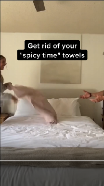
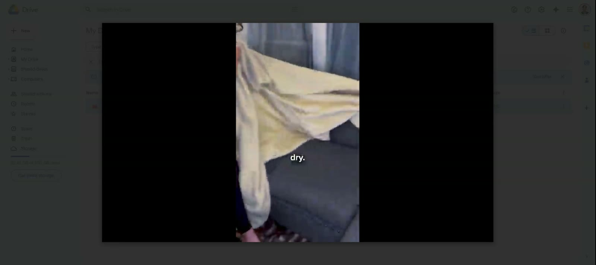
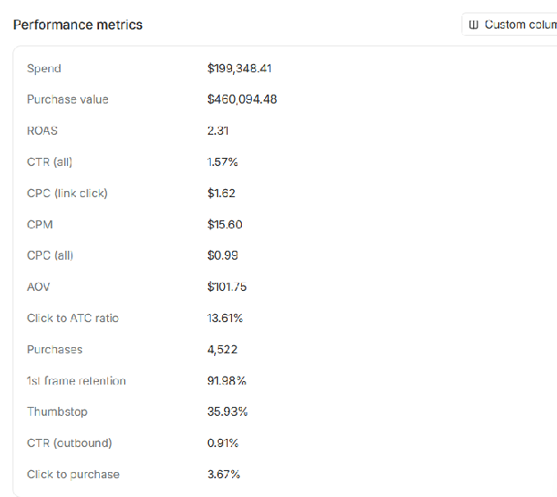

# 79. Intimacy Brand: $200K at 2.3 ROAS
> Justin dissects the Love Blanket ad, a solution-aware script that spent about $199K at a 2.31 ROAS (instructor claim) by attacking the audience's current fix (towels), shifting one belief, stacking benefits and tying each to Reddit-sourced real-life scenes; the emotional path runs zone 3 to zone 1 with a brief zone 4 dip.

## 🤖 Agent use
- **Use when:** the category already has a common DIY or incumbent solution (towels, puppy pads, plastic sheets) and the buyer is solution aware; you want a script that moves them from "my current fix is fine" to "I need a better one".
- **Inputs → outputs:** the incumbent solutions and why each fails (from research), the product's mechanism and 3-5 features, the buyer's real-life scenes in their own words (Reddit, reviews) → a ~25-line script: pattern interrupt, twist-the-knife problem lines, product intro, benefit stack, lived-experience lines, new-belief close.
- **Rules:**
  - **DO** start where the buyer already is: name their current solution and tell them it is not okay: "Stop pretending your crusty, spicy time towels work" [07:47–08:32].
  - **DO** use research vocabulary for the incumbent ("spicy time" is Reddit language) [07:47].
  - **DO** twist the knife over several lines, each explaining why a different substitute fails (towels leak, puppy pads crinkle, cheap sheets lie) [09:27].
  - **DO** introduce the product quickly: in a solution-aware state "you don't need much intro or persuasion", you are shifting a belief [10:24].
  - **DO** stack benefits as a direct contrast to the incumbent, then convert each into the lived experience (no 3 a.m. sheet change, no ruined $1,500 mattress, no holding back) because "that's ultimately what they're buying" [11:33–12:23].
  - **DO** close on the new belief ("Pleasure should not give you anxiety or laundry") [12:23–13:15].
  - **DO** write the open-loop visual: the first three seconds show a couple happily laying down a blanket so the viewer wonders what it is [07:47].
  - **DON'T** copy the script with new nouns: "You have to take the actual principles... the belief shifts" [10:54–11:33].
  - **DON'T** treat polish as a requirement: a misspelled word ("Plesure") ran in the winner [01:40]. Do still fix it in your own cut (derived).
  - **IF** the ad lacks risk reversal or offer **THEN** test variants with the guarantee, urgency and discount; the instructor lists these as the missed opportunity [13:15–13:51].
- **See also:** [Market awareness](../../../evolve/copywriting/concepts/market-awareness.md) · [Labels and customer language](../../../evolve/copywriting/concepts/labels-and-customer-language.md) · [Beliefs](../../../evolve/copywriting/concepts/beliefs.md) · [Valence](../../../../concepts/valence.md) · [Valence-intensity diagnostic](../../../../frameworks/valence-intensity-diagnostic.md) · [Emotional zones](../../../../concepts/emotional-zones.md) · [KPIs and columns](../../../evolve/start-here/frameworks/kpis-and-columns.md) · [LLM output claim audit](../../../stefan-georgi/rmbc-ii/rubrics/llm-output-claim-audit.md)

## Key ideas
### Reported performance [00:00–02:32]
- Spend $199,348, purchase value $460,094, ROAS 2.31, 4,522 purchases (doc screenshot; instructor: "almost $200,000... $460,000... 2.31 ROAS at scale") [00:00].
- Soft metrics he calls "decent... nothing spectacular": CTR (all) 1.57% ("technically pretty low"), thumbstop 35.93%, 1st-frame retention 91.98%, CPM $15.60, link CPC $1.62, AOV $101.75, click-to-ATC 13.61%, click-to-purchase 3.67%, CTR outbound 0.91% (doc screenshot).
- Interpretation: hook rate 35% "is still good but not amazing"; "it got high intent people... we don't need to capture 50% of the audience if we can capture 35% at high intent" [02:32] (instructor claim).
- Perfection is not the driver: the winner shipped with a misspelling and "your ad looking perfect is not the reason why it's going to win" [01:40].

### Awareness level: solution aware [02:32–05:08]
- Entry: "get rid of your spicy time towels". The problem (protecting the mattress during sex) already has solutions: towels, puppy pads, crinkly plastic, waterproof sheets [02:32–03:24].
- "If you're trying to hit a higher awareness market, this ad wouldn't work. If you're trying to hit a product aware market, this ad wouldn't work" [03:24].
- Definition used: solution aware = aware that solutions exist but not convinced which is best; product aware = knows which product they want [04:09]. Brought in from the Evolve definition (doc, as quoted again in lesson 80).

### Valence and intensity zones [05:08–07:47]
- Explained with the zone chart credited to "Sarah Levenger" (Whisper spelling; the course also teaches this in [Emotional zones](../../../../concepts/emotional-zones.md)): high valence/low intensity (cozy, calm, supportive, reassuring) = zone 1; high/high (joy, thrill, excitement, pride) = zone 2; low valence/low intensity (annoyance, disappointment, fatigue, irritation) = zone 3; low/high (panic, sadness, loss, anxiety) = zone 4 [05:08–06:06].
- Path of this ad: opens zone 3 ("bunch up, stink a bit, wake up in the wet spot": annoyance, resignation, dry humour), dips into zone 4 ("no holding back your climax because you're scared of the mess": anxiety, inhibition), closes in zone 1 ("Pleasure should not give you anxiety or laundry": relief, permission) [06:06–06:56].
- Rule of thumb he states: "most ads end up closing in zone one... and usually open in a lower zone" [06:56] (instructor claim).

### Hook mechanics [06:56–09:27]
- On-screen text "Get rid of your 'spicy time' towels" creates an open loop: people who use towels wonder why they should drop them. Analogy: "get rid of your toothbrush" [07:47].
- Visual open loop: first 3 s show a couple putting down a blanket; the viewer does not know what it is, which "makes them want to watch" [07:47].
- Voiceover pattern interrupt: "Stop pretending..." addresses the audience, tells them their solution is not okay and that "this is an actual problem that needs fixing". "Crusty" is a visual word. Doc note: pairing with a shot of a crusty towel would have been better [08:32; doc].
- "Slippery slope effect": the loop stays open for the whole ad, which keeps most viewers watching while selling [08:32].

### Twist the knife, then reveal the product [09:27–10:24]
- "They bunch up, stink a bit, and you still wake up in the wet spot" [09:27]; "Towels leak. Those puppy pads crinkle like a damn hospital bed. Cheap waterproof bed sheets, they lie. They all leak." (doc and video).
- Belief shift: from "my towel does the job" to "my towel doesn't do the job, it's gross, and I need a better solution" [10:24]. "This Love Blanket actually fixes the problem" lands after that shift.

### Benefit stacking as risk reversal [10:24–11:33]
- Lines: "The top soft layer absorbs everything. The inner layer blocks out all leaks. Feels like a soft throw blanket. No plastic, no noise, no slipping around. You can literally soak it and your mattress stays bone dry."
- Each benefit is a comparison to the incumbent: "reversing the risk for the customer buying because we're validating their new belief" [10:54].

### Tie benefits to lived experience [11:33–13:15]
- "Now, you don't have to change the sheets at 3:00 AM when you are tired and wanna stay in bed cuddling after a night of passion. No more stressing about ruining a $1,500 mattress. No holding back your climax because you're scared of the mess, and actually enjoy the moment without thinking, [sh*t] we're gonna have to clean this up."
- "It's not because of the benefits. The benefits allow the in-person experiences to happen, and that's ultimately what they're buying" [11:33]. They are "pulled straight from Reddit threads... real people said online" [12:23].

### Close: new belief and bridge [12:23–13:15]
- "Pleasure should not give you anxiety or laundry. You just need a Love Blanket." Previously the buyer thought anxiety and laundry were part of the experience; now it "doesn't actually have to be that way", with the product as the bridge from here to there [13:15].

### What was missing and what to test [13:15–13:51]
- Missed risk reversal and urgency: the brand has a 30-night guarantee; "grab it now before stock runs out"; show the offer (53% off) [13:15–13:51; doc]. He is unsure it would help, because "the way this voiceover worked sounded more like a friend recommendation rather than their brand selling" [13:51].
- Method: form hypotheses, make variations, test, see whether the extra CTA bits raise sales [13:51].

## Steps / framework
Solution-aware belief-shift script (derived from the breakdown):

| # | Move | Love Blanket line | Purpose | Source |
|---|---|---|---|---|
| 1 | Pattern interrupt aimed at the incumbent | "Stop pretending your crusty, spicy time towels work." | Tell them the current fix is not OK | [08:32] |
| 2 | Twist the knife (why it fails) | "They bunch up, stink a bit, and you still wake up in the wet spot." | Make the failure concrete | [09:27] |
| 3 | Twist further (every substitute fails) | "Towels leak. Those puppy pads crinkle... Cheap waterproof bed sheets, they lie." | Close escape routes | [09:27] |
| 4 | Product intro, short | "This Love Blanket actually fixes the problem." | Belief now: "I need a better solution" | [10:24] |
| 5 | Benefit stack vs incumbent | soft absorbent layer, leak-proof inner layer, no plastic, no noise, no slipping | Validate the new belief | [10:54] |
| 6 | Lived-experience lines (from research) | no 3 a.m. sheet change, no ruined mattress, no holding back | The real purchase reason | [11:33–12:23] |
| 7 | New-belief close | "Pleasure should not give you anxiety or laundry." | Reinforce the belief; soft landing in zone 1 | [12:23–13:15] |
| 8 | (Missing) risk reversal / urgency / offer | 30-night guarantee, stock, 53% off | Test as variants | [13:15–13:51] |

## Examples
| Ad | Version | What is in it | Reported result | Source |
|---|---|---|---|---|
| Love Blanket "LB Winner" (Drive file name not legible) | Winner | Couple lays a blanket; text "Get rid of your 'spicy time' towels"; voiceover as above; "Plesure" typo on screen | $199,348 spend, $460,094 value, ROAS 2.31, thumbstop 35.93% | doc screenshot; [00:00–01:40] |

## Structured units
### Ad teardown
| Brand / product (niche) | Format | Hook / opening | What works | What fails | Fix suggested | Principle | Source |
|---|---|---|---|---|---|---|---|
| Love Blanket (intimacy / bedding protection) | UGC-style demo with voiceover and text | "Stop pretending your crusty, spicy time towels work." + text "Get rid of your 'spicy time' towels" | Names incumbent solution; belief shift; benefit stack mapped to Reddit scenes; zone 3 to zone 1 arc | No guarantee, urgency or offer; hook rate only 35.93% (not poor, not strong); doc says a crusty towel visual would help | Test guarantee (30 nights), stock urgency, 53% off; pair "crusty towel" text with a towel shot | belief shift, open loop, benefit stacking, customer language | [07:47–13:51] |

### Hooks
| Hook (verbatim or near) | Heuristic(s) | Emotion / zone | Self targeted | Why it works | Source |
|---|---|---|---|---|---|
| "Stop pretending your crusty, spicy time towels work." | pattern interrupt, challenge to current solution, visual word ("crusty") | annoyance / irritation (zone 3) | couples using towels on the bed | Attacks the thing they do today, so they need to hear why | [08:32] |
| Text: "Get rid of your 'spicy time' towels" | open loop (toothbrush analogy) | zone 3 | same | They wonder why they should drop what works | [07:47] |

### Rewrites
| Before | After | What changed | Source |
|---|---|---|---|
| "my towel does the job" | "my towel doesn't do the job, it's gross, I need a better solution" | Belief reversed by the first lines | [10:24] |
| "this is just part of intimacy" | "Pleasure should not give you anxiety or laundry" | Reframes the accepted cost as optional | [13:15] |

### Rules
- **DO** end ads on a happy zone (1) after opening in a lower zone [06:56].
- **DON'T** apply a solution-aware opener to a product-aware or higher-awareness market [03:24].
- **IF** your hook rate is only about 35% **THEN** check whether the people who stop are buyers before pushing it higher; he says intent matters more than the percentage [02:32].

## Prompts / templates (verbatim)
Script from the doc (bold lines are the ad; margin notes omitted), for structure only:

```text
Stop pretending your crusty, spicy time towels work.
They bunch up, stink a bit, and you still wake up in the wet spot.
Towels leak. Those puppy pads crinkle like a damn hospital bed. Cheap waterproof bed sheets, they lie. They all leak.
This Love Blanket actually fixes the problem.
The top soft layer absorbs everything.
The inner layer blocks out all leaks.
Feels like a soft throw blanket.
No plastic, no noise, no slipping around.
You can literally soak it and your mattress stays bone dry.
Now, you don't have to change the sheets at 3:00 AM when you are tired and wanna stay in bed cuddling after a night of passion.
No more stressing about ruining a $1,500 mattress.
No holding back your climax because you're scared of the mess, and actually enjoy the moment without thinking, "[sh*t] we're gonna have to clean this up."
Pleasure should not give you anxiety or laundry. You just need a Love Blanket.
```

Doc's zone classification text (quoted): "Zone 3 → Zone 1 (with a brief dip into Zone 4)". "Opens in Zone 3 (Low Valence, Low Intensity): Annoyance, irritation, resignation... Brief Zone 4 moment (Low Valence, High Intensity)... Closes in Zone 1 (High Valence, Low Intensity): Relief, calm, permission. Not a hype close, a reassurance close."

## Screenshots

*First frame of the winner: the visual open loop (what is the blanket?) with the text hook. [Doc image 3]*


*Demo of the blanket staying dry ("dry." caption). The instructor notes the on-screen "Plesure" misspelling in the live ad at [01:40]; this frame is from the Drive viewer. [01:00]*


*Doc metrics: spend $199,348, purchase value $460,094, ROAS 2.31, thumbstop 35.93%, outbound CTR 0.91%. Instructor-reported.*

## How to apply
- [ ] List every incumbent solution in your category and one specific reason each fails, in customer language.
- [ ] Write the belief you want to change and the belief you want after it ("my X does the job" to "I need a better solution").
- [ ] Open with a pattern interrupt aimed at the incumbent; pair the text hook with a visual that creates a question.
- [ ] Convert each product feature to a lived scene from Reddit/reviews; use those lines after the benefit stack.
- [ ] End on the new belief and a calm emotional close; draft a variant with guarantee, urgency and offer.
- [ ] Spell-check on-screen text; the winner's typo is a counterexample, not a goal.
- [ ] Run the draft through the claim audit before shooting.

## Related
- Previous: [078. Wine brand](078-wine-brand-125k-at-2-24-roas.md) · Next: [080. Supplement brand $70K](080-supplement-brand-70k-winning-ad-breakdown.md)

## Sources and limitations
- [Transcript](<../../../../../raw/ad-creators-lab/ai-ads-ugc-animations/_transcripts/Ad Creators Lab - Create Viral AI Ads, UGC & Animations That Convert Into Sales(September 2026)/6. 7-Figure Vault (NEW)/3. Intimacy Brand 200K at 2.3 ROAS.txt>) (Whisper; duration 885.53 s, last segment ends 882.74 s: complete apart from silence). "Sarah Levenger" is as heard (likely Sarah Levinger; unverified).
- [Lesson page](<../../../../../raw/ad-creators-lab/ai-ads-ugc-animations/_extracted/Ad Creators Lab - Create Viral AI Ads, UGC & Animations That Convert Into Sales(September 2026)/6. 7-Figure Vault (NEW)/3. Intimacy Brand $200K at 2.3 ROAS.htm.md>) · [Winning Ad Breakdown Doc](<../../../../../raw/ad-creators-lab/ai-ads-ugc-animations/_extracted/_linked/google/1l0kADXe5S18.md>) (confidential notice in doc). Drive folder with the ad and the Loom are not in the course files.
- Conflict inside the Vault: lesson 78 calls outbound CTR above 2% "usually amazing"; this winner's outbound CTR is 0.91% and the instructor reads the 1.57% "CTR (all)" as low. Judge on spend and ROAS first; the same ad scaled with weak CTR (see [KPI framework](../../../evolve/start-here/frameworks/kpis-and-columns.md)).
- All results are instructor claims from a client account; why it worked is inferred, not tested.
- Compliance flags (derived): sexual-wellness products face stricter Meta policies on adult and body-related language and on "personal attributes"; the script's explicit wording passed in this account but may not in yours. Product claims ("blocks all leaks", "stays bone dry", "$1,500 mattress", "53% off", "30 night guarantee") are the brand's and must match the product page. Do not present invented customers or reviews as real when you reuse the structure.
