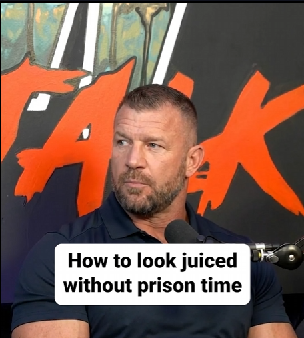
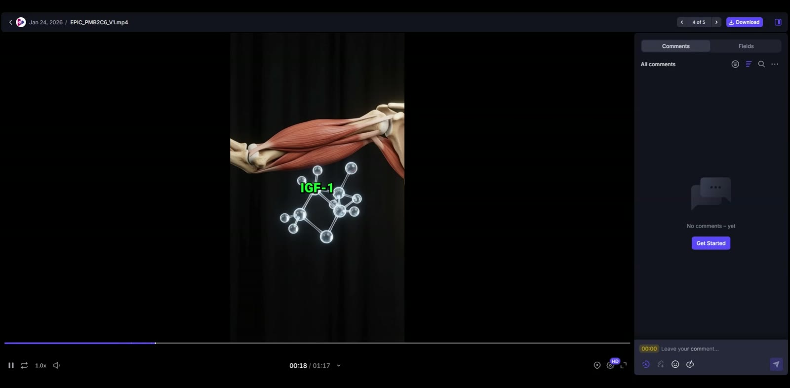
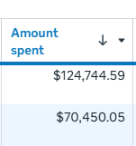
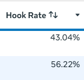

# 80. Supplement Brand: $70K Winning Ad Breakdown
> Justin tears down the Primal Muscle "podcast" script (AI UGC, plain editing) that spent about $70K and became the account's top ad (instructor claim): a direct-response structure of Reddit-language hook, juxtaposition, new mechanism, authority, FOMO loop, objection handling, recap and risk reversal in a zone-4 (fear) emotional state.

## 🤖 Agent use
- **Use when:** writing a podcast-style or talking-head direct-response script for a solution-aware, high-desire/high-fear audience, or checking a draft against a "winning ad checklist".
- **Inputs → outputs:** Reddit/forum language for the audience, the desire and the pain linked to it, a unique mechanism, an authority source from the research, objections, guarantee → a script with hook, bridge (mechanism), education, FOMO loop, objection handling, recap sentence, risk reversal plus CTA.
- **Rules:**
  - **DO** run the checklist he applies to every winner: open loops, customer language, authority, unique mechanism [13:20].
  - **DO** use juxtaposition as a quick win: "how to [desire] without [linked pain]" ("how to look juiced without prison time") [07:28–08:22] (instructor claim: "works almost all of the time"; seen in this account's top two ads).
  - **DO** lift customer language 1:1 from Reddit into the hook; the "county lockup" line is "I think a one-to-one direct sentence that someone said on Reddit" [09:06–10:43].
  - **DO** use visual words ("muscle-like gear", not "you'll get bigger"); they help the viewer and make the editor's job easier [11:41].
  - **DO** remove objections inside the copy ("a *legal* hormone") [11:41].
  - **DO** tie education back to the desire: "educate, but don't lecture" [15:07].
  - **DO** handle one objection honestly ("Is it as strong as actual steroids? No.") to add trust [16:03].
  - **DO** end with risk reversal and a CTA; here "nothing special" [16:58].
  - **DON'T** let AI characters claim personal results: his example of what not to do is an obvious AI UGC character saying "I lost 200 pounds" [09:55]; use them to "get across the information as long as they're not making any claims" [09:55] (but see the compliance flag: this script does make efficacy statements).
  - **DON'T** assume a high hook rate wins: a 30% hook rate with half the viewers intending to buy outscales a 50-60% hook rate with few buyers [04:11].
  - **IF** you do not know why a pattern works (the recap sentence) **THEN** keep it as an observed pattern, not a theory; he says "I really don't know why it works so well" [16:58].
- **See also:** [Open loops](../../../evolve/copywriting/concepts/open-loops.md) · [Unique mechanism](../../../evolve/copywriting/concepts/unique-mechanism.md) · [Authority in ads](../../../evolve/copywriting/concepts/authority-in-ads.md) · [Objection handling](../../../evolve/copywriting/concepts/objection-handling.md) · [Market awareness](../../../evolve/copywriting/concepts/market-awareness.md) · [Valence-intensity diagnostic](../../../../frameworks/valence-intensity-diagnostic.md) · [Claim audit](../../../stefan-georgi/rmbc-ii/rubrics/llm-output-claim-audit.md) · [081 the iteration of the same product](081-turning-400-ad-to-13k-spender.md) · [KPIs and columns](../../../evolve/start-here/frameworks/kpis-and-columns.md)

## Key ideas
### Why ugly ads win [00:01–03:15]
- Justin made the ad with Howie "back then when he was doing editing for the agency"; spent $70,000 and "has been the top winner ever since for this client" [00:01] (instructor claim).
- Honest framing: "didn't have the most realistic looking AI UGC, didn't have the best editing" [02:30].
- He claims access to "about 15 plus accounts" spending six to seven figures a month and that "usually the top ads aren't anything too spectacular... it's usually the ugly ads that end up performing really well" [02:30] (instructor claim).
- Reason given: fancy visuals and edits usually do not correlate with performance; the script and clear, simple presentation do [03:15].

### Metrics [03:15–05:04]
- Doc screenshot (blue row = this ad): spend $70,450.05 and hook rate 56.22%. The row above ($124,744.59, hook rate 43.04%) is another top ad he had to include by mistake [03:15; doc].
- "Having a high hook rate does not correlate with having an ad that performs really well": scaled ads with 30-40% hook rates exist; avoid 15-20%; what matters is the intent of those who stay [04:11].

### Awareness: solution aware [05:04–06:33]
- Definition read from "Evolve... their definition from the copywriting program", and "pairs with Breakthrough Advertising": aware of solutions, not convinced which is best [05:04].
- Here: men who want to get "jacked, juiced" know steroids and supplements exist and are comparing options; the ad walks them to the product [06:02].

### Emotional zone: zone 4 [06:33–07:28]
- "I basically train my own Claude on identifying valence and intensity zones" [06:33] (the Claude prompt is not shown).
- Zone 4 = negative valence, high intensity: prison, sexual assault, felony fear, then a relief frame ("legal", "what's left") [06:33; doc]. He contrasts frustration with the fear of jail: "two completely different things" [06:33].

### Hook: juxtaposition + customer language [07:28–10:43]
- Hook visual text: "How to look juiced without prison time"; script: "Look, bro, you don't wanna be someone's girlfriend in county lockup just 'cause you wanted bigger arms, right?"
- Juxtaposition = two things that should not go together (looking juiced and prison time). Template: "how to [desire] without [pain/problem]" [08:22].
- Style: podcast, so the hook is different from a normal DR mashup: "Look, bro" is the conversational language people use [09:06].
- Pull from the core research doc: the "county lockup" sentence was taken from Reddit [10:43].

### Bridge: reinforce juxtaposition and introduce the mechanism [10:43–11:41]
- "Steroids aren't worth it because there's a legal hormone that builds muscle-like gear without the needles or the felonies." Juxtaposition again; this is the hook-to-bridge handoff where the new mechanism appears.
- Principle breakdown for reuse: relatable research line → bridge with juxtaposition → education [10:43].

### Education and authority [12:34–13:20]
- "IGF-1 is the actual hormone that builds muscle, not testosterone, not HGH, IGF-1. Those just tell your body to make more IGF-1." Providing new info gives the podcaster authority: "if we didn't produce any sort of authority I'm 99 percent sure this ad wouldn't work" [12:34] (instructor claim).
- Winning-ad checklist: open loops, customer language, some authority, a unique mechanism [12:34–13:20].

### FOMO loop with a third-party authority [13:20–14:13]
- "Athletes have been using this for decades, and WADA warns competitors about it specifically." Makes the viewer feel behind (a basic desire is to belong), so they continue [13:20]. WADA came from the research and "they trust in this organization", so the ad "leveraged their name" [14:13]. (Compliance flag below.)

### Mechanism as a legal loophole [14:13–15:07]
- "And it's completely legal if you're not a tested athlete. The difference is delivery. Pills get destroyed in your stomach. This is an orally delivered spray. Go straight into your bloodstream."
- Exclusive-feeling: "this is how you do it; this is not something that's common" [14:13].
- Channel the copy back to why the viewer is there: "if you don't actually channel the copy back into why they're there... you're just going to lose people" [14:13–15:07]. The claim "triggers your body to create new muscle cells... permanent, even if you stop" paints the picture [15:07].

### Handle the objection [15:07–16:03]
- "Is it as strong as actual steroids? No. But it's the strongest legal option between worthless supplements and catching felonies." Realism adds trust; over-promising "takes away from all the desires you're giving" [16:03]. His bank-account analogy: a believable claim needs evidence.

### Recap sentence and close [16:03–17:51]
- Recap: "If you're tired of being outpaced by enhanced guys and you're not crossing the legal line, this is what's left." Problem, solution and desire in one sentence; seen "in countless winning ads, not every single one"; he does not know why it works [16:58] (instructor-observed pattern).
- Close: product line plus "lifetime guarantee. If it doesn't work, you don't pay. Here, I'll leave a link below" = risk reversal and CTA [16:58]. The script was written "in about 20, 30 minutes" and "the ones that you think will become winning ads end up becoming losing ads", which is why breakdowns matter [16:58].

## Steps / framework
Script structure with beat names (from the doc comments and video):

| # | Beat | Line (verbatim from the doc) | What it does | Source |
|---|---|---|---|---|
| 1 | Research-language hook (juxtaposition) | "Look, bro, you don't wanna be someone's girlfriend in county lockup just 'cause you wanted bigger arms, right?" | Relatable Reddit phrase; stakes; open loop | [09:06–10:43] |
| 2 | Bridge: new mechanism teaser | "Steroids aren't worth it because there's a legal hormone that builds muscle-like gear without the needles or the felonies." | Juxtaposition, risk reversal ("legal"), visual words | [10:43–11:41] |
| 3 | Education / authority | "IGF-1 is the actual hormone that builds muscle, not testosterone, not HGH..." | New info makes the speaker an authority | [12:34] |
| 4 | FOMO loop | "Here's what's wild. Athletes have been using this for decades, and WADA warns competitors..." "They only warn about stuff that actually works, bro." | Feel behind, new loop, borrowed authority | [13:20–14:13] |
| 5 | Mechanism + legal loophole | "completely legal if you're not a tested athlete. The difference is delivery..." | Exclusivity; mechanism of delivery | [14:13] |
| 6 | Usage + core desire | "Just six sprays before bed. That's it... triggers your body to create new muscle cells. Those cells are permanent, even if you stop." | Simplicity; paint the picture | [14:13–15:07] |
| 7 | Objection | "Is it as strong as actual steroids? No..." | Trust through realism | [16:03] |
| 8 | Recap sentence | "If you're tired of being outpaced by enhanced guys... this is what's left." | Problem + solution + desire in one line | [16:58] |
| 9 | Product, guarantee, CTA | "One Nine One XT by Primal Muscle was engineered to boost IGF-1 through an orally delivered spray... lifetime guarantee. If it doesn't work, you don't pay. Here, I'll leave a link below..." | Risk reversal and CTA | [16:58] |

Checklist for any script (his, [13:20]): open loops, customer language, authority, unique mechanism; add objection handling and a recap (derived from the rest).

## Examples
**Ad:** Primal Muscle 191 XT (oral IGF-1 spray), AI-generated podcaster, plain edit with product B-roll (muscle and molecule animation, 100% money-back badge) (frames [00:00]-[06:24]).

| Metric | Value | Source |
|---|---|---|
| Spend | $70,450.05 (blue row) | doc screenshot |
| Hook rate | 56.22% (other top ad: 43.04% at $124,744.59) | doc screenshot |
| Position | account's top ad since launch, still running (instructor) | [00:01] |
| Production | AI UGC; edit "not the most high production" | [02:30] |

## Structured units
### Ad teardown
| Brand / product (niche) | Format | Hook / opening | What works | What fails | Fix suggested | Principle | Source |
|---|---|---|---|---|---|---|---|
| Primal Muscle 191 XT (oral IGF-1 spray, muscle supplement) | AI podcast-style talking head, product B-roll | "Look, bro, you don't wanna be someone's girlfriend in county lockup just 'cause you wanted bigger arms, right?" + text "How to look juiced without prison time" | Juxtaposition hook; Reddit language; mechanism; authority; FOMO; objection; recap; risk reversal | Not stated as a flaw; CTA "nothing special"; script written in 20-30 minutes | Keep the structure; test more hooks | juxtaposition, open loop, authority, mechanism | [07:28–17:51] |

### Hooks
| Hook (verbatim or near) | Heuristic(s) | Emotion / zone | Self targeted | Why it works | Source |
|---|---|---|---|---|---|
| Text: "How to look juiced without prison time" | juxtaposition (desire without pain) | fear and relief; zone 4 | lifters who want size and fear legal risk | Splits two things the audience links; open loop | [08:22] |
| "Look, bro, you don't wanna be someone's girlfriend in county lockup just 'cause you wanted bigger arms, right?" | customer language, threat, tag question | fear; zone 4 | guys weighing steroids | One-to-one Reddit phrasing; conversational | [10:43] |
| "Steroids aren't worth it because there's a legal hormone that builds muscle-like gear without the needles or the felonies." | juxtaposition, visual words, risk reversal | relief | same | Names the alternative and removes the legal objection | [10:43–11:41] |

### Rules
- **DO** write juxtaposition as "desire without pain" for a quick win [08:22].
- **DON'T** let the script drift from the desire during education [14:13–15:07].
- **IF** an objection is obvious ("as strong as steroids?") **THEN** answer it with a plain "No" plus a positioning line [16:03].

## Prompts / templates (verbatim)
Full script from the doc (bold lines = ad), for structure study only:

```text
Look, bro, you don't wanna be someone's girlfriend in county lockup just 'cause you wanted bigger arms, right?
Steroids aren't worth it because there's a legal hormone that builds muscle-like gear without the needles or the felonies.
For those who don't know, IGF-1 is the actual hormone that builds muscle, not testosterone, not HGH, IGF-1. Those just tell your body to make more IGF-1.
Here's what's wild. Athletes have been using this for decades, and WADA warns competitors about it specifically.
They only warn about stuff that actually works, bro.
And it's completely legal if you're not a tested athlete. The difference is delivery. Pills get destroyed in your stomach. This is an orally delivered spray. Go straight into your bloodstream.
Just six sprays before bed. That's it. And here's the thing, it doesn't just make existing muscle bigger. It triggers your body to create new muscle cells. Those cells are permanent, even if you stop.
Is it as strong as actual steroids? No. But it's the strongest legal option between worthless supplements and catching felonies.
If you're tired of being outpaced by enhanced guys and you're not crossing the legal line, this is what's left.
One Nine One XT by Primal Muscle was engineered to boost IGF-1 through an orally delivered spray, a powerful IGF-1 booster that actually works, and they back it with a lifetime guarantee. If it doesn't work, you don't pay. Here, I'll leave a link below for you guys that wanna try it.
```

Doc zone note (quoted): "Zone 4 — High Negative Valence / High Intensity (fear/threat-driven). The opening leans on a visceral threat (prison, sexual assault) plus felony fear — that's high-intensity negative emotion used to create urgency and contrast. It then pivots to a relief/escape frame ('legal,' 'what's left'), which is the classic Zone 4 move: spike fear, then offer the safe exit."

Reusable skeleton (derived):

```text
[Relatable research sentence naming the pain/stakes], right?
[Alternative] isn't worth it because there's a [risk-free adjective] [mechanism noun] that [delivers desire] without [pain 1] or [pain 2].
For those who don't know, [mechanism] is [what actually does the work], not [common wrong answer].
Here's what's wild. [Authority group] has been using this for [time], and [respected body] [verb] about it.
[Why the delivery/mechanism is different]. [Simple usage]. [What it does beyond the obvious, tied to the desire].
Is it as [extreme alternative]? No. But it's the strongest [safe option] between [useless option] and [pain].
If you're tired of [problem] and you're not [crossing a line], this is what's left.
[Brand] was engineered to [mechanism]. [Guarantee]. [CTA].
```

## Screenshots

*First frame of the winner: podcast-style speaker with the juxtaposition hook text. [Doc image 3]*


*B-roll while the mechanism is explained: muscle fibre with a molecule labelled IGF-1. Visuals follow the script words. [01:30]*


*Doc screenshot: $124,744.59 (another top ad) and $70,450.05 (blue row, this ad). Instructor-reported.*


*Same rows' hook rate: 43.04% and 56.22% (blue row = this ad). [03:15]*

## How to apply
- [ ] Collect 3-5 verbatim customer sentences about the pain and stakes; use one in the hook.
- [ ] Write the juxtaposition ("how to [desire] without [pain]") as hook text and spoken line.
- [ ] Add a research-backed authority; check it is real and quotable (see compliance).
- [ ] Add one honest objection answer and a one-sentence recap.
- [ ] Brief the editor to show each visual word; keep production simple.
- [ ] Check the winning-ad checklist (open loops, customer language, authority, mechanism) before shooting.
- [ ] Verify every efficacy and legal claim with the brand before using it; run the [claim audit](../../../stefan-georgi/rmbc-ii/rubrics/llm-output-claim-audit.md).

## Related
- Previous: [079. Intimacy brand](079-intimacy-brand-200k-at-2-3-roas.md) · Next: [081. Turning a $400 ad into a $13K spender](081-turning-400-ad-to-13k-spender.md)

## Sources and limitations
- [Transcript](<../../../../../raw/ad-creators-lab/ai-ads-ugc-animations/_transcripts/Ad Creators Lab - Create Viral AI Ads, UGC & Animations That Convert Into Sales(September 2026)/6. 7-Figure Vault (NEW)/4. Supplement Brand 70K Winning Ad Breakdown.txt>) (Whisper; 1098.07 s, last segment 1097.94 s, complete). Whisper wrote "Howie" (the editor and now strategist); "191 XT" is the product name as spelled in the doc.
- [Lesson page](<../../../../../raw/ad-creators-lab/ai-ads-ugc-animations/_extracted/Ad Creators Lab - Create Viral AI Ads, UGC & Animations That Convert Into Sales(September 2026)/6. 7-Figure Vault (NEW)/4. Supplement Brand $70K Winning Ad Breakdown.htm.md>) · [Winning Ad Breakdown doc](<../../../../../raw/ad-creators-lab/ai-ads-ugc-animations/_extracted/_linked/google/1fzTMfEXy9HO.md>). The Frame.io ad link and the Loom are not in the course files.
- Only spend (blue row) and hook rate are shown for this ad; no ROAS, purchases or revenue are given in the files, so "winner" rests on spend and the instructor's word. Zone 4 classification uses a Claude prompt that is not shown.
- Compliance flags (derived, important): (1) This is a supplement ad built on unverified health and performance claims: "builds muscle", "creates new muscle cells", "those cells are permanent, even if you stop", "a powerful IGF-1 booster that actually works", the legal status of an oral IGF-1 product, and "completely legal if you're not a tested athlete". None is substantiated in the course; do not reuse any of it without evidence and regulatory review (IGF-1 products are a known FDA and WADA regulatory area; verify before running). (2) "WADA warns competitors about it" borrows a third-party organisation's name to imply endorsement of efficacy; avoid or verify. (3) The speaker is described as AI, and the script contains product-efficacy statements even though the instructor says AI characters should not make claims ("as long as they're not making any claims, which is not what we did here" [09:55], which is ambiguous); use a disclosed or human presenter and keep results claims out. (4) The "prison / sexual assault" fear framing targets a sensitive emotion; check platform policy on shocking or discriminatory content. (5) "Link below" CTA: lesson 82 argues against "link below" because it triggers sales defences, so this is an inconsistency to test, not a rule.
