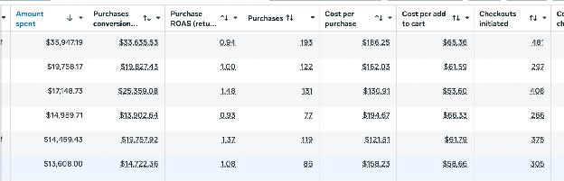
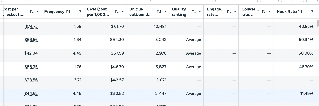
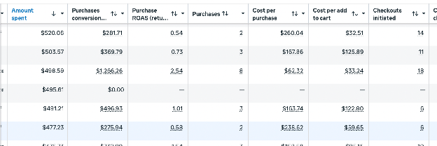
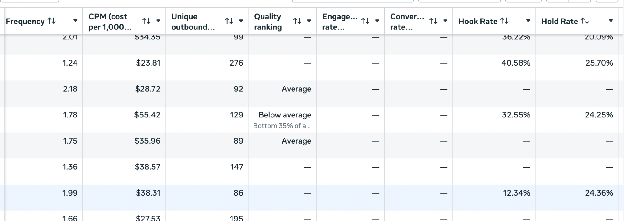
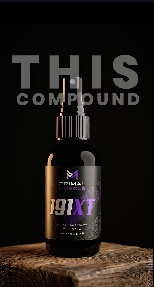
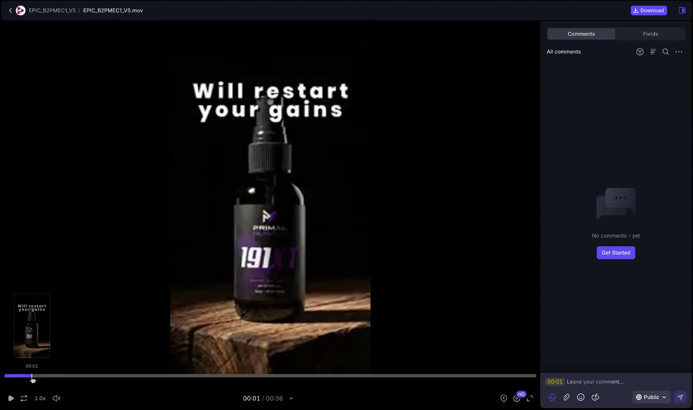

# 81. Turning a $400 Ad into a $13K Spender
> Same concept, same body, only the first 3 seconds changed: "This growth factor will restart your gains after 40" reached about $13.6K spend at 1.08 ROAS while "This compound will finally move your bench press PR again" stalled at $477 and 0.58 ROAS (instructor-reported); the lesson is a worked feedback loop on why a hook loses and what to iterate next.

## 🤖 Agent use
- **Use when:** reviewing a winner/loser pair, diagnosing why a hook lost, or planning the next iteration of a body that works.
- **Inputs → outputs:** two ads with the same body and different hooks, their spend/ROAS/hook-rate/hold-rate rows, and the customer-research language → a written learning (what the avatar does and does not desire, which words segment), an iteration plan (new visual hooks and copy hooks on the same body).
- **Rules:**
  - **DO** review losers, not just winners: "please, please review your losers" [03:30].
  - **DO** treat the hook as most of the ad: the 3-second hook was the only difference between about $13.6K and about $477 of spend [07:36].
  - **DO** lead with the avatar's real desire in the hook (look big again after 40) rather than a performance metric (bench-press PR) [05:46–06:43].
  - **DO** segment with specific words: "growth factor" and "after 40" call out an audience pocket; "compound" and "bench press" do not [04:58].
  - **DO** make hook words and hook visuals agree: if the line says "compound", show a compound, not a product bottle [06:43–07:36].
  - **DO** iterate on the same body with new visual and copy hooks right away when the body sells but the hook rate is low: "if we bumped that 11% to 20 to 30%, that could have made all the difference" [08:30–09:24].
  - **DO** do the feedback loop quickly after the data lands: "don't make my same mistake... do this right away" [08:30].
  - **DO** "use your research as your Bible" when writing [10:29].
  - **DON'T** pick the hook by the absolute hook rate alone: the loser's hook rate (about 12%) was slightly higher than the winner's (about 11%) [04:28].
  - **DON'T** judge a lower ROAS by itself: for this client (supplements, LTV payback) a ROAS slightly over 1 on first purchase can be a winner because they "pay more for net new customers because they make it back in LTV" [00:54] (instructor claim; confirm your own LTV and break-even, see [KPIs and columns](../../../evolve/start-here/frameworks/kpis-and-columns.md)).
- **See also:** [Rewrite losers and iterate](../../../evolve/start-here/frameworks/rewrite-losers-and-iterate.md) · [Learnings review](../../../evolve/start-here/frameworks/learnings-review.md) · [Iteration outcomes](../../../evolve/copywriting/concepts/iteration-outcomes.md) · [Hooks](../../../evolve/copywriting/concepts/hooks.md) · [Labels and customer language](../../../evolve/copywriting/concepts/labels-and-customer-language.md) · [080 same product, podcast ad](080-supplement-brand-70k-winning-ad-breakdown.md)

## Key ideas
### The setup: one concept, two hooks [00:00–01:40]
- Two ads Justin wrote and briefed to an editor, "the same concept. The only difference is the hook copy and a little bit of the hook visuals" [00:00].
- Winner (doc name EPIC_B2PMEC1_V5): $13,614 spend in the video; the doc screenshot row shows $13,608.00, purchase value $14,722.36, ROAS 1.08, 85 purchases [00:00; doc img 1].
- "It's a 1.08 ROAS. How is this even a winner?" His answer: this client "operates very, very well with lower ROAS because they pay more for net new customers because they make it back in LTV"; supplements like this often go "just about break even or negative on the first purchase" [00:54] (instructor claim). It was also "a top spender in the account" (in the doc's table it is the sixth row by spend; the others in view are $35,947 at 0.94, $19,758 at 1.00, $17,149 at 1.48, $14,960 at 0.93, and about $14,459 at roughly 0.95 (computed from the screenshot values)).
- Loser (EPIC_B2PMEC1_V2): $477 spend, ROAS 0.58, 2 purchases (doc: $477.23 spend, $275.94 value, $238.62 per purchase); "towards the bottom of the account" [01:40]. The winner was "within the top five... sorry, top six or seven" [01:40].

### The game and the answer [01:40–03:30]
- He plays both hooks and has viewers guess. The losing hook: "This compound will finally move your bench press PR again." [02:37]
- "Customers cared more about this... about restoring their gains after 40" [03:30]. He only worked out why after reviewing both ads; the customer language had pointed him to the winning angle [03:30].

### The hook-rate paradox [04:28–04:58]
- Winner hook rate "super low... 11%"; loser 12% and "actually had a higher hook rate and still lost" [04:28].
- Inference: of the 11% who stopped, the copy "resonated so much better" for the winner; hook rate measures stopping, the copy decided who stayed and bought [04:28–04:58] (instructor claim).
- In the doc's tables the winner row shows a hook rate of 11.49% while most neighbouring top spenders show 40-50% (40.83%, 50.94%, 50.00%, 46.70%); the loser row shows 12.34% hook and 24.36% hold (doc screenshots).

### Why the winning words worked [04:58–06:43]
- "Growth factor" vs "compound": the first sounds scientific; "compound sounds too much like steroids", the thing this audience wants to avoid, since the product is "a legal version of quote-unquote steroids" [06:43].
- "Restart your gains after 40" calls out the avatar and speaks to the desire; "move your bench press" speaks to a number. "They do have the desire to look and be big, not just put up numbers" [05:46].
- Learning for future ads: this audience does not care about lifting heavier; they care about looking bigger, putting on muscle, getting "jacked after 40" and scientific-sounding terms [06:43].

### The hook visual mismatch [06:43–07:36]
- His read: the loser said "compound" but immediately showed a product bottle (frame text "THIS COMPOUND" over the bottle), so "you instantly know you're being sold" and "the disconnect... broke the belief that it will work from the start" [06:43–07:36].
- Better: if you use "compound", show a compound (periodic-table-style powder), not a product [07:36]. Observation: frames of the winner (text "Will restart your gains", then "THIS GROWTH FACTOR") also show the bottle, so the visual mismatch is his hypothesis, not isolated by this test [07:36; frames] (derived).

### Why three seconds matter [07:36–08:30]
- Quote: "The winner version only had a difference of a hook of three seconds, which took it to 13K spend versus $400" [07:36].
- He cites the advertising rule that the headline is "80 to 90 cents of your advertising dollar": if the hook fails, nobody reaches the body [08:30] (instructor-recalled maxim, no source given).

### What to do next: iterate the hook on the same body [08:30–10:29]
- Both ads had weak hook rates (11-12%), so "we should have done an iteration on this exact body and only change the visual hook and your copy hooks to see if we can bump it up to 20 or 30 percent" [08:30].
- Timing mistake: he reviewed the pair "a month or two months out"; the loop should happen as soon as data exists, which could have produced another winner in the account [09:24].
- Observation across accounts: winning ads on an account often share a body and angle; "just switching out that hook... and boom you have another winner" [10:29] (instructor claim).

### Sloppy docs are fine [04:28]
- Unlike the other Vault docs, this one has no margin comments; "sloppy work usually has a lot of value in it... It just has to have good information" [04:28].

## Steps / framework
Winner/loser feedback loop (derived from the doc and video):

| # | Step | What he did | Output | Source |
|---|---|---|---|---|
| 1 | Pair ads with one variable | Same body; hook text and first 3 s differ | clean comparison | [00:00] |
| 2 | Pull the table for both | spend, ROAS, purchases, cost per purchase, hook, hold | numbers in the doc | doc img 1-4 |
| 3 | Judge winner by the account, not ROAS alone | top-spender status, LTV-based break-even | "winner" label | [00:54] |
| 4 | Compare hook rate vs outcome | 11% vs 12%: hook rate did not explain it | copy, not stopping power, decided | [04:28] |
| 5 | Diagnose with customer language | "gains after 40", "growth factor" vs "bench press PR", "compound" | learning about the avatar's desire | [04:58–06:43] |
| 6 | Check visual vs word agreement | "compound" + product bottle | broken belief hypothesis | [06:43] |
| 7 | Write the takeaway and iteration plan | same body; new visual hooks and copy hooks; target 20-30% hook rate | next tests | [08:30] |
| 8 | Do it fast | do not wait weeks | iterate while spend is live | [09:24] |

## Examples
| Ad | Hook text | Visual | Spend / ROAS / purchases | Hook rate / hold | Source |
|---|---|---|---|---|---|
| EPIC_B2PMEC1_V5 (winner) | "This growth factor will restart your gains after 40." | text "Will restart your gains" then "THIS GROWTH FACTOR" over the product bottle | $13,608 / 1.08 / 85 | 11.49% hook (doc) | doc; [00:00] |
| EPIC_B2PMEC1_V2 (loser) | "This compound will finally move your bench press PR again." | text "THIS COMPOUND" over the product bottle | $477.23 / 0.58 / 2 | 12.34% hook, 24.36% hold (doc) | doc; [02:37] |

## Structured units
### Ad teardown
| Brand / product (niche) | Format | Hook / opening | What works | What fails | Fix suggested | Principle | Source |
|---|---|---|---|---|---|---|---|
| Primal Muscle 191 XT (supplement), V5 | Short product-visual ad with voiceover (exact format not stated; frames show the bottle on a dark set with big text) | "This growth factor will restart your gains after 40." | Names the avatar (after 40), the desire (restart gains), a scientific term | Hook rate only about 11%; hook visual still product-first | Keep the body; test new visual hooks and copy hooks aiming for 20-30% | avatar-specific desire in the hook | [04:58–09:24] |
| Primal Muscle 191 XT, V2 | same | "This compound will finally move your bench press PR again." | Same body | Metric the avatar does not want; "compound" sounds like steroids; product shown on the word "compound" | Use "growth factor"-type hooks; match visual to word | desire over metric; word-visual agreement | [05:46–07:36] |

### Hooks
| Hook (verbatim or near) | Heuristic(s) | Emotion / zone | Self targeted | Why it works / fails | Source |
|---|---|---|---|---|---|
| "This growth factor will restart your gains after 40." | avatar callout, desire, scientific term | aspiration / nostalgia for past gains (derived) | lifters over 40 | Specific segment plus desire; scaled to about $13.6K | [04:58] |
| "This compound will finally move your bench press PR again." | feature metric | low | lifters | Performance number the audience cares less about; "compound" reads as steroids; stalled at $477 | [05:46–06:43] |

### Rewrites (before to after, same body)
| Before | After | What changed | Source |
|---|---|---|---|
| "This compound will finally move your bench press PR again." | "This growth factor will restart your gains after 40." | noun (compound to growth factor); promise (PR to gains/look); self (adds "after 40") | [04:58] |

### Rules
- **DO** compare ads that differ in one variable (here, the first 3 s) [00:00].
- **DON'T** conclude from a single pair that every number-based hook fails; it is one account and one avatar (derived).
- **IF** hook rates are low (11-12%) but the body sells **THEN** iterate new hooks on the same body to push hook rate to 20-30% [08:30].
- **IF** ROAS is about 1.0 on first purchase **THEN** decide by LTV economics for that client, not a universal ROAS cutoff [00:54] (derived).

## Prompts / templates (verbatim)
Scripts from the Feedback Loop doc. Body is identical in both; only line 1 differs. For structure study only.

```text
EPIC_B2PMEC1_V5 - Winner
This growth factor will restart your gains after 40.
IGF-1 is the real growth factor that builds muscle in your body.
Most supplements just give you a pump, but IGF-1 creates brand new muscle cells.
Pro bodybuilders have injected it for years, but now there's a legal oral version.
One Nine One XT by Primal Muscle was engineered to boost IGF-1 through an orally delivered spray.
Just take six sprays before bed. That's it.
WADA warns athletes about it because it actually works.
Guys are adding ten to fifteen pounds of real muscle in just twelve weeks.
No needles, no prescriptions, completely legal.
Stop wasting years stuck at the same weights. Try IGF-1 and One Nine One XT completely risk-free
```

```text
EPIC_B2PMEC1_V2 - Loser (line 1 only differs)
This compound will finally move your bench press PR again.
[body identical to V5]
```

Takeaways from the doc (quoted): "The words 'growth factor' resonated better, and 'will restart your gains after 40.' seems to be more believable or more of a desire than moving your bench press PR." "I think it worked better because the target avatar doesn't desire to move their bench press weight, they desire the look and to be big, not just put up numbers." "Actually show a compound, because we showed people a product they immediately knew they were being sold. The word 'Compound' sounds too much like steroids, doesn't resonate with audience." "The body sells... the winner version which only had a different hook of 3 seconds scaled to 13k spend and was one of the top for the account. Meanwhile the loser ad got 400 dollars in spend and the only difference was the first 3 seconds."

## Screenshots

*Winner table (bottom, blue row): $13,608 spend, $14,722 value, ROAS 1.08, 85 purchases, among other top-spending ads at ROAS 0.93-1.48. Instructor-reported.*


*Hook-rate column for the same rows: 40-51% for most top spenders; 11.49% for the winner (last row). The ad scaled despite a low hook rate.*


*Loser table (blue row): $477.23 spend, $275.94 value, ROAS 0.58, 2 purchases, $238.62 per purchase.*


*Loser hook rate 12.34% and hold rate 24.36%: not worse than the winner on hook, which is the lesson's point.*


*The losing hook frame (doc image 5): the word "compound" with a product bottle shown immediately. [02:30]*


*The winning hook in the editor review: "Will restart your gains" on the product bottle, followed by "THIS GROWTH FACTOR". The bottle is on screen here too. [02:53]*

## How to apply
- [ ] For every winner, find its sibling with the same body and a different hook; compare spend, ROAS, hook, hold.
- [ ] Write down what the avatar does and does not desire as a rule for the next brief (here: look and size after 40, scientific terms; not lifting numbers).
- [ ] Check each hook word against the visual; avoid showing the product while the voice says something else.
- [ ] If the body sells and hook rate is below 20%, brief 3-5 new visual hooks and 3-5 new copy hooks on the same body within days.
- [ ] Decide winner status from money and LTV, not from ROAS alone; link results to your [KPI columns](../../../evolve/start-here/frameworks/kpis-and-columns.md).
- [ ] Log the learning in a [learnings review](../../../evolve/start-here/frameworks/learnings-review.md).

## Related
- Previous: [080. Supplement brand $70K](080-supplement-brand-70k-winning-ad-breakdown.md) · Next: [082. Men's skincare $135K](082-mens-skincare-135k-spend-ad-breakdown.md)

## Sources and limitations
- [Transcript](<../../../../../raw/ad-creators-lab/ai-ads-ugc-animations/_transcripts/Ad Creators Lab - Create Viral AI Ads, UGC & Animations That Convert Into Sales(September 2026)/6. 7-Figure Vault (NEW)/5. Turning 400 Ad to 13K Spender.txt>) (Whisper; 688.47 s, last segment 688.34 s, complete). Whisper wrote "elemental table" for the periodic table at [07:36].
- [Lesson page](<../../../../../raw/ad-creators-lab/ai-ads-ugc-animations/_extracted/Ad Creators Lab - Create Viral AI Ads, UGC & Animations That Convert Into Sales(September 2026)/6. 7-Figure Vault (NEW)/5. Turning $400 Ad to $13K Spender.htm.md>) · [Feedback Loop Document](<../../../../../raw/ad-creators-lab/ai-ads-ugc-animations/_extracted/_linked/google/1fUezX9NT5YA.md>) with five images in `linked/inline-images/google-1fuezx9nt5ya/`. The two Frame.io ad links and the Loom are not in the course files.
- Small number differences: video says $13,614 and "$400"; the screenshot shows $13,608.00 and $477.23; the doc text says "400 dollars". The pair is one account, one avatar, one test; no statistical significance is given. Row-5 ROAS is read from blurry values.
- Both scripts are the same product as lesson 80 and carry the same unsupported claims ("guys are adding ten to fifteen pounds of real muscle in just twelve weeks", "creates brand new muscle cells", "completely legal", "WADA warns athletes", "completely risk-free"). Treat them as examples of structure only; do not reuse the claims without substantiation, and run drafts through the [claim audit](../../../stefan-georgi/rmbc-ii/rubrics/llm-output-claim-audit.md). The "80 to 90 cents of your advertising dollar" maxim is recalled without a source.
