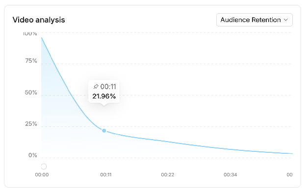
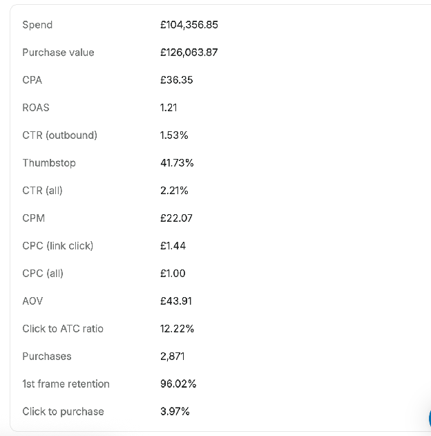

# 82. Men's Skincare: $135K Spend Ad Breakdown
> Howie breaks down a three-voice "Beginner / Average / Pro" script for Penrose body butter that, he says, spent over $130K in a little over 30 days: the first 11 seconds create cognitive dissonance and stacked open loops, the audience-retention curve shows who is filtered out, and the pro delivers a story, a mechanism and an objection.

## 🤖 Agent use
- **Use when:** writing a hook for a sub-avatar that already holds a strong, repeated belief (a "best product" or a standard routine) or reading a video's audience-retention curve to separate qualified viewers from the rest.
- **Inputs → outputs:** the sub-avatar's repeated beliefs and tips (from research), the product's mechanism, an objection the viewer has not thought of → a three-speaker script (confident wrong belief, niche tip, story-led pro reveal), plus a retention-curve read.
- **Rules:**
  - **DO** open by having a "beginner" voice state the audience's current belief; the discomfort acts as a pattern interrupt and opens a curiosity loop: "if a beginner is saying this, what is the pro going to say?" [03:29].
  - **DO** stack a second dissonant statement (the "average" gives niche advice the avatar has heard) and end it on another open loop [03:29–04:25].
  - **DO** begin the payoff with a story in visual language that describes the sub-avatar's indirect desire ("she leaned in, grabbed my collar and goes, 'what are you wearing? You smell insane.'") [07:18–08:18].
  - **DO** keep adding loops through the body ("same Baccarat scent... but I stopped spraying it. I rub it in now.") [09:16].
  - **DO** create an objection the viewer had not thought of and answer it ("absorbs in 30 seconds with no grease") to build trust [09:16–10:15].
  - **DO** read the audience-retention curve: a steep drop then a flat tail is a filter, and viewers past the elbow are the qualified ones [01:02–01:58].
  - **DON'T** say "buy it now / link below / try it now" in the CTA; it "activates the natural defense mechanism" [11:09] (instructor claim). Add urgency indirectly instead.
  - **DON'T** claim neuroscience you cannot back: the dopamine and "5 to 7 pieces of information" statements are the speaker's theories ("I haven't hooked someone up to a brain scan yet") [05:24].
  - **IF** the unique-mechanism section runs long **THEN** shorten it and move to the indirect benefits; the speaker says he "could have written it better and slightly shortened" [09:16].
- **See also:** [Open loops](../../../evolve/copywriting/concepts/open-loops.md) · [Beliefs](../../../evolve/copywriting/concepts/beliefs.md) · [Story building blocks](../../../evolve/copywriting/concepts/story-building-blocks.md) · [Objection handling](../../../evolve/copywriting/concepts/objection-handling.md) · [Unique mechanism](../../../evolve/copywriting/concepts/unique-mechanism.md) · [KPIs and columns](../../../evolve/start-here/frameworks/kpis-and-columns.md) · [080 podcast-style winner](080-supplement-brand-70k-winning-ad-breakdown.md) · [LLM output claim audit](../../../stefan-georgi/rmbc-ii/rubrics/llm-output-claim-audit.md)

## Key ideas
### Result claim and the retention graph [00:00–01:58]
- Howie says the ad "spent over 130k USD in a little over 30 days... It took over their ad account in like a week" (instructor claim) [00:00].
- The ad shows a hook text "APPLYING COLOGNE" that disappears at 15 seconds (doc note); he asks the viewer to watch the first 11 seconds, because of the retention graph [00:00].
- Audience-retention graph: from 0 s to 11 s the slope is -6.73 (retention falls from 96.02% to 21.96%); from 11 s to 45 s the slope is -0.54 (21.96% to 3.6%) (doc, computed in the doc as (21.96-96.02)/11 and (3.6-21.96)/34) [01:02].
- Reading: viewers who pass 11 s "are almost definitely going to finish the ad... because it speaks to them"; those who leave by 11 s are the "trash audience", especially after $100K when delivery reaches colder people [01:02–01:58]. "Make sure you analyze your audience retention rates" [01:58].

### Hook: Beginner says the common belief [01:58–03:29]
- Script: "Bro, just get Baccarat Rouge. It's the most complimented cologne on the planet. Spray it on, you're good."
- It states no benefit and no pain point. It works through cognitive dissonance: the sub-avatar believes an expensive cologne gets compliments because "that's what I've heard for the past months or even years"; "belief is built on repetition, it's not built on reason" [02:28–02:58].
- A beginner voicing it against the viewer's expectation creates discomfort, a pattern interrupt and a curiosity loop [03:29].

### Average adds a niche tip [03:29–05:24]
- Script: "Nah, you gotta layer it. Hit your moisturizer first, then spray on top. And don't just hit the wrists, get your neck, your chest, behind the ears."
- Same principle: more discomfort; the average's niche layering advice (known to the target avatar) makes the viewer wonder what the pro will say [04:25].
- Claim: "the brain rewards dopamine... in the part where you're expecting an outcome", so continued tension keeps dopamine high; flagged by him as a theory [04:25–05:24].
- Audience drop-off continues here: "filtering out a lot of the unnecessary viewers" [03:29].

### Why nested open loops [05:24–07:18]
- Concept he names: Milton Model nested loops, "a strategy to overcome the conscious brain" [05:24]. Logic rarely converts a first-time customer; speak to emotion by bypassing the conscious mind [05:24].
- Mechanism he claims: the conscious brain holds "about five to seven pieces of information"; overload it with open loops and it "freaks out and shuts down temporarily", so viewers become emotional [06:22] (instructor claim, no source).

### The Pro tells a story [07:18–09:16]
- Script: "So I'm on a date last week, after dinner she leaned in, grabs my collar and goes 'what are you wearing, you smell insane.'"
- Story is more interesting than "get this body butter" [07:18]. Visual language describes the sub-avatar's indirect desire; "imagination can be more powerful than lived experiences" because the viewer already imagines this scene [07:18–08:18]. It also subconsciously reminds them of their pain points (doc).
- Open loop again: "It's the same Baccarat scent I've been wearing for two years. But the difference is I stopped spraying it. I rub it in now." [09:16]. Dopamine spikes; viewers become "highly vulnerable to first-hand purchase" [09:16] (instructor claim).

### Unique mechanism and a new objection [09:16–10:15]
- Script: "See, cologne is alcohol. It evaporates off your skin in maybe four hours. This body butter is the opposite. It's mixed with same fragrance oils as Baccarat 540 and hydrating shea butter that absorbs in 30 seconds with no grease. The scent lasts well over 12 hours."
- "Unique mechanism without over-selling; creating and handling the objections" (doc). Raising "no grease" gives an objection nobody had, and then solves it; analogy: a salesperson who says polyester can lower testosterone, then "our stuff is fully cotton" builds trust [10:15].
- Self-critique: shorten the mechanism and concentrate on indirect benefits [09:16].

### CTA [11:09–12:06]
- "It's Penrose body butter. It's 35 bucks a jar and it will get you compliments at 8 pm when you applied it at 8 am."
- Good: a visual CTA that sets an expectation. Weak: no urgency [11:09; doc].
- He recommends adding urgency and implying the link is below rather than saying "link below / buy it now / try it now", because that triggers the sales defence in a subconscious viewer [11:09] (instructor claim).

## Steps / framework
Three-voice dissonance script (derived from the doc and video):

| # | Voice | Job | Line type | Source |
|---|---|---|---|---|
| 1 | Beginner | State the sub-avatar's repeated belief, quick and confident | "Bro, just get [popular option]. Spray it on, you're good." | [02:28–03:29] |
| 2 | Average | Add the niche tip they already know; stack tension | "Nah, you gotta layer it... neck, chest, behind the ears." | [04:25] |
| 3 | Pro: story | Open with a lived scene of the indirect desire | "I'm on a date last week... what are you wearing, you smell insane." | [07:18–08:18] |
| 4 | Pro: loop | Same product, different method | "same scent... I stopped spraying it. I rub it in now." | [09:16] |
| 5 | Pro: mechanism + objection | Explain why it lasts; remove an unexpected objection | cologne = alcohol; shea butter, no grease | [09:16–10:15] |
| 6 | Pro: CTA | Price + visual outcome | "$35 a jar... compliments at 8 pm when you applied it at 8 am." | [11:09] |

Retention-curve read (derived): (1) note retention at the moment the hook loops close (11 s here); (2) compute the slope before and after; (3) the flat segment after the elbow is the qualified audience; (4) iterate the first 11 s, not the tail.

## Examples
**Ad:** Penrose body butter, men's fragrance-oil body butter (niche: men's skincare/fragrance). Hook text "APPLYING COLOGNE" until 15 s; script has three speakers (doc table has Voice-over / Hook text / Visuals columns, visuals left blank). The ad file is on Frame.io (link in the doc; not available).

| Metric (doc screenshot, in GBP) | Value |
|---|---|
| Spend | £104,356.85 |
| Purchase value | £126,063.87 |
| ROAS | 1.21 |
| CPA | £36.35 |
| Thumbstop (hook rate) | 41.73% |
| 1st-frame retention | 96.02% |
| CTR outbound / all | 1.53% / 2.21% |
| CPM / link CPC | £22.07 / £1.44 |
| AOV | £43.91 |
| Click-to-ATC / click-to-purchase | 12.22% / 3.97% |
| Purchases | 2,871 |

## Structured units
### Ad teardown
| Brand / product (niche) | Format | Hook / opening | What works | What fails | Fix suggested | Principle | Source |
|---|---|---|---|---|---|---|---|
| Penrose body butter (men's fragrance/skincare) | Three-voice talking script (Beginner, Average, Pro), text hook "APPLYING COLOGNE" | "Bro, just get Baccarat Rouge. It's the most complimented cologne on the planet. Spray it on, you're good." | Cognitive dissonance, pattern interrupt, nested loops; story; mechanism; objection; strong qualification (retention flat after 11 s) | Mechanism too long; CTA has no urgency | Shorten the mechanism toward indirect benefits; add urgency indirectly | cognitive dissonance, open loops, storytelling, objection creation | [02:28–11:09] |

### Hooks
| Hook (verbatim or near) | Heuristic(s) | Emotion / zone | Self targeted | Why it works | Source |
|---|---|---|---|---|---|
| "Bro, just get Baccarat Rouge. It's the most complimented cologne on the planet. Spray it on, you're good." (Beginner) | cognitive dissonance, pattern interrupt, curiosity | discomfort (not classified by him) | men who believe an expensive fragrance gets compliments | The viewer's belief is stated by a "beginner", which implies a better answer exists | [02:28–03:29] |
| "Nah, you gotta layer it. Hit your moisturizer first, then spray on top..." (Average) | nested open loop, niche knowledge | tension | men who already learned fragrance tips | Same dissonance one level up; keeps filtering | [04:25] |
| "So I'm on a date last week, after dinner she leaned in, grabs my collar and goes 'what are you wearing, you smell insane.'" | story, visual language, imagined desire | desire | men wanting attention from dates | Makes the viewer imagine the desired scene | [07:18] |

### Rewrites / notes
| Before | After | What changed | Source |
|---|---|---|---|
| "Mechanism paragraph" (as shipped) | shorter mechanism focused on indirect benefits (suggested) | cut explanation, add desire | [09:16] |
| "$35 a jar... compliments at 8 pm" | add urgency; imply link, avoid "buy now" (suggested) | CTA strength | [11:09] |

### Rules
- **DO** have a character voice the viewer's current belief [03:29].
- **DO** invent no new product claims; the "same fragrance oils as Baccarat 540" line is the brand's claim and carries risk (see limitations).
- **IF** retention is steep early and flat after, **THEN** the hook is filtering; change the first seconds if you want a different filter [01:02].

## Prompts / templates (verbatim)
Script table text from the Google doc (bold = script; notes in brackets are the author's). Structure study only.

```text
HOOK 1: VOICE OVER: —  | HOOK TEXT: APPLYING COLOGNE [this should disappear at 15 seconds] | VISUALS: —

BODY:
BEGINNER (quick, confident, wrong): "Bro, just get Baccarat Rouge. It's the most complimented cologne on the planet. Spray it on, you're good."

AVERAGE: "Nah, you gotta layer it. Hit your moisturizer first, then spray on top. And don't just hit the wrists — get your neck, your chest, behind the ears."

PRO: "So I'm on a date last week, after dinner she leaned in, grabs my collar and goes 'what are you wearing, you smell insane.'

It's the same Baccarat scent I've been wearing for two years. But the difference is I stopped spraying it. I rub it in now.

See, cologne is alcohol. It evaporates off your skin in maybe four hours.

This body butter is the opposite. It's mixed with same fragrance oils as baccarat 540 and hydrating shea butter that absorbs in 30 seconds with no grease. The scent lasts well over 12 hours.

It's Penrose body butter. It's 35 bucks a jar and it will get you compliment at 8 pm when you applied it at 8 am."
```

Retention-slope formulas from the doc (author's notation):

```text
0 SEC -> 0:11 SEC: (21.96 - 96.02) / (11 - 0) = -6.73
0:11 SEC -> 0:45 SEC: (3.6 - 21.96) / (45 - 11) = -0.54
```

Author's margin notes (paraphrase kept close to the doc): beginner line is "a phrase the target subavatar hears often online and in person. Belief is established through repetition... creates cognitive dissonance, discomfort. Why is discomfort so important? Because it's a very strong emotion: pattern interruption, curiosity loop. Ends in an open loop." / Average: "same principle... Milton Model Nested Loops." / Pro opening: "visual language that describes the indirect desire of subavatar. Imagination can be more powerful than lived experiences. This also subconsciously reminds the target subavatar of their core pain points." / Mechanism: "Unique mechanism without over-selling. Creating and handling the objections." / CTA: "GOOD - Visual CTA. BAD - Weak since it doesn't have any urgency connected to it."

## Screenshots

*Retention falls to 21.96% by 11 s, then flattens; the doc computes slopes of -6.73 and -0.54. The basis for reading the first 11 s as a filter. [01:02]*


*Doc metrics: £104,356.85 spend, ROAS 1.21, thumbstop 41.73%, outbound CTR 1.53%. Instructor-reported; does not match the "135K" in the title.*

## How to apply
- [ ] List 2-3 beliefs your sub-avatar repeats (what they hear online and from friends); write the "beginner" line as that belief.
- [ ] Write the "average" line as a niche tip they already know; end both on open loops.
- [ ] Write the pro's story as a lived scene of the indirect desire; avoid naming the benefit.
- [ ] Add one objection the viewer would not think of and answer it.
- [ ] Draft a CTA with a visual outcome and an indirect urgency; test it against a plain version.
- [ ] After launch, pull the audience-retention graph, compute early and late slopes, and iterate the first 11 s.
- [ ] Verify product claims and comparisons before shipping ([claim audit](../../../stefan-georgi/rmbc-ii/rubrics/llm-output-claim-audit.md)).

## Related
- Previous: [081. Turning a $400 ad into a $13K spender](081-turning-400-ad-to-13k-spender.md) · Next: [083. Ad roast calls, 17 August 2026](083-ad-roast-calls-2026-08-17.md)

## Sources and limitations
- [Transcript](<../../../../../raw/ad-creators-lab/ai-ads-ugc-animations/_transcripts/Ad Creators Lab - Create Viral AI Ads, UGC & Animations That Convert Into Sales(September 2026)/6. 7-Figure Vault (NEW)/6. Mens SkinCare 135K Spend Ad Breakdown.txt>) (Whisper; 726.51 s, last segment 726.32 s, complete). Whisper wrote "sub-application" and "sub-advocacy" for "sub-avatar", "clone" for cologne, "wrist" for wrists, "Baccarat" correct.
- [Lesson page](<../../../../../raw/ad-creators-lab/ai-ads-ugc-animations/_extracted/Ad Creators Lab - Create Viral AI Ads, UGC & Animations That Convert Into Sales(September 2026)/6. 7-Figure Vault (NEW)/6. Men's SkinCare $135K Spend Ad Breakdown.htm.md>) · [Winning Ad Breakdown doc](<../../../../../raw/ad-creators-lab/ai-ads-ugc-animations/_extracted/_linked/google/1dGSGTyKRD4H.md>) (tabs: Winning Ad Brief, Winning Ad Results, Winning Ad Breakdown). The Frame.io ad is not in the course files, so the visuals (who plays the three speakers, whether AI or human) are unknown.
- Number conflict: the lesson title says "$135K spend", the speaker says "over 130k USD in a little over 30 days", but the doc screenshot shows £104,356.85 spend and ROAS 1.21 (pound sterling; possibly a different window, account or currency). Use the screenshot's ROAS (1.21) for realism; spend and "took over their account in a week" are instructor claims.
- The psychology (dopamine, five-to-seven items, Milton model, "trash audience") is the instructor's opinion, not evidence; test it, do not state it as fact. The "link below is a defence trigger" advice conflicts with lesson 80, whose winning ad ends "Here, I'll leave a link below"; treat CTA wording as a test.
- Compliance flags (derived): the script compares against a third-party trademark (Baccarat Rouge / "Baccarat 540") and claims "same fragrance oils"; unsupported dupe or composition claims invite trademark and substantiation problems. "The scent lasts well over 12 hours" and "absorbs in 30 seconds" are brand claims to verify. Using a staged dating anecdote as a personal story is a dramatization; label it or source it. Do not copy this script 1:1; reuse the structure.
