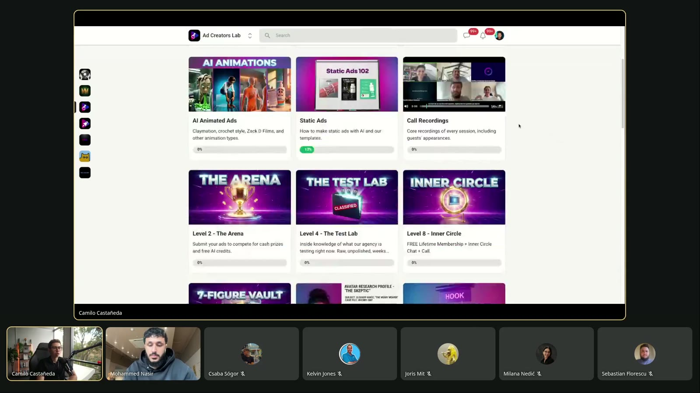
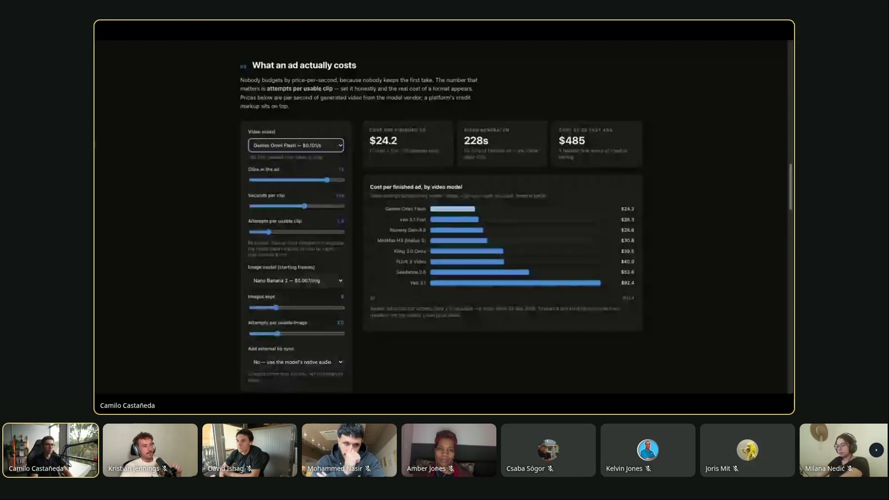
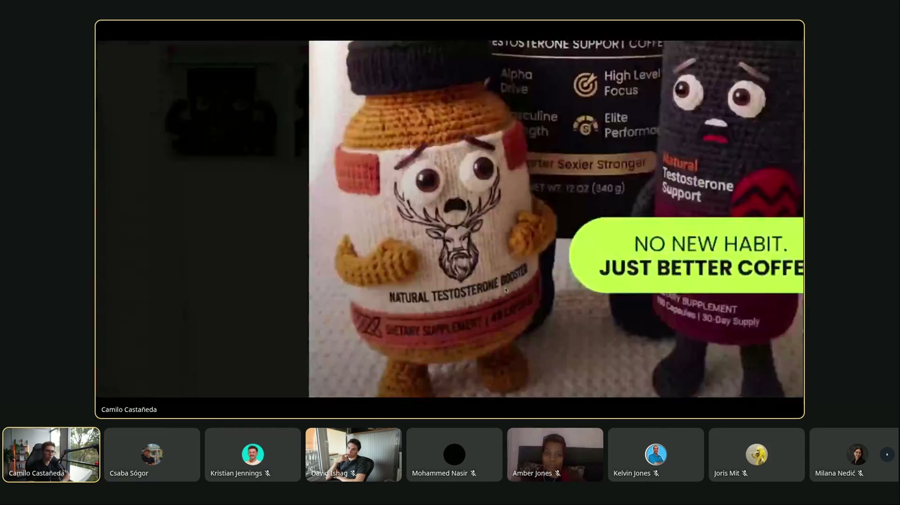
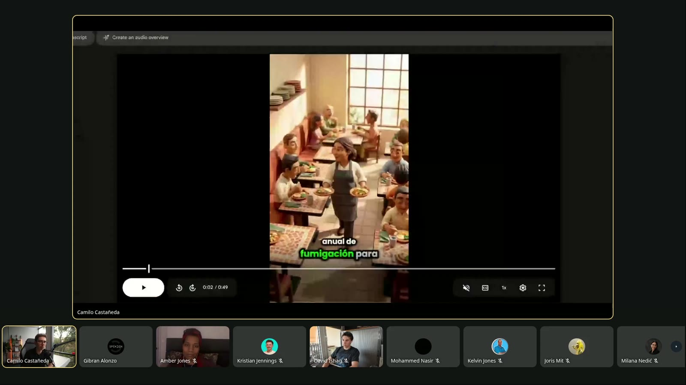
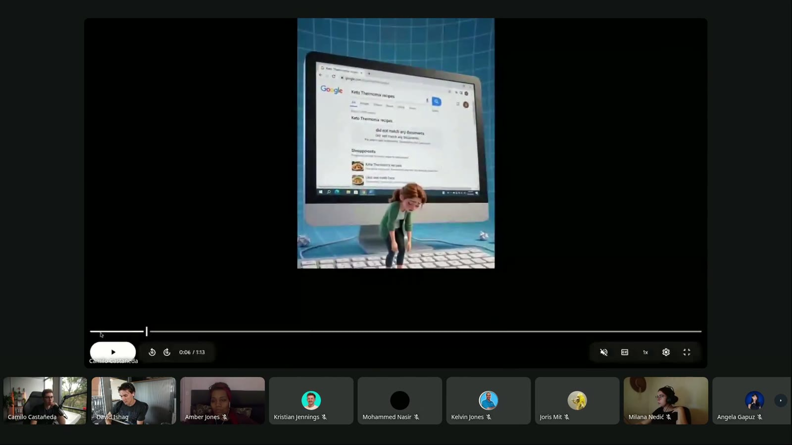

# 83. Ad Roast Call, 17 August 2026
> A live community roast: five member ads (a Kegel program for men, crochet-style testosterone statics, a fumigation service, a Tai Chi app AI-UGC ad, a Zack D-style keto ad) get line-by-line fixes on hooks, open loops, visuals that match the script, and AI realism, plus a closing discussion on editing with AI.

## 🤖 Agent use
- **Use when:** reviewing or fixing a draft hook, an AI-UGC script, a static ad or an animated ad before launch; writing feedback that is specific and testable; briefing visuals so every script line has a matching image.
- **Inputs → outputs:** ad (copy, video or static) + avatar, awareness stage and offer → a diagnosis (hook, bridge, visuals, realism, safe zone) and concrete replacement lines or shot changes.
- **Rules:**
  - **DO** write the stage of awareness, the avatar and the target market at the top of every copy doc: "it just helps me when it comes to associating the copy to who we're speaking to" [11:18].
  - **DO** build hooks around an open loop (an unresolved thing the viewer needs closed), not a bare statement of the problem: "saying you have a weak pelvic floor is not an open loop" [16:30].
  - **DO** use the words the customer uses about themselves, not clinical or invented terms: "you want someone to resonate with the words you're saying" [12:46].
  - **DO** make every line of the script show a matching visual ("association and showing not telling" is what the agency screens editors for) [47:25].
  - **DO** build pain before the product ("twisting the knife"): name why previous solutions failed in the customer's situation before the app appears [40:27].
  - **DO** keep generated AI visuals imperfect: add "candid photo, TikTok style with uneven angles, as if a friend was recording it" to the image prompt [43:20]; real creators never get perfect framing [44:21].
  - **DO** address the objections a service buyer has (how long until I can re-enter the restaurant, how many return visits) inside the ad [31:29].
  - **DON'T** use vague claim words: "better" [24:36] and "game changer" ("we've never had an ad that crushed [where] we said this was a game changer") [41:20].
  - **DON'T** lead with a stunt comparison the audience cannot relate to ("his electric toothbrush is lasting longer than him"); doctor-authority copy must sound like something a doctor would say [18:22].
  - **DON'T** fix framing only in generation: keep key elements centered and reframe in the edit [40:48].
  - **IF** a hook is a statement THEN turn it into a curiosity question or an "it starts outside the bedroom" style reveal [19:54].
  - **IF** the headline template is reused across videos THEN check it fits this video's topic (a "flat stomach" template on a keto video was criticised) [49:16].
  - **IF** AI voice sounds like a "podcasty" narrator that does not match the scene THEN redo the voice before touching anything else [36:17]; write scripts to be read out loud, dropping the "g" in "-ing" words so the model picks up natural speech [20:43, from a member's tip, not Camilo].
- **See also:** [Ad roast call, 21 August 2026](084-ad-roast-calls-2026-08-21.md) · [Winning-ad breakdown: supplement brand](080-supplement-brand-70k-winning-ad-breakdown.md) · [Realistic AI UGC, character consistency](026-character-consistency.md) · [write-ugc-script skill](../../../../../../.claude/skills/write-ugc-script/SKILL.md) · [LLM output claim audit](../../../stefan-georgi/rmbc-ii/rubrics/llm-output-claim-audit.md)

## Key ideas
### Community news: levels, Arena, Test Lab, tool wizard [01:15–09:45]
- Camilo launched three modules "locked by levels" (Skool points for likes): **The Arena** (level 2), **The Test Lab** (level 4), **Inner Circle** (level 8) [01:15–02:11, 06:01–06:50].
- **Arena:** a monthly competition. Theme at recording: animated ads, running 10 days. Top three win "full year subscription of platform of your choice plus credits"; the team also covers credits used to make the entries. Entries are posted in the community with an Arena tag; Camilo reviews them in a YouTube-style breakdown [02:11–03:09]. Brand sponsorships and equipment prizes were being explored [04:06].
- He declined an "ad bounties" model like EcomTalent: ~50% of members are brand owners, not editors, and most spend "a couple hundred dollars a day... less than 10k a month", so bounties would de-incentivise them [04:06–05:04] (instructor claim, from a member survey).
- **Test Lab:** every month Camilo and Justin report what they are testing live on client accounts. Formats are "not proven yet" so they are not turned into frameworks [06:01–06:50].
- **Inner Circle:** level 8, "free lifetime membership", a dedicated chat and call [06:50].
- **Sneak peek (demo, not official):** a tool-chooser wizard (which model for motion, scripting, languages) plus a cost tracker using direct API prices, not platform prices; it would add per-platform costs (Higgsfield, Max Fusion) and link to model modules such as Seedance [07:50–08:47]. His caveat: cost per ad "varies so much" because much time goes into testing clips first [08:47].

### Segment 1: Kegel training program for men (hook and body, Romanian market) [10:18–21:53]
Ad: a direct-response copy for a Kegel/pelvic-floor program marketed to men who want to last longer; written in English, translated to Romanian. Product/brand name not shown. [10:18]
- **Awareness check first.** The member had no avatar or awareness notes ("the only thing I know is that I'm just trying to get it in front of as many people as possible") [11:18]. Camilo's first criticism is that he could not tell who the copy was for.
- **Hook as shown:** "you don't have a two-minute [penis], you have a weak pelvic floor". Camilo: this attracts people who already want to know what a pelvic floor is; it sets up education, but the claim is too obvious, so "they'll just skip through it" [12:16, 15:36]. His analogy: "the reason girls don't want to date you is because you have bad breath. It's like, duh, scroll" [15:36].
- **Fix 1, language:** test whether the audience uses the phrase at all; they may say "I don't last long", "one and done" or local euphemisms. Specific self-descriptions resonate more [12:46].
- **Fix 2, open loop:** reframe the cause as something unexpected the viewer cannot see: "it's to do with a muscle you didn't even know existed in your body, a muscle you've never trained" → "now I have hope that I can train this muscle" [16:30]. Gym-goers see it as "solvable" [17:24]. "If you're gonna get anything... create more open loops in your hooks" [17:24].
- **Translation workflow (member):** write English, translate to native-sounding Romanian, send to the client for a sound check, then repeat for Polish and other languages [14:39]. Camilo (Colombian) warns regional sayings are hard: use TikTok videos from language creators, or have an AI read local transcripts "to get the right tones" [13:43].
- **Hook 2 as shown:** "just three weeks ago I was telling my patient that his electric toothbrush is lasting longer than him and now he's lasting 12 minutes. Here's how we did it." Camilo: it sounds "made up" and "you wouldn't want your doctor to compare you to a toothbrush" [17:24–18:52]. **Rewrite:** "just three weeks ago I was telling my patient that there are people who can last more than two minutes and he didn't believe me, now he's lasting over 12" (future-pacing what the viewer could become) [18:22–18:52].
- **Body line:** "the biggest change happens outside the bedroom". Make it curiosity: "did you know that to improve how long you last it starts outside the bedroom?" [19:54]. "Most men wait until they're close" → speak directly: "you probably wait until you're really close before you start contracting muscles" so the viewer nods "yeah, I do" [19:54].
- **Shame debate:** the member had been told to avoid shame and use a third-person view. Camilo: this is education, not shame; shame would be "you're probably feeling embarrassed, aren't you" [20:24–20:54].

### Segment 2: Testosterone-support coffee, crochet-style statics [21:53–29:59]
Product on screen: a testosterone coffee ("Alpha Brew" on the packaging) shown as a crochet/knit character beside a competitor "booster" product, with a green sticker "No new habit. Just better coffee." [22:39–24:36; frame at 23:54]. The member had written it after a copywriting call with Justin; the previous headline was weaker [22:39].
- **Clarity:** the two competitor products drawn in yarn style are hard to read: "I'm always big on just clarity... choose images that are undoubtedly super clear of what it is" [23:37].
- **Colour:** the green sticker "kind of removes it": colours off-brand "take away from the perceived value", "it looks like it was made on Canva". Use the brand's gold with black text and regenerate with GPT Image or Nano Banana [23:37].
- **Copy:** "better" is "so vague". Replace with a specific contrast: "No new habit. Just part of your routine" [24:36]. Reason: no syringe, no extra supplements, nothing to forget to take [24:36].
- **CTA button:** remove it from the static and test the clean version against the existing format [25:35].
- **Contrast:** re-run the image asking the AI for "more contrast... a backlight" because the pack "blends in a lot with the background" [25:35].
- **Second static: "no crashes, no jitters, no lock-in":** three claims vs TRT. Pick the ones that map to the real alternative: "no needle, no prescription, no crashes" [26:33–27:33].
- **Ingredient statics ("L-citrulline makes her notice you"):** buyers of this category "want to know what the ingredients mean". Go "one step back": say what L-citrulline does for you before the emotional payoff ("she notices first", "2 p.m. stops being the wall") [28:04]. The member's next AI video idea: ingredients talking; Camilo agrees [29:03].

### Segment 3: Fumigation / pest-control service, Spanish short video [29:59–37:46]
Ad: a 5-segment before/after timeline in Spanish ("Día 5. Dejas de encontrar bichos... Día 60. Llega la inspección y ni te preocupa porque tienes tu constancia de servicio al día. Contrata."), visuals clean and "very professional". Two hooks shown: a red cockroach hook and a restaurant-kitchen hook [30:32–35:20].
- **What works:** the inspection payoff is a real worry for restaurant owners; polished, high-end look for a service business [30:32].
- **Fix 1, objections:** collect the questions customers ask the client (how long out of the restaurant, how many returns after the first three days) and answer them in the ad [31:29].
- **Fix 2, hook caption:** "it has to sound like a story... the captions on the hook [need to] add to the video to make you want to watch the rest" [32:29].
- **Fix 3, contrast (member feedback):** a black-and-white section with a black "X"; make the X red [32:29].
- **Fix 4, camera movement consistency:** some shots have movement, some do not; add a slow zoom-in or zoom-out to every shot for retention [33:29]. Camilo: "zoom-ins build tension and zoom-outs release tension"; zoom in through the problem, zoom out at the solution reveal [33:29–34:24].
- **Fix 5, safe zone:** the cockroaches sit at the bottom, under the button area; start zoomed in on the cockroach and zoom out, or zoom in on a reaction face [34:24].
- **Hook ranking:** the over-the-shoulder "what is going on" kitchen hook beats the emotional red one: "this one definitely for sure passes" [35:20].
- **Meta spend trick:** change the hook audio or lengthen the hook so Meta spends on it ("sometimes it doesn't") [35:20–36:17]. Example hook extension: "primeros treinta días de contratar un programa de fumigación" [36:17].
- **New concept, objections-only video:** use the question-box format (Instagram or TikTok reply style): a question from real reviews ("how long does it take to get rid of an infestation?") answered by an AI character or a claymation character ("typically 10 days or 5, depending on your space"). "That's a really good concept for service-based businesses, that always crushes" (instructor claim) [36:47].

### Segment 4: Tai Chi walking app, AI-UGC ad [37:46–45:20]
Ad: AI creator voiceover "Love wearing sleeveless tops but I was always self-conscious... I uploaded a photo, took a short quiz, and the app created a personalized Tai Chi walking plan... Most days I'm done in just 10 minutes." The member's app name was heard as "Soonbody" (spelling unverified) [38:30].
- **Visual match:** the visuals do not match the words. "Sleeveless top" shows a top, then her rear; arms should be shown three times; "not worrying about getting injured" shows her happy in a mirror. Show fear of running or high-impact exercise instead [38:30–39:29].
- **Missing pain:** "going to the gym every day or yoga just didn't work for me" jumps straight to the app. Add why: "because I'm a busy mom", "my right knee hurts after 50", "I was too scared of the gym because hench guys are looking at me". This is "twisting the knife" [40:27].
- **Vague claims:** replace "it was a game changer / I uploaded a photo, took a quiz" (features, not reasons) with the actual mechanism: "I found a quiz online that helped me find a workout plan that allows me to work out whenever I want without any high-impact strain on my knees, and the workout was actually Tai Chi... it allows me to burn fat" [41:20–42:50].
- **Realism:** the visuals look "AI-ish... too brushed, too perfect"; the mirror is "squeaky clean". Use the Pinterest method from the course [42:50]. Member tip adds a prompt fragment for the image prompt (see Prompts) [43:20]. Camilo: dead-on flat angles "give away" AI [44:21]. A member said Pinterest now has lots of AI images; TikTok search is another source [44:21].

### Segment 5: Zack D-style animated keto ad (Thermomix recipes) [45:20–50:12]
Ad: Zack D Films style (the skill Camilo is making a YouTube video about, to be posted within 24 hours; the object and skeleton skills also exist, more coming from "other proven formats") [45:20]. Script: keto is "too hard, too boring... maybe it's because nobody told you the one secret that makes everything 10 times easier"; contrasts people who do keto for years with those who quit after two weeks; reveal: "a ready system... 500 keto recipes with all macros calculated, one-click import into Cookidoo [heard as 'CookieDoo'] and a Thermomix" [45:51–46:42]. The member wrote it in English for a Polish campaign [47:42].
- **Fix, reveal timing:** blur the product or hold it back "just to have that reveal at the end", then add recipe features after the sale [46:42].
- **Headline:** the template read "flat stomach" (a CapCut template that exported the wrong title). Camilo: write headlines as a topic page would: "why keto doesn't work in 2026", or "if you've tried keto and failed, it wasn't because of..." because the video is about keto, so the headline should be too [48:46–49:16].

### Q&A: editing with AI, CapCut blocks, tool picks [50:12–56:43]
- Camilo's AI edit: a raw talking-head turned into a near-finished edit with subtitles, hook and B-roll, using Claude Code + an MCP for Max Fusion (works with Higgsfield) running "Google Omni Flash" to add to the video; it also pulled B-roll from a local folder of screenshots [50:43]. A full "edit fully with AI" video was planned [50:43].
- Turn a dialled-in edit into a skill (e.g. a "claymation edit" command that trims the awkward first half-second, adds music, slow zooms, subtitles and text caption) [51:41].
- **CapCut limits (members):** CapCut blocks automation (auto-updates cannot be pinned; imported assets now get unique IDs); the working path is AI to ~90% then finish in CapCut, or use Premiere Pro plugins or free DaVinci Resolve; Remotion is an open-source option but "worse" [52:12–56:43]. Camilo: even a basic AI assembly and trim saves time to spend on visuals and scripting [56:43].

## Steps / framework
Camilo's repeatable roast order, derived from the call (derived):

| # | Check | Question | Example from call | Source |
|---|---|---|---|---|
| 1 | Context | Who is the avatar, awareness stage, market, offer? | Kegel ad had none | [11:18] |
| 2 | Hook | Is there an open loop or is it an obvious statement? | "weak pelvic floor" vs "a muscle you've never trained" | [16:30] |
| 3 | Language | Would the customer say it this way? | "two-minute..." vs "I don't last long" | [12:46] |
| 4 | Believability | Would the speaker really say it? | doctor + toothbrush | [18:22] |
| 5 | Specificity | Any "better", "game changer", feature lists? | Tai Chi ad, coffee static | [24:36, 41:20] |
| 6 | Pain build | Is the knife twisted before the product appears? | Tai Chi: why gym/yoga failed | [40:27] |
| 7 | Visual match | Does each line show its image? | sleeveless/arms | [38:30–47:25] |
| 8 | Reveal | Is the product revealed after the sale? | keto Cookidoo reveal | [46:42] |
| 9 | Realism | Perfect framing, clean mirror, plastic skin? | AI-ish visuals | [42:50] |
| 10 | Safe zone | Key elements out of caption and button zones? | roaches at bottom | [34:24] |
| 11 | Retention | Consistent camera motion; zoom in = tension, out = release | fumigation | [33:29] |

## Examples
- **Kegel hook rewrite:** statement → open loop (see Rewrites).
- **Fumigation concept:** "questions box" objection-handling video with AI or claymation answerer, built from review language [36:47].
- **Open-loop analog:** "the reason girls don't want to date you has something to do with... you look good or really well groomed, something you can't tell for yourself. What is it?" [15:36].
- **Zoom grammar:** open zoomed in on the problem (cockroach), zoom out at the solution [34:24].

## Structured units
### Ad teardowns
| Brand / product (niche) | Format | Hook / opening | What works | What fails | Fix suggested | Principle | Source |
|---|---|---|---|---|---|---|---|
| Kegel program for men (sexual health, Romanian market) | Direct-response copy (hooks + body) | "You don't have a two-minute penis, you have a weak pelvic floor" | Specific education angle | No avatar/awareness; obvious claim, not an open loop; unfamiliar phrasing | Open loop ("a muscle you've never trained"); use customer words | Open loop; customer language | [12:16–17:24] |
| Same, hook 2 | Doctor-authority copy | "Telling my patient his electric toothbrush is lasting longer than him..." | Authority character | Toothbrush comparison unrelatable and made-up feeling | "There are people who can last more than two minutes... now he's lasting over 12" | Believability; future pacing | [17:24–18:52] |
| Same, body | Copy | "The biggest change happens outside the bedroom... most men wait until they're close" | Education angle | Statement tone | Curiosity form; address the viewer directly | Curiosity; nod test | [19:54] |
| Testosterone-support coffee (supplement) | Static, crochet/knit character vs competitor | "No new habit. Just better coffee." | Distinct style; precise "no new habit" idea | Competitors hard to read; off-brand green sticker; "better" vague; CTA button; low pack contrast | Brand gold/black; "No new habit. Just part of your routine"; remove CTA; add backlight | Clarity; perceived value | [23:37–25:35] |
| Same, comparison static | Static | "No crashes, no jitters, no lock-in" | Comparison vs TRT | Three unclear claims | "No needle, no prescription, no crashes" | One alternative, one contrast | [26:33–27:33] |
| Same, ingredient static | Static | "L-citrulline makes her notice you" | Emotional ingredient framing | Skips what the ingredient does | Step back and say what L-citrulline does | Ingredient education | [28:04] |
| Fumigation service (pest control, Spanish) | Short video, day 5 to day 60 timeline | Red cockroach hook / kitchen over-the-shoulder hook | Inspection payoff; premium look; kitchen hook "passes" | Inconsistent camera moves; hook text; objects in bottom safe zone | Objection answers; consistent slow zooms; red X; new hook audio or longer hook; Q&A video concept | Zoom grammar; objections | [30:32–37:46] |
| Tai Chi walking app (fitness app) | AI UGC with claymation cutaways | "I used to love wearing sleeveless tops but I was always self-conscious" | Hook is relatable | Visuals do not match; pain missing; "game changer" vague; AI-looking visuals | Three arm shots; add why gym/yoga failed; explain Tai Chi mechanism; Pinterest-style realism | Show not tell; twist the knife | [38:30–44:21] |
| Keto recipe system for Thermomix (food/diet) | Zack D-style animated | "If you feel like keto is too hard, too boring..." | Strong story, "one secret" reveal, system sale | Template headline unrelated; product shown early | Blur product to the end; headline "why keto doesn't work in 2026" | Reveal timing; topic match | [45:51–49:16] |

### Rewrites (before → after)
| Before | After | What changed | Source |
|---|---|---|---|
| "You don't have a two-minute [problem], you have a weak pelvic floor" | "It's a muscle you didn't even know existed... a muscle you've never trained" | statement → open loop; hope added | [16:30] |
| "I was telling my patient his electric toothbrush is lasting longer than him" | "I was telling my patient there are people who can last more than two minutes and he didn't believe me, now he's lasting over 12" | absurd comparison → believable authority line | [18:22] |
| "The biggest change happens outside the bedroom" | "Did you know that how long you last starts outside the bedroom?" | claim → curiosity | [19:54] |
| "Most men wait until they're close" | "You probably wait until you're really close before you start contracting muscles" | third-person → second-person | [19:54] |
| "No new habit. Just better coffee." | "No new habit. Just part of your routine." | vague word → specific | [24:36] |
| "No crashes, no jitters, no lock-in" | "No needle, no prescription, no crashes" | three claims → TRT-contrast set | [26:33] |
| "Going to the gym every day or yoga just didn't work for me" | Add reasons (busy mom, knee pain after 50, intimidated at the gym) | blunt statement → specific pain | [40:27] |
| "Then I found [the app]... it was a game changer" | "I found a quiz online that helped me find a workout plan with no high-impact strain on my knees, and the workout was actually Tai Chi" | feature/claim → reason and mechanism | [41:20] |
| Headline "flat stomach" (template) | "Why keto doesn't work in 2026" / "If you've tried keto and failed, it wasn't because of..." | off-topic → on-topic theme-page style | [48:46] |

### Rules (DO / DON'T / IF-THEN)
- **DO** zoom in to build tension and zoom out to release it [33:29]. **DO** keep camera motion in every shot [33:29].
- **DO** use real review language to generate Q&A questions [36:47].
- **DON'T** copy off-brand colours into statics [23:37].
- **IF** a script line has no matching visual THEN add one before exporting [47:25].

## Prompts / templates (verbatim)
- Image-prompt realism line, from a member and endorsed by Camilo (verbatim from transcript, "I don't have it right off the top verbatim") [43:20]: `candid photo, TikTok style with uneven angles, as if a friend was recording it`. The same member also suggests adding "TikTok style angles" to the prompt [43:20].
- Claude Code edit-skill pattern: `/claymation edit` (a custom slash command) that trims the awkward first half-second, adds music, slow zoom-ins, subtitles and a text caption [51:41]. Skill text itself is not shown.
- The Arena prompt: no prompt text. Tool wizard and cost tracker are demos with no shared text.

## Screenshots

*The Classroom shows The Arena, The Test Lab and Inner Circle cards next to the main modules. [02:18]*

*Sneak-peek cost calculator: "What an ad actually costs", with sliders and a per-model cost bar chart (example values on screen: $24.20, 228s, $485). Demo only. [07:59]*

*The roasted static: knit character, ingredient list, green "No new habit. Just better coffee." sticker that Camilo wanted recoloured. [23:54]*

*Kitchen hook with Spanish caption "[...] de fumigación para"; the caption sits low and Camilo flags the safe zone. [34:33]*

*Zack D-style 3D animated character at a giant monitor from the keto ad; the reveal is the recipe system. [48:32]*

## How to apply
- [ ] Put avatar, awareness stage, market and offer at the top of the brief.
- [ ] Rewrite the hook as an open loop; check the customer would say those words.
- [ ] For each script line, list the image that proves it; replace "game changer" and "better" with a reason or number.
- [ ] Add why-it-failed pain before the product.
- [ ] Add "candid, uneven angle" to AI image prompts; keep surfaces slightly dirty.
- [ ] Preview in Meta Advanced Preview for safe zones (see [lesson 84](084-ad-roast-calls-2026-08-21.md)).
- [ ] Give hooks consistent slow zoom; swap hook audio or length to get Meta to spend.

## Related
- Previous: [82. Men's skincare 135k ad breakdown](082-mens-skincare-135k-spend-ad-breakdown.md) · Next: [84. Ad roast, 21 August 2026](084-ad-roast-calls-2026-08-21.md) · [85. Recordings index](085-ad-roast-calls-page.md)

## Sources and limitations
- Transcript: 57:22 video, transcript ends 57:20 (complete). Speaker labels are absent: only Camilo is identified (on-screen); all members are anonymised. Statements by members are marked "member". Machine transcription: "Cookidoo" heard as "CookieDoo", app name heard as "Soonbody", "Omni" = Google Omni (video model), "Higgsfield" as "hicksfield".
- No lesson text on the Skool page. Linked ad files were in Drive and not fetched; ad contents are known only from the video.
- Results claims ("always crushes", ad structure results) are instructor claims; no spend data was shown.
- Compliance flags: the Kegel ad is a sexual-health performance claim ("last more than two minutes... lasting over 12") and a doctor character: use a real, disclosed expert or no expert, and avoid unsupported outcome claims; AI-generated "patients" or "creators" must not be presented as real customers; copying a competitor's ad frame-for-frame is out of policy for this knowledge base.
