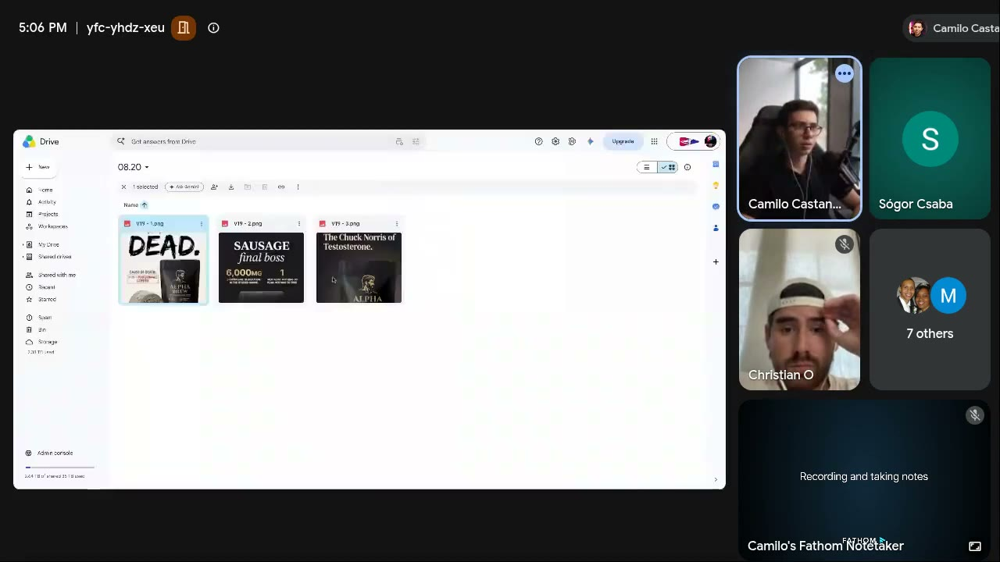
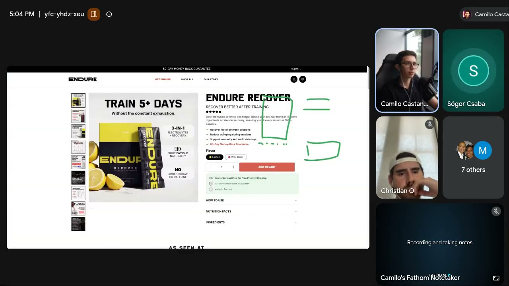
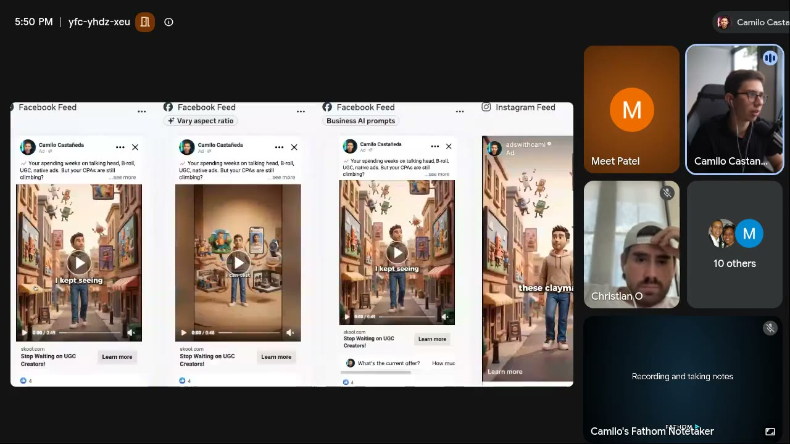
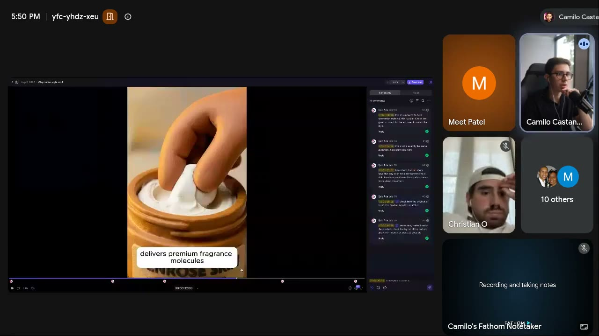

# 84. Ad Roast Call, 21 August 2026
> A live community roast: cortisol and "final boss" statics for a testosterone coffee, a revised Tai Chi AI-UGC ad, a six-minute talk-show style AI story ad, a cinematic microplastics ad made in Seedance 2.0, a song ad, a telehealth top-of-funnel script, and a claymation cologne ad, with the team's scorecard and a safe-zone demo in Meta's ad preview.

## 🤖 Agent use
- **Use when:** judging a static or video ad before launch; deciding where the click should land (PDP vs education page); making AI story or talk-show ads; checking safe zones; scoring a submission.
- **Inputs → outputs:** an ad plus its funnel step → a verdict on hook, clarity, sell and execution, with specific rewrites and visual fixes.
- **Rules:**
  - **DO** score ads on four criteria: hook, clarity, sells, execution (0-5 each, total /20) [37:59, sheet on screen at 38:06].
  - **DO** make a strong static hit hard: a "massive strong call out" that "makes you want to find out more" needs no extra elements [01:34–02:04].
  - **DO** send curiosity-led or education-needed clicks to a page that educates; make each PDP image work like its own mini-ad (headline, ingredients, offer, objections) [03:57].
  - **DO** use the "rule of one thing" per static [05:24].
  - **DO** show visuals that make the viewer nod "I tried that": show the character trying walking, steps, low impact, not just looking sad [10:52].
  - **DO** write scripts for AI talking-video models line by line, read aloud, with natural speech ("drop the g") and prompt gestures to match the words [20:43, 23:38; member advice].
  - **DO** add B-roll cutaways to a talking doctor/creator scene to show what the dialogue names (what you are exposed to every day) [29:23].
  - **DO** keep key visuals centered in generation and add the safe zone template when editing; zoom in slightly when reframing [39:05–40:48].
  - **DO** show the product's mechanism visually: particles bouncing off skin, scents mixing, not only text [46:27, 50:03].
  - **DON'T** point a high-click, education-needed ad straight at a thin PDP: "people... never gonna go to the bottom part" [02:57].
  - **DON'T** reveal the product too early when the goal is curiosity; showing only ingredients (or a mug) can attract broader audiences and keeps it from reading as a retargeting ad [06:23].
  - **DON'T** let a perfect, podcast-style AI voice carry a story ad: "the voice and... so perfect podcasty voice" breaks believability [27:34–28:27].
  - **DON'T** label an ad as a style it is not ("claymation" on a non-claymation video) [46:27, 50:57].
  - **IF** the ad is top-of-funnel and constraints forbid callouts THEN judge on visuals and make sure the viewer still has a reason to watch past ten seconds [43:28].
  - **IF** Higgsfield rejects a lip-sync clip for privacy-policy reasons THEN try the same image in Kling or Seedance with slowed speech [35:26–36:24].
- **See also:** [Ad roast call, 17 August 2026](083-ad-roast-calls-2026-08-17.md) · [Claude Skill + Seedance 2.0 AI UGC](020-claude-skill-seedance-2-0-ai-ugc.md) · [Make AI creators talk](029-make-ai-creators-talk.md) · [AI song-ad pipeline (Loom)](../../../../resources/ai-song-ad-pipeline-loom.md) · [write-landing-page skill](../../../../../../.claude/skills/write-landing-page/SKILL.md)

## Key ideas
### Opening note: mine reviews for the buyer [00:00–01:34]
- Camilo praises a member's practice video on a random product and says reading Amazon reviews is a main step: "some commonality from the responses you get in a review... can help you find the person you're speaking to very easily" [00:31].

### Segment 1: Testosterone coffee statics (cortisol "found dead", "sausage final boss", "Chuck Norris") [01:34–08:13]
Product on screen: Alpha Brew testosterone coffee; a Drive folder of three statics shown (frame 06:09). Funnel: ads go straight to the product page; the member plans listicles or advertorials and reports a high click-through rate but weak conversion [02:04–03:57].
- **Static 1, "Cortisol was found dead. Cause of death..." + "11-in-1 performance coffee":** "oh that's so good... in your face... a very good use of static ads... massive strong call out" [01:34–02:04]. Run it: "I don't think you need anything else" [02:04].
- **Problem is the page, not the ad:** a cortisol ad needs education; the PDP shows a product image and an offer, and the explanation is below. Visitors "never gonna go to the bottom part of the ad... those are for a very small amount of people" [02:57].
- **Camilo's example (Endure electrolyte brand, same agency):** before, the PDP had a product image; they redesigned the page so "each image is its own ad with a bit more information": headline "train five plus days without constant exhaustion", ingredients with why each matters, the subscribe-and-save offer, objection handling [03:57]. His summary: people who already know cortisol hurts testosterone will convert; "if you want it to scale more, it's going to work better on a page that has more education" [04:54].
- **Static 2, "Sausage final boss" (the member explained what the word means in the target language; Camilo: "big sausage final boss" or "small sausage final boss" to "really send it") [05:24]:** "One mug a day, nothing to plan, nothing to time": change "nothing to time" to "nothing to remember"; "better" [as a word] is dropped; offer line fine [05:24]. Credit: "the rule of one thing" [05:24].
- **Static 3, "The Chuck Norris of testosterone. You don't just drink this":** "that's crazy" (strong, humorous angle) [05:24].
- **Next test (Camilo):** ads that do not show the product, only a coffee mug with the ingredient list: "L-citrulline... your testosterone support in a mug". Product-light visuals "draw curiosity", while product-heavy visuals attract certain people who know the category; Meta may use it as retargeting [06:23]. Their top spender follows a similar concept (instructor claim) [06:23].
- **Ingredient method:** 11 ingredients: for each, state what it is, what it does, what it means for the customer (Justin's method, per the member) [07:21].

### Segment 2: Tai Chi walking app, version 2 (AI UGC + claymation) [08:13–12:54]
Ad: voice says "just 10 minutes a day of Tai Chi walking to clear the mind and steady the body. I'm 57, I've tried everything: 10,000 steps, gym memberships, even YouTube yoga, nothing stuck... designed for women over 50... 12 movements, 10 minutes. Week two my joints aren't stiff anymore, week three my belly is visibly changing" [08:56].
- **What works:** cuts between AI-UGC creator and claymation ("I haven't seen it before"); pacing and editing are good ("very hard thing to teach") [08:56–09:53].
- **Fix 1, voice and character:** the AI creator's voice doesn't match the character and "ruins it a little"; use her voice in the hook rather than a male voice [09:53, 11:50].
- **Fix 2, show, don't tell:** where she says joints aren't stiff, show her climbing stairs or doing something stiff joints stop you doing [09:53–10:52].
- **Fix 3, visualise each claim:** "I tried everything, 10,000 steps": show the character trying walking, steps, the low-impact thing, so viewers nod "I tried that" [10:52]. Rule: "can you show something visual that makes me feel something?" [11:50].
- **Context:** Camilo mentions a Tai Chi app spending heavily (hundreds of millions per year, per him, instructor claim) [12:20]. The same app/ad was in [call 83](083-ad-roast-calls-2026-08-17.md); this time the pacing is better.

### Segment 3: Six-minute "talk show" AI story ad (skin condition) [12:54–26:27]
A member's new long-form style: a Oprah-type talk show with an AI woman telling a personal story about a chronic inflammatory skin condition (heard as "hidradenitis suppurativa"); the product appears only in the last minute; target: broad cold audience; the member had seen the format working organically. Only the first part was shown [13:25–18:32].
- **Reception:** "this is crazy, this is really good", "I'm forgetting this is an ad. It was like a piece of content", "you left me with so many open loops" [15:42–17:34]. Script praised: "no fluff... very deep without the fluff" [15:42].
- **Member's process:** script took two days; first told the story herself, then had AI write it; the AI draft was 19 pages of fluff, so she printed it and edited line by line on paper [19:02–20:00].
- **Tech:** characters, video and voice all from Google Omni via Flow; images from GPT Image 2 (heard as "GPT2"); a reference video set the talk-show look; 86 B-roll images; no separate ElevenLabs voice [20:43–21:40, 22:37]. Same Flow project helped keep voice consistent; gestures were prompted to match speech ("if they're talking about their chest, let them touch") [23:38]. Cost reference: Flow ~25,000 credits for about $200/month (member claim) [24:30].
- **Fallback for voice consistency (member):** clone or model a voice from an online sample, if Omni drifts [22:37].
- **Camilo on format:** ultra-long VSL-type ads "don't convert super high" (1–2 ROAS, not 3–5) but "you can scale it and scale it and scale it and it brings new customers and your other ads sweep up the conversion" (instructor claim, Pet Lab) [20:00].
- **Realism tip, member:** read the script out loud verbatim; "drop the G"; sentences should sound spoken [20:43].
- **Tool take:** Camilo says Google Omni "seems to be very good" for realistic podcast and talk formats; he previously used Kling; "Google Omni is taking the crown" (instructor claim, at recording, Aug 2026) [51:30].

### Segment 4: Microplastics / non-toxic kitchenware (wooden utensils), cinematic AI story [26:27–32:54]
Ad: a woman in a kitchen with a doctor-style monologue ("some things we can't control, age, genes, but the rest: what you eat, your stress, what you're exposed to every day in your food in your house... most people never look at that part... it's not just plastic, it's the coating on your pans, the chemicals in your cleaning products") [27:03–27:34]. Script was given to the member; made in Seedance 2.0 following the wine tutorial; product: wooden utensils; creator image from Pinterest [28:27, 39:05].
- **What works:** proper storytelling script; Camilo likes the story [27:34, 29:23].
- **Fix 1, voice:** the "perfect podcasty voice" doesn't match the kitchen; "if I'd change one thing, redo the voice" [27:34–28:27].
- **Fix 2, B-roll:** when the voice says "what you eat, your stress, what you're exposed to", cut to footage of those exposures; or the doctor pushes a paper with things to avoid or her results [29:23].
- **Fix 3, character plastic look:** use a character sheet (a sheet of the woman made as realistic as possible), Nano Banana Pro over GPT Image (his preference, instructor claim) [30:22].
- **Fix 4, camera angles:** straight-on is neutral; use worm's-eye or eagle-eye in prompts: "tense or sad calls have the angle lower"; Seedance 2 also takes camera movement [31:24–32:22].
- Pinterest now contains a lot of AI images [30:22].

### Segment 5: Song ad (emotional lyric ad), partial 30-second cut [32:54–36:57]
Ad: a man's confession song ("I faked being asleep when my wife came to bed on our anniversary... I couldn't be the man...") with B-roll, a trial edit for a client; full song about six minutes; only the first ~30 seconds exported [33:26–33:58].
- **What works:** builds tension about what the product will do; scene choice good; cutting from him singing to B-roll "feels like it's him speaking" [34:32].
- **Lip-sync pain:** the member tried cutting the sung section; Higgsfield rejected it due to a privacy policy ("I made the song") [34:32]. Models used: Seedance 2.0 (sometimes mini/fast), lip-sync with 2.0 only; images Nano Banana via Flow [35:26].
- **Suggested workflow (Camilo):** same image in Kling or Seedance, give only the words he says and have him say them slowly, then sync in edit [35:26].
- **Caption:** at the hook add a "story, open loop" caption [36:24].
- See [AI song-ad pipeline](../../../../resources/ai-song-ad-pipeline-loom.md).

### Segment 6: Scorecard, competition and safe zones [36:57–41:37]
- **Arena competition reminder:** "who's submitting ads for the competition... I got all this money for credits" [36:57]. Camilo reviews every entry even if you don't win [52:03].
- **Scorecard (shown):** a Google Sheet scored hook, clarity, sells, execution out of 5 each, total /20. Key on screen: Clarity "Within a few seconds do you know what the product is and why you'd want it"; Sells "Is desire built and is there a real reason + CTA to act, would it move units"; Execution "Clean craft, no AI jank, good pacing, sound, edit. Polish in service of the sell"; Hook (0-3s) "Does it stop the scroll - pattern interrupt or a claim that earns the next second" [37:59, frame 38:23]. A past submission scored low on hook and fine on clarity and execution [37:59].
- **Safe zones:** a member asks how elements are positioned for Instagram's bottom caption area. Camilo: generate references first, then animate; keep references centered; use the safe-zone template in the community; zoom in slightly while editing to reframe [39:05–40:48]. Members: some fix in post only [40:48].

### Segment 7: Telehealth top-of-funnel script (skeleton visual, "sprinkler" metaphor) [41:37–45:22]
A member's script for a telehealth brand, shown as a skeleton-style video. Voice: "fine at 7 a.m... by 2 p.m. you're moving things to tomorrow... it isn't in your head, it isn't your discipline... Think of a sprinkler that comes on for a fire, then shuts off. After a certain age, yours stops shutting off... a cellular deficit no blood panel measures. So tap below and read what's actually spending it." [41:49–42:28]. The brand's dossier forbade callouts and any product display [43:28].
- **What works:** visuals are great; contrast; the sprinkler metaphor [44:23].
- **Fix:** "will the person that watches after the first 10 seconds want to watch the rest?": add a callout such as "if you are... / do you know somebody in the same spot" [43:28]; the member explains constraints (no calling people out) [43:28].
- **Shot warning:** a low-angle shot where a girl at the bottom gets lost [44:23].
- Camilo has seen top-of-funnel ads that are a 50-minute woman on stage, "clearly AI", and "crushes" (instructor claim) [44:23].

### Segment 8: Cologne claymation ad (trial task) [45:22–51:30]
Ad: Penrose-style body butter for smokers: "He smokes one pack a day, but women can't stop burying their face in his neck. Here's how..." The member made it as a trial task for a job posting [45:54]. Frame at 49:49 shows a cream tub being applied.
- **Mislabel:** the on-screen label says "claymation" but it isn't claymation [46:27, 50:57].
- **Show the mechanism:** "the mixed scent of cigarette and cologne is more nauseating to a woman": zoom to scents and put blobs of cologne and blobs of cigarette mixing; cut to the woman reacting [46:27].
- **Hiring signal:** "association and showing, not telling" are what Camilo looks for in editors [47:25].
- **Barrier visual:** "fragrance molecules push the smoke scent out": show particles, one enters, another bounces out, so the viewer believes it is a barrier to smoke scent [50:03].
- **Check product accuracy:** the original jar must look like the product [50:57].
- **Safe zone demo:** Camilo opens an ad in Meta's Advanced Preview: the 9:16 ad can be cropped or overlaid by a "Learn more" button and text; the ad's text in this edit is "100% covered" [48:24–49:32; frames at 49:15–49:35]. Purpose of these visuals: raise intent before the click [50:03].

### Closing Q&A [51:30–52:58]
- "Best model for realistic AI podcast?": Omni now, Kling earlier [51:30].
- Reminders: submit ads to the competition; Justin's copywriting call is "tomorrow" [52:33].

## Steps / framework
Funnel-fit check for statics (derived from segment 1):

| Click-to-page match | Page needs | Source |
|---|---|---|
| Strong callout static (cortisol) | Education-led PDP: image-per-ad blocks (headline, ingredients, offer, objections) | [02:57–04:54] |
| Ingredient/mechanism static | Ingredient-by-ingredient explainer: what it is, does, means | [07:21] |
| Listicle/advertorial landing | Plan it for high-CTR, low-CVR traffic | [02:04] |

## Examples
- Cortisol "found dead" static: strong callout with no extras [01:34].
- PDP rebuilt as stacked mini-ads (Endure) [03:57].
- AI talk-show story with printed, hand-edited script [19:02].
- Doctor monologue plus B-roll fix [29:23].

## Structured units
### Ad teardowns
| Brand / product (niche) | Format | Hook / opening | What works | What fails | Fix suggested | Principle | Source |
|---|---|---|---|---|---|---|---|
| Alpha Brew testosterone coffee (supplement) | Static | "Cortisol was found dead. Cause of death..." | Massive callout; clean; 11-in-1 | PDP lacks education; CTR high, CVR low | Run it; send education-heavy traffic to an educating page, or listicle/advertorial | Callout; funnel fit | [01:34–04:54] |
| Same | Static | "Sausage final boss / 6,000 mg... one mug a day, nothing to plan, nothing to time" | Rule of one thing; humor | "Time" wording; unclear pun | "Nothing to remember"; big/small sausage for effect | One idea per static | [05:24] |
| Same | Static | "The Chuck Norris of testosterone" | Memorable angle | n/a | n/a | Humor | [05:24] |
| Same | Proposed product-free static | Coffee mug with "L-citrulline..." | Curiosity; wider audience; less retargeting feel | not yet made | Mug + ingredient breakdown: "your testosterone support in a mug" | Product-light | [06:23] |
| Tai Chi walking app (fitness app) | AI UGC + claymation | "10 minutes a day of Tai Chi walking... I'm 57, I've tried everything" | Pacing; format mix; hooks better | AI voice mismatch; visuals do not show claims | Use her voice in hook; show attempts and stiff-joint tasks | Show not tell; nod test | [08:56–12:54] |
| Skin-condition brand (health) | 6-min AI talk-show story | Personal confession of years with boils | Story, no fluff, open loops | Transitions and discovery section weak; compliance risk (AI "patient") | Script hand-edited; keep realism | Long-form story | [14:56–26:27] |
| Wooden kitchen utensils (home) | Cinematic AI story, Seedance 2.0 | "Some things we can't control, age, genes, but the rest..." | Story script | Podcasty voice; plastic character; flat angle; no B-roll | Redo voice; B-roll cutaways; character sheet; worm-eye/eagle-eye | Voice match; cinematic angles | [27:03–32:22] |
| Anonymous song-ad brand (marketing demo) | AI music/lip-sync video | "I faked being asleep when my wife came to bed on our anniversary..." | Emotional; cuts between singing and B-roll | Lip-sync limits, Higgsfield privacy block | Slow-spoken words in Kling/Seedance; hook caption | Open loop; story | [33:26–36:24] |
| Telehealth brand (health) | Script + skeleton visuals | "Fine at 7 a.m., by 2 p.m. moving things to tomorrow" | Visuals, sprinkler metaphor | No callout; low-angle shot loses a figure | Add "if you are..."; keep legible shots | Intent in first 10s | [41:49–44:23] |
| Penrose body butter (fragrance/skin) | "Claymation" ad (not claymation) | "He smokes a pack a day, but women can't stop burying their face in his neck" | Hook; script | Label wrong; text in safe zone; telling not showing | Show scent mixing, barrier particles, her reaction | Show not tell; safe zone | [46:27–50:57] |

### Rewrites (before → after)
| Before | After | What changed | Source |
|---|---|---|---|
| "Nothing to time" | "Nothing to remember" | clearer benefit | [05:24] |
| Product-shot static | Mug-with-ingredients static | product shown → mechanism teased | [06:23] |
| Product page = product image + offer | Each page image = headline / ingredients / offer / objections | thin PDP → mini-ad stack | [03:57] |
| "I've tried everything" (face only) | Character trying walking/steps/low impact | claim → shown attempts | [10:52] |
| Talking doctor only | Doctor + B-roll of exposures, or a paper of avoid-list | talking head → shown proof | [29:23] |
| Hook with flat shot | Zoom or angle change (worm-eye/eagle-eye) | neutral → tension | [31:24] |
| "Mixed scent... more nauseating to a woman" over text | Blobs of cologne+smoke mixing, then her reaction | text → visual | [46:27] |

### Rules (DO / DON'T / IF-THEN)
- **DO** read reviews to find the common words of the buyer [00:31].
- **DON'T** compromise a strong static with an extra callout stack [02:04].
- **IF** a lip-sync clip is blocked by a platform policy THEN rebuild it in another model [35:26].
- **IF** a long-form ad is cold-traffic THEN expect 1–2 ROAS but new customers (instructor claim) [20:00].

## Prompts / templates (verbatim)
No prompts were shown. Verbatim fragments from speakers:
- Scorecard key (frame 38:23): `Clarity: Within a few seconds do you know what the product is and why you'd want it` · `Sells: Is desire built and is there a real reason + CTA to act - would it move units` · `Execution: Clean craft - no AI jank, good pacing, sound, edit. Polish in service of the sell` · `Hook (0-3s): Does it stop the scroll - pattern interrupt or a claim that earns the next second` (full key visible in frame 38:23).
- Member's gesture rule for Claude-written video prompts: "go back, analyze this script, make sure that the gestures match naturally with what they're saying" [23:38].
- Camera words suggested: "worm eye", "eagle eye" [31:24].

## Screenshots

*Statics reviewed: "Cortisol was found dead", "Sausage final boss", "Chuck Norris of testosterone". [05:11]*

*The PDP Camilo uses to show each product image carrying its own headline ("Train 5+ days without the constant exhaustion"). [03:42]*

*The same ad cropped across Facebook Feed, vary-aspect-ratio and Instagram placements: overlays and the bottom button change what is visible. [49:15]*

*Frame from the body-butter ad, caption "delivers premium fragrance molecules" near the bottom edge. [49:49]*

## How to apply
- [ ] Score your ad 0-5 on hook, clarity, sells, execution before launch (/20).
- [ ] Match click destination to the ad's education needs.
- [ ] Turn each "I tried everything" line into three shown attempts.
- [ ] Add B-roll under any doctor or talking-head claim.
- [ ] Check voice match; redo the voice first.
- [ ] Open the ad in Meta Advanced Preview and move text out of overlay zones.

## Related
- Previous: [83. Ad roast, 17 August 2026](083-ad-roast-calls-2026-08-17.md) · Next: [85. Ad roast recordings page](085-ad-roast-calls-page.md)

## Sources and limitations
- Transcript is 52:58 (ends 52:49, complete). Member names removed. Machine transcription: "Omni" = Google Omni; "Higgsfield" as "hicksfield"; ad content for the song and talk-show ads is lyrics/story read aloud. Brand names only as seen on screen.
- Frames show the Drive folder; linked ad files and the scorecard sheet were not fetched; the scorecard shows member names and scores, which are not reproduced.
- Results statements ("always crushes", ROAS ranges, spend) are instructor claims.
- Compliance flags: the skin-condition story uses an AI-generated "patient" telling a medical history as if real; the telehealth script cites a "cellular deficit no blood panel measures"; the sexual-health and kitchenware claims rely on a doctor character. Label AI characters, avoid unsupported medical claims, and do not present AI customers as real. The song ad uses a real song the member composed; cloned voices of real people are not covered.
