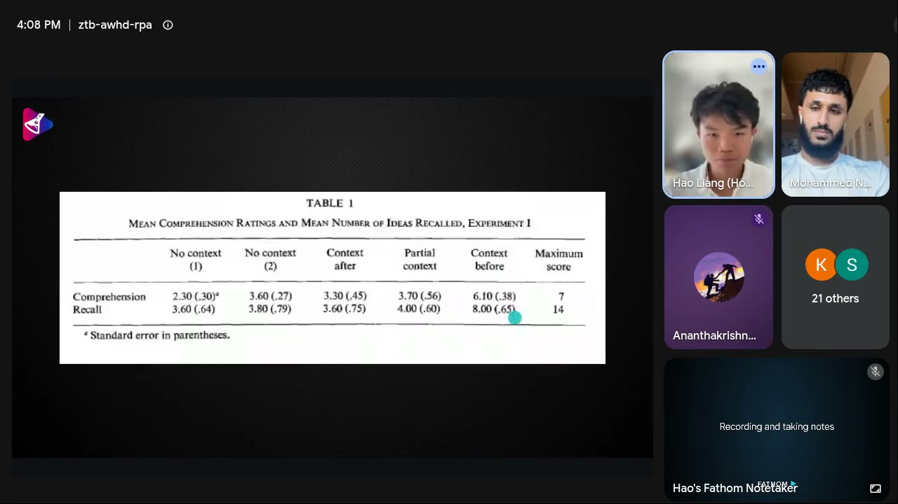
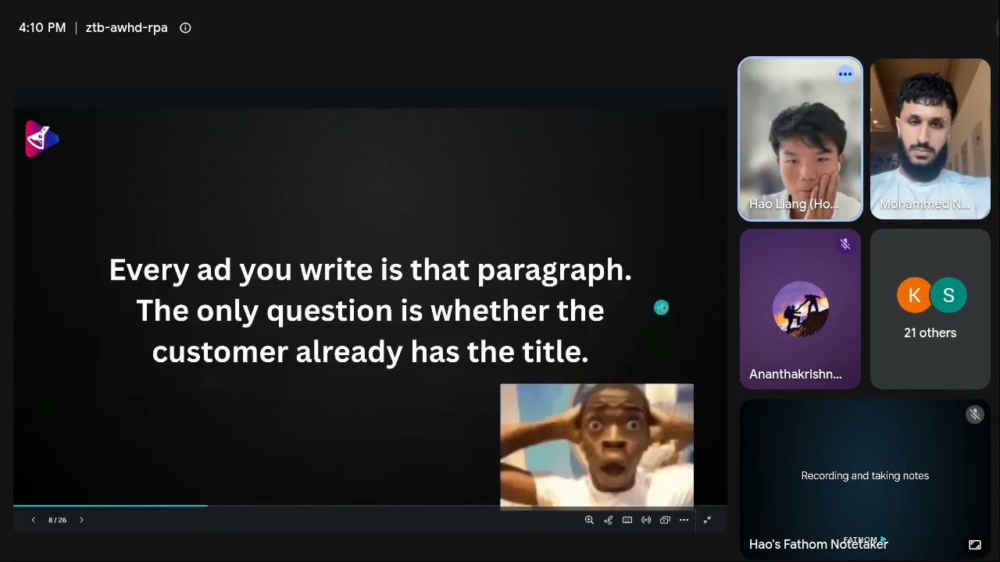
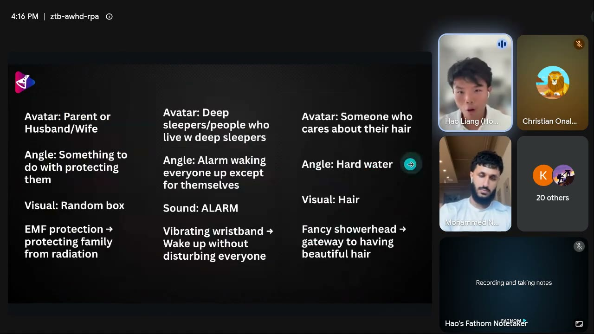

# 86. Ad Psychology Call, 12 August 2026: Schema, the Ad's Title and Hook Relatability
> Weekly "Psychology" call (first class of the series): a hook works as the "title" that lets the viewer file the rest of the ad into an existing mental folder (schema), so the hook must be built from the avatar's own language, experiences and stereotypes; the second half is Q&A on guilt and shame, funnel stages, research and format choice.

## 🤖 Agent use
- **Use when:** writing or auditing a hook; choosing a format (claymation, skeleton, split-screen) for an audience; deciding whether to use guilt or shame; diagnosing "great hook, weak conversion" accounts; scoping research.
- **Inputs → outputs:** audience (age, generation, niche) + product + raw customer language → hook defined by four parts (avatar, angle, sound, visual) that the audience can instantly file into a schema → body that stays inside that schema.
- **Rules:**
  - **DO** treat the hook as the ad's title: "Every ad you write is that paragraph. The only question is whether the customer already has a title" [11:21]. Comprehension and recall "nearly tripled" with full context before the text (instructor's reading of Bransford and Johnson, 1972) [10:49–11:21].
  - **DO** build the hook from four elements: avatar, angle, sound, visual; their combination sets product positioning for the whole ad [12:35–13:39].
  - **DO** use the avatar's own words, experiences and visuals so the hook is "easy to process": easy processing "feels true, more familiar, and more likable" [22:53]. Mechanism: [processing fluency](../../../../concepts/heuristics/processing-fluency.md).
  - **DON'T** make an ad look like an ad: "make your ad look as organic as possible" [24:54]; the ad itself is a schema the viewer filters out [23:56].
  - **DO** pick the format that triggers a pleasant schema for the target age band, not the format that is trending (nostalgia formats for 50+, skeleton for 20s to 30s) [31:10–33:12]. "The format… of the AI is not what wins an ad, it's a script. The format… is just to bypass the defense mechanism" [33:46].
  - **DON'T** confuse relatable with desired: "What's relatable is pain and loss"; desire is the outcome they want [34:42–35:40].
  - **IF** a hook attracts window shoppers (high CPC, low buyer quality) **THEN** make the hook narrower with a visual or verbal cue only the buyer recognises [1:04:21–1:05:17].
  - **IF** a message is not working **THEN** check "will the audience understand this" before "do I think this works"; one scaled brand's winning angle was reworded after four months of failure [1:11:14–1:12:21] (instructor claim).
  - **DON'T** judge top-of-funnel creative on bottom-of-funnel ROAS; keep a ladder of top, middle, bottom and promo ads [53:24; 1:05:17–1:06:15].
- **See also:** [Ad psychology call 27 Aug](087-ad-psychology-with-howie-2026-08-27.md) · [Ad reviews 29 Jul](088-ad-psychology-with-howie-2026-07-29.md) · [Processing fluency](../../../../concepts/heuristics/processing-fluency.md) · [Emotional zones](../../../../concepts/emotional-zones.md) · [Mirror effect](../../../../concepts/mirror-effect.md) · [Pattern disruption](../../../../concepts/heuristics/pattern-disruption.md) · [Cognitive dissonance](../../../../concepts/heuristics/cognitive-dissonance.md)

## Key ideas
### Who speaks and setup [00:12–07:27]
- The host introduces himself: "My name is Howie. I've been working at Epic Ads Lab for the past eight-ish months. And I'm one of the career strategists" (transcript word likely "creative strategists"; machine error) [06:12]. He cites an International Baccalaureate psychology course as his authority [06:52]. On screen the tile reads "Hao ... (Howie)" and the meeting notetaker "Hao's Fathom Notetaker" [00:09]. Evidence supports: coach Hao, goes by "Howie". Written here as "Hao/Howie".
- The call opens late (about 6 minutes of waiting and chatter, including an unrelated editing-export question) [00:12–06:12]. First slide is a meme "PSYCHOLOGYMAXXING" [07:27]. He says the session is "a quick 20-minute session" [25:25] followed by about 45 minutes of Q&A. Slide deck and recording "posted in the school community" [1:13:11]; the deck is not in the course files.

### Exercise: the laundry paragraph [07:27–11:21]
- Attendees guess what a paragraph is about. Text (read aloud, shown on slide) [08:03–08:39]: "The arrangement matters more than most people assume. Too few in the process stalls, too many [and you'll] spend longer sorting than doing. Start with what's on top, since reaching underneath first tends to undo progress. Warm is usually safer than hot, though there are exceptions you learn by ruining one. When it's finished, don't leave it sitting. The delay is what causes the smell. Most people only think about any of this after something goes wrong."
- Answer: "Doing laundry". One attendee out of the group guessed it [10:11]. "The words never changed. The comprehension did" [10:11].
- Evidence cited: Bransford and Johnson, 1972 ("contextual prerequisites for understanding"). Conditions: no context, context after, partial context, full context before. Instructor's reading: context after barely helped; full context before roughly tripled comprehension and recall [10:49–11:21]. The slide table (mean comprehension ratings and mean ideas recalled) is in the screenshots; its maximum scores are 7 (comprehension) and 14 (recall) [11:15].
- Conclusion on slide: "Every ad you write is that paragraph. The only question is whether the customer already has a title." [11:21].

### What is the title of an ad? [11:21–13:39]
- Attendees answer: on-screen text, headline, main messaging. He says those are the editor's view; for scripting and strategy it is the first sentence and how you call out the customer, the hook [12:35–13:06].
- His definition: the hook plus four elements create the title: **avatar, angle, sound, visuals** [13:06]. "Your entire hook will just determine your entire product positioning for the entirety of this ad" [13:39].

### Three teardown examples of titles [13:39–19:54]
Slide: Avatar / Angle / Visual / Sound / repositioning. Hooks shown as organic-looking Instagram video posts (accounts' handles not recorded here).

| Ad (niche) | Avatar | Angle | Visual / sound | New brand positioning | Source |
|---|---|---|---|---|---|
| EMF blocker for phones (health and tech) | Parent or husband/wife | "Something to do with protecting them" ("Protect your family") | Visual: a random box being opened | "EMF protection → protecting family from radiation" | [14:29–16:34] |
| Vibrating wristband alarm (sleep) | Deep sleepers, or people who live with deep sleepers | Alarm waking everyone up except themselves | Sound: the alarm itself | "Vibrating wristband → wake up without disturbing everyone" | [16:34–18:21] |
| Shower head filter (hair care) | Someone who cares about their hair | Hard water | Visual: smooth hair versus messy hair comparison | "Fancy showerhead → gateway to having beautiful hair" | [18:21–19:54] |

- **EMF ad:** the angle ("protect your family") is embedded "subconsciously" in the viewer, the random box creates a [curiosity gap](../../../../concepts/heuristics/curiosity-gap.md), and the villain (EMF) is created later in the video [15:40–16:34]. He rates it "Great ad" (instructor opinion). Test he proposes: swap the headline to "protect yourself from EMF" and keep everything else: the viewer thinks "EMF? What is that? I don't care… another conspiracy. Scroll"; protecting family "is a primal need" [22:21–22:53]. Compare [specificity](../../../../concepts/heuristics/specificity.md) and [fear appeal in emotional zones](../../../../concepts/emotional-zones.md).
- **Alarm ad:** "extremely relatable" but no curiosity gap; viewers watch to the end, then a sudden change in audio and visuals is "a really really big pattern interrupt" that bridges into the product [17:12–18:21]. See [pattern disruption](../../../../concepts/heuristics/pattern-disruption.md).
- **Hard water ad:** "hard water" is itself a curiosity gap for most people [18:52]; the comparison visual makes the unknown term legible.

### Schema theory [19:54–22:21]
- Frederic Bartlett, 1936: a schema is "a mental framework that organizes what you already know" so the brain files new information against old information instead of spending energy [19:54]. Brain-energy figures he gives (about 5% of body weight, 20 to 25% of daily energy) are stated from memory (instructor claim) [19:54].
- Peptides example: a parent hears "peptides", thinks needles, then drugs, then meth; the belief becomes identity, so "you never want to argue against a belief" [20:52–21:50].
- Practical rule: speak "in a language that matters the most to the avatar, to the angle" so it is easy to process and the viewer stays instead of scrolling; the brain "hates discomfort" and wants autopilot [23:24].
- Schema is not only language: "It's experience. It's smell. It's physical action. It's things you hear. It's all the five senses combined" [45:44]; also "schema in a way is just identity" [52:19] and "tied in with stereotypes" (bodybuilder implies steroids, angry) [38:41]. Related: [identity stacking](../../../../concepts/identity-stacking.md), [actual self](../../../../concepts/actual-self.md).

### Make the ad look native: the KFC case [23:56–30:01]
- KFC (Portugal and other country accounts on TikTok) runs deliberately chaotic Gen-Z "brain rot" content; he says it "fits the schema" of what Gen Z doom-scrolls and the purpose is "brand awareness and… brand reputation… beyond just pure sales", with Gen Z sales "up" (instructor claim, no data shown) [23:56; 27:19–28:58].
- Takeaway: study how the audience speaks, then "apply this schema into the hook" [28:58]. Compare [native advertising](../../../../concepts/native-advertising.md).
- On a conservative CEO objecting: Eugene Schwartz's awareness stages that took weeks (newspapers) now can pass in about 30 minutes online, so "if you really want to sell to Gen Z people use brain rot formats" [30:01–31:10].

### Format by audience: nostalgia versus trend [31:10–33:46]
- Why knit/claymation worked: they "don't necessarily work well for a younger audience". For 50+ the first thought is nostalgia, not "this is an ad"; claymation and felt-style stop-motion recall 80s and 90s films [31:10–32:42]. For 20s to 30s: the transparent skeleton format, "viral… around last year", reads as "something funny is going to happen" so it "blends into their feed" [32:42–33:12]. Compare the course's format lessons in section 4.
- A claymation-or-Barbie question is answered with "do market research… when was Barbie popular to what audience did they grow up watching" [33:12–33:46].
- Rule: the AI format is not the winner, the script is; the format only lowers the "this is an ad" defence [33:46].

### Relatable versus desire, pain, loss [33:46–36:42]
- A supplement for women aged 50 to 65 (grandmothers): the proposed angle "better time with family" is a **desire**, not what is relatable. "What's relatable is pain and loss" [34:42–35:40]. Hook starter: something painful the grandmother recognises ("I don't remember the last time I picked up my grandchildren") [35:40].
- Zone call: "if you want to go a negative angle more valence intensity zone three that's the way to go for supplements for 50 to 65 year old grandmas" [35:40]. This matches Tether Zone 3 (low intensity, negative): see [emotional zones](../../../../concepts/emotional-zones.md).
- Follow-up: forgetting a grandchild's birthday, being out of breath on stairs and feeling sleepy after eight hours are experiences that fit a schema; he names that schema "I'm a bad grandma" [44:48–45:44]. He admits this is guilt-tripping and "not very ethical" [46:15].

### Hook versus rest-of-ad as separate concepts; pattern interrupt versus relatability [36:42–41:11]
- A strategist suggests treating the hook as an independent ad concept apart from the body. Howie: hook is "like one ad on a For You page" then cuts to a body; a brand he works with does this and "100% works" [36:42–37:39]. Schema applies "to every aspect"; the most important part is the hook [38:10–38:41].
- Pattern interrupt is different: relatable first versus unexpected scroll-stopper. Unexpected hooks are "cognitive dissonance… saying the opposite thing of what they believe" [39:39–40:09]; see [cognitive dissonance](../../../../concepts/heuristics/cognitive-dissonance.md).
- Example (internal deodorant pill brand): hook "stop using deodorants to smell good" breaks the belief that you must use deodorant to smell fine. Rule: after a belief-breaking hook, "make sure your body starts off in storytelling and… fits into their schema folders" [40:41–41:11].

### Research: where the language comes from [41:11–44:48; 1:06:50–1:10:43]
- He reads comments by verbs and nouns used and how pain is described [41:45–42:45].
- "An ad concept is the last thing I think about"; first he looks for the pain [43:15]. Reddit posts are rare because people avoid typing long confessional posts; **TikTok comments** are the richer source: impulsive, emotional, hundreds of them (example: makeup, millennial women) [43:15–44:48]. Related: [customer research stack](../../../../frameworks/customer-research-stack.md); the Research Protocol lessons in this course (see [097](097-customer-research-protocol-1.md)).
- Enough research? "You never know… weekly research, monthly research, stay up to the trends" [1:06:50]. Sometimes one good Reddit post is enough when the emotion, past attempts, problem size and many same-problem comments are visible [1:10:11–1:10:43].
- Example of schema in a winner: a static jewelry ad "jewelry you don't have to leave on the sink" took two minutes to write and spent $50k to $60k (instructor claim); it works because waterproof jewelry removes the take-off, wash, dry routine the target woman already lives [1:07:44–1:09:08]. Other ads he wrote in two hours "didn't do anything" [1:07:44]. Lesson: you only know after launch.
- Rule of thumb he gives (script writing "on autopilot"): can the audience understand it, have they lived it, can they **visualize** it, can you **falsify** it, can **no other brand say it** (three principles he attributes to Justin, a Justin session is not in this recording) [1:09:08–1:10:11].

### Guilt and shame [47:43–52:19; 59:15–1:03:24]
- Question: guilt-trip, or tell them it is not their fault? Answer: "the culture is a zone four… not fully zone four but somewhere between zone three and zone four more on a zone four side"; guilt works then pivot "it's not your fault" because "nobody wants to [be] a fault of anything", move the problem to something unknown (unaware angle), then "there is an actual solution… and that solution is us… from actual self into your ideal self" [49:48–50:18]. See [actual self](../../../../concepts/actual-self.md), [ideal self](../../../../concepts/ideal-self.md), [three selves](../../../../concepts/three-selves.md).
- Two ways: hook with guilt, or hook with something else and use guilt in the storytelling body; "highly product dependent and audience dependent" [50:18–51:48]. Soft guilt example: "Protect your family… am I not protecting my family enough?" [51:48]. UGC grandma example: "Three months ago I couldn't remember the last time I picked up my grandchildren. But I wish I had found this that finally let me play outside with them for three hours" [52:19].
- Shame (Kegel training program for lasting longer): "shaming is a very very strong emotion. No one likes to be shamed… we all have an ego" [1:00:25]. Alternatives: embarrassment (lighter, "more funny", "I lasted two minutes in bed last night, my bad"), or a third-person framing so the viewer relates to someone else [1:00:25–1:01:24]. This is the [mirror effect](../../../../concepts/mirror-effect.md). Do not drop shame blindly: "men feel differently about things… shame might encourage some men… maybe a warm, calming message"; explore other emotions to unlock more of the market [1:01:24–1:02:24].
- Indirect versus direct benefit: the direct benefit is "lasting longer"; everything else is indirect (ego boost, confidence). Gym analogy: direct = get jacked; indirect = look better on the beach, less self-conscious, take the shirt off, smile in photos. Mix indirect benefits into the hook instead of staying shame-based [1:02:24–1:03:24]. This anticipates the "indirect desire" teaching in [088](088-ad-psychology-with-howie-2026-07-29.md).

### Funnel and diagnostics Q&A [53:24–1:06:15]
- High CPC while Facebook keeps spending on creator ads: those are likely top-of-funnel; let them run. "We can't expect every single ad we make to get a two, three ROAS, even the top funnel ones. Unless it's a VSL" [53:24] (instructor claim).
- Great hook and hold rate but about 40% fewer conversions than medium-hook creatives: the high-engagement ads are "most likely 90% top funnel"; lower-engagement ones are middle funnel and convert more because only warmer people engage. "Leave it running" [54:22–54:54].
- Narrowing a broad hook: "a pet product with pet health, just show a pet on a vet bed about a diet… a very strong visual hook" that attracts cat owners [1:05:17]. Always keep diversity: "middle funnel, bottom funnel, some statics, promotion ads" so warmer leads convert [1:05:17–1:06:15].
- Using the Meta ad account structure: "it's a whole structure, funnel, ladder" [1:06:15].

### Idea sourcing and misc [54:54–59:15; 1:11:14–1:13:11]
- Best ad structure for a course brand: "there's no best"; **create a TikTok account tailored to your audience** (e.g. grandmas) so the feed shows their native content, then pull concepts [55:56–57:05]. A follow-up (keep reels without posting, as a clothing brand does) is deferred to DM [57:05–58:02].
- A brand he works on has a simple retargeting aesthetic ad that spent $150k in 30 days (instructor claim) [58:33]. Retargeting ads are also said to sit at the top of most accounts (see [087](087-ad-psychology-with-howie-2026-08-27.md) [46:25]).
- A participant suggests saving viral TikTok hooks and having Claude break them down into an idea bank; Howie: "that's a cool idea" [1:02:24] (derived: usable with a swipe-file workflow).
- Keep testing: if you believe in an idea, keep writing; one scaled brand (100k-dollar days) ran a messaging four months before he changed it; angles are about whether the audience understands them [1:11:14–1:12:21] (instructor claim). With tight budget test statics; with budget test video [1:12:21].
- Do not use meme split-screens (e.g. Subway Surfers gameplay) for grandmothers: "that doesn't make sense for them"; it is for Gen Z [47:43].

## Steps / framework
Schema-first hook check (derived from [10:49–23:56], [38:10–41:11]):

| # | Step | Detail | Source |
|---|---|---|---|
| 1 | Name the avatar | Specific viewer plus who lives with them (e.g. "people who live with deep sleepers") | [16:34] |
| 2 | Name the angle | The one problem or protective motive; must already exist in their head | [15:40] |
| 3 | Pick the visual | Show the pain or an unexplained object; comparison visuals for unfamiliar terms | [18:52] |
| 4 | Pick the sound | Audio the viewer already knows (alarm, trending sound) | [17:12] |
| 5 | Check the schema | Can the viewer file this in an existing "folder"? If a term needs explaining it must be a curiosity gap, not confusion | [20:52; 22:21] |
| 6 | Check organic look | Does it look like something posted organically, not an ad? | [24:54] |
| 7 | If the hook breaks a belief | Start the body in story that fits their schema | [40:41] |
| 8 | Label the funnel stage | Do not judge a top-funnel hook on ROAS | [53:24] |

## Examples
| Ad | What it shows | Result as stated | Source |
|---|---|---|---|
| Three ads (EMF blocker, alarm wristband, shower head) | Different titles reposition the same product | "Great ad" (instructor opinion); no metrics | [14:29–19:54] |
| KFC Gen-Z brain rot account | Format fits viewer schema | "Sales up", "doing crazy numbers" (instructor claim, no data) | [23:56; 28:58] |
| Jewelry static ("you don't have to leave on the sink") | Hyper-specific daily routine | Spent $50k to $60k, written in two minutes (instructor claim) | [1:07:44–1:09:08] |
| Deodorant pill hook "stop using deodorants to smell good" | Belief-breaking hook | Offered as an example, no result stated | [40:41] |

## Structured units
### Hooks
| Hook (verbatim or near) | Heuristic(s) | Emotion / zone | Self targeted | Why it works | Source |
|---|---|---|---|---|---|
| "Protect your family" + random box opened | [curiosity gap](../../../../concepts/heuristics/curiosity-gap.md), primal need | Fear/protection, Zone 3 to 4 (derived) | Parent or spouse | Primal motive plus unexplained object; EMF villain introduced later | [14:29–16:34] |
| Alarm sounds, "he slept through your alarm" (near) | relatable, [pattern disruption](../../../../concepts/heuristics/pattern-disruption.md) in the bridge | Humor/relatable | Deep sleeper or partner | Everyone knows the sound; audio and visual switch bridges to the product | [16:34–18:21] |
| "This wig was washed with hard water" | curiosity gap, contrast visual | Curiosity | Hair-conscious | Unknown term plus smooth-vs-messy comparison | [18:21–19:54] |
| "Stop using deodorants to smell good" | [cognitive dissonance](../../../../concepts/heuristics/cognitive-dissonance.md) | Surprise | Deodorant user | Contradicts a held rule | [40:41] |
| "Three months ago I couldn't remember the last time I picked up my grandchildren…" | [loss](../../../../concepts/heuristics/loss-aversion.md), schema "bad grandma" | Zone 3 to 4 guilt | Grandmother | Names a lived loss | [52:19] |
| "I lasted two minutes in bed last night, my bad" | self-deprecation, [mirror effect](../../../../concepts/mirror-effect.md) | Embarrassment (lighter than shame) | Men with the problem | Third-person or humorous distance | [1:00:25] |

### Angles
| Angle | Core desire / pain | Heuristic(s) | Best format | Example line | Source |
|---|---|---|---|---|---|
| Protect your family | Primal protective motive | fear, curiosity | UGC with product reveal | "Protect your family" | [15:40] |
| Alarm wakes everyone except you | Disturbing others, sleeping through | relatable humor | Skit with sound | Alarm sound as hook | [17:12] |
| Hard water | Hidden cause of messy hair | curiosity gap | Comparison visual | "washed with hard water" | [18:52] |
| "I'm a bad grandma" | Lost time with grandchildren | guilt, loss | UGC, Zone 3 to 4 | See hook row | [44:48; 52:19] |
| Indirect benefit of lasting longer | Ego, confidence | indirect desire | UGC or skit | not given verbatim | [1:02:24] |

### Rules
- **DO** pick the zone from the buyer's emotional state; for 50 to 65 women with a supplement he picks negative low intensity "zone three" [35:40].
- **DON'T** lead with shame only; test embarrassment, third-person and warm tones [1:00:25–1:02:24].
- **IF** guilt is used **THEN** transition to "it's not your fault, the cause is something you didn't know" before the product [49:48].
- **DON'T** judge format by popularity; judge it by the generation's nostalgia or feed schema [31:10–33:12].
- **DON'T** use Gen-Z formats (brain rot, meme split-screens) for older audiences [47:43].
- **DO** test in the other emotional zone (opposite pleasantness), not a neighbouring one: see [087](087-ad-psychology-with-howie-2026-08-27.md) [18:22].

## Screenshots

*Slide: comprehension and recall by context timing (no context, context after, partial, context before; maxima 7 and 14). Evidence the instructor uses for "the title" [11:15].*

*Core claim of the session [12:20].*

*The three-ad teardown framework: avatar, angle, visual, sound, and the repositioning each hook creates [18:45]. Call participants' tiles at the side are not captioned.*

## How to apply
- [ ] For each new hook, write avatar, angle, visual, sound in one line each before scripting.
- [ ] Ask: would a viewer need a title to understand this? If yes, rewrite with their language.
- [ ] Pull hook language from TikTok comments and Reddit; keep verbs and nouns verbatim.
- [ ] Choose the visual format from the audience's generation (nostalgia for 50+, trend formats for 20s to 30s).
- [ ] If using guilt, add the "not your fault" pivot or put the guilt on a third person ([mirror effect](../../../../concepts/mirror-effect.md)).
- [ ] Run a [claim audit](../../../stefan-georgi/rmbc-ii/rubrics/llm-output-claim-audit.md) on any AI-written grandmother or health hooks; do not invent personal experiences presented as real customers.
- [ ] Tag every ad by funnel stage before reading results.

## Related
- Previous: Call Recordings order 85 (not in this batch) · Next: [087 Ad psychology call 27 Aug](087-ad-psychology-with-howie-2026-08-27.md)
- Earlier in time: [088 Ad reviews 29 Jul](088-ad-psychology-with-howie-2026-07-29.md)
- Tether Lab: [Heuristics index](../../../../concepts/heuristics.md), [Psychology application ladder](../../../../frameworks/psychology-application-ladder.md), [three vs of creative](../../../../frameworks/three-vs-of-creative.md)

## Sources and limitations
- Transcript: <../../../../../raw/ad-creators-lab/ai-ads-ugc-animations/_transcripts/Ad Creators Lab - Create Viral AI Ads, UGC & Animations That Convert Into Sales(September 2026)/6. Call Recordings/2. Ad Psychology With Howie/12 August 2026 - Call Recordings · Ad Creators Lab.txt>. Whisper machine transcript, 4,431.6 s, last segment ends 4,421.7 s (complete). Lesson page has no text.
- Speaker label: "Howie" is what the host says and what the tile shows; the Meet-the-Team page spells the coach "Hao". Attendee names are omitted. Several lines are garbled (e.g. "Quantum Tumon", "Pemos/Penrose", "career strategists"); wording used here follows the closest reading.
- The slide deck (Canva) and the Fathom recording are not in the course files. Scientific references (Bransford and Johnson 1972, Bartlett 1936) are quoted as the instructor states them; they were not independently checked. The brain-energy figures are rough.
- Compliance flags: the "I'm a bad grandma" guilt schema and the shame hooks can read as manipulative; the instructor calls guilt-tripping "not very ethical" [46:15]. Do not present invented customer experiences as real; copy the mechanism, not the brand's ad (the EMF, alarm and hard-water ads were analysed as mechanisms only).
- Agreements and disagreements with Tether Lab are listed in the hand-off notes for this batch, not on this page.
