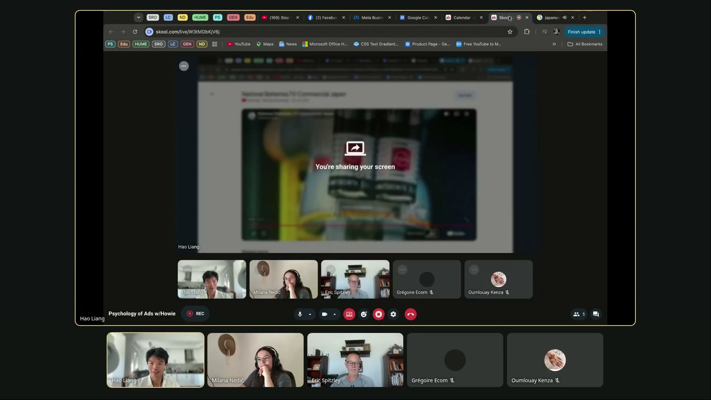
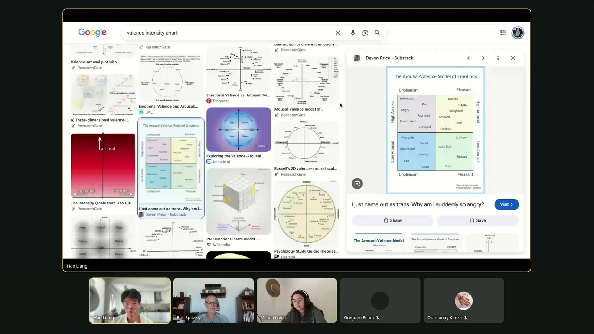
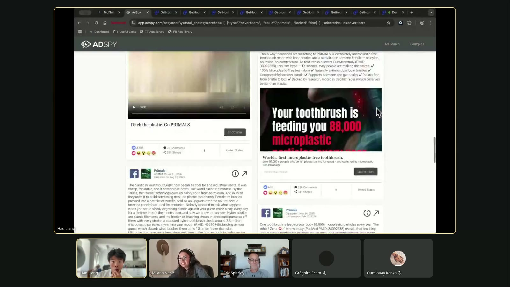

# 87. Ad Psychology Call, 27 August 2026: Brand Positioning, Zone Contrast and Script Feedback
> No slide deck this week (host was ill): a short talk on winning saturated markets by being the first brand to show an old mechanism in a new way, a quick valence-intensity contrast test for visuals, then live feedback on a member's grandparent-angle song ad and landing page and an agency Q&A.

## 🤖 Agent use
- **Use when:** positioning a product in a saturated or sophisticated market; choosing visual intensity for animated or claymation ads; reviewing a song-ad script and a landing page; deciding offer pricing and upsells for a subscription.
- **Inputs → outputs:** product + market (what every competitor already says) → a demonstration, or a "first to say it" mechanism claim no competitor shows; visual test pair in opposite emotional zones; script and page edits.
- **Rules:**
  - **DO** in a saturated market show the product's effect in a way no competitor has shown, even if every competitor could: "being the first brand to show something cool in a way that no other brand has shown before… is a perfect way to attack a very saturated… very sophisticated market" [04:30–05:01].
  - **DO** claim a true but unclaimed process fact first (Camel "our tobacco is toasted", though all tobacco is toasted) [05:01–06:32]. (derived: only with a fact you can substantiate; see the claim-audit rule.)
  - **DO** test visuals in opposite zones of the valence-intensity grid: "make sure to not test something in the same pleasantness… Make sure it's in the opposite" [18:22].
  - **DO** let stylistic intensity match the intended emotion; muted claymation colours may not carry intense emotion [18:22–19:26].
  - **DO** reuse a trending sound the audience already recognises [19:57–20:31].
  - **DON'T** worry about ad length when copy keeps an open loop: song ads of 10 minutes "crush it" (instructor claim) [24:16].
  - **DO** introduce the product clearly in a song ad (give it three lines, not one) [34:08–34:39].
  - **DO** raise price when CPA is near break-even and margin is thin: raise break-even CPA by raising price [29:35–31:06].
  - **DO** add a cheap physical upsell for physical subscriptions [31:40–32:38].
  - **DON'T** run "brain rot" or hyper-aggressive tones blindly: the aggressive toothbrush ad shows one zone can run long if it fits the avatar [15:09–16:12].
- **See also:** [086 Schema call](086-ad-psychology-with-howie-2026-08-12.md) · [088 Ad reviews](088-ad-psychology-with-howie-2026-07-29.md) · [Emotional zones](../../../../concepts/emotional-zones.md) · [Valence](../../../../concepts/valence.md) · [Intensity](../../../../concepts/intensity.md) · [Valence-intensity diagnostic](../../../../frameworks/valence-intensity-diagnostic.md) · [Emotional stagnation](../../../../concepts/emotional-stagnation.md) · [Contrast](../../../../concepts/heuristics/contrast.md)

## Key ideas
### Who speaks and format [00:00–01:30]
- Opening line: "if you're watching this recording, there's not going to be a presentation today because I've been so sick" [00:00]. Topics: "brand positioning. All the way back from the 1980s, from a battery brand in Japan", then one-on-one questions [00:00]. Five attendees. The recording title on the page is "AD PSYCHOLOGY CALL RECORDING 27 08" and is paired with the 27 August page (the page text only links to the Skool post).
- Speaker identity: same host as [086](086-ad-psychology-with-howie-2026-08-12.md); an attendee says "I showed live with Howie" [21:31]; the tile reads "Hao ..." on screen [00:00]. Written here as Hao/Howie. Attendee names omitted. Weekly slot: "Wednesdays, 5 p.m. UK time" [53:12].

### Positioning a saturated market: the Japanese battery TV ad [01:30–04:30; 50:31–52:35]
- He shows a National Batteries TV commercial from Japan, 1983, with heavy-metal music; a small figure is carried up a skyscraper, puts out a fire and a cigarette using a battery [01:30–04:30; 50:31]. Claim: "in a few weeks, it doubled the battery market in Japan" (instructor claim, no source) [02:57; 50:31].
- Lesson: "it's not because the battery is special… other battery brands probably can do the same thing, maybe even better. But what they did is just showing the effects of a battery… in a way that no other brand thought of" [02:57–03:57]. First to show efficacy wins attention; the human brain "automatically associates that with, oh, this brand is [strong]" [04:30].
- Caveat: pacing from 1983 TV would not work in 2026 ("we want faster paced stuff") [02:57].
- Same logic restated near the end: "the market itself is super saturated… this brand… showed in practice… be the first to do something in the market. It's one of the best ways to go if the market is really highly sophisticated and highly saturated" [51:39–52:35]. This is the market-sophistication move taught by Eugene Schwartz in the Evolve and RMBC material: new mechanism, not a better claim; see [Evolve Start Here](../../../evolve/start-here/) and [Evolve copywriting](../../../evolve/copywriting/).

### Camel toasted tobacco and "A diamond is forever" [05:01–07:05]
- Camel: 1970s to 90s cigarette market with doctor-endorsed health claims; Camel won with "our tobacco is toasted" although every cigarette brand toasts tobacco; "because they were the one who said it" it read as better [05:01–06:32].
- Diamonds: before the "a diamond lasts forever" positioning diamonds were "just a fancy jewel"; the campaign made a diamond the thing you give a lover to get married; he says engagement rings were pearls and then gold before diamonds (instructor claim, history not verified) [07:05].
- Conclusion: "it comes down to creative strategy to see how you can position your brand… in a way that no other brands have done it before in your niche" [06:32]. Compare [category perception](../../../../concepts/category-perception.md) and [perception management](../../../../concepts/perception-management.md).
- A participant adds that seeing an ad makes them trust a product in-store even as an ad professional; Howie: "the human brain it's so lazy it just lives its life on autopilot unless you force yourself to think" [08:07–09:10]. Mechanism: familiarity; see [processing fluency](../../../../concepts/heuristics/processing-fluency.md).

### Valence-intensity contrast for visuals [09:10–20:31]
- Question from a claymation ad maker: same script, one version aesthetic and colour-matched, another not: does it matter? Yes, "the visuals… part of the emotion"; high saturation and bold imagery push high arousal [09:10–10:03]. "It's not a new mechanism, but you're positioning the same mechanism in a way that no other brand has" [10:03–10:33].
- He pulls up the valence-intensity chart from a search result [10:33–11:16]. His description of the four cells: high arousal and unpleasant (fear, angry, frustrated; copy "very aggressive… if you don't do this you're going to get fat"); low arousal and unpleasant (sad, gloomy; "your grandson wants to play with you but your back is hurting too much"); high arousal and pleasant (excited, happy, delighted); low arousal and pleasant (cozy, calm, relaxed) [11:16–12:47].
- Application: "try the visuals with opposing sections": one version very saturated, aggressive, showing the pain directly; another mellow, lower saturation, calm [12:47–13:48].
- Terminology caution: at [17:24] he says "high valence is just unpleasant. Low valence is unpleasant" while explaining the axes. That is garbled; his usage is pleasantness versus unpleasantness plus arousal level, and he says "it's not the exact model that I use… the exact model has different wordings" [17:24]. Tether Lab defines Zone 1 to 4 with valence high = positive; see [emotional zones](../../../../concepts/emotional-zones.md). Use Tether's labels in our work.

### Primals toothbrush: aggressive zone ad that ran long [13:48–18:22]
- He tries to show the ad in the Meta Ad Library, which is down ("We're currently investigating an issue with ads library"), so he uses a third-party ad spy [14:27–15:09]. The brand sells a "natural" toothbrush alternative claiming ordinary toothbrushes release microplastics into the mouth. The AI-made hook: "a disgusting-looking" talking toothbrush with rotten teeth, "super aggressive, very negative"; it ran for a long time and "kept showing up" [15:09–16:12].
- Voiceover read on the call [17:24]: "Poisoning you. Every time you use me, friction tears my bristles apart and 120 microplastic particle[s] release straight into your mouth. You don't spit them all out." On screen the ad pages show headlines about "88,000 microplastics" (see screenshot) [15:56].
- He places it in the "higher intensity and unpleasant" area [17:24]. Advice: test in the opposite quadrant (pleasant, even "rainbows and unicorns", or relaxed) rather than a neighbour, "because something unpleasant has way more of a differentiator than something between high arousal and low arousal" [18:22].
- Rule he gives: "once you actually find which zone works for which avatar… just stick with it and just keep running it" [16:12] (instructor claim). That conflicts with Tether Lab's emotional-stagnation rule, see Sources and limitations.
- Compliance flag: the microplastic and toxicity claims are unsubstantiated here; do not replicate such health claims without evidence.

### Sound: borrow a viral track [19:26–20:31]
- Intense music from TikTok movie-recap videos can be reused in an ad: "the person recognizes it. It's already approved for it because it goes viral organically" [19:57]. See [pattern disruption](../../../../concepts/heuristics/pattern-disruption.md) and the sound element in [086](086-ad-psychology-with-howie-2026-08-12.md) [12:35].

### Live feedback: a grandparent-angle song ad and funnel [20:31–38:35]
Context (member's business, not named): a monthly mailer subscription (letter with facts, activities, stickers) sold to grandparents who want connection with distant grandchildren; angle that worked: "grandparents looking for connection"; "screen-free" kids' angle "wasn't anywhere near as strong" [22:32–27:13]. Product is a physical kit with digital follow-along questions for the grandparent as a bonus [26:01–26:43]. A competitor mailing monthly stories to older women exists; Howie: "no one at least that I know really hit this angle" [27:13–28:14].
- **Script:** a crochet-style song, about one minute, 100 bpm "80s pop soft pop"; a three-minute draft was cut down [23:25; 34:39]. Length is not the problem: "the length of an ad doesn't matter… song guys are 10 minutes and they crush it" (instructor claim) as long as the loop stays open; analogy: a terminally ill person offered a 100-page document hiding a cure would read all of it [24:16].
- **Edits requested:** (1) the line "one more ring" is unclear and should be replaced with a ringing sound or clearer wording; (2) "I think you can do the product introduction a bit better": the intro is one line, "definitely make the product intro stronger", three lines maybe, bringing the song to 1:20 to 1:30 [32:38–35:12]. Praise: "very emotional, very visual, really simple to understand" [34:08].
- **Landing page (advertorial, then PDP):** move the testimonial just under pricing to sit by add-to-cart because "when the person is about to add to cart and they see a positive review, they get a little extra emotional push" [36:11–37:13]; remove "simple flexible pricing" copy then restore it below pricing [36:11]; add a footer for professionalism [37:13]; the letters are large and the page "looks so trustworthy" [37:49].
- **Founder ad:** try one; owner's attempt was "terrible" [37:49]. Howie: UGC is a hard skill; replace the old AI image (made with Nano Banana in December of the previous year) with a more realistic AI image, "ChatGPT 2", because human faces expose the older look [38:35]. Tool names as heard; compare [AI UGC tools](../../../../tools/ai-ugc-tools.md).
- **Price and CPA:** the account is near target CPA but breaks when scaling; "I'm pretty sure you can double the price honestly… test it" [28:14–29:04]. Subscription caution: lowering the price later is easy; raising is harder [29:04–29:35]. Suggested move: price to about 12 dollars a month from 6.50 to 8; "always a public price. So then your margins… stretch… CPA is going to be less of a worry" [30:07–31:06] (instructor claim). Grandparents "probably have a lot saved up" [30:07].
- **Upsells:** import cheap toys (cost roughly $1 each in batches of about $100) and offer them at $8.99; if 10% take it with 100 customers, about 70 dollars a month extra; "upsells, it's usually more than 10%" (instructor claim, arithmetic from the call) [31:40–32:38]. Compare [offer and bundle psychology](../../../../frameworks/offer-and-bundle-psychology.md).

### Agency Q&A [39:30–49:53]
- Success claim: "I've succeeded with" a men's body butter brand (name as heard "Pemos"; unverified) that spent about 400k a month at roughly 1.1 to 1.2 ROAS (subscription), which he "scaled to 100k days" (instructor claim) [41:08–41:39]. Another big brand he mentions spends about 3 million a month [42:41].
- Agency pricing as stated: flat monthly fee (about 9k to 10k) until ad spend passes 100k a month, then roughly 9 to 10% of ad spend [42:10]. Preferences: "creative freedom", fast loop (writer to editors to launch without review rounds), no corporate brands with SOPs [43:11–45:27; corporate-brand complaints continue to 49:14].
- Winning ad shown: a retargeting ad for a men's fragrance that pairs a designer-cologne comparison with a "smells like" concept; "always almost every account retargeting ads are going to be in the top of the ad accounts" (instructor claim); two hooks, both winners; made as UGC by a UGC agency from his concept [45:27–47:39]. Compliance flag: naming a luxury brand in a comparison ("same scent as…") is a trademark and platform-policy risk; copy the structure (comparison hook), not brand names.
- "Uncapped imagination" is his creative approach for first 100k [44:11; 47:39].

### Repeat of the positioning point for late joiners [49:53–52:35]
- Re-shows the battery ad (Japan, 1983) and Camel; ends with "be the first to do something in the market" [51:39–52:35].

## Steps / framework
Saturated-market positioning check (derived from [03:57–06:32; 51:39–52:35]):

| # | Step | Detail | Source |
|---|---|---|---|
| 1 | List what every competitor claims | Ad Library and ad spy research | [04:30] |
| 2 | Find a true product fact or demonstration nobody shows | Process fact (toasted) or dramatic proof | [05:01–06:32] |
| 3 | Show it in a visually striking way | "looks cool"; brain assigns authority | [04:30] |
| 4 | Test visuals in opposite emotional quadrants | Aggressive/high-arousal versus calm/low-arousal | [12:47–13:48; 18:22] |
| 5 | Keep winners running | Aggressive ad "kept showing up" | [15:09] |
| 6 | Check substantiation | (derived) Compliance review of any health or superiority claim | n/a |

## Examples
| Ad | What it shows | Result as stated | Source |
|---|---|---|---|
| Japanese National batteries TV ad (1983) | Demonstration positioning | "Doubled the battery market in Japan in a few weeks" (instructor claim) | [02:57] |
| Camel "toasted" campaign | "First to say it" process claim | "Increased their sales quite a bit" (instructor claim) | [05:01; 51:39] |
| Diamond "forever" positioning | Reframing category meaning | Billion-dollar category (instructor claim) | [07:05] |
| Primals microplastic toothbrush ad | High-arousal, unpleasant visuals | Ran long, "kept showing up" (no spend data) | [15:09–16:12] |
| Member's grandparent song ad script | Emotional but weak product intro | Edit list above | [32:38–35:12] |
| Men's fragrance retargeting ad | Comparison concept | "Winning ad right now" (instructor claim) | [45:27] |

## Structured units
### Ad teardowns
| Brand / product (niche) | Format | Hook / opening | What works | What fails | Fix suggested | Principle | Source |
|---|---|---|---|---|---|---|---|
| Primals toothbrush (oral care) | AI talking-toothbrush video | "Poisoning you…" voiceover, rotten-teeth visual | Extreme, differentiated tone; long run | Unsubstantiated toxicity claims (flag) | Test the opposite zone | Valence-intensity contrast | [15:09–18:22] |
| Grandparent mailer subscription (kids' enrichment) | Song script (about 1 min) | "My granddaughter, if I called her once…" (script on screen; not quoted further) | Emotional, simple, visual | Thin product intro; unclear "one more ring" | Three-line product intro; clearer ring line | Product clarity, [open loop](../../../../concepts/heuristics/open-loop.md) | [32:38–35:12] |
| Same brand, advertorial and PDP | Landing page | n/a | Trustworthy, big type | Testimonial far from add-to-cart; no footer | Move review under pricing; add footer | Social proof at the decision point, [social proof](../../../../concepts/heuristics/social-proof.md) | [36:11–37:49] |
| Men's fragrance (retargeting) | UGC by outside agency | Two concept hooks | Concept-first comparison | Brand-name comparison risk (flag) | Remove third-party marks | Contrast, concept reuse | [45:27–47:39] |

### Rewrites
| Before | After | What changed | Source |
|---|---|---|---|
| Song intro with one product line | Three product lines (about 1:20 to 1:30) | Promise and clarity added | [34:08–35:12] |
| Review block above pricing | Review below pricing, next to add to cart | Placement | [37:13] |
| Founder ad with old AI image | Newer, more realistic AI image | Visual realism | [38:35] |
| Price 6.50 to 8 dollars a month | About 12 dollars a month | Price raise to widen CPA room | [29:35–31:06] |

### Rules
- **DO** make a demonstration the proof, not a claim [04:30].
- **DO** test opposite quadrants [18:22].
- **IF** CPA is at break-even when scaling **THEN** raise price first [29:35].
- **IF** a script moves emotionally but the product is unclear **THEN** extend the product introduction [34:08].
- **DON'T** treat a past result as a rule without data; most figures here are instructor claims.

## Screenshots

*The 1983 Japanese National batteries commercial used as the positioning example [02:29]. Attendee tiles at the bottom are not captioned.*

*The generic arousal-valence chart he uses to explain zone contrast; it is a web search result, not his own model [11:10].*

*The aggressive-zone ad discussed in the call [15:57]. The microplastic number is the advertiser's claim, not verified.*

## How to apply
- [ ] Write down what all competitors claim; look for a demonstration or process fact nobody shows.
- [ ] Produce two creative variants for the same script in opposite emotional quadrants (see [emotional zones](../../../../concepts/emotional-zones.md)).
- [ ] Add a trending sound the audience already knows.
- [ ] For song ads: keep an open loop, keep length flexible, and give the product three lines.
- [ ] On landing pages put a testimonial next to add to cart.
- [ ] Test a price rise before pushing spend on a subscription near break-even.
- [ ] Add a cheap upsell for physical products and track take rate.
- [ ] Run any health claim through the [claim audit](../../../stefan-georgi/rmbc-ii/rubrics/llm-output-claim-audit.md).

## Related
- Previous: [086 Ad psychology call 12 Aug](086-ad-psychology-with-howie-2026-08-12.md) · Next: Call Recordings order 89 (not in this batch)
- Earlier in time: [088 Ad reviews 29 Jul](088-ad-psychology-with-howie-2026-07-29.md)
- Tether Lab: [Emotional zones](../../../../concepts/emotional-zones.md), [Valence-intensity diagnostic](../../../../frameworks/valence-intensity-diagnostic.md), [Tone-shifting](../../../../frameworks/tone-shifting.md)

## Sources and limitations
- Transcript: <../../../../../raw/ad-creators-lab/ai-ads-ugc-animations/_transcripts/Ad Creators Lab - Create Viral AI Ads, UGC & Animations That Convert Into Sales(September 2026)/6. Call Recordings/2. Ad Psychology With Howie/AD PSYCHOLOGY CALL RECORDING 27 08 · Ad Creators Lab.txt>. Whisper machine transcript, 3,285.5 s, last segment ends 3,285.5 s (complete). The Skool page has only a link.
- Several lines are garbled ("Quantum", "Pemos", "global ad", "this is a shit" probably "strong"); the closest reading is used and flagged. Historical claims (Japan 1983 market doubling, Camel, diamond history) are as the instructor states and not verified.
- Tether Lab comparison: Howie's advice to "stick with" the working zone conflicts with Tether's emotional stagnation rule ([emotional stagnation](../../../../concepts/emotional-stagnation.md)); his "test the opposite quadrant" agrees with Tether's four-zone testing.
- The member's script and landing page shown on screen were summarised only for the feedback given; no member names or handles recorded.
