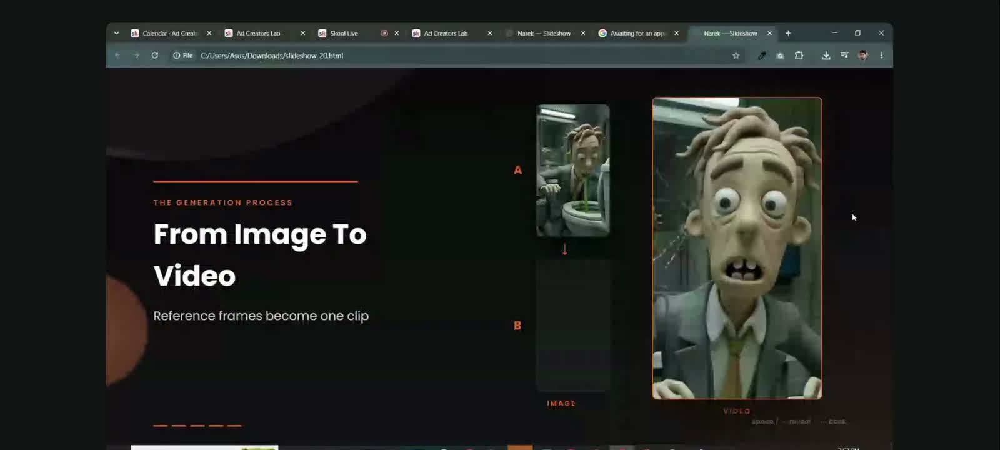
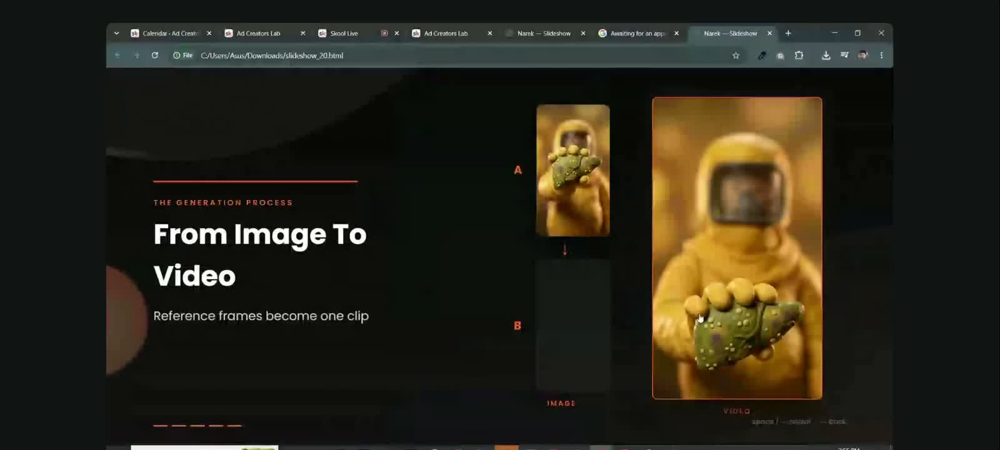
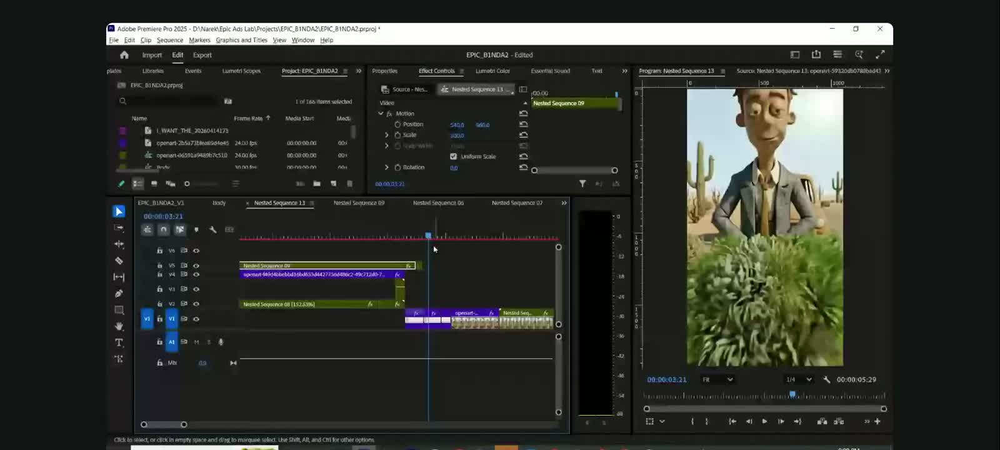
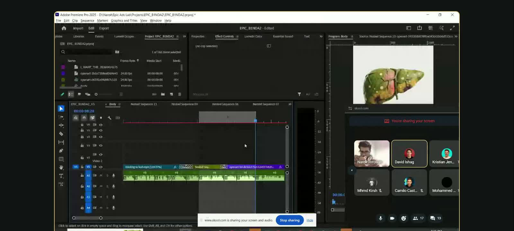
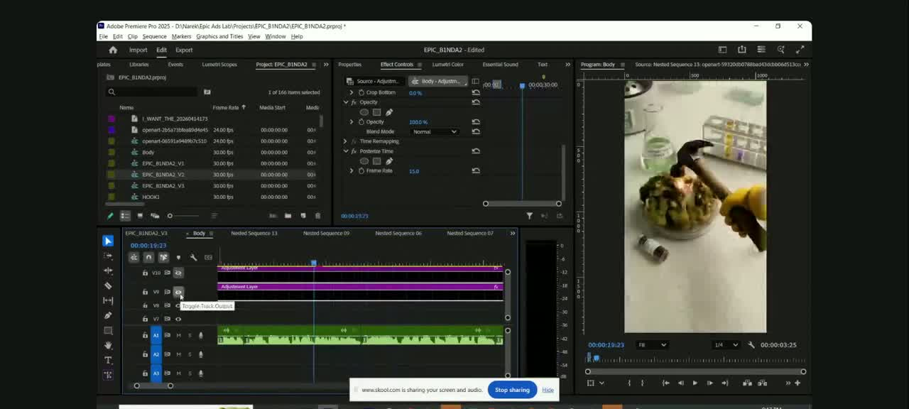
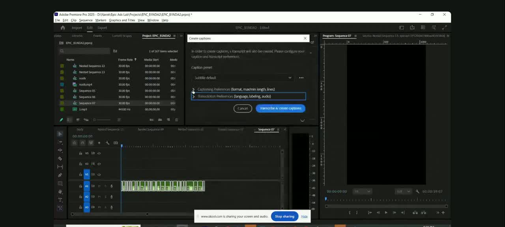

# 90. AI Editing call, 18 August 2026
> Narek, the agency's AI video editor, takes apart one finished claymation ad (a hangover-supplement ad) clip by clip, showing how references, first/last frames, After Effects and Premiere fixes, posterize time and captions turn raw AI clips into a finished ad, then answers member questions.

## 🤖 Agent use
- **Use when:** producing or briefing an AI animated ad (claymation, Pixar style); editing raw Seedance or Kling clips; deciding clip lengths; adding captions; briefing an editor on what "AI editing" means.
- **Inputs → outputs:** script from strategy (concept + style, brand/avatar info, hook text, voiceover text) → ElevenLabs voiceover → pause-cleaned audio in the editor → images (Nano Banana / GPT Image 2) → image-to-video clips (Seedance 2.0 or Kling) → fixed, retimed, stylised timeline → captions + music → ad.
- **Rules:**
  - **DO** treat the script's voiceover as the master timeline: "the main drive of what our ad will become" [05:06]. Generate the voiceover first, remove pauses, then visualise each segment while playing the audio [06:04–07:00].
  - **DO** put references before prompts: "number one important thing is reference not your prompt" [11:31]; "if your reference is good, then prompt is bad, I think it will give you better results" [42:06].
  - **DO** build an avatar sheet for character consistency before generating clips [11:00].
  - **DO** expect 4–5 attempts per scene: "your first generations will not be the best generations" [12:29].
  - **DO** continue a scene by snapshotting the last frame of a clip and using it as the first frame of the next [12:29, 17:40].
  - **DO** sharpen a low-quality snapshot first: GPT Image 2, "sharpen and enhance", resolution 2K or 4K, then use it as the first frame [43:35–44:55].
  - **DO** fix small bugs in post (After Effects brush, hue/saturation, reversing a clip): "editing is… the only tool that will make the AI generations less AI sloppy" [22:11].
  - **DO** cut a new clip every 2–3 seconds [31:37]. Generate the model minimum (3 s) and speed the clip up to the gap you measured with In/Out points [30:31–31:06, 36:43–37:26].
  - **DO** add Posterize Time to claymation to force a consistent stop-motion frame rate [37:26–39:02].
  - **DON'T** "just generate and stitch the clips together" [22:11].
  - **DON'T** rely on the LLM for the visual idea: take its initial idea and add your own [1:06:22–1:08:51] (instructor claim that no LLM would produce his hazmat-suit idea).
  - **IF** a model fails a motion **THEN** reverse the clip in the editor and generate the opposite motion [16:01].
  - **IF** you need precise control **THEN** cut manually in the editor; use multi-shot prompting only when you have a storyboard [1:00:46–1:01:50].
  - **IF** an AI-generated avatar is flagged as a likeness on fal.ai **THEN** Narek suggests generating it with Seedream (same company as Seedance) [25:13–25:44] (instructor claim, not demonstrated).
- **See also:** [Skeleton: editing the video](042-skeleton-editing-the-video.md) · [Editing claymation step by step](058-editing-claymation-step-by-step.md) · [Claymation: generating videos and transitions](056-claymation-generating-videos-transitions.md) · [Claude skill + Seedance 2.0 AI UGC](020-claude-skill-seedance-2-0-ai-ugc.md) · [AI UGC tools](../../../../tools/ai-ugc-tools.md) · [ElevenLabs](../../../../tools/elevenlabs.md)

## Key ideas
### Who and what [00:05–04:08]
- Narek: "video editor and content creator at Epic Ads Lab… over 12 years" [00:05]. One ad is broken down per call [00:36]. Today's ad is "Next Day", an alcohol-recovery capsule, made in the agency and already posted in the community [00:36]. The ad's voiceover (heard at 03:08) opens "Become hell the second you turn 30?" and explains acetaldehyde, then points to DHM and L-cysteine (script document on screen, 34:55 frame).
- Screen-share needed a retry (share a Chrome tab with system audio) [01:31–02:27]; irrelevant to method.

### How the agency hands an ad to the editor [04:08–06:04]
The creative strategist and copywriter send a script with four parts [04:08]:
1. Concept and style (podcast, interview UGC; Pixar, claymation, UGC), stated explicitly.
2. Brand info and avatar (age, gender, e.g. older women, Gen Z, male bodybuilders) [05:06].
3. Hook text, to be placed on screen.
4. Voiceover text, "very, very important" [05:06].

### Editor workflow [06:04–07:58]
1. Paste the voiceover text into ElevenLabs, generate, download [06:04].
2. Import into Premiere ("you guys could use CapCut or DaVinci") [06:04]; find and remove pauses.
3. Play the audio and visualise the picture for each segment [07:00].
4. Generate images from those visuals, then videos from the images, then place and edit them on the timeline [07:00].

### Tool stack with reasons [07:00–10:14]
| Job | Tool / model | Why (instructor) | Source |
|---|---|---|---|
| Avatars and character references | Nano Banana (v2 or Pro) | "gives a better avatars and characters"; GPT Image 2 results are "so dark", need colour correction | [07:58] |
| Image enhancing, object references, graphic design | GPT Image 2 | "so precise and so detailed about the objects" | [07:58] |
| Storyboards | GPT Image 2 | Nano Banana "messes so much", needs many regenerations; one GPT Image 2 result is very good | [08:44] |
| Video, quality first | Seedance 2.0 ("C dance" / "sedans" in transcript) | priority is quality; slower | [08:44] |
| Video, speed or B-roll | Kling 3.0 (also 2.x) | faster; "better for b-rolls"; drifts on claymation | [08:44, 1:09:39] |
| Voice | ElevenLabs | script voiceover | [06:04] |
| Editing | Premiere Pro 2025; After Effects for fixes | personal preference; he says CapCut is "better for ads" now because of its built-in Seedance | [06:04, 48:19] |
| Prompt writing | Claude with a custom claymation / Pixar skill | each model has its own prompt structure | [40:39–41:35] |
| Free image volume | Google Flow, Nano Banana 2 | "hundreds… 200 images per day" with no limit; Pro has a limit; switch Google account if daily limit hit | [26:42–28:02] (instructor claim) |

Three generation modes [09:43–10:14]:
- **Text-to-video:** only for quick B-roll ("someone eat an apple").
- **Image-to-video:** for control of composition, character and action.
- **Reference-to-video:** most powerful; pass storyboards, avatar sheet, object sheet, style sheet, audio and even videos. He uses it "a lot" and defers detail to a later call [10:14].
This ad used image-to-video with first and last image only [11:00].

## Steps / framework
| # | Step | Detail | Source |
|---|---|---|---|
| 1 | Read script | concept, style, avatar, hook text, voiceover | [04:08–05:06] |
| 2 | Voiceover | ElevenLabs, import to Premiere, strip pauses | [06:04] |
| 3 | Visualise | play audio, picture each segment | [07:00] |
| 4 | Avatar sheet + object sheets | character consistency; many B-roll images made from the sheet | [11:00–11:31] |
| 5 | Pick generation mode | text / image / reference to video | [09:43–10:14] |
| 6 | Generate 4–5 takes per scene | keep the best | [12:29] |
| 7 | Chain scenes | last frame to first frame; enhance blurry snapshots | [17:40, 43:35] |
| 8 | Fix in post | brush, hue, reverse, speed | [14:31–19:36] |
| 9 | Stylise | Posterize Time on an adjustment layer | [37:26–39:02] |
| 10 | Captions | Premiere transcript-to-captions | [50:41–53:35] |
| 11 | Music | match the style ("sneaky… jazz" for claymation); subtitles are "the easiest part" | [24:09] |

Time budget: Narek delivers in "one day or one and a half" [48:58]; a member says four hours per one-minute claymation ad and Narek agrees "four hours is fair" [49:40] (instructor claim).

## Examples
Ad: Next Day (hangover capsule), claymation style: a character in a grey suit, later a yellow hazmat-suited character with a liver.

| Segment | What he did | Fix / trick | Source |
|---|---|---|---|
| Vomit in toilet, then "shocked" reaction | Image A first frame only; prompt "this person to vomit in the toilet"; about the 4th or 5th attempt was best; last frame snapshotted as the next first frame and prompted to look shocked (script line: "you'll be shocked at how easy you can recover") | iterate + chain | [12:29–13:27] |
| Camera arc round character, zoom into organs | Came out well but with a bug on the neck skin | Brushed the neck to skin colour in After Effects: "I'm so picky" | [14:00–15:31] |
| Hazmat character shows the liver | Could not generate "he shows the liver and drops it down" | Generated the reverse and reversed it in the editor; also recoloured the suit (was blue) in the editor and used that last frame as the next first frame | [16:01–17:05] |
| Toxin to harmless chemicals | Idea: first-person-shooter style, kill the toxins, turn them into liquid | Liquid generated green; Hue/Saturation effect shifted hue to a pea green; another result looked bad so he added a mosaic (censor) effect | [18:23–20:08] |
| Burst-out last scene | Took image B, asked Nano Banana to remove everything but a solid background to make image A, then prompted a burst into a new scene | first and last frame both supplied | [20:40–21:12] |
| Transition clip (smashed liver to roses) | Generated 3 s, sped up so it lasts under a second; the hand cutting the branch is described only in the prompt | speed-up to fit | [32:07–37:26] |
| Claymation look | Posterize Time on an adjustment layer plus colour correction | see below | [37:26–39:02] |
| Older Kling-made ad | Kling "drifts a lot"; Seedance has fewer minor-detail errors | model choice | [1:09:39–1:10:20] |

### Posterize Time (claymation stop-motion look) [37:26–39:02]
- What: an effect that holds frames so video looks like stop motion; "you don't have to prompt it" in the generation [38:03].
- Why: cinema is 24 fps, claymation about 12–15 fps; AI clips mix smooth and 12 fps frames, so one posterize layer makes them consistent [39:02].
- Setting: the transcript says "set to 50"; the on-screen Effect Controls show Posterize Time, Frame Rate 15.0, on an adjustment layer [38:20 frame]. Trust the screen: 15 (derived).
- Apply it on the top adjustment layers over the whole sequence, together with colour correction [37:26].

### Captions in Premiere (about two clicks) [50:41–53:35]
1. Select the voiceover; open the Text window; click Create captions from transcript [50:41].
2. Preset "Subtitle default"; open Captioning Preferences [51:33].
3. Set maximum length 15 characters, maximum duration 2 s, lines: single; then Transcribe & create captions [51:33].
4. Edit text, font, size and position (centre or lower) in Properties [52:19–53:01].
5. Premiere is right about 90% of the time; brand and technical words need manual fixes (he corrects "DHM" and "L-cysteine") [53:35].

## Structured units
### Member Q&A
| Question | Answer | Source |
|---|---|---|
| Use Seedream for characters and concepts? | Yes for specific cases: fal.ai flags uploaded AI avatars as a likeness; Seedream outputs carry metadata Seedance accepts. The asker finds Seedream 4.5 gives creative camera angles | [24:09–26:42] |
| Clip length rules? | New clip every 2–3 s; model minimum is 3 s, so speed up | [29:24–32:07] |
| Why a one-second transition clip? | Keeps one script paragraph feeling continuous; generated 3 s then sped up | [33:37–37:26] |
| Prompts from an AI? | Claude with a custom skill per style (claymation, Pixar); each model (Seedance, Kling) has its own prompt "language"; "there is no right prompt", best prompts also fail sometimes; he generates many times | [40:39–41:35] |
| Reference bank? | Pinterest: "90% of my references"; he reworks the image into his own character; references go to both Claude and Seedance | [42:06–43:05] |
| Quality loss from last-frame snapshots? | A bad snapshot continues as bad; enhance in GPT Image 2 first | [43:35–44:55] |
| Custom multi-shot in Kling? | A member explains Kling lets you set shot lengths inside one clip, each with its own prompt (total at least 3 s); Narek prefers cutting manually; Seedance directing is good but may cut to a one-millisecond scene | [45:28–46:32, 1:00:46–1:01:50] |
| Premiere or CapCut? | Preference; CapCut has built-in Seedance | [48:19] |
| How long per ad? | one day to 1.5 days; four hours is "fair" for a one-minute claymation ad | [48:58–49:40] |
| Library of transitions? | "Libraries are all in my head" (movies, animation, games); a document works too; he mentions a camera-movement website with sample prompts and sent it in chat (not in the files) | [54:15–57:13] |
| Transition vs camera movement? | Different; Premiere's built-in transitions are basic; with AI use natural or creative camera-based transitions (match cut, whip pan, fast pan) and ask the model for the one you want | [57:48–59:16] |
| Storyboard worth it? | "Makes a big difference… it literally tells AI what to follow" | [1:01:50] |
| Storyboard tool and method? | GPT Image 2; cherry-pick panels from several generations and stitch them; describe the shot list to Claude, which returns one storyboard prompt | [1:02:26–1:05:30] |
| Let the LLM write visuals? | Its visuals are often too simple. Take its initial idea and add your own. Love Blanket interview ad: concept from Claude; the Druski-style reference, the cigar and the rain-on-towel gag were his | [1:06:22–1:08:51] |
| Seedance or Google Omni for claymation? | Not used Omni (heard good for medical visuals); Seedance over Kling because Kling drifts | [1:08:51–1:10:20] |

## Prompts / templates (verbatim)
No full prompt text is shown or read out. Spoken fragments:
- Scene prompt (as paraphrased by the speaker): "I want this person to vomit in the toilet" [12:29].
- Nano Banana clean-background prompt: "remove all the elements. I only want the background, solid background, nothing else" [20:40].
- GPT Image 2 enhance prompt (near verbatim): "I want enhanced photo of this… up-res and sharpen and enhance this image", resolution 2K or 4K [44:06–44:55].
- Storyboard instruction to an LLM (near verbatim): "I want this shot to be this, then the second shot to be this, then the third shot to be this", and the LLM returns one storyboard prompt [1:04:10].
- The custom claymation Claude skill is not included in the course files.

## Screenshots

*Narek's slide "From Image To Video, reference frames become one clip": image A (character at the toilet) and the generated video of the shocked character. [13:40]*

*Same slide format with the hazmat-suit character and the liver video, the clip that was reversed. [16:29]*

*Premiere Pro 2025 timeline: nested sequences, speed-adjusted generated clips on V1, overlay layers above. [21:15]*

*Body sequence: generated clips over the ElevenLabs voiceover waveform on A1 during the transition-clip discussion. [37:00]*

*Effect Controls: Posterize Time, Frame Rate 15.0, on adjustment layers spanning the whole sequence. [38:20]*

*Create captions dialog: preset "Subtitle default", Captioning Preferences and Transcription Preferences, then "Transcribe & create captions". [51:40]*

## How to apply
- [ ] Get a script with concept, style, avatar, hook text and voiceover; do not start without the voiceover text.
- [ ] Generate the voiceover first; strip pauses; mark In/Out per segment and note durations.
- [ ] Make an avatar sheet and object sheet from Pinterest-sourced references (see [Claude skill + Seedance](020-claude-skill-seedance-2-0-ai-ugc.md)).
- [ ] Generate 4–5 takes per scene; chain via last frame to first frame; enhance snapshots.
- [ ] Fix visible glitches (skin, colour, impossible motion) in post; reverse clips when the model fails a motion.
- [ ] Speed up 3 s minimum clips to the segment length; cut every 2–3 s.
- [ ] Claymation: posterize adjustment layer at 15 fps; captions max 15 characters, 2 s, single line; correct brand words.
- [ ] Pick music that matches the style.

## Related
- Previous: [Ad psychology with Howie, 29 July 2026](088-ad-psychology-with-howie-2026-07-29.md) · Next: [AI office hours with David](091-special-guest-recordings-ai-office-hours-david.md) · [MR PAID SOCIAL guest talk](093-special-guest-recordings-mr-paid-social-guest-talk.md)

## Sources and limitations
- Machine transcript, complete (duration 4,335.6 s, last segment 4,334.4 s). Misheard: "C dance" / "sedans" = Seedance, "cling" = Kling, "Sea Dream" = Seedream, "11 labs", "Nerek". The transcript's "posterize time set to 50" conflicts with the screen (15.0).
- The lesson page has no text. The camera-movement website was sent in chat and is not in the files; the claymation Claude skill is not included.
- Compliance: the ad's hangover and liver claims are health claims; do not reuse without substantiation. The Druski-style reference is a real person: copy the mechanism, not the likeness. The fal.ai likeness-flag workaround is an instructor suggestion; do not use it to pass real people's faces. Member names and faces in the recording are not recorded here.
