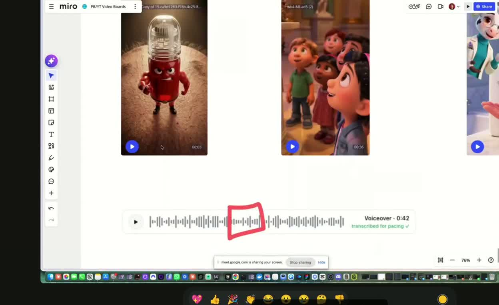
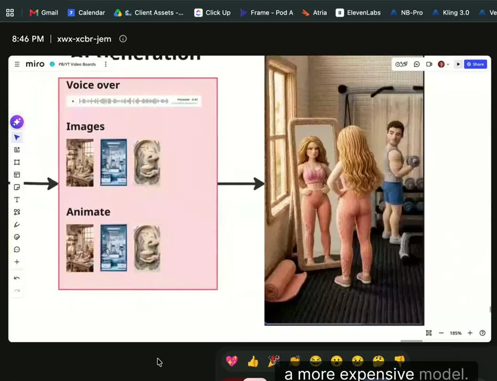

# 91. AI office hours David
> A 64-minute community office hour in which an AI-video practitioner shows how to turn a reference ad's look into a reusable Claude skill file, how to clone a competitor ad (same product vs different product), the one sequence that makes lip-sync work, and why scripts, not visuals, decide whether an ad works.

## 🤖 Agent use
- **Use when:** building a visual-style skill (claymation, crochet, other); cloning or adapting a competitor video ad; producing lip-synced animated characters; getting a non-generic first-pass script out of an LLM; deciding which layer of a reference ad to analyse.
- **Inputs → outputs:** a reference video you like (frames extracted) + product + research (Reddit, TikTok comments, reviews) → a tested style skill; a layered teardown (visual / audio / script) → adapted ad using the same foundations but your product and claims.
- **Rules:**
  - **DO** classify any reference ad first by one question, "is the character's mouth moving?": lip-sync, voiceover + B-roll, or a mix [01:24–02:49]. He says voiceover + B-roll is "90 percent easily" of what he sees in AI ads because it is easier [02:49].
  - **DO** build a style skill from real reference frames: extract frames, give them to Claude, generate test images, then feed back what you like and dislike, repeatedly, in one session [07:44–14:49; 55:33–56:57].
  - **DO** generate style tests in several different scenes (office, bathroom, etc.) so edge cases show up before you codify the skill [08:46–13:21; 55:33].
  - **DO** break a reference ad into three independent layers (visual, audio, script) and analyse each separately; "do not try to do everything in one go" [41:26–42:27].
  - **DO** decide the script first, then the visuals: visuals are "a tool… to create relatability and get people's attention but they are not the crux of your ad" [43:53].
  - **DO** for lip-sync: write the whole script, generate the whole voiceover in one go, clean dead air, slice it, then pass each slice plus a start frame to the video model [49:12–52:51].
  - **DON'T** generate the voiceover in pieces: "voice models are not consistent… different accents… different pacing… entirely different voices" [50:13].
  - **DON'T** copy the biggest competitors; start from the client's own account winners and change the angle on the same avatar [46:51–47:52] (instructor claim, passed on from Camilo).
  - **IF** the competitor sells the same product **THEN** duplicate scene by scene and swap the product in start frames and script references [16:16–18:21]. **IF** the product or avatar differs **THEN** identify the foundations that make the ad good and rebuild them for your product [18:21–36:26].
  - **DON'T** reuse a competitor's lines, claims or characters 1:1 ("copy the mechanism, not the asset"; see Sources and limitations for compliance).
- **See also:** [Clone B-roll UGC ads](016-clone-broll-ugc-ads.md) · [Claude Skill + Seedance 2.0 AI UGC](020-claude-skill-seedance-2-0-ai-ugc.md) · [Make AI creators talk](029-make-ai-creators-talk.md) · [Claymation: generating voice-over](057-claymation-generating-voice-over.md) · [Mr Paid Social guest talk](093-special-guest-recordings-mr-paid-social-guest-talk.md) · [LLM output claim audit](../../../stefan-georgi/rmbc-ii/rubrics/llm-output-claim-audit.md)

## Key ideas

### Poll topics for the call [00:00–01:24]
- A community poll chose the agenda: (1) how to develop Claude skill files for new visual styles (he is helping a coach convert remaining custom GPTs into Claude), (2) how to clone competitor ads, (3) how to handle lip-sync for animated ads [00:00–01:24]. Q&A closes the call. He plans weekly office hours with polls posted earlier next time [55:33].

### A three-box taxonomy of AI ads [01:24–05:14]
- Lip-sync: the character's mouth moves. He puts UGC in this box too and does not think of AI video "as UGC / animated" but by whether the character speaks [01:24].
- Voiceover + B-roll: a full voiceover with B-roll shots, no mouth movement [01:24–02:49].
- Mix: lip-sync scenes layered with B-roll. Example shown: a fairy-tale princess-and-mattress ad (lip-sync scenes with B-roll over them) and an extreme case, a full green-screen animated character over continuous B-roll for a moisturiser ad [02:49–03:57].
- Why it matters: classifying an ad "into a box" makes it "not as scary anymore it's very easy to replicate" [05:14].
- The style skill he teaches covers only the visual layer, i.e. the B-roll look, in voiceover + B-roll ads [05:14].

### Developing a Claude visual-style skill [06:32–14:49]
1. Pick the reference: a crochet creatine ad by a community member and a claymation pre-workout ad ("one of the best claymation ads I've seen in a while", the motivator for his claymation skill) [05:14; 09:08].
2. Extract frames from the reference and pass them to a Claude agent; ask for a first pass of revisions and a list of style variants (e.g. "different styles of claymation") [07:44].
3. Generate test images with Nano Banana 2. He does not like GPT Image 2 for animated ads [07:44].
4. Repeat until you find "edge cases, problems in the prompts" and can get the style consistently [07:44]. He says Goofy was one style that needed a lot of testing; the "cinematic" claymation variant was built entirely from the pre-workout reference [07:44].
5. Give feedback on every batch: what you did not like in the output and what you did [10:33–11:53].
6. The unlock for the polished claymation look was lighting: "telling it that the scenes had to have more light in them to get that cleaner style" [11:53].
7. Name and fix specific failures: a character suddenly got blue skin, so the prompt was corrected [11:53]. For an "office slump" scene the same prompt produced happy characters; he gave Claude the good and bad outputs and asked for stronger emotion wording, and the next iteration "much better slump" [13:21].
8. Result: "This is the reinforcement cycle… I will take a reference video that I really like, take some frames, pass it to Claude and iterate, iterate, iterate until I have something that works consistently" [13:21–14:49]. He calls it "a muscle" you get better at [11:53].
- Run in one session, then ask Claude to write the skill; confirmed by a member's summary, answered "yeah that's the idea" [55:33]. Without a reference frame "Claude has no idea how to do a claymation" [56:57].
- He built a small app for this but says you can do the same in any platform; recommends using an MCP with Claude so it can help work through it [06:32]. He is working on a faster, more programmatic reverse-engineering skill to share later and is currently reverse-engineering the Zack D Films style [14:49].

### Cloning a competitor ad: same category vs different category [14:49–37:51]
- First question: is it lip-sync, voiceover + B-roll or a mix, and is "your product in the same category?" [14:49].
- **Same product:** only references to the product and brand in the script need adapting; the agent's scene, framing and visual analysis transfers because the product works the same way. He duplicated a talking-object ad (a community member's competitor ad) for a fictional hair product by breaking it into scenes and remaking each start frame with his product, and the AI's own analysis even produced a better visual hook through camera angle [16:16–18:21]. Dropshippers do the same: change each start frame to your product [17:21].
- **Different product or avatar:** "what is it that I like about this ad? What makes this ad good?" and keep those foundations [18:21–19:33]. Then do customer research (Reddit "golden nuggets") to replace the original's content, write the script, then generate [36:26–37:51].
- He then ran a live critique of the crochet creatine ad (see Examples), including the criticism that the product appears too early [22:21–32:27].
- He adapted the same ad to a women's creatine product (opposite demographic) and keeps the foundations: wide top-of-funnel hook, humour, visually appealing style, couple dynamic, attractive characters [34:57–36:26]. His own critique of that adaptation: "the hook is not strong enough, the pacing is not fast enough" [39:06].
- Extreme transfer: the same foundations could sell a lawnmower: a husband mowing with an inefficient mower, the wife complaining it looks bad or is too loud around friends, in a couple-dynamic hook with humour [36:26].

### Better positioning after the hook [24:19–34:57]
- His fix for products shown too early: keep the product as an open loop, "slap a huge question mark on it", educate on the mechanism, then position the product [29:37–30:59].
- Order he recommends: stay on the audience's problem; filter out wrong viewers; objection handling; unique mechanism; then the product as the all-in-one solution [30:59–32:27].
- Transition through a failed past solution: educate on the ingredient (his example: beef tallow), then "most brands do beef tallow wrong, we do it right because of this" rather than repeating the ingredient name and selling [33:57]. Camilo gave him this feedback on one of his own ads [32:27].

### Analysis layers and what is automated [40:26–45:24]
- A member asked whether he has a skill that dissects a competitor ad. Answer: visual and audio analysis skills exist; he has not yet built a script-analysis skill because he is still learning copywriting, and plans one "solely from a copywriting perspective and solely from a creative strategy perspective" [40:26–42:27].
- Visual: style and model. He says you can tell an expensive-model ad from a cheaper-model one, and hard cuts indicate it was not an only-reference-model strategy [41:26].
- Audio: how speech is handled [41:26]. Third layer: script. Editing sits on top [41:26].
- Script-first: if a visual format is performing in an account you can ask for that format, but "that's like 1% of it"; "all of your attention should then revert back to script" [43:53].

### Strategist question: first 10 creatives for a new client [45:24–49:12]
- Answer: do not copy the biggest competitors. Look at the client's ad account, find what already works, and target the same avatar with a different angle, because a new avatar "can take a long time" [46:51–47:52]. If the brand is new, do deep research, talk to the founders, build an initial gut view of the avatar, do Reddit research on who talks about the problem [47:52]. (A member's reply about five ICP age bands for a brand was cut off for time and moved to DMs [49:12].)
- Member-suggested path: define the ICP, then mine Google/Maps reviews and other reviews, then build a pipeline [45:24].

### Lip-sync workflow [49:12–54:06]
1. Write the full script.
2. Generate the entire voiceover. Regenerate until it is good; never trust cut-by-cut generation [50:13].
3. Cut dead air (he built a free tool and posted it in the community) [50:13].
4. Slice the final voiceover (CapCut or other tools) [50:13].
5. Give each slice and its start frame to the video model. Expensive, higher quality: Seedance 2 Mini or Seedance 2 Fast (heard as "c dance 2 mini / fast"; omni-reference, accepts start frame, character, product and the audio slice) [50:13–51:21]. Or Kling Omni [51:21].
6. Cheap option: a model called P Video ("crazy cheap", lower visual quality). For a fast ad with a cut every three seconds "you don't actually need like insanely high quality lip syncing" [51:21–54:06].
- In the editor the full voiceover sits on a timeline and each clip is fitted to it. He says lip-sync clips are "the fastest to make" because pacing of each clip is guaranteed, unlike B-roll [52:51]. His fictional hair-regrowth ad was made entirely this way with the cheap model [52:51–54:06].
- "I actually don't think that lip syncing is that hard" [54:06].

### Q&A: scripts from AI are generic [57:00–1:02:20]
- A new member had research docs and frameworks but Claude still produced generic scripts. Answer: [58:18–1:00:50]
  - Learn copywriting yourself: "you're gonna hear a lot about Eugene Schwartz in this community", awareness stages, market sophistication, script do's and don'ts; study winning scripts and reverse-engineer them.
  - You must be able to say why something feels wrong and how you will fix it.
  - AI workflow: ask AI for Reddit insights, TikTok comment insights and review insights, then avatars and objections, work on the foundation with it before asking for a script, decide who the script targets.
  - For a good first pass give a reference script from a good copywriter and tell it to apply it with your avatar [1:00:50].
  - Gary Halbert was mentioned as something he intends to study [59:21].
  - Do not stop at the first pass: use your own copy knowledge to iterate [1:00:50].
- He is collecting a public swipe file, with copywriting analysis attached to each video, from downloaded community ads [1:02:20].

## Steps / framework

### A. Build a visual-style skill (voiceover + B-roll look)
| # | Step | Detail | Source |
|---|---|---|---|
| 1 | Choose a reference video | A format you want to replicate (claymation, crochet…) | [07:44] |
| 2 | Extract frames | Give them to a Claude agent with "here's my reference, I definitely want this" | [07:44] |
| 3 | First-pass variants | Ask Claude for several style variants | [07:44] |
| 4 | Test images | Nano Banana 2, many scenes, repeated runs | [07:44; 55:33] |
| 5 | Feedback | Say what you like and dislike; paste a good and a bad output back; ask for reinforcement in the prompt | [11:53–13:21] |
| 6 | Fix recurring failures | e.g. add light; fix skin colour; strengthen emotion wording | [11:53–13:21] |
| 7 | Ask Claude to write the skill | After results are consistent, same session | [55:33] |
| 8 | Test on a new script | (derived) run the skill on a brand-new product before relying on it | — |

### B. Clone or adapt a competitor ad
| # | Step | Detail | Source |
|---|---|---|---|
| 1 | Classify | Lip-sync / voiceover + B-roll / mix | [14:49] |
| 2 | Same product? | Yes: scene-by-scene duplicate with your product in the start frames and script. No: go to 3 | [16:16–17:21] |
| 3 | Name the foundations | Hook type, humour, visual style, couple dynamic, attractiveness of characters, etc. | [36:26] |
| 4 | Analyse in layers | Visual, audio, script, each separately | [41:26] |
| 5 | Research your customer | Replace the original's "golden nuggets" with real Reddit and review language | [36:26] |
| 6 | Write the script first | Then the visuals | [43:53] |
| 7 | Generate and edit | See lip-sync workflow for talking characters | [49:12] |

### C. Lip-sync (animated ads)
Script → full voiceover → clean dead air → slice → start frame + slice into Seedance 2 Mini/Fast or Kling Omni (premium) or P Video (cheap) → assemble to the voiceover timeline [49:12–54:06].

## Examples

### Crochet creatine ad (community member's ad, played in full) [06:32; 19:33]
Script as heard: opens with a husband saying his wife claimed his creatine was why he was farting; he blames the cheap protein powder; she googles and switches him to "99.9% pure pharma grade" creatine; it does not help the gas "not one bit" but strength, recovery and fullness improve; he found a gummy with five supplements plus "pharmaceutical grade CreaPure creatine", "1,000 milligrams… claimed per gummy, 1,165 tested", "over 50,000 men", "62 cents a day" [19:33–20:52]. Numbers are the ad's own claims and unverified.

What members and the instructor said works:
- Unaware hook: starts with farts, a common experience, then transitions to the product with humour [20:52–22:21].
- Open loops and humour buy goodwill after the hook [22:21].
- Character consistency and detailed crochet textures hold across the whole video [23:54].
- Intentional character design: an attractive "gym couple", the girlfriend made attractive and in pink because the target is men; "if the girlfriend was busted… that second scene would not be as interesting" [25:16] (instructor claim that this lifts the hook "from average to really, really good").
- Crochet style that stays human-looking keeps viewers identifying with the character, like Pixar and skeleton formats [26:44].
- Shareability: a viewer can send it to a partner [26:44].
- Couple dynamics are "a proven format on UGC… on TikTok Shop couples sell so well" because they allow storylines that look native [28:12].
- Another member's checklist: visual coherence, hook from a common experience, failed solutions, three desired outcomes, objection handling, social proof [32:27].

What he thinks fails: the product is shown "a bit too early"; a member countered that an early product reveal may control CPM for a broad hook, but he replied you can filter without being salesy [29:37–30:59].

### Other ads shown
- Pea-and-princess mattress ad: a mix of voiceover and lip-sync with B-roll on top [02:49–03:57].
- Moisturiser ad: full green-screen character over B-roll [03:57–05:14].
- Hair product duplicate and a women's creatine adaptation (his own, made quickly) [17:21; 37:51–39:06].
- Mattress-for-RVs lip-sync ad using sliced voiceover + Seedance 2 Mini and a hair-regrowth ad using the cheap P Video model with three-second cuts [51:21–54:06].

## Structured units

### Ad teardown
| Brand / product (niche) | Format | Hook / opening | What works | What fails | Fix suggested | Principle | Source |
|---|---|---|---|---|---|---|---|
| Crochet creatine gummy (supplements, men 50+) | Crochet animation, voiceover + B-roll, couple | Wife blames his creatine for his farting | Unaware hook, humour, open loops, couple dynamic, consistent character and texture, intentional attractive characters, shareable | Product shown too early; filters out viewers who dislike being sold to | Keep the product as an open loop; educate on mechanism; transition via a failed past solution; then position product | Keep it about the audience before the product | [19:33–32:27] |

### Rewrites
| Before | After | What changed | Source |
|---|---|---|---|
| Ingredient X is great → buy ours | Ingredient X is great → most brands do X wrong → we do it right because… | Adds failed-past-solution objection handling into the product transition | [33:57] |
| Men's creatine couple ad | Women's creatine couple ad | Same foundations (wide hook, humour, style, couple), new avatar, new Reddit research | [34:57–37:51] |

### Rules
- **DO** study and reverse-engineer winning scripts yourself before leaning on an LLM [58:18–1:00:50].
- **DON'T** treat the first AI script as final [1:00:50].
- **IF** a style skill produces the wrong emotion **THEN** paste the better and worse outputs back and ask for reinforcement [13:21].

## Prompts / templates (verbatim)
No full prompt text is shown on screen or on the lesson page. The page's own summary of the skill workflow (Skool lesson page, "Developing Skill Files for Visual Styles") is: identify fundamentals (lip-sync, voiceover + B-roll, or a mix); start with a reference video, extract specific frames, provide them to a Claude agent; test with image generation (Nano Banana 2); give positive and negative feedback ("adding specific instructions about lighting was the 'unlock' for a polished claymation look"); goal is "a consistent text-based definition of a style that can be applied to any new video". The lip-sync page summary: "Full Voiceover… Clean & Slice… Syncing: Pass the audio slices and start frames into a model like SeaDance 2 Mini (for high quality) or P Video (for a cheaper option)". The skill file itself is not included in the course files.

Reusable feedback prompt (derived, not verbatim from the call): "Here is the reference frame, one good output and one bad output from the same prompt. Say what makes the good one match the reference (lighting, texture, emotion, skin tone) and rewrite the style prompt so the bad result is less likely."

## Screenshots

*Board used to teach the taxonomy: lip-sync, voiceover + lip-sync, full lip-sync + B-roll, with example frames and a waveform for the voiceover. [02:56]*

*Pipeline diagram of voiceover first, then images, then animate, shown during the lip-sync section. [41:52]*

## How to apply
- [ ] Classify the reference ad: lip-sync, voiceover + B-roll or mix.
- [ ] Split the teardown into visual, audio and script and run each separately.
- [ ] Write the script first; style second.
- [ ] Build a style skill from reference frames with Nano Banana 2 tests in several scenes; record lighting and emotion fixes.
- [ ] For talking characters: single voiceover, clean, slice, one slice per clip.
- [ ] For a different product, list the foundations you are keeping and replace all product claims and proof with real research.
- [ ] Run the finished script through the claim audit before generating.

## Related
- Previous: [AI editing 2026-08-18](090-ai-editing-2026-08-18.md) · Next: [Email marketing for retention](092-special-guest-recordings-email-marketing-for-retention.md)
- Same-course workflow with Claude Code: [Mr Paid Social guest talk](093-special-guest-recordings-mr-paid-social-guest-talk.md)
- Other courses: [Tether Lab AI UGC tools](../../../../tools/ai-ugc-tools.md)

## Sources and limitations
- Transcript (machine, Whisper large-v3-turbo; full coverage, last segment 3844.08 s of 3845.29 s): `../../../../../raw/ad-creators-lab/ai-ads-ugc-animations/_transcripts/Ad Creators Lab - Create Viral AI Ads, UGC & Animations That Convert Into Sales(September 2026)/6. Call Recordings/5. Special Guest Recordings/AI office hours David - Call Recordings · Ad Creators Lab.txt` and the lesson page summary.
- Mishearings: "cloud" = Claude, "Banana 2" = Nano Banana 2, "c dance / SeaDance 2 mini/fast" = Seedance 2 (Mini/Fast names as heard), "P Video" as heard, "crochet" ads, "Zagdi film" = Zack D Films. Whether "mini" and "fast" are official model names is unverified.
- The skill files, the free dead-air tool and the claymation skill are not included in the course files. Model prices and availability date quickly; treat as at recording (Aug-Sep 2026).
- Compliance: the cloned ad was built for a fictional product; adapting a competitor's script claims ("99.9% pure", "50,000 men", "1,165 tested") would be copying unverified proof. Keep the mechanism (couple dynamic, open loop, humour) and write your own verified claims. Attractive-character targeting is an instructor view; check ad-policy on body-focused imagery.
- Participant names, faces and Q&A identities are omitted on purpose.
