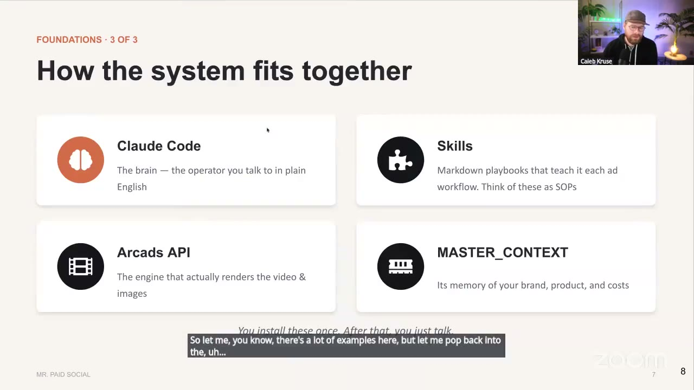
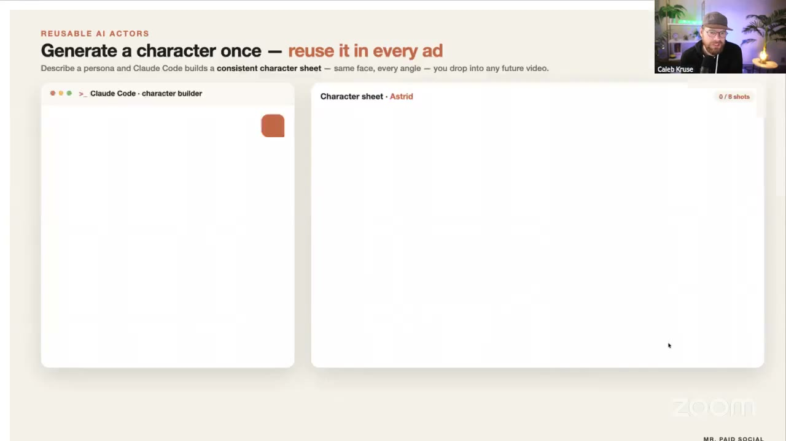
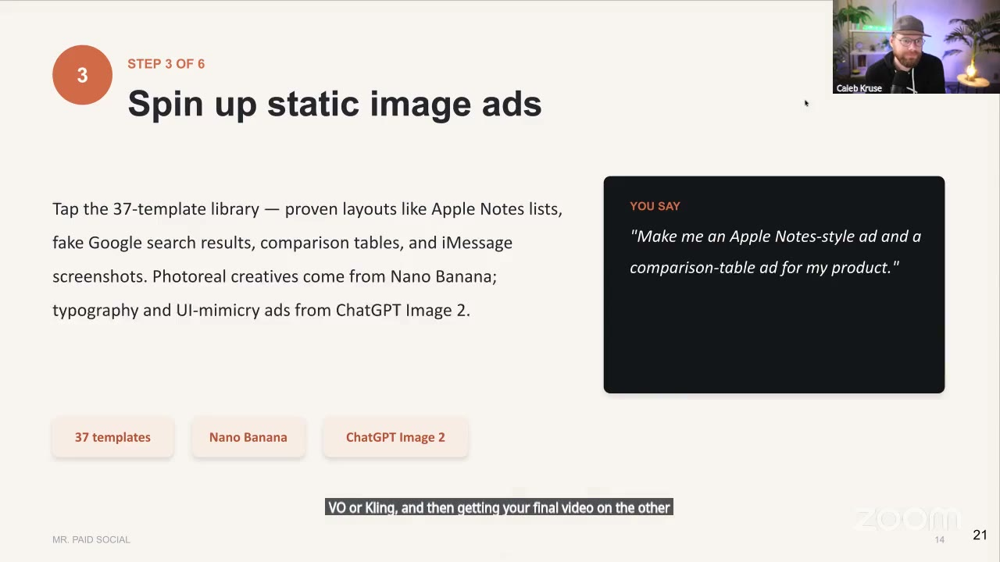
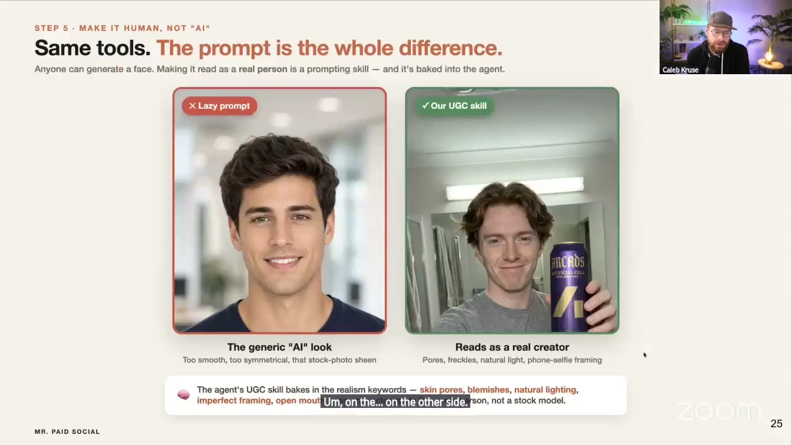
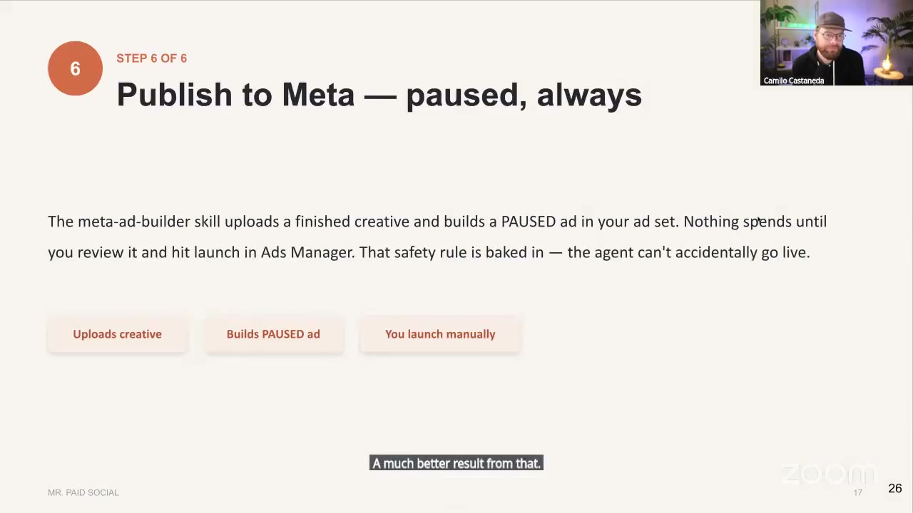
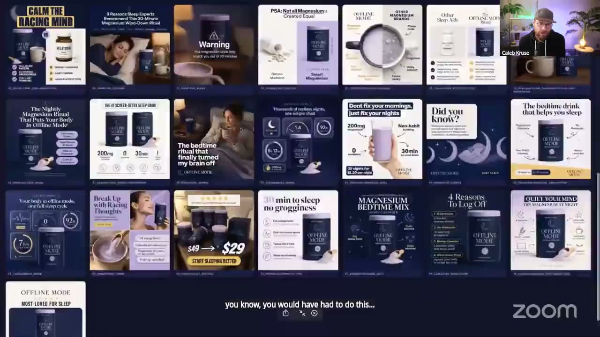
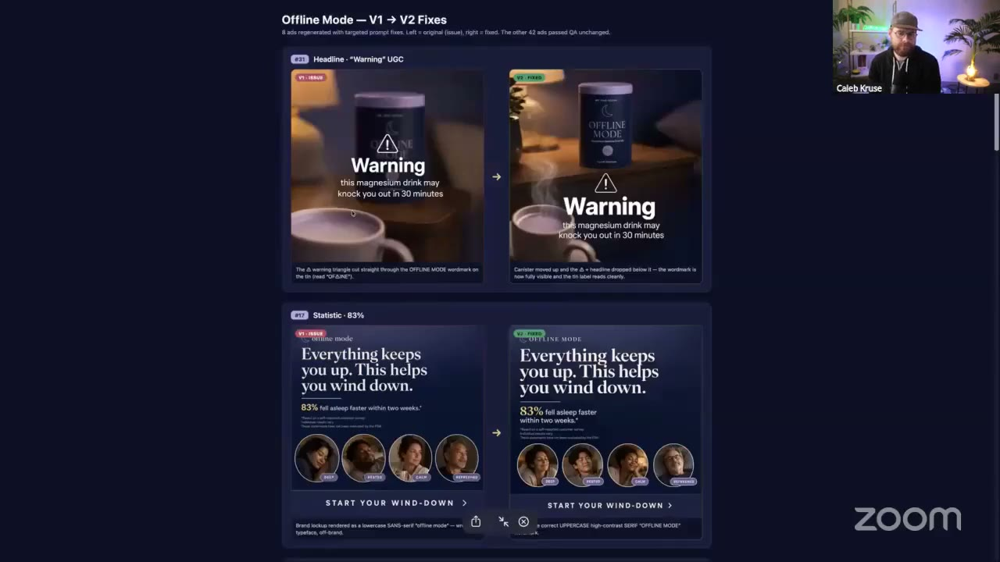

# 93. MR PAID SOCIAL GUEST TALK
> A 73-minute guest talk on running an AI creative studio from Claude Code: a master context file, reusable skills, a 2,000-ad Airtable reference library, Arcads (or any generation API) to render images and video, Meta Marketing API upload as paused ads, and AI QA layers. It is about creative production and launch automation, not about Meta media-buying strategy.

## 🤖 Agent use
- **Use when:** setting up an agent that produces and launches ad creative in bulk (static image batches, UGC video, clones of ads seen in the wild); planning cost and credit use; adding QA layers; deciding how to connect an ad account safely.
- **Inputs → outputs:** brand + product facts in a master context file, reference ads (Airtable library, screenshots, example videos), a generation API key, a Meta app access token in a `.env` file → character sheets, UGC videos, 50-image ad batches, per-ad copy variants, a review page, and PAUSED ads in the ad account.
- **Rules:**
  - **DO** treat Claude Code as an operator that runs tasks, not a chatbot: "you direct; it executes" (slide) [07:41; 08:20].
  - **DO** write the brand, product and per-call costs into a master context document first; "skipping the master context" is the first beginner trap [19:50; 48:59].
  - **DO** feed references: "Context is everything. The better context you provide the model, the better output you're going to get" [10:45]. Recreation of an ad needs the source ad and, for people, a reference video and audio [11:46; 12:53].
  - **DO** build a character sheet (multiple angles, same outfit and body) per video for consistency, then combine character + product + scene in a video model [27:54–29:24].
  - **DO** put realism keywords in prompts and exclude generic ones: call out "visible pores, real skin texture, underlying shadows, mouth open, a few blemishes"; never "cinematic, professional, studio, perfect" [33:41–34:41].
  - **DO** estimate cost, ask for approval and smoke-test one image before a batch; fire batches of 10 [36:11–38:40].
  - **DO** store API keys only in a `.env` file, never in chat [46:22–47:25].
  - **DO** upload every ad PAUSED and review before launch [50:59; 59:19].
  - **DO** run a separate AI QA agent on the first agent's output and keep a human final yes/no [50:59–52:27].
  - **DON'T** fire large batches without checking credit cost, publish before a human copy pass, or treat output as final instead of raw material [59:19–1:00:46].
  - **DON'T** claim AI creative "will not get flagged" as an excuse to skip disclosure: he says Meta will not flag it for being AI but disclosure and non-deception rules still apply [56:54–58:18].
  - **IF** a single prompt does not give a convincing result **THEN** iterate: "it might take five or ten iterations" [58:18; 59:19].
- **See also:** [Claude Skill + Seedance 2.0 AI UGC](020-claude-skill-seedance-2-0-ai-ugc.md) · [AI office hours David](091-special-guest-recordings-ai-office-hours-david.md) · [AI UGC tools](../../../../tools/ai-ugc-tools.md) · [ElevenLabs](../../../../tools/elevenlabs.md) · [Meta ads algorithm (Andromeda)](../../../../tools/meta-andromeda.md) · [Campaign structure 3:2:2](../../../evolve/start-here/frameworks/campaign-structure-322.md) · [KPIs and columns](../../../evolve/start-here/frameworks/kpis-and-columns.md) · [Scaling rules](../../../evolve/start-here/frameworks/scaling-rules.md) · [LLM output claim audit](../../../stefan-georgi/rmbc-ii/rubrics/llm-output-claim-audit.md)

## Key ideas

### Who and what [00:01–06:53]
- Guest says he has about 12 years in paid media (started 2013, affiliate-style work, then a large performance-marketing agency with eight media buyers and "millions of dollars" spend), quit in 2023 and now runs the "Mr. Paid Social" brand and a Skool community [03:06–04:06] (instructor claim). A slide in the deck lists "12 years", "$150M+ in ad spend managed", "560+ buyers", "400k+ followers" [slide at 06:34] (instructor claims, unverified).
- Topic: building entire AI ad campaigns with Claude Code from a free GitHub repo (linked on the lesson page) [05:31]. The deck is itself built by Claude Code live and was partly unfinished [05:31].
- The lesson page lists a recording from an "Ad Roasting Session - July 09" heading and purpose "to demonstrate an AI-powered workflow for generating and launching ad campaigns"; the page's Fathom link is the same 73-minute recording, not different calls.

### The old way vs agentic work [06:53–09:20]
- Old: brief, design that takes days, revisions, launch; slow when relying on other people's interpretations of briefs [06:53].
- Chatbot vs agent: same prompt "make me five Facebook ads for a coffee brand": a chatbot gives ideas; an agent reads a master text document, pulls product shots, generates images with Nano Banana, writes hooks and primary text, launches the ads, and does QA against your QA guidelines [07:41–08:20]. Idea from the phone can start the work at 5 a.m. [08:20].

### Demo reel, with what each used [09:20–18:31]
| Example | Built how | Notes | Source |
|---|---|---|---|
| Personal-clone ad | Reference video of himself plus reference audio into Seedance 2.0 via Claude Code | Reference was ~1 minute filmed on his own camera and mic, expressive and varied delivery, so voice and manner carry over | [09:20–11:46] |
| Cinematic ad ("Plunge") | Shots generated (Sora-era), music and voiceover generated by Claude Code (ElevenLabs API), sound effects added | Older ad | [11:46] |
| UGC try-on of a fake hat | Fed Claude Code a try-on UGC video he liked; it reconstructed the script delivery and specific actions (taking the hat off, pulling the band) | The product is invented | [12:53–14:16] |
| "This is a message to all advertising bros" viral recreate | Original viral video plus a reference video of himself into Seedance 2.0, a one-for-one recreate | About 15 minutes versus filming in several rooms with lighting and editing | [14:16–15:46] |
| Pixar-style animated ad | Standard animated format | Shown only briefly | [15:46] |
| Music video | Claude Code connected to Suno; wrote a song from his community landing page | Early-2000s rock sound | [15:46] |
| AI UGC with fake branded products | Generated product images and people wearing them (a vintage tee, a magnesium drink, an ashwagandha item, a serum) | He made fake self-branded products because brands complained when he used theirs | [17:03] |

### System architecture [18:31–24:16]
- **Claude Code** = brain and operator; run on his Mac mini and reached from phone and laptop through a custom remote setup; he uses the desktop app rather than a terminal, VS Code or Cursor are equally fine [18:31–24:16].
- **Skills** = SOPs. Build them by doing a task once with heavy iteration, then "review this entire Claude Code session, how we got to this point and distill it into a skill that we can call again" [18:31]. Examples listed later: musical number skill, 90s / 1950s TV skill, dark comedy indie, film noir [43:16].
- **Generation API** = Arcads in this repo; any API can plug in. A second version uses Key API (a model aggregator for Veo, Kling, Seedance 2.0 and image models) [18:31]. Alternatives named in Q&A: Key API, Fal (used by a host to save credits) [1:05:08].
- **Master context document** = brand, product, and model costs so it can estimate spend [19:50].
- **Repo contents (as stated):** 10 skills (videos, images, thumbnails, cloning ads, publishing to ad accounts), 9 AI model specs, 37 static-image ad templates, plus a separate 2,000-ad repository [19:50].
- Skills are packaged with models: asking for a UGC video makes it generate images with Nano Banana Pro or ChatGPT Image 2, then prompt Seedance 2.0 or Gemini/Veo style prompts [19:50].
- **Setup:** about five minutes; paste the repo link into Claude Code and say "set this up"; it clones itself, asks what it needs, and helps fill the master context file; no coding background needed [24:16].
- **Tooling** = Claude Code subscription ($200/month Max stated) + Arcads or other API + the repo [44:50; 21:19].

### The 2,000-ad Airtable library [24:16–26:54]
- Built over about a month, filterable by format, brand, brand category, platform, with an "AI prompt" field in which Claude Code dissected each image ad and wrote a ChatGPT Image 2 recreation script; "over 800 something" images have recreation prompts [24:16–25:34; 30:52].
- Give Claude Code the Airtable link and say "I want 50 new ads for my product, help me find ads to recreate"; it selects ads for the brand using the tagging. Needs the official Airtable MCP [25:34–26:54].
- Library and password were shown on screen and promised to the community. The link and password are not reproduced here.
- Non e-com works: he used it for his own info product; lead gen and home services can use it too [30:52].
- A host noted their own agency runs creative through Airtable but lacked a library of winning formats [25:34; 1:02:15].

### Step-by-step build ("six steps, brand brief to Meta ad") [26:54–50:59]
1. **Master context** by answering Claude Code's questions [26:54–27:54].
2. **UGC video hook:** example prompt style "make a 12-second Seedance UGC video, a woman in her car wearing the [hat], says she stopped buying [competitor]" [27:54]. Slide: the agent uses a "9-layer UGC formula tuned for Seedance 2.0", iPhone look, natural delivery, casual eye-contact breaks, estimates credit cost, confirms, then generates [slide 01717; 27:54].
3. **Character sheet:** persona described once, multiple angles, reused in every ad; slide shows four AI UGC actors from "one prompt each" [28:37–30:05]. Then combine character + product + scene and choose Seedance, Veo or Kling for the final video [29:24; 30:14].
4. **Static image ads:** a 37-template library of layouts (Apple Notes lists, fake Google search results, comparison tables, iMessage screenshots); photoreal elements via Nano Banana, typography and UI mimicry via ChatGPT Image 2 [30:31 slide]. Cost "30 cents on average per image" [29:24–30:52].
5. **Make it human:** same tools, prompt skill decides realism (see Prompts) [34:41].
6. **Publish to Meta, paused, always:** uploads the finished creative and builds a PAUSED ad in the ad set; nothing spends until you review and press launch in Ads Manager [slide 02135; 50:59].

### Live recording: 50 image ads from one prompt [35:46–41:50]
- Prompt: "make 50 image ads from this product" with a link to a fake magnesium sleep-drink product and the Airtable base: "grab 50 ads you think would perform well" [36:11].
- Claude asks a couple of questions, spins up multiple agents to rewrite all 50 prompts in parallel, gives a plan with the estimated credit cost, then generates one smoke-test image before the rest [36:11–38:40].
- It tracks cost because APIs return credit usage; if the master context says "1 credit ≈ $0.005" it can compute totals (example: "20 videos… like a hundred dollars") and asks approval first so there is no surprise bill [37:15].
- Sends all 50 to Arcads in batches of 10 [37:15].
- "Self-healing": when an API call was malformed it corrected and retried; he contrasts this with n8n or Make where you must repair JSON yourself [38:40].
- Output: a generated HTML review page of every ad [39:41].
- Self-QA step: prompt to review all ads, "identify anything that sticks out as an AI giveaway and then regenerate it"; it produced a V1 to V2 comparison document for a human yes/no [39:41–40:46; slide V1 to V2, 8 targeted fixes].
- Learning loop: save session learnings to a session log and an architecture doc, and instruct every new session to read them first [40:46].
- Visual result: 50 distinct ad styles from one product photo (offers, comparisons, testimonial-style, editorial) for creative diversity [32:16; 39:35].

### Cloning an ad end to end [41:49–44:17]
- He screenshotted an ad from another community and had Claude Code remake it; the remake keeps the vibe and swaps in his own offer (a $97/month callout, replacing a $7 callout). Claude Code made all shots, stitched them with background music and sound effects: "everything that normally a video editor would do" [41:49–43:16]. Host reaction: "took the essence and the style and the taste… rather than just directly copying" [43:16].
- Other skills built the same way: short-form editing style (captions, tight overlapping cuts, from a good example of his own), thumbnails, comparison ads, claymation ads [36:11; 41:49; 44:17].
- Tooling for editing and motion: Remotion (Claude Code skill) and "hyper frames" for motion graphics; ElevenLabs for voiceovers, SFX and music; Suno for background music [44:17–46:22].

### Launching on Meta: API connection and copy [46:22–52:27]
1. Create an app at developers.facebook.com ("Create app", a name, create); this is just a container for the API connection and issues an access token [46:22].
2. Paste the token into a `.env` file on your machine, never into a Claude chat, because chat history is stored. If a key leaks, anyone can use it to "launch a million ads in all of your ad accounts" until security stops it; "treat it like your bank password" [46:22–48:26].
3. For each ad he uses all five primary text variations and five headline variations; Claude Code analyses each creative, pulls the account's top performing ad copy from the live account, then either reuses the top five or rewrites variants matched to the new creative's callout [49:31–50:59]. "50 ads times five that's 250 variations" in a couple of minutes [50:59].
4. Upload as paused ads; review; ask Claude Code to turn them on if you do not want to use Ads Manager [50:59; 1:00:46].
5. QA agent: write down what you would manually check on a launched ad, put it into a skill, and let a second, separate AI agent scan the ads just launched and flag misses [50:59–52:27].
- He runs several agents at once: image ads, UGC creator, Seedance video, ad cloning, YouTube thumbnails, and an upload/packaging agent; the human becomes "a director" [32:16–33:41].

### Economics and what still needs a human [52:27–56:54]
- Costs stated: agency or freelancer $150-$500 per creative with days of turnaround; Claude Code + Arcads about $0.30 per image ad and "maybe $65" per finished video depending on shot count [52:27–53:55] (instructor claims). Even at 10 times volume "under one agency invoice" [53:55].
- His own AI bill: $200/month Claude Code Max + $200/month Cursor, total maybe $1,000-$2,000/month, with no employees (instructor claim) [53:55].
- Real unlock = testing velocity: "new concepts in minutes not days… you can do 10 times more of it… find winners a lot faster, so long as you have the budget to sustain that" [52:27]. He explicitly does not recommend dumping a thousand AI ads into an account; ad count depends on spend, budget and offer price [52:27].
- Still needs you: strategy and offer, your own judgment and taste (his 12 years help him spot good copy), compliance and claims, final review [55:22].

### FAQ answers [56:54–1:10:41]
| Question | Answer | Source |
|---|---|---|
| Need to code? | No; talk to it like Claude or ChatGPT | [56:54] |
| Will Meta flag AI? | No; Meta is "AI forward" (creative enhancements; "you hand them a URL and a budget"); you still need disclosures and no deception | [56:54–58:18] |
| Quality good enough to spend on? | Yes, but finals took 5-10 iterations | [58:18–59:19] |
| Wrong claims? | Everything ships paused; you approve each ad. Meta's own creative enhancements have invented copy that was not true for his offer, so check | [59:19] |
| Skill or MCP? | Either or both. Official Meta MCP is more limited and cannot upload creatives to the account; the API can do everything; "API is the way to go for the Meta side right now"; he says Meta is expanding the MCP (info not shareable) | [1:02:15–1:03:42] |
| Why Arcads? | Admitted bias; any API works; Arcads is solid but "on the more expensive side"; cheaper: Key API, Fal | [1:03:42–1:05:08] |
| Other languages? | Arcads has a translation feature that works with its MCP, so you could create elsewhere and translate in Arcads; one host found "Sora 2 Pro" good on languages but it was due to be removed in September | [1:05:08–1:06:09] |
| Video vs image balance? | "Probably 80 image 20 video", then lean into whatever moves the needle; large DTC brands still run many image ads because of brand affinity | [1:06:09–1:07:37] |
| Which brands/accounts to follow for formats? | Mostly organic creators now; Dara Denny named | [1:08:37–1:09:40] |
| Can it replace editors with script + visuals trained on a brand's history? | Yes in principle: record an exact example, let it cut frame by frame plus transcript, recreate it, then save as a skill | [1:09:40–1:11:42] |
| Can it find winning elements from winning vs losing ads with the same body? | "Pretty close", but human eyes still valuable | [1:11:42] |

## Steps / framework
| # | Step | Tool | Setting / rule | Check | Source |
|---|---|---|---|---|---|
| 1 | Install | Claude Code (desktop app or terminal), repo | Paste repo link, "set this up" | Master context filled | [24:16] |
| 2 | Master context | Markdown file | Brand, product, model costs (credit price) | Cost estimate works | [19:50] |
| 3 | Reference library | Airtable base + Airtable MCP | 2,000 ads, 800+ with recreation prompts | Agent picks ads for brand | [24:16–26:54] |
| 4 | Character sheet | Image model | Multi-angle, same outfit | Consistent across shots | [27:54] |
| 5 | Video | Arcads or aggregator; Seedance 2.0, Veo, Kling | 12-second UGC prompt; credit estimate | Approve cost first | [27:54; 37:15] |
| 6 | Static batch | Nano Banana (photoreal) + ChatGPT Image 2 (text/UI) | 37 templates, batches of 10, smoke test | HTML review page | [30:31; 37:15] |
| 7 | AI giveaway QA | Second pass | Identify and regenerate AI giveaways, V1/V2 doc | Human yes/no | [39:41–40:46] |
| 8 | Copy | Account data via Meta API | 5 primary texts x 5 headlines per ad | Matches creative callout | [49:31] |
| 9 | Upload | Meta Marketing API via app token in `.env` | PAUSED | Human review, then launch | [46:22; 50:59] |
| 10 | Launch QA agent | Separate agent/skill | Your manual checklist as a skill | Flags failures | [50:59–52:27] |

## Examples
- 50 image ads for a fictional magnesium bedtime drink: dark navy and purple palette, "Offline Mode"-style headline, discount callout ("First tin 40% off") [35:46–41:50]. Product and discount are fictional demo content.
- V1 to V2 changes after AI-giveaway QA, e.g. a "Warning" headline UGC style and statistics ad refined; shown as side-by-side tiles [40:46].
- Static ad types shown in the deck: Apple Notes ad, comparison-table ad, "Before / after", UGC video, viral hook, animated ad, claymation ad, comparison ad, YouTube thumbnail, paused Meta ad [slides 29-33].
- A deck example of "real creator" vs "lazy prompt": lazy prompt "make me an influencer" gives a smooth, symmetrical face and blurred background; the UGC skill gives pores, freckles, natural light and phone-selfie framing [34:41].
- Testimonial text shown in the deck ("in 30 days I went from random boosting to 2.4x blended ROAS") is the deck's own sample claim, unverified.

## Structured units

### Rules of thumb
- **DO** one reference image or ad per recreation; let the agent write the recreation prompt [25:34].
- **DO** keep API credit costs in the context file so the agent can budget [37:15].
- **DON'T** paste secrets into chat [47:25].
- **IF** Meta MCP is the only connection **THEN** upload creatives manually first, because it cannot upload [1:03:42].
- **IF** a brand is large and known **THEN** images alone can win; if cold traffic needs education, video and landing pages carry more [1:07:37] (host view).
- **IF** you must translate an ad **THEN** use a tool with native translation rather than re-generating [1:05:08].

### Ad teardown (generated ad, guest's own critique)
| Brand / product (niche) | Format | Hook / opening | What works | What fails | Fix suggested | Principle | Source |
|---|---|---|---|---|---|---|---|
| Fictional hat (apparel) | AI UGC try-on recreated from a real try-on video | "If I could only wear one hat for the rest of my life this is it" | Copied specific physical actions (taking the hat off, pulling the band) from the reference | Product is fictional demo | Use a real reference and your real product | Reference replication | [12:53–14:16] |
| Fake self-branded products (supplements, apparel) | AI UGC | "I'm in love with this vintage tee" | Natural speech, product on person | Fake products, not proof | Do not present AI people as real customers | Disclose AI | [15:46–17:03] |

## Prompts / templates (verbatim)
Prompts as stated or shown (course screen and speech):

```text
Make me five Facebook ads for a coffee brand
```
*Chat vs agent comparison prompt [07:41].*

```text
Make a 12-second Seedance UGC video: a woman in her car wearing the [hat], says she stopped buying [competitor].
```
*Slide wording, "you say" box (reconstructed from the slide and the spoken example) [27:54].*

```text
Make me an Apple Notes-style ad and a comparison-table ad for my product.
```
*Slide "you say" box for step 3 [30:31].*

```text
I want you to make 50 image ads for me from this product. [link to product] [link to Airtable base] Grab 50 ads you think would perform well based on the product.
```
*Spoken prompt in the screen recording; wording near verbatim [36:11].*

```text
Review all of those ads and identify anything that sticks out to you as being an AI giveaway and then regenerate it.
```
*Self-QA prompt [39:41].*

```text
Review this entire Claude Code session, how we got to this point and distill it into a skill that we can call again to come to this output without having to start from scratch again.
```
*Turn a session into a skill [18:31].*

Realism keywords (spoken list) [33:41–34:41]:
- Include: "visible pores", "real skin texture", "underlying shadows", "mouth open", "a few blemishes", natural setting, natural lighting, iPhone feel.
- Exclude: "cinematic", "professional", "studio", "perfect".

Master context file template: not included in the course files (stated to be created by Claude Code's questions; repo not fetched).

Deck slide text (step 1): "Answer a few questions once — the brand file writes itself". Slide for step 6: "The meta-ad-builder skill uploads a finished creative and builds a PAUSED ad in your ad set. Nothing spends until you review it and hit launch in Ads Manager. That safety rule is baked in — the agent can't accidentally go live."

## Screenshots

*Four-part architecture slide: Claude Code, Skills, Arcads API, MASTER_CONTEXT. [18:18]*


*Step 1: Claude Code asks questions and writes the brand file. [28:37]*


*Step 3: 37-template static library with Nano Banana for photoreal elements and ChatGPT Image 2 for typography and UI mimicry. [30:31]*


*"Same tools. The prompt is the whole difference": generic AI face vs UGC-skill realism. [34:56]*


*Step 6: publish to Meta as a paused ad only. [35:35]*


*50 generated static ads from one product photo (fictional product). [39:35]*


*Self-QA comparison document: first and second versions of regenerated ads. [40:36]*

## How to apply
- [ ] Write the master context (brand, product, verified claims, price per credit) before any generation.
- [ ] Collect a reference library of ads in Airtable (or a folder) and tag by format.
- [ ] Always run a cost estimate and one smoke-test image before a batch.
- [ ] Add a realism skill (keywords in, "cinematic/studio/perfect" out).
- [ ] Add an AI self-QA pass plus claim audit; human approval last.
- [ ] Connect Meta through an app token in `.env`; publish paused.
- [ ] Decide mix with an 80/20 image/video starting guess; adjust to results.
- [ ] Disclose AI where required; never present AI people as real customers.

## Related
- Previous: [Email marketing for retention](092-special-guest-recordings-email-marketing-for-retention.md) · Next: [Research protocol: start here](094-research-protocol-start-here.md)
- Meta account structure (for after the ads exist): [Campaign structure 3:2:2](../../../evolve/start-here/frameworks/campaign-structure-322.md)

## Sources and limitations
- Transcript (machine, Whisper large-v3-turbo; complete to 4382 s): `../../../../../raw/ad-creators-lab/ai-ads-ugc-animations/_transcripts/Ad Creators Lab - Create Viral AI Ads, UGC & Animations That Convert Into Sales(September 2026)/6. Call Recordings/5. Special Guest Recordings/MR PAID SOCIAL GUEST TALK - Call Recordings · Ad Creators Lab.txt`; lesson page text with the Fathom summary.
- Fathom: the lesson page has one share link plus ~25 timestamp deep links into this same recording; no other recordings are linked, and none was fetched. The repo (github.com/krusemediallc/arcads-claude-code), a YouTube walkthrough and the Skool community are linked but not fetched, so skill files, master-context template, `.env` handling and the Airtable library are unverified. The Airtable password and link appear on screen and are omitted here.
- Mishearings: "cloud code" = Claude Code, "C dance / c-dance 2.0" = Seedance 2.0, "Arc ads" = Arcads, "Playwright MCP" as heard, "Fall" = Fal, "Key API" as heard, "Solar 2 Pro" (probably Sora 2 Pro) as heard; "Howie" on host side is the coach shown on screen as Hao.
- This talk is not media-buying strategy: there are no CPA, ROAS, budget-structure or testing-structure rules beyond the only volume/mix statements (80/20 image/video; "not a thousand ads"). Numeric claims (costs, ad spend, followers, ROAS example in a deck sample) are the guest's or deck's own and unverified. Prices and model availability are at recording (Aug-Sep 2026).
- Compliance: the demo clones the guest's own face and voice (consent is his own); do not clone anyone else's face or voice. Fictional products with AI "customers" in the demos are not real testimonials; do not publish AI people as real customers. Recreating a competitor ad (cloned viral formats, an ad from another community) should reuse the mechanism, not the lines or offer. Meta may generate inaccurate copy through its own enhancements; the guest recommends human review of all claims.
- Participants other than the guest and hosts are not named.
