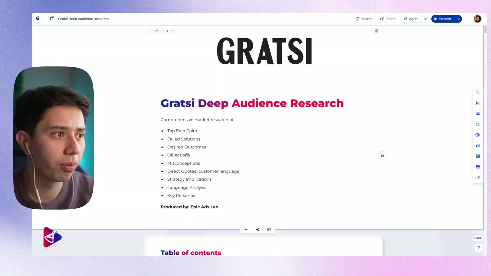
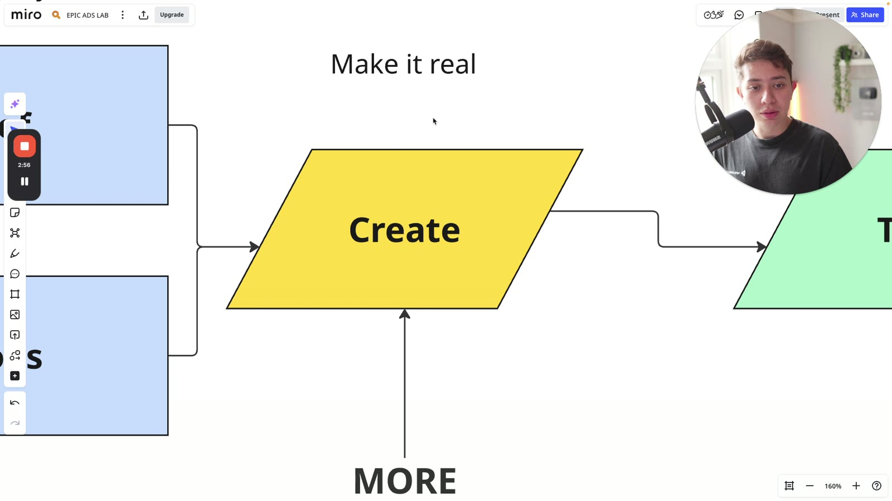

# 94. Research Protocol: START HERE
> The agency's whole creative process in one loop (research → concept → brief or hooks → create → test → feedback), including which stage to go back to depending on whether you need more, better or new creative.

## 🤖 Agent use
- **Use when:** planning a creative batch for a brand, or deciding what to do after test results come in.
- **Inputs → outputs:** test results + current research doc → a decision: make variations (MORE), rewrite brief/hooks (BETTER), or restart at research (NEW).
- **Rules:**
  - **DO** start every new brand or new batch at research: "what they want, what words they use, what desires, problems" go into one document that feeds the angles [00:00].
  - **DO** split the writing step by format: a **brief** for video, a **selection of hooks** for statics [00:44].
  - **IF** you need more creative **THEN** return to Create and make variations of what exists [01:30].
  - **IF** creative is not performing **THEN** return to hooks and brief: change wording, look at different desires [01:30].
  - **IF** you need new creative (ideas exhausted) **THEN** return to research, extract new things, pick a new concept, run the loop again [01:30].
  - **DON'T** skip research: the course's claim is that this loop produced "hundreds of creatives per month for 35 plus brands" [02:21] (instructor claim).
- **See also:** [Market awareness in 180s](095-market-awareness-explained-in-180s.md) · [Customer research protocol 1](097-customer-research-protocol-1.md) · [Customer research stack](../../../../frameworks/customer-research-stack.md) · [Evolve: research to first concepts](../../../evolve/start-here/playbooks/research-to-first-concepts.md) · [Test and iterate](../../../../playbooks/test-and-iterate.md)

## Key ideas
### The loop (diagram on lesson page) [00:00–02:21]
- **Research = "what they want"** [00:00]: audience desires, problems, vocabulary, collected in a document "that you can then use to make the angles".
- **Concept = "what to show"** [00:44]: e.g. an interview, or a static "us versus them". The concept decides how the desire is shown.
- **Brief / Hooks = "what to say"** [00:44]: brief for video, hooks for statics, "so you know what words to put in the video or in the static".
- **Create = "make it real"** [01:30]: produce the videos or statics.
- **Test, then Feedback = "What do we need?"** [01:30]: the answer routes back as MORE (to Create), BETTER (to Brief/Hooks), NEW (to Research).

## Steps / framework
| Stage | Question | Output | Go back here when |
|---|---|---|---|
| Research | What do they want? | Research doc (desires, pains, objections, language) | Need NEW creative |
| Concept | What to show? | Concept (interview, us-vs-them, etc.) | New research angle found |
| Brief / Hooks | What to say? | Video brief or static hooks | Need BETTER creative |
| Create | Make it real | Videos / statics | Need MORE creative |
| Test | Load into ad account | Results | always |
| Feedback | What do we need? | Choose MORE / BETTER / NEW | after every test |

## Examples
No ad examples in this lesson; it is the process overview. The rest of the Research Protocol module covers [market awareness](095-market-awareness-explained-in-180s.md), [customer research](097-customer-research-protocol-1.md), [personas](098-customer-research-protocol-2.md) and competitor-ad research ([100](100-why-copying-longest-running-is-bad.md), [101](101-how-to-find-ads-based-on-ad-spend.md), [102](102-find-winning-concepts-with-adnova.md)).

## Structured units
- **DO** treat creative as a system with a feedback input, not one-off ads [01:30].
- **IF** results are weak **THEN** fix words and desire before re-shooting: BETTER goes to hooks/brief, not to Create [01:30].
- Mapping (derived): MORE = iteration of winners; BETTER = rewrite of losers; NEW = new angle from fresh research. Compare Evolve's [rewrite losers and iterate](../../../evolve/start-here/frameworks/rewrite-losers-and-iterate.md).

## Screenshots

*The diagram posted on the lesson page; the video walks it left to right. Feedback arrows: NEW to Research, BETTER to Brief/Hooks, MORE to Create.*

*The Miro board where "Create" and the MORE arrow are explained. [01:30]*

## How to apply
- [ ] Open or create the brand's research doc before any concept work.
- [ ] After each test read the result as MORE / BETTER / NEW and go to the matching stage.
- [ ] Write a brief for video, hooks for statics.

## Related
- Previous: [093 Mr Paid Social guest talk](093-special-guest-recordings-mr-paid-social-guest-talk.md) · Next: [095 Market awareness in 180s](095-market-awareness-explained-in-180s.md)

## Sources and limitations
- Transcript: <../../../../../raw/ad-creators-lab/ai-ads-ugc-animations/_transcripts/Ad Creators Lab - Create Viral AI Ads, UGC & Animations That Convert Into Sales(September 2026)/7. Research Protocol/1. START HERE.txt>; page text holds only the diagram image. Transcript complete (150.16 of 150.85 s). Machine transcription.
- "Ignore this new thing for now" [00:00] refers to an on-screen item not identifiable in the files. No thresholds are given for choosing MORE / BETTER / NEW.
