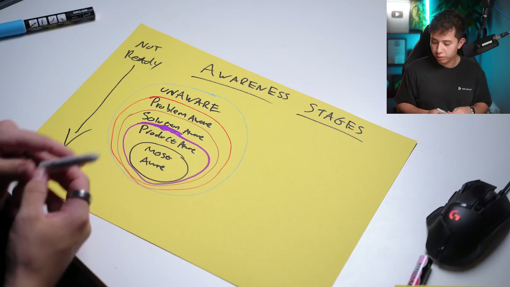
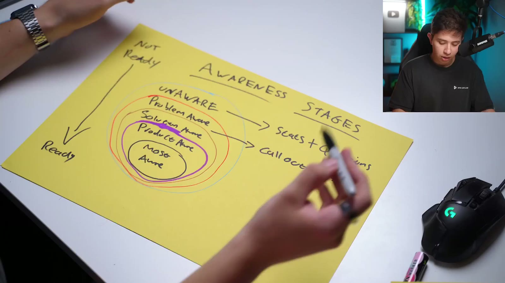

# 95. Market Awareness Explained in 180s
> Eugene Schwartz's five awareness stages with the ad tactic the course assigns to each, so every concept starts by naming which stage it targets.

## 🤖 Agent use
- **Use when:** choosing what an ad must say first; labelling a competitor ad; deciding hook type (statistic, question, mechanism, comparison, social proof).
- **Inputs → outputs:** product + target audience + what they already know → one awareness stage and the matching tactic.
- **Rules:**
  - **DO** pick the stage before writing and use that stage's tactic (table below) [00:43].
  - **IF** unaware **THEN** use statistics and questions that expose hidden pain points; do not name the product [00:43–01:38].
  - **IF** problem aware **THEN** call out the problem clearly and "you don't want to pitch your product" [01:38].
  - **IF** solution aware **THEN** introduce your unique mechanism [01:38].
  - **IF** product aware **THEN** compare your product with others and show unique benefits [02:29].
  - **IF** most aware **THEN** social proof, answered FAQs, guarantees [02:29].
  - **DON'T** reuse the lesson's statistics or proof ("75% of people", "over 3,000 men and women", "within three days") as facts; they are illustrations [01:38; 02:29]. Use verified numbers only (derived: repo rule "never invent proof").
- **See also:** [Evolve: market awareness](../../../evolve/copywriting/concepts/market-awareness.md) · [Evolve: unaware ads](../../../evolve/copywriting/concepts/unaware-ads.md) · [Ad examples per stage](096-market-awareness-ad-examples.md) · [Why longest-running ads are bottom-funnel](100-why-copying-longest-running-is-bad.md) · [Customer research stack](../../../../frameworks/customer-research-stack.md)

## Key ideas
### The five stages [00:00–00:43]
- Credit to Eugene Schwartz [00:00]. Unaware (no idea about problem, solution or product) → problem aware → solution aware (back-pain example: chair, cushion, massage, surgery) → product aware → most aware ("about to purchase") [00:00–00:43].
- Size vs readiness: more people are unaware than most aware; readiness to buy rises with awareness [00:43] (stated, not quantified).

### Tactic per stage (office-chair example) [00:43–03:01]
| Stage | Tactic | Instructor's example line | Source |
|---|---|---|---|
| Unaware | Statistics + questions that expose hidden pain | "Have you ever sat down on your desk working really hard and feel like you have to stand up every five minutes?" / "Did you know that 75% of people are sitting on a chair that is destroying their back and making them live five years less?" | [00:43–01:38] |
| Problem aware | Call out the problem clearly; no pitch | "If you're experiencing lower back pain whilst you're at your desk, it's probably because you have the wrong chair." | [01:38] |
| Solution aware | Introduce unique mechanism | "…we have our proprietary buoyancy activated premium GPU accelerated technology so that when you lie down your back is supported much more than any other chair" (joke placeholder mechanism) | [01:38–02:29] |
| Product aware | Compare to others, highlight unique benefits | "if you've seen different chairs on the market ours is very different because of this technology…" | [02:29] |
| Most aware | Social proof, answer FAQs, guarantees | "we've helped over 3,000 men and women and workers get rid of their back pain within three days" | [02:29–03:01] |

## Examples
Only the chair example above. Real ads per stage: [096](096-market-awareness-ad-examples.md).

## Structured units
- **Cross-course note:** Evolve places "compare solution types" at solution aware and the new mechanism at product aware; this lesson puts the mechanism at solution aware and comparison at product aware. Evolve also calls product aware the biggest level, while this lesson says the unaware pool is larger [00:43]. Default (derived): label the stage by what the viewer already believes, then test hook types rather than trusting either mapping.

## Screenshots

*Nested circles: unaware (outermost) to most aware (centre), with the arrow from "not ready" to "ready". [01:17]*

*Arrows from the rings to the tactics: stats + questions, call out problem, unique mechanism, compare, social proof / FAQs. [01:46]*

## How to apply
- [ ] Write the stage on every concept card.
- [ ] Draft the hook with that stage's tactic only.
- [ ] Replace placeholder stats and proof with verified ones.

## Related
- Previous: [094](094-research-protocol-start-here.md) · Next: [096 Market awareness ad examples](096-market-awareness-ad-examples.md)

## Sources and limitations
- Transcript: <../../../../../raw/ad-creators-lab/ai-ads-ugc-animations/_transcripts/Ad Creators Lab - Create Viral AI Ads, UGC & Animations That Convert Into Sales(September 2026)/7. Research Protocol/2. Market Awareness Explained in 180s.txt>. Page has no text. Transcript complete (181.3 s). The whiteboard shows unaware at the top and most aware at the bottom ("not ready" to "ready").
- Schwartz's stages come from *Breakthrough Advertising*; not checked against the book here.
