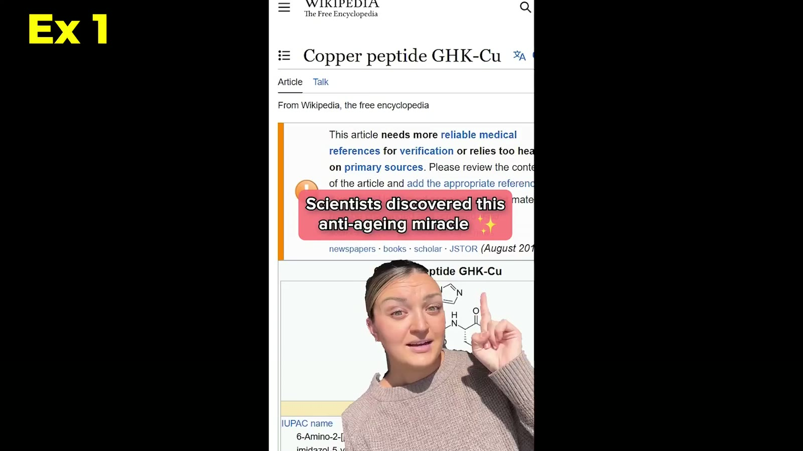
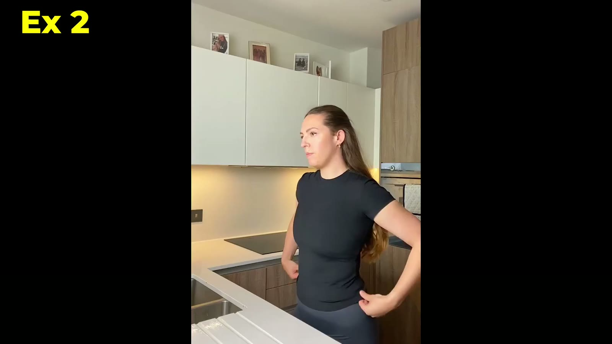
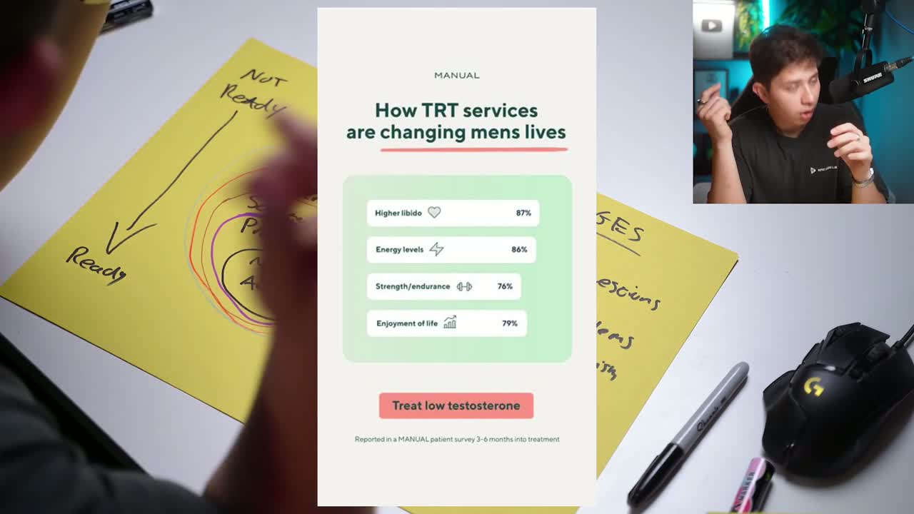
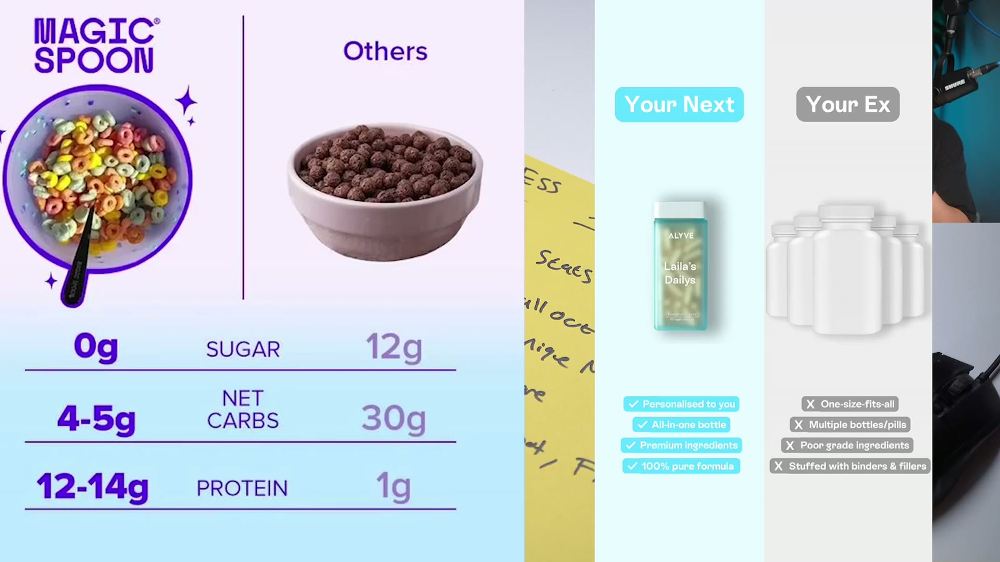
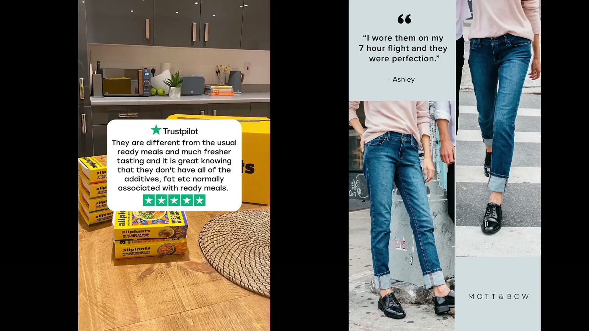

# 96. Market Awareness Ad Examples
> A 37-second montage that pins an ad format to each awareness stage: stats and questions for unaware, an us-versus-them for product aware, a golden-nugget review for most aware.

## 🤖 Agent use
- **Use when:** choosing a static or video format after labelling the awareness stage ([95](095-market-awareness-explained-in-180s.md)).
- **Inputs → outputs:** awareness stage → ad format and opening.
- **Rules:**
  - **IF** unaware **THEN** hook with a surprising claim or "stats and asks questions" [00:00].
  - **IF** product aware **THEN** make an us-versus-them [00:00].
  - **IF** most aware **THEN** make a golden-nugget review (social proof) [00:00].
  - **DON'T** copy these ads: copy the format mechanism only. The unaware example makes a health claim ("anti-ageing miracle") and cites a discovery date that the course does not verify; do not reuse either (compliance flag).
- **See also:** [95 Market awareness in 180s](095-market-awareness-explained-in-180s.md) · [Evolve: market awareness](../../../evolve/copywriting/concepts/market-awareness.md) · [Competitor ad teardown](../../../../playbooks/competitor-ad-teardown.md) · [LLM output claim audit](../../../stefan-georgi/rmbc-ii/rubrics/llm-output-claim-audit.md)

## Key ideas
### Stage to format [00:00–00:37]
- Unaware: two examples, "Ex 1" and "Ex 2" on screen. Ex 1 line: "Scientists discovered this in 1973, but nobody told me that it was a natural way to combat aging until now." Ex 2 line: "Do you ever just ask yourself, how on earth can I go to work, have a social life, eat well and stay active?" The instructor calls these "different stats" and "asks questions" [00:00].
- Problem aware and solution aware: the transcript says "you might make an ad that looks like this" with no spoken description [00:00]; the video shows ad clips only. Which clip belongs to which stage is not stated (a static ad about a men's testosterone-treatment service appears at about 0:28, unlabelled).
- Product aware: "you might make an us versus them" [00:00].
- Most aware: "a golden nugget review where you're using social proof" [00:00].

## Steps / framework
| Stage | Format | What to build |
|---|---|---|
| Unaware | Stat or question video | Hook = surprising fact or relatable question; no product |
| Problem aware | Problem call-out | per [95](095-market-awareness-explained-in-180s.md) |
| Solution aware | Mechanism explainer | per [95](095-market-awareness-explained-in-180s.md) |
| Product aware | Us versus them | Two columns/products compared on specific attributes |
| Most aware | Golden-nugget review | One strong customer quote as the ad |

## Examples
See table.

## Structured units
**Ad teardowns** (what is visible; "What works / fails" is limited to what the lesson says)

| Brand / product (niche) | Format | Hook / opening | What works | What fails | Fix suggested | Principle | Source |
|---|---|---|---|---|---|---|---|
| Copper-peptide anti-ageing (skincare/supplement; brand not shown) | UGC with Wikipedia page behind creator, overlay "Scientists discovered this anti-ageing miracle" | "Scientists discovered this in 1973…" | Stat/discovery hook for people not seeking a solution | Unverified health claim; "natural" and "combat aging" claims | Replace with a verified, compliant claim | Unaware: stats and questions | [00:00]; frame 0:06 |
| Women's health/lifestyle (brand not shown) | UGC in kitchen and gym | "how on earth can I go to work, have a social life, eat well and stay active?" | Relatable question | Not stated | not stated | Unaware: question | [00:00]; frames 0:12, 0:15 |
| Magic Spoon (cereal) | Static, split "Magic Spoon vs Others" with sugar / net carbs / protein rows; also a "Your Next vs Your Ex" supplement-style comparison | Side-by-side numbers | Direct comparison on attributes | Not stated | not stated | Product aware: us versus them | [00:00]; frame 0:30 |
| Ready-meal brand and Mott & Bow (denim) | Static/UGC with a Trustpilot-style review quote; denim ad with a quote from a flight | One review quote as headline | Real-language praise as proof | Not stated; quotes unverified | Use only genuine reviews | Most aware: golden-nugget review | [00:00]; frame 0:33 |

## Screenshots

*Ex 1: creator on a Wikipedia page, overlay "Scientists discovered this anti-ageing miracle". [00:06]*

*Ex 2: question-led UGC. [00:12]*

*A static ad shown between the unaware and product-aware examples; stage not stated. [00:28]*

*Product-aware format: comparison on specific numbers. [00:30]*

*Most-aware format: a review quote carries the ad. [00:33]*

## How to apply
- [ ] For each concept card pick one of these formats from the stage.
- [ ] Source the claim or review before scripting; run the claim audit.

## Related
- Previous: [095](095-market-awareness-explained-in-180s.md) · Next: [097 Customer research protocol 1](097-customer-research-protocol-1.md)

## Sources and limitations
- Transcript: <../../../../../raw/ad-creators-lab/ai-ads-ugc-animations/_transcripts/Ad Creators Lab - Create Viral AI Ads, UGC & Animations That Convert Into Sales(September 2026)/7. Research Protocol/3. Market Awareness Ad Examples.txt>. Page has no text. Complete (37.13 s).
- Ad audio is not transcribed except the two quoted lines; stage assignments for problem aware and solution aware are not recoverable. Third-party ads shown are research references only; do not copy 1:1.
