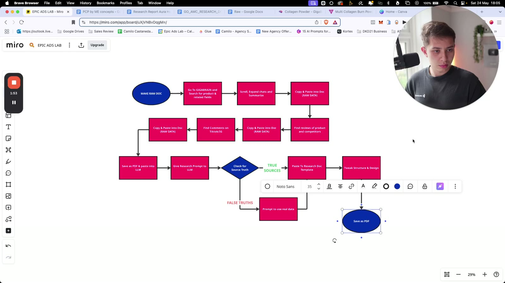
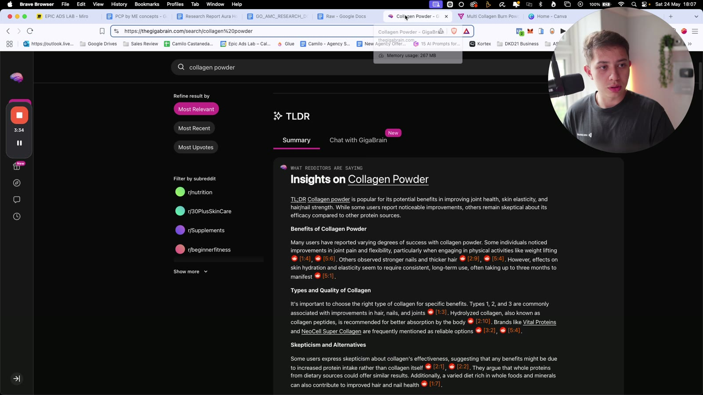
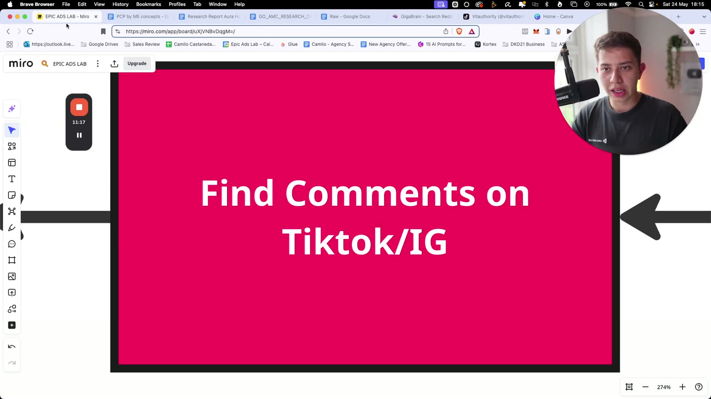
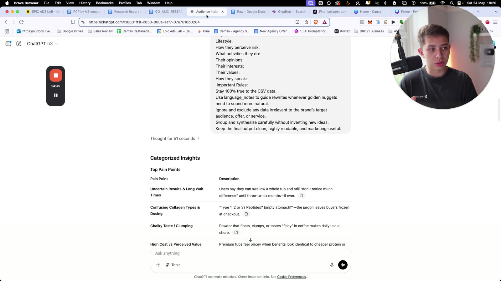
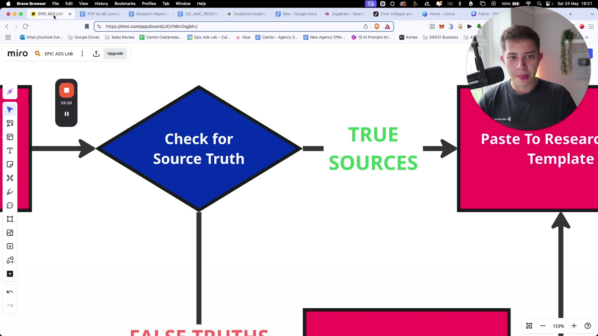

# 97. Customer Research Protocol 1
> A step-by-step way to build an "audience conversion report": paste raw Reddit threads, product and competitor reviews and TikTok comments into one doc, have an LLM structure it with a fixed prompt, then check every claim against the raw data.

## 🤖 Agent use
- **Use when:** starting research for a product, before angles, concepts, hooks or scripts.
- **Inputs → outputs:** product category + own and competitor reviews (10-30 each) + TikTok comments + Reddit threads → a Research Document (categorized insights, strategy implications, ICP language, personas) saved as PDF for the scripting phase.
- **Rules:**
  - **DO** collect more than desires and pains: also **objections**, **behaviors** (moments people can be called out on) and **terminology** [00:00].
  - **DO** use the customer's exact words ("I wake up with a hangover" vs "I woke up like I got hit by the train"): if the ad uses their words, "it's meta spying on me" and they click, or arrive warmer [00:00].
  - **DO** paste everything raw and unformatted first, clean up afterwards [02:32].
  - **DO** go for width and depth: follow-up queries such as "What are side effects people had with collagen powders?" produce angles ("if you've taken collagen powder that makes you feel bloated…") [05:37].
  - **DO** run a **source-truth check** on the LLM report; the AI "does hallucinate" [10:14]. For anything not traceable to the raw thread, prompt it to "use the actual data that's in the document" [11:10].
  - **DO** address objections in the ad up front (e.g. "I don't want my house smelling like a chemical factory") [01:37].
  - **DON'T** invent quotes: the prompt itself says "no invented quotes" (page prompt).
  - **IF** you have no comments on your own TikTok **THEN** search the category on TikTok and copy comments on other brands' videos [08:00–08:32].
  - **IF** copy is the next task **THEN** switch to Claude: "ChatGPT just for building out the report is fine. Claude definitely is better for any copywriting" [08:32].
- **See also:** [98 Add brand info and generate personas](098-customer-research-protocol-2.md) · [99 Research report examples](099-research-report-examples.md) · [Customer research stack](../../../../frameworks/customer-research-stack.md) · [Evolve: research to first concepts](../../../evolve/start-here/playbooks/research-to-first-concepts.md) · [Evolve: research stack workflow](../../../evolve/start-here/frameworks/research-stack-workflow.md) · [Customer research to angles](../../../../playbooks/customer-research-to-angles.md) · [LLM output claim audit](../../../stefan-georgi/rmbc-ii/rubrics/llm-output-claim-audit.md)

## Key ideas
### Why: "the biggest lever" [00:00–01:37]
- "The biggest lever that you can pull when it comes to making ad creative that converts is doing an audience conversion report" built from deep customer research [00:00] (instructor claim). Sources: Reddit forums, reviews of your product and competitors, TikTok comments [00:00–00:58].
- Example output for a law brand: desires "full refund or cash settlement", "reliable repairs", "fast hassle-free legal help"; objections "why should I trust a lawyer"; for a diffuser "I don't want my house smelling like a chemical factory" [01:37].

### The flow (Miro flowchart) [01:07–11:28]
1. Make raw doc (docs.new, "Raw Data - [product]") [01:37].
2. Search the category in the Reddit-conversation tool (video: GigaBrain; page update: Reddit Answers replaces it). Example "collagen powder": "649 comments searched, giving you a hundred relevant comments from 10 relevant discussions" [02:32]. Click "show more", copy threads and summaries, paste without formatting [03:22].
3. Use the follow-up questions in the tool ("What do people dislike about collagen powders?") and paste the sourced replies [04:13–05:01]. Budget: "probably take you… half an hour" [05:01].
4. Paste reviews of your product and competitors (website, sales calls) [06:27].
5. Paste TikTok comments from your brand's most-commented videos; look for questions ("How is this different from burn?", "Does it have aftertaste?") [06:27–07:09]. Put them under a "TikTok comments" heading; right-click clear formatting [07:09].
6. Download as PDF ("easier for the learning language model") [08:00]. (The page says download as .txt; see limitations.)
7. Paste into the LLM with the research prompt below [08:32].
8. Read the report, then **check source truth** (see below), then paste into a Google Doc "Research Document" template and save as PDF for scripting [10:14–11:10].

### What the LLM output looked like (collagen demo) [08:32–10:14]
- Pain points: uncertain results, confusing collagen types, chalky taste, high cost, side effects, protein skepticism [08:32–09:27]. Failed solutions: cheap or single-type collagen tubs [09:27].
- Desires: pain-free flexible joints; hair, nail, lash glow-up; easy tasty daily ritual. Example angle: "this is how I ensure I get smooth, faster healing skin with a two-step ritual I do with my morning coffee" [09:27].
- Objections: "isn't this just another pricey protein powder? I use that, nothing happens" → inform about time frames [10:14].
- Instructor warns the demo was thin: more data and your own USPs improve output [09:27].

### Source-truth check [10:14–11:10]
- Spot-check a suspicious line ("vegetarians have zero options"): ask where it came from; the AI cites the Reddit thread; if false, prompt it to use only the document data [10:14–11:10].

## Steps / framework
| # | Step | Tool | Time / count | Source |
|---|---|---|---|---|
| 1 | Raw doc | docs.new, title "Raw Data - [Product Name]" | - | page; [01:37] |
| 2 | Reddit conversations | Reddit Answers (page update; video shows GigaBrain) | about 30 min | page; [05:01] |
| 3 | Reviews | own site/emails + competitors (Amazon, review sites) | 10-30 each | page |
| 4 | TikTok comments | own + competitor videos; questions, concerns, objections | - | page; [06:27] |
| 5 | LLM synthesis | ChatGPT-5 / Claude / other, prompt below | - | page; [08:32] |
| 6 | Source-truth check | compare with raw; re-prompt | - | [10:14] |
| 7 | Research Document | Google Doc "Research Document - [PRODUCT NAME]", save PDF | - | page; [11:10] |

## Examples
Collagen powder (demo category): see Key ideas. Law-firm and diffuser examples are shown only as objection/desire illustrations [01:37]. Full example reports: [99](099-research-report-examples.md) (external links, not fetched).

## Structured units
- **IF** the LLM output includes a "fact" with no thread behind it **THEN** ask for its source and drop or re-prompt [10:14].
- **DON'T** feed it only your own reviews (derived): the Tether research stack warns that review-only inputs re-recruit existing buyers; this protocol mitigates with Reddit and competitor sources. See [customer research stack](../../../../frameworks/customer-research-stack.md).
- (derived) The prompt expects structured fields (pain_points, failed_solutions …, "CSV data") that a raw paste does not contain; tell the LLM to extract them from the raw text first or drop the CSV references.

## Prompts / templates (verbatim)
Text from the lesson page, "Research LLM Prompt". Wording is verbatim; list/table indentation reconstructed from the page markup. It was written for an automotive example (brakes, dealership, warranty) and refers to "CSV data" and Reddit; adapt names, not structure.

```text
You are an expert audience researcher and copy strategist.
You are given audience data that includes the following fields:
- pain_points
- failed_solutions
- desired_outcomes
- objections
- misconceptions
- golden_nuggets
- language_notes

Objective:
Analyze and synthesize this data into a clean, structured format using the following exact sections:

Categorized Insights

Top Pain Points
Format (in tabular form):
- Pain Point → Short, clear title capturing the core frustration.
- Description → 1–2 lines summarizing the emotional reality behind it.
- Group similar issues where appropriate (e.g., brake issues + overheating = Recurring Mechanical Failures).

Only include pain points relevant to the brand's ICP, product, and service. Ignore off-topic or irrelevant entries.

Failed Solutions
Format (in tabular form):
- Attempt → What users tried.
- Why It Failed → Why it didn't solve the problem.
- Group similar failed attempts if needed (e.g., dealership repairs, DIY fixes).

Only include attempts tied to the brand's core offer or target problem.

Desired Outcomes
Format (in tabular form):
- Outcome → Desired state the user wants.
- Explanation → Why that matters to them emotionally or practically.

Objections
Format (in tabular form):
- Objection → User hesitation captured in simple, natural phrasing.
- Real Quote/Paraphrase → Write it like a Redditor would speak, using natural skepticism and casual tone.

Misconceptions
Format (in tabular form):
- Misconception → Wrong belief the audience holds.
- Clarification → Correct understanding written simply.

Golden Nuggets (Quotes from Reddit)
Format:
- Take the golden_nuggets entries.
- If the golden nugget already sounds like a natural Reddit comment, keep it verbatim.
- If the quote sounds too formal or clunky, rewrite it using the style in language_notes (DIY tone, slang, contractions, emotional phrasing).
- Maintain honesty — no invented quotes.
- Focus on quotes expressing:
  - Frustration
  - Skepticism
  - Humor/sarcasm
  - Hopelessness
  - DIY struggle

ONLY include nuggets directly tied to the brand's ICP, product, or service. Ignore irrelevant ones.

Strategy Implications for [Brand Name]
Format:
Opportunity | How [Brand] Can Win
------------|------------------
Summarize practical, marketing-relevant opportunities from the audience's real experiences.

ICP Language Analysis
Based on language_notes, summarize:
- Natural tone (formal vs informal)
- Emotional style (skeptical, stressed, proud, fed up, hopeful)
- Vocabulary (specific mechanical terms, warranty phrases, slang words)
- Copywriting Tips: How to speak exactly like the ICP.

Use real examples where possible ("pads and discs", "lot-pack", "safe to drive", "I don't get it").

Key Personas
Format:
- Persona Name ("Nickname")
- Age Range
- Quick Summary: 1–2 lines of their situation and emotional needs.
- Desire:
- Pain point:
- Objection:
- Lifestyle:
- How they perceive risk:
- What activities they do:
- Their opinions:
- Their interests:
- Their values:
- How they speak:

Important Rules:
- Stay 100% true to the CSV data.
- Use language from the raw threads and reviews to guide rewrites whenever golden nuggets need to sound more natural.
- Ignore and exclude any data irrelevant to the brand's target audience, offer, or service.
- Group and synthesize carefully without inventing new ideas.
- Keep the final output clean, highly readable, and marketing-useful.
```

Follow-up prompt used in the video for false findings (near verbatim) [11:10]: "hey can you go and use the actual data that's in the document".

Reddit follow-up questions used in the demo: "What do people dislike about collagen?" (page); "What are side effects people had with collagen powders?" [05:37].

## Screenshots

*Miro flowchart of the whole protocol: raw doc, Reddit tool, scroll/expand/summarize, paste, reviews, TikTok/IG comments, PDF to LLM, prompt, source-truth check (TRUE SOURCES / FALSE TRUTHS loop), research-doc template, save as PDF. [01:07]*


*Category search returning a summary with insights, sources and follow-up questions to copy into the raw doc. [02:46]*


*Brand video comments with questions ("How is this different from burn?") to copy as raw data. [07:57]*


*ChatGPT's Categorized Insights output with the Top Pain Points table. [10:45]*


*The source-truth decision node: true sources go to the template, false truths go to "prompt to use real data". [11:17]*

## How to apply
- [ ] Create "Raw Data - [Product]" and paste 10-30 reviews of yours, 10-30 of competitors.
- [ ] Gather Reddit threads and TikTok comments, unformatted.
- [ ] Run the prompt; verify each quote and claim against the raw doc.
- [ ] Save as the "Research Document" and go on to [98](098-customer-research-protocol-2.md).

## Related
- Previous: [096](096-market-awareness-ad-examples.md) · Next: [098 Customer research protocol 2](098-customer-research-protocol-2.md)

## Sources and limitations
- Transcript: <../../../../../raw/ad-creators-lab/ai-ads-ugc-animations/_transcripts/Ad Creators Lab - Create Viral AI Ads, UGC & Animations That Convert Into Sales(September 2026)/7. Research Protocol/4. Customer Research Protocol 1.txt>. Complete (710.74 of 711.23 s). Machine transcription ("GigaBrain" appears as "GigaBrain/Gigabrain"; "Burn" is a competitor name).
- Tool drift: the page banner says the Reddit tool shown in the video was replaced by Reddit Answers; screenshots show the old tool. Format drift: page says download the raw doc as .txt, video says PDF.
- The prompt text is on the page, not in the video; the video says it is "in the description below".
- Personas in the prompt are generated from data; do not present them as real customers. Third-party reviews and comments are research inputs only; do not republish them as testimonials.
