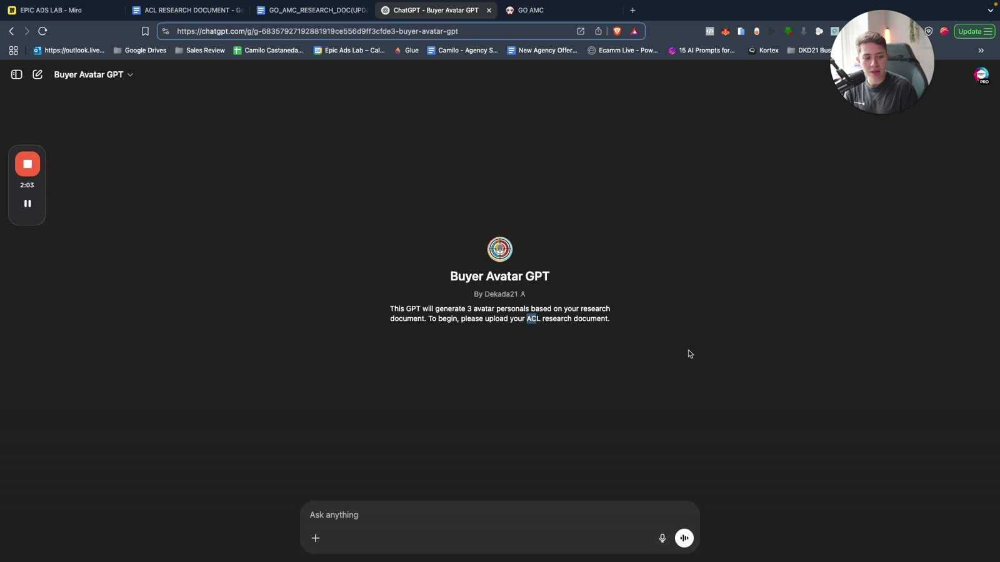
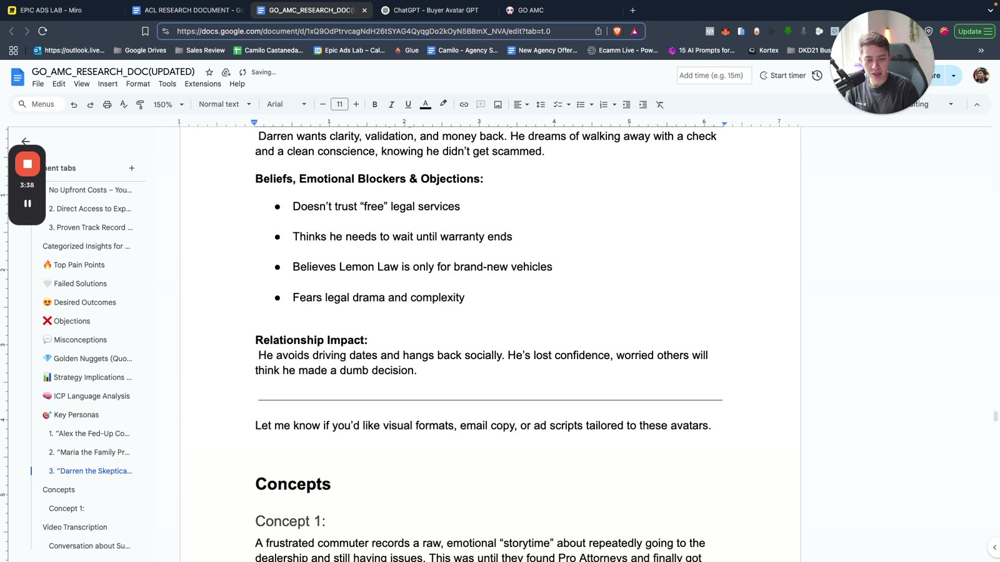

# 98. Customer Research Protocol 2
> Add brand facts to the research doc, generate three buyer personas with a custom "Buyer Avatar GPT", paste them under "Key Personas", and leave an empty "Concepts" section ready for brainstorming.

## 🤖 Agent use
- **Use when:** the research doc from [97](097-customer-research-protocol-1.md) exists and you need avatars before concepts.
- **Inputs → outputs:** research doc (PDF) + brand information section → three personas pasted into the doc, empty Concepts section.
- **Rules:**
  - **DO** write to **one** avatar: "you want to speak to a singular avatar, one specific person… rather than speaking to people with different desires" (example "Susan, 32, yoga instructor") [00:00].
  - **DO** fill "Brand Information" as densely as possible: brand name, differentiator, best-selling product, "three things you wish everyone knew about your product", desired perception, seasonal patterns, FAQs, claims [00:00–00:58].
  - **DO** treat the research doc as "the source of truth" for the GPT and make it accurate [01:54].
  - **DO** read each persona and edit anything that does not match your real customer data; ask the community for review if unsure [01:54–02:27].
  - **DON'T** accept invented traits (derived): personas come from an LLM; check them against raw quotes ([97](097-customer-research-protocol-1.md)).
  - **IF** you prefer better copy **THEN** paste the finished doc into Claude; the course keeps ChatGPT to avoid extra tools, and the next stage's Poppy AI has Claude built in [02:27].
- **See also:** [97](097-customer-research-protocol-1.md) · [99 Research report examples](099-research-report-examples.md) · [Evolve: research to first concepts](../../../evolve/start-here/playbooks/research-to-first-concepts.md) · [Evolve: build core avatars](../../../evolve/start-here/lessons/074-how-to-build-core-avatars.md) · [Customer research stack](../../../../frameworks/customer-research-stack.md)

## Key ideas
### Brand information [00:00–01:54]
- Add a "Brand Information" section to the research doc. The demo brand is an attorney practice; "This works for all different products and services" [00:58]. Frame shows a claims list headed "List any claims that you offer. (IMPORTANT)" with refund/no-out-of-pocket/fast-process style claims [frame 01:00].
- Save the doc as PDF: "the easiest way for the large language models to process it" [00:58].

### Buyer Avatar GPT [00:58–02:27]
- Custom GPT: "This GPT will generate three avatar personas based on your research document." Upload the PDF and press Enter [00:58–01:54].
- Demo output: "Alex, the fed up commuter, demographics, age 34, soundbites" [01:54].
- Personas can also carry sections such as beliefs and emotional blockers, relationship impact (frame at 03:00).

### Finalise [02:27–03:30]
- Copy personas into the doc under "Key Personas"; confirm an empty "Concepts" section sits below [02:27–03:21]; next step is concept brainstorming in Poppy AI [02:27].

## Steps / framework
| # | Step | Detail | Source |
|---|---|---|---|
| 1 | Open the Research doc | add section "Brand Information" | page |
| 2 | Fill it | Brand Name; Unique Differentiator; Best-Selling Product/Service; Desired Brand Perception (tone, values); Seasonal Patterns (busy periods, offers); FAQs & Common Claims. Video adds: three things you wish everyone knew | page; [00:58] |
| 3 | Download as PDF | | page |
| 4 | Open "Avatar GPT" | link below | page |
| 5 | Upload PDF, press Enter | wait for three personas | page; [01:54] |
| 6 | Review and refine | tweak vs real customer data; ask team/community | page |
| 7 | Paste into "Key Personas" | | page |
| 8 | Verify empty "Concepts" section | save/export again | page |

## Examples
Persona example names in the course: "Susan, the 32-year-old yoga instructor" (page); "Alex, the fed up commuter, age 34" [01:54]. These are template illustrations from the demo, not real customers.

## Structured units
- **DO** keep brand information as structured fields so every later prompt receives the same facts.
- **IF** a persona contradicts the quotes **THEN** the quotes win (derived).

## Prompts / templates (verbatim)
Avatar GPT link (page): `https://chatgpt.com/g/g-68357927192881919ce556d9ff3cfde3-buyer-avatar-gpt`. Its instructions are **not included in the course files**; only the greeting is seen: "This GPT will generate three avatar personas based on your research document. To begin, please upload your [Ace] Ad Creators Lab research document." [00:58].

Brand Information template (from the page):

```text
Brand Information
- Brand Name
- Unique Differentiator (what makes you stand out)
- Best-Selling Product/Service
- Desired Brand Perception (tone, values)
- Seasonal Patterns (busy periods, offers)
- FAQs & Common Claims
```

## Screenshots

*The custom GPT waiting for the research doc upload. [01:30]*


*Personas pasted into the doc (beliefs, blockers, relationship impact) with an empty "Concepts" section beneath. [03:00]*

## How to apply
- [ ] Complete Brand Information with verified claims only.
- [ ] Export PDF, run the Avatar GPT, edit the three personas.
- [ ] Paste under Key Personas; leave "Concepts" blank for the next step.

## Related
- Previous: [097](097-customer-research-protocol-1.md) · Next: [099 Research report examples](099-research-report-examples.md)

## Sources and limitations
- Transcript: <../../../../../raw/ad-creators-lab/ai-ads-ugc-animations/_transcripts/Ad Creators Lab - Create Viral AI Ads, UGC & Animations That Convert Into Sales(September 2026)/7. Research Protocol/5. Customer Research Protocol 2.txt>. Complete (209.42 of 209.96 s).
- The GPT's internal prompt and the Poppy AI concept step are not in these files. Persona demos are fictional; do not present AI personas as real customers.
