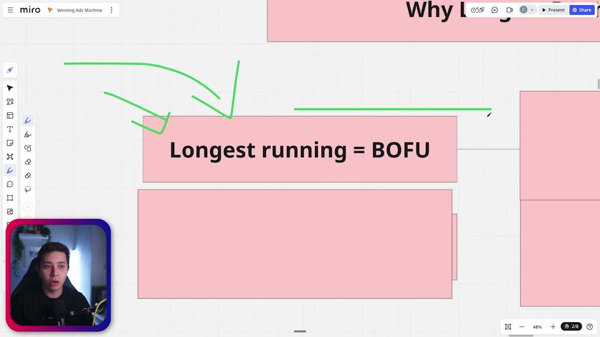
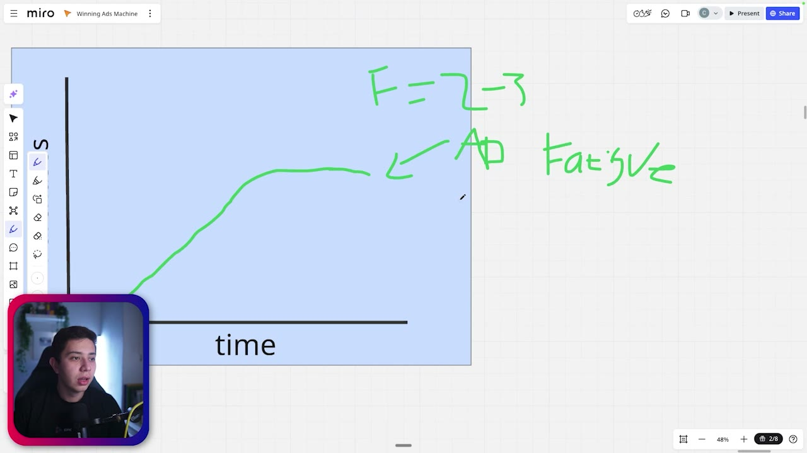
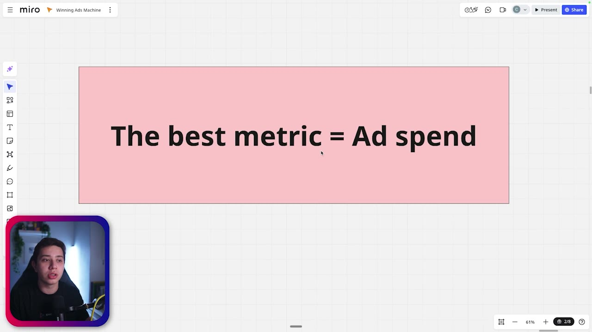

# 100. Why Copying Longest Running is Bad
> Sorting an ad library by "longest running" surfaces bottom-of-funnel ads and $1-a-day decoys; ad spend is the metric to use instead.

## 🤖 Agent use
- **Use when:** collecting competitor or adjacent-niche ads to remix, before any teardown.
- **Inputs → outputs:** an ad library or spy tool → a shortlist chosen by spend and top-of-funnel relevance, not run time.
- **Rules:**
  - **DON'T** pick ads by days running: "that is the worst thing that you can do" [00:00].
  - **DO** know why: a long-running ad "typically means that they are actually bottom of the funnel ads", fed by a top-of-funnel ad that brings traffic [00:00–00:45] (instructor claim).
  - **DO** copy the mechanism of ads that bring in **new** customers, i.e. unaware or problem-aware ads: "you can only scale ads that are bringing in new customers" [00:45].
  - **DON'T** trust run time as proof of a winner: some brands run $1-a-day ads "to fool you into thinking that they are winning ads"; "since like 2015"; used by big brands to hide competition [02:08] (instructor claim).
  - **DO** use ad spend as "the best metric to know what a good ad is" [02:08]; the how-to is [lesson 101](101-how-to-find-ads-based-on-ad-spend.md).
  - **IF** a creative's frequency reaches about 2 to 3 **THEN** expect ad fatigue and a CPA spike, so keep a pipeline of new top-of-funnel creative [01:29] (instructor claim).
- **See also:** [101 Find ads by ad spend](101-how-to-find-ads-based-on-ad-spend.md) · [102 Adnova](102-find-winning-concepts-with-adnova.md) · [Competitor ad teardown](../../../../playbooks/competitor-ad-teardown.md) · [Evolve: market awareness](../../../evolve/copywriting/concepts/market-awareness.md) · [95](095-market-awareness-explained-in-180s.md)

## Key ideas
### Reason 1: longest running = bottom of funnel [00:00–01:29]
- An ad can run long because it converts an audience already warmed by a top-of-funnel ad: "you have an ad that's feeding this ad all the time" [00:00–00:45]. High ROAS possible, but dependent on that feeder.
- Copying by "longest running" in Atria or AdSpy (transcribed "Atrio") produces "a bunch of bottom of funnel type of creative" with nothing that brings in new customers [00:45].

### What a scalable ad looks like [00:45–02:08]
- A very-unaware or problem-aware ad grows purchases and spend; it plateaus at a healthy CPA; if spend rises ROAS falls; at frequency about 2-3 ad fatigue hits "really bad": kill it [00:45–01:29].
- So you keep making new creative to "find a new peak and a new peak"; top-of-funnel ads "bring traffic to the bottom funnel ads" [01:29–02:08].

### Reason 2: $1-a-day decoys [02:08–02:46]
- Instructor says he has "been inside a lot of these ad accounts" [02:08] (instructor claim). Conclusion: filter by spend.

## Steps / framework
1. Do not sort the library by longest running.
2. Filter by minimum ad spend ([101](101-how-to-find-ads-based-on-ad-spend.md)).
3. Label each candidate's awareness stage; prefer unaware / problem aware (new-customer) ads for scale concepts ([95](095-market-awareness-explained-in-180s.md)).
4. Tear down with the [competitor ad teardown](../../../../playbooks/competitor-ad-teardown.md); copy the mechanism, not the asset.

## Examples
No real ads are shown; the whiteboard has a purchases-over-time curve with "F = 2-3 / Ad fatigue" and the slogans "Longest running = BOFU" and "The best metric = Ad spend".

## Structured units
- **DON'T** equate days live with performance; Tether agrees ("running for 195 days isn't proof; big brands leave ads on", see [competitor ad teardown](../../../../playbooks/competitor-ad-teardown.md)).
- (derived) Spend can also be misleading (brand-awareness budgets); pair spend with duplicates count and CPM, as [101](101-how-to-find-ads-based-on-ad-spend.md) does.

## Screenshots

*"Longest running = BOFU". [00:30]*

*Purchases over time, plateau and "F = 2-3 / Ad fatigue". [01:30]*

*The conclusion slide. [02:30]*

## How to apply
- [ ] Remove "longest running" from your research SOP.
- [ ] Add a spend threshold and an awareness-stage label per saved ad.

## Related
- Previous: [099](099-research-report-examples.md) · Next: [101 How to find ads based on ad spend](101-how-to-find-ads-based-on-ad-spend.md)

## Sources and limitations
- Transcript: <../../../../../raw/ad-creators-lab/ai-ads-ugc-animations/_transcripts/Ad Creators Lab - Create Viral AI Ads, UGC & Animations That Convert Into Sales(September 2026)/7. Research Protocol/7. Why Copying Longest Running is Bad.txt>. Page has no text. Complete (166.51 s).
- All causal claims (BOFU, $1/day, frequency 2-3) are the instructor's and unsupported by data in the lesson. Compare [102](102-find-winning-concepts-with-adnova.md), which treats "lasted the longest" as a winner signal inside a client's own account.
