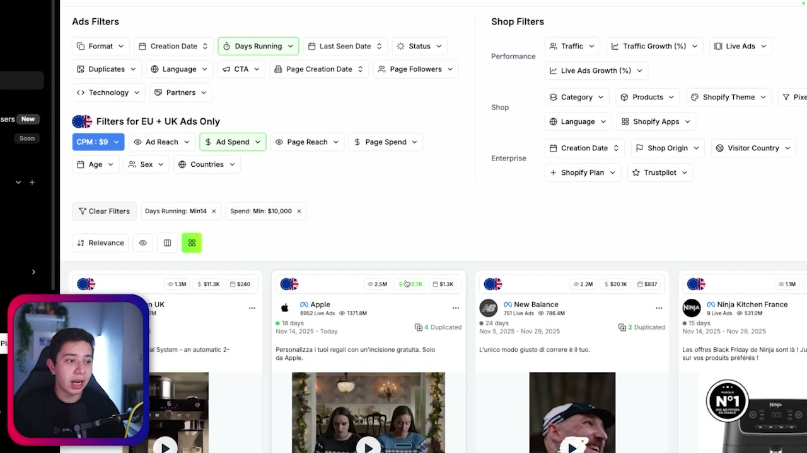
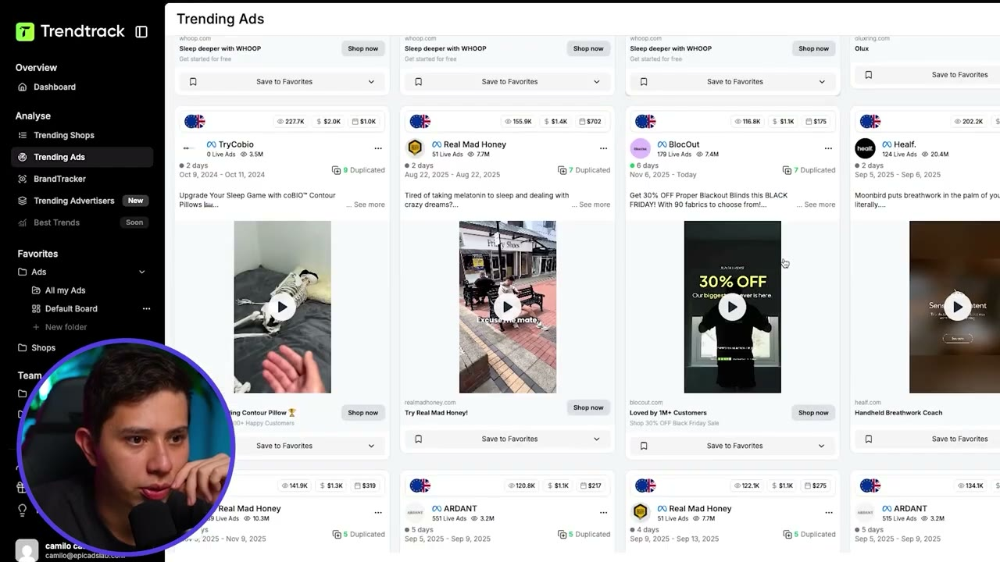

# 101. How To Find Ads Based on Ad Spend
> Use Trendtrack's Trending Ads with an ad-spend minimum, a days-running minimum and a "most duplicates" sort to find ads that real money was put behind, and take ideas from adjacent niches.

## 🤖 Agent use
- **Use when:** building a swipe list of ads to tear down for a brand ([100](100-why-copying-longest-running-is-bad.md) explains why not "longest running").
- **Inputs → outputs:** niche keyword + adjacent niches → saved ads (board) with spend, days running, duplicate count and transcript for teardown.
- **Rules:**
  - **DO** go to Trending Ads, set **Ad Spend minimum $10,000** and **Days running minimum 14**: "ads that have spent at least ten thousand dollars that ran for two weeks straight" [01:34].
  - **DO** open the per-ad "EU and UK statistics" to see spend and daily spend over the last days [01:34].
  - **DO** sort by **Most Duplicates** ("93 duplicates" on one ad: duplicated "in many campaigns many many times") [02:20; frame 02:49].
  - **DON'T** rely on this for US ads: "it only works for EU and UK ads" [00:00].
  - **DON'T** copy from your exact niche; look at **adjacent niches** (travel supplements → other supplements, nootropics, then fitness) [02:20].
  - **DO** use advanced ad search with keywords ("sleep") to pull ads on a topic with the same stats [03:17; frame 03:29].
  - **IF** you find a keeper **THEN** save to a board, pin, follow the brand in Brand Tracker, copy, or open the transcript [02:20].
  - **DO** expect big brands at this filter ("Herbal Essences, Superdry, Airbnb"); that signals real creative spend but not your budget [02:20].
- **See also:** [100 Why longest running is bad](100-why-copying-longest-running-is-bad.md) · [102 Adnova](102-find-winning-concepts-with-adnova.md) · [Competitor ad teardown](../../../../playbooks/competitor-ad-teardown.md) · [Customer research stack](../../../../frameworks/customer-research-stack.md) · [Evolve: market awareness](../../../evolve/copywriting/concepts/market-awareness.md)

## Key ideas
### Trendtrack features [00:00–01:34]
- Trending Shops (monthly visits, live ads, spend), Trending Ads, and Brand Tracker (load a brand, see its ad library, "pumped up a lot of ads towards Q4", testing cadence, pattern detection: a launched ad that keeps running signals a winner) [00:00–00:55].
- "The most important thing… is to go to trending ads and to organize them based on ad spend, which is a super key hidden feature that not many platforms like these have" [00:55] (instructor claim).

### The filter recipe [01:34–03:17]
- Filters seen on screen: Format: Video; Days running 30-180 (later in the video; first pass min 14); Spend: Min $10,000; CPM filter at $9 (the tool's EU/UK default shown, "you can slide CPM") [01:34; frames 02:00, 02:49].
- Sort "Most Duplicates"; example "93 duplicates" for a Temu ad [02:20].

### Adjacent niches and keyword search [02:20–03:37]
- Run keyword searches (e.g. "sleep") and compare results; examples shown include a skeleton sleep-pillow ad and a mushroom-honey ad (frames 03:29), "matching the same stats" [03:17].

## Steps / framework
| # | Step | Setting | Source |
|---|---|---|---|
| 1 | Trendtrack → Trending Ads | EU/UK only | [00:00] |
| 2 | Ad Spend | min $10,000 | [01:34] |
| 3 | Days running | min 14 (later 30-180 in frame) | [01:34]; frame 02:49 |
| 4 | Format | Video (frame) | frame 02:49 |
| 5 | Sort | Most Duplicates | [02:20] |
| 6 | Open stats | EU and UK statistics (spend per day) | [01:34] |
| 7 | Search | advanced ad search by keyword | frame 03:29 |
| 8 | Save | board / pin / brand tracker / transcript | [02:20] |
| 9 | Tear down | awareness stage, hook, mechanism; copy the mechanism, not the asset | (derived) |

## Examples
Ads on screen (shown as research references): Temu Poland, Zalando, Apple, New Balance, Ninja Kitchen; sleep category: TryCobio, Real Mad Honey, BlocOut, Healf. Teardowns are not done in the video.

## Structured units
- **DON'T** treat spend alone as quality; Tether scores multiple "winner signals" ([teardown playbook](../../../../playbooks/competitor-ad-teardown.md)) (derived).
- **IF** your market is the US **THEN** this tool gives no spend data; use another source (derived).

## Screenshots

*Trending Ads: Days Running and Ad Spend filters highlighted; chips "Days Running: Min 14" and "Spend: Min $10,000"; EU+UK filters. [02:00]*

*Chips "Format: Video", "Days Running: 30-180", "Spend: Min $10,000", sorted by Most Duplicates; first ad shows 93 duplicates. [02:49]*

*Sleep-niche results with duplicates, days live and spend per ad. [03:29]*

## How to apply
- [ ] Apply the filter recipe for your niche and two adjacent niches.
- [ ] Save 10-20 ads to a board; transcribe; label stage; then run teardowns.

## Related
- Previous: [100](100-why-copying-longest-running-is-bad.md) · Next: [102 Find winning concepts with Adnova](102-find-winning-concepts-with-adnova.md)

## Sources and limitations
- Transcript: <../../../../../raw/ad-creators-lab/ai-ads-ugc-animations/_transcripts/Ad Creators Lab - Create Viral AI Ads, UGC & Animations That Convert Into Sales(September 2026)/7. Research Protocol/8. How To Find Ads Based on Ad Spend.txt>. Complete (217.02 s). The ending ("matching the same stats") is abrupt.
- Affiliate: page link "Try Trendtrack" with discount code CAMILO20 (20% off) is the instructor's affiliate offer. Tool UI and the EU/UK limitation are as at recording (Aug-Sep 2026). Screenshots show brand ads from third parties; research only, never reuse.
