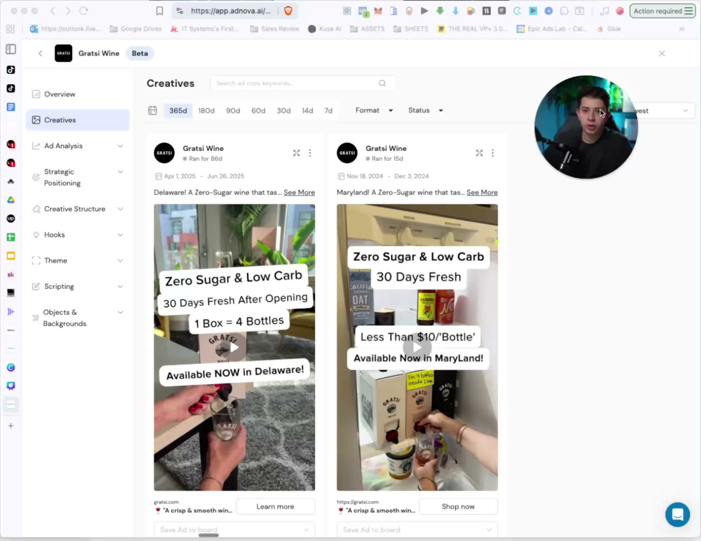
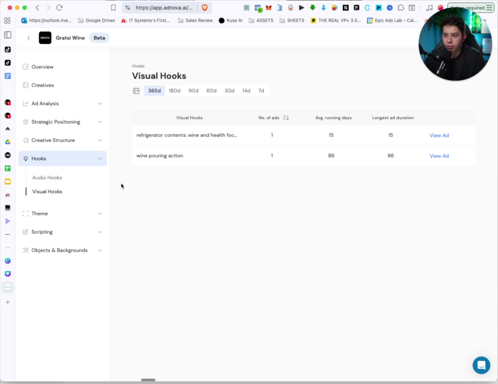

# 102. Find winning concepts with Adnova
> Adnova's "AI detective" lists the visual and audio hooks and recent ad angles that work for a client's account, so you can remix winners rather than start blank.

## 🤖 Agent use
- **Use when:** you need current winning hooks and angles for a brand whose ad data is loaded in Adnova, or want fast "edit-only" iterations.
- **Inputs → outputs:** brand account in Adnova → visual winning hooks, audio hooks, strategic positioning, ad angles over the last 7 days → concept ideas to remix.
- **Rules:**
  - **DO** open the brand in Adnova's Detective and check Hooks → Visual / Audio, plus ad angles by recent window (7d to 365d) [00:00–00:57].
  - **DO** watch the best ads for the current angle ("best dog itching ads") and "innovate on them" [00:57].
  - **DO** remix rather than copy: the example keeps the earwax-remedy topic but writes "Using Q-tips to remove earwax? Huge mistake. You're making things worse. Do this instead." with different visuals [00:57].
  - **DO** use it for "repurposed ads or sometimes we call them edit only ads just for speed sake" [00:57].
  - **DON'T** read "lasted the longest" as proof by itself: [100](100-why-copying-longest-running-is-bad.md) warns against run time; here winners are judged inside the client's own account data "lasted the longest and performed the best" (derived reconciliation).
- **See also:** [100](100-why-copying-longest-running-is-bad.md) · [101](101-how-to-find-ads-based-on-ad-spend.md) · [Competitor ad teardown](../../../../playbooks/competitor-ad-teardown.md) · [Evolve: research to first concepts](../../../evolve/start-here/playbooks/research-to-first-concepts.md)

## Key ideas
### AI detective [00:00–00:57]
- "Inside Adnova we have an AI detective… it goes through different clients that we have and it can give you visual winning hooks that have worked for these clients" and audio hooks [00:00]. The speaker is "giving a lot of you guys access" [00:00], so this is client data on the agency's account, not a public library.
- Views: Creatives, Ad Analysis, Strategic Positioning, Creative Structure, Hooks (Audio / Visual), Theme, Scripting, Objects & Backgrounds (frames 00:00, 00:25). Time windows 365d / 180d / 90d / 60d / 30d / 14d / 7d (frame 00:00).
- Visual hooks table columns: hook, number of ads, average running days, longest ad duration (frame 00:25). Example rows: "refrigerator contents: wine and health foo…" (1 ad, 15 days) and "wine pouring action" (1 ad, 86 days) for a wine brand.

### Using the angles [00:57–01:38]
- "The ad angles in the last seven days has been about dog itching or something" → watch those ads, pick the longest-lasting and best-performing, then remix [00:57].

## Steps / framework
1. Open the client brand → Detective / Hooks.
2. Choose window (e.g. 7 days) → read the angle list.
3. Open the best ads for that angle.
4. Write your version: same problem, new visuals/wording (the Q-tip example).
5. Make it as an edit-only ad if speed matters.

## Examples
| Original angle (from tool) | Remix shown | What changed |
|---|---|---|
| Dog itching ads (best in last 7 days) | "Using Q-tips to remove earwax? Huge mistake. You're making things worse. Do this instead." | New topic, same warning-then-fix structure; different visuals [00:57] |

## Structured units
- **IF** you want to copy a winning ad **THEN** copy the mechanism, remix visuals and wording [00:57]; not the asset (repo rule).

## Screenshots

*Creatives view with time windows and ad cards. [00:00]*

*Visual Hooks table: ads count, average running days, longest ad duration. [00:25]*

## How to apply
- [ ] If you have Adnova access, pull 7-day angles for the brand and save three winners.
- [ ] Write a remix per winner; run the claim audit before scripting.

## Related
- Previous: [101](101-how-to-find-ads-based-on-ad-spend.md) · Next: [103 Video editors](103-video-editors.md)

## Sources and limitations
- Transcript: <../../../../../raw/ad-creators-lab/ai-ads-ugc-animations/_transcripts/Ad Creators Lab - Create Viral AI Ads, UGC & Animations That Convert Into Sales(September 2026)/7. Research Protocol/9.Find winning concepts with Adnova.txt>. Page note: "Sorry for audio lol". Complete (97.17 of 97.62 s).
- Affiliate: the page links Adnova with a referral and a promo code (10% off for 12 months); treat as a sponsored link. Access, pricing and client data are specific to the agency; not reproducible without an account.
