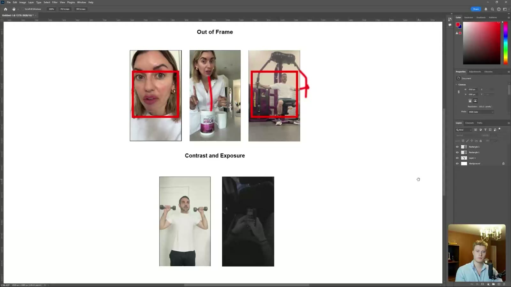

# 103. Video Editors (UGC Shooting Mistakes To Avoid + UGC Brief Template)
> The menu label says "Video Editors" but the lesson is the creator-side filming checklist plus the agency's Google-Doc brief template (creator brief and editor brief) that stops raw footage from coming back unusable.

## 🤖 Agent use
- **Use when:** briefing a human UGC creator (hooks, talking head, B-roll), reviewing raw footage for framing, colour or exposure faults, or briefing an editor who will cut the footage.
- **Inputs → outputs:** concept + product link + hook scripts + body script points + B-roll list → the two-part Google Doc below (creator brief, editor brief) → raw files in three folders.
- **Rules:**
  - **DO** keep the face or the main action in the centre of the frame; no extreme close-ups ("this really limits our options") [00:00].
  - **DO** hold the product near the face (without covering it), so the action stays in the centre [00:45].
  - **DO** capture the whole action (exercise, stretch); if the angle is too tight, switch to the 0.5x or wide/fisheye lens "better than nothing" [01:37].
  - **DO** wear clothes that contrast with the background (white shirt on white wall fails); change outfit between talking head and B-roll [01:37–02:29].
  - **DO** tap to set exposure on the phone; fixing dark or blown footage in post "becomes a bit difficult" [02:29].
  - **DO** test framing in selfie mode first to see where the product gets cut off [00:45].
  - **DON'T** let the creator add captions, transitions, voiceover or music: raw files only (doc, section 5-6).
  - **DON'T** show the product in hooks unless the brief says so (doc, section 2 and 5).
  - **IF** the creator forgets the outfit change (it is in the brief but "people just forget") **THEN** remind them before the shoot [02:29].
- **See also:** [Creator brief playbook](../../../../playbooks/creator-brief.md) · [UGC script writing](../../../../playbooks/ugc-script-writing.md) · [UGC script checklist](../../../../rubrics/ugc-script-checklist.md) · [104 Bad UGC (what the agency rejects)](104-bad-ugc.md) · [107 Getting creators](107-how-to-get-ugc-creators-yourself.md)

## Key ideas
### Centre the action [00:00–01:37]
- Most basic rule: face or main action in the centre of the screen. His example was taken "a bit too far": super close-ups the editor cannot use [00:00].
- Imagine a line between face and product. A product held far from the face gives half the body out of frame, product low, "nothing happening in the middle of the screen" [00:45].
- A subject who is roughly centred but whose action runs out of frame is still a fail; shoot wide enough for the whole move [01:37].

### Colour, contrast, exposure [01:37–02:29]
- "White on white is not a good combination": wear clothes that stick out from the background. He wears blue against a chocolate-brown wall [01:37].
- Dark footage: tap the phone screen to brighten and let it re-expose before recording [02:29].

## Steps / framework
Creator-side filming checklist (from the video and the doc table):
1. Shoot 9:16, eye level, eyes in line with the camera, centre square of the screen.
2. Record talking heads before B-roll.
3. iPhone: Settings → Camera → Record Video → untick HDR.
4. Check outfit contrast against the background; different outfit for B-roll.
5. Check exposure and shadows on the face.
6. Deliver raw files in three folders (see template).

## Examples
The slide he walks through ("Out of Frame" and "Contrast and Exposure"): three out-of-frame frames (face cropped, product low and the person half out, product action cut) and a bright vs a dark frame. A white-shirt-on-white-wall clip is the colour fail [01:37].

## Structured units
| Mistake | Fix | Source |
|---|---|---|
| Extreme close-up | Pull back; face centred | [00:00] |
| Product far from face, body cropped | Product near face, not covering it | [00:45] |
| Action leaves the frame | Whole action in shot; 0.5x / wide lens | [01:37] |
| White-on-white clothing and wall | Contrasting top; change outfit for B-roll | [01:37] |
| Too dark or bright | Tap to expose on phone, not in post | [02:29] |

## Prompts / templates (verbatim)
### UGC brief template (linked Google Doc, "UGC Brief Template with filming guides")
Part 1 is the creator brief; part 2 (after the page break) is the editor brief. Bracketed items are the doc's placeholders; it also embeds two images (a contrast and exposure example) and a link to a video-guidelines clip that is not in the course files.

```text
CONCEPT #[add number]

| [Product Name] | Product link: [LINK] |
| Timeline | 3 days to film and send your content from the product delivery date. |

In this document, you will find:
1. The concept that you will be representing
2. Script for 5 hooks (talking head format)
3. Script for main talking-head/body video
4. The B-roll shot list
5. Filming instructions and video guidelines
6. How to deliver your files

1) Concept
[Copy explaining the concept goes here]
Idea: [LINK]

2) Script - Hooks
Guidelines:
* Hooks allow editors to create multiple ad variations to test performance.
* Do not show the product in the hooks unless explicitly stated.
| HOOK | SCRIPT | ADDITIONAL INSTRUCTIONS |
| 1 | copy | text |
| 2 | copy | text |
| 3 | copy | text |
| 4 | copy | text |
| 5 | copy | text |

3) Talking Head / Body script
Guidelines:
* This is your main speaking video.
* Please express the points naturally, in your own storytelling voice.
* Avoid words like "game changer", "skyrocketed", "level up", "elevate", "boost", "synergy" unless they are part of the product name.
* Change your outfit between the talking video and all B-rolls.
* Please articulate clearly.
Script Points:
| The Realization | ["copy."] |
| The Time Drain | ["copy."] |
| The Avoidance Pattern | ["copy."] |
| The Discovery | ["copy."] |
| The Time Reclaimed | ["copy."] |
| The Frequency Shift | ["copy."] |
| The Real Benefit | ["copy."] |
| The Invitation | ["copy."] |

4) B-roll Shot List
Guidelines:
* No voiceover.
* B-roll is aesthetics: clean, well-lit, timeless
* Avoid festive or seasonal decorations.
* Change outfit from the talking video.
Script to Film: use this tick-off list to make sure all the content has been filmed:
- [ ] B-roll 1: [description]  ... through ...  - [ ] B-roll 10: [description]

5) Filming requirements
Please watch this short explanation of our VIDEO GUIDELINES [Drive link, video not in course files]
| | DO | DON'T |
| Filming | Shoot vertically (9:16). Film at eye level. Keep eyes in line with the camera. Be natural. Light improvisation is welcome. Record talking head videos before B-rolls. On iPhone: Turn off HDR (Settings -> Camera -> Record Video -> Untick HDR). Frame: Stay in the centre square of the screen. | Don't film out of frame. Don't speak too close to the camera. |
| Editing | Share all the raw files without captions or transitions. | Don't edit your content (no captions, no transitions). |
| Sound | Ensure there isn't any background noise. | No voiceover. |
| Lighting | Ensure the lighting is great. Contrast & exposure [image]. | Don't film with shadows on your face. |
| Product | Only show the products as instructed on the script. | Don't show the product in hooks unless stated. |
| Clothes | Wear what you feel most comfortable with as long as it's not too loud or revealing. Change your outfits for the speaking video and b-rolls. Contrast & exposure [image]. | Don't wear branded or logo outfits. |

6) Sending your files:
* Share raw footage only (no edits, music or effects).
* Use Google Drive. If you don't have it, we'll provide a folder link.
* Organise your files per concept into three folders: 1. Hooks 2. Talking Head Video(s) 3. B-rolls
* Name your files following this structure:
  Hooks: "Hook 1", "Hook 2", ...
  B-roll: "B-roll 1_Description of action"
  Talking head: "Talking-head video"
```

### Editor brief (second half of the same doc)
```text
CONCEPT
Product link: LINK
Idea: LINK
Concept #:

Editing Principles:
* Show what is being said
  * E.G. "shovelling snow off driveway" - show them shovelling snow
  * E.G. "which makes me so rigid" - show them in layers looking rigid when they move
  * E.G. "On chilly winter days, the heating struggles to warm up my house." - show a cold winter scene (with snow and ice), then show someone turning on the heating OR a radiator in a house OR a mix of a thermostat and radiator etc
* Engage every 3-5 seconds with cuts, broll, text animation etc.
* Keep it native to social media.
  * E.G. Use tiktok style text and borders, DON'T use huge animated graphics
* Keep text animations simple and easy to read.
  * E.G. DON'T use 3D animations on text, use simple, short effects
* Keep text and subtitles to 2 lines, don't show 3 lines worth of text
* Ensure text borders don't touch the sides of the frame.
* All content must come exclusively from this client's approved resources. Do not use any material from other clients, including creator b-roll.

SCRIPT
General guide of what the edit should feel like.
|  | AUDIO HOOK | CAPTION HOOK | BROLL GUIDE |
| 1 |  |  |  |
| 2 |  |  |  |
| 3 |  |  |  |

Editor Creative Direction:
```

## Screenshots

*Slide used in the lesson: red boxes mark where the face or product should sit; the lower row compares a well-exposed and an under-exposed frame. [00:00]*

## How to apply
- [ ] Copy the template, fill product, concept, 5 hooks, body points (use script points, not lines), 10 B-roll items.
- [ ] Send with the filming table; confirm HDR off and outfit change before the shoot.
- [ ] Review the first clips for the five mistakes above; ask for a reshoot early.
- [ ] Give the editor the second half plus the approved raw folders only.
- [ ] (derived) The body headings in the template are product-specific (a time-saving product); rewrite them for your concept, do not ship them as-is.

## Related
- Next: [104. BAD UGC](104-bad-ugc.md)
- [Creator brief playbook](../../../../playbooks/creator-brief.md) · [write-ugc-script skill](../../../../../../.claude/skills/write-ugc-script/SKILL.md)

## Sources and limitations
- [Transcript](<../../../../../raw/ad-creators-lab/ai-ads-ugc-animations/_transcripts/Ad Creators Lab - Create Viral AI Ads, UGC & Animations That Convert Into Sales(September 2026)/8. Hiring Talent/1. UGC/1. Video Editors.txt>) (Whisper; ends 2:56 of 2:57). [Lesson page](<../../../../../raw/ad-creators-lab/ai-ads-ugc-animations/_extracted/Ad Creators Lab - Create Viral AI Ads, UGC & Animations That Convert Into Sales(September 2026)/8. Hiring Talent/1. UGC/1. Video Editors.htm.md>) holds only the doc link. [Google Doc](<../../../../../raw/ad-creators-lab/ai-ads-ugc-animations/_extracted/_linked/google/1Q3Zo6hLmpjP.md>) fetched 2026-11-13.
- The linked video-guidelines clip and the "Idea:" links are not in the course files. The speaker is not named; nothing is claimed about his role.
- Compliance (derived): the "Avoid words" list is a style rule, not a claims rule; still run script points through the [claim audit](../../../stefan-georgi/rmbc-ii/rubrics/llm-output-claim-audit.md).
