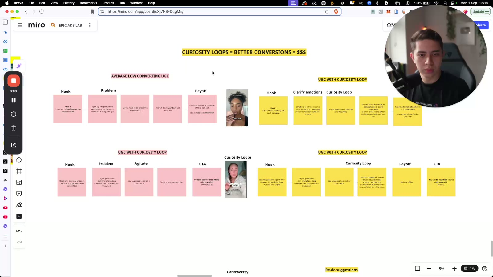
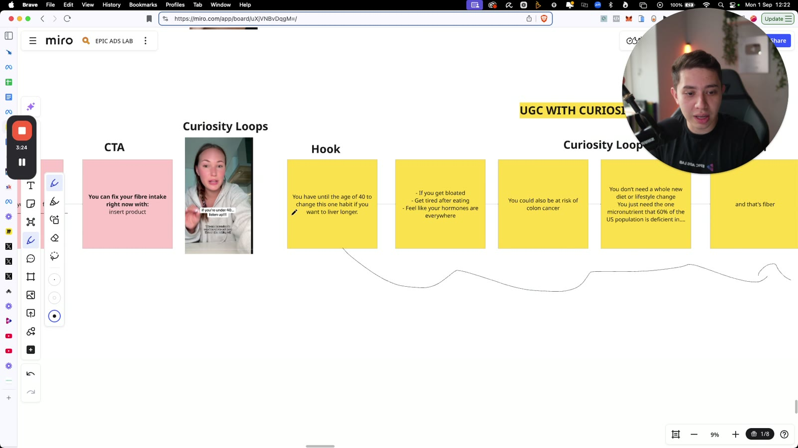

# 105. Make UGC Scripts That Scale
> Rewrite a standard hook-problem-solution UGC script as a chain of curiosity loops (name the feeling, withhold the product, reveal the mechanism, pay off last) because that is what lifts attention and conversions (instructor claim).

## 🤖 Agent use
- **Use when:** writing or rewriting a UGC script that reads as "problem, agitate, solution"; briefing creators on script structure.
- **Inputs → outputs:** a flat PAS script → a script that clarifies the viewer's emotion, then delays each reveal (what to take, what it does, what it is) until a late payoff and CTA.
- **Rules:**
  - **DO** open with a hook, then a line that clarifies the emotion the viewer already feels ("clarifier of emotions") [00:54].
  - **DO** make the product the withheld answer: say "all you need to do is take this" and show it without naming or explaining it yet [00:54].
  - **DO** stack loops: detox secret (loop 1) → "take this powder" (loop 2) → what it does (loop 3) → payoff "it's from this product" [01:50].
  - **DO** hold back the category word until late: in the fiber rewrite "we don't even know it's a micronutrient until we get to this" [02:45].
  - **DON'T** run the default: hook, problem, agitate, solution, CTA in order; "people don't really, this doesn't work" [01:50] (instructor claim).
  - **IF** the viewer can already guess the topic (the hook says "fiber") **THEN** still delay the specifics; "human beings are really smart" and wait for the reveal [02:45].
- **See also:** [Hooks and open loops in the script playbook](../../../../playbooks/ugc-script-writing.md) · [UGC script checklist](../../../../rubrics/ugc-script-checklist.md) · [write-ugc-script skill](../../../../../../.claude/skills/write-ugc-script/SKILL.md) · [106 Concepts that print](106-ugc-concepts-that-print.md) · [Evolve copywriting hooks](../../../evolve/copywriting/)

## Key ideas
### The method [00:00–01:50]
- One concept makes better UGC: curiosity loops; "better conversions and basically make more money" (instructor claim) [00:00].
- Average low-converting UGC: hook → problem → solution → payoff/CTA [00:00].
- Better version: hook → clarify emotions → curiosity loop(s) → payoff → CTA. The first loop is the "detox secret"; the second is "take this powder" (shown, not explained); the third is what it does; the payoff names the product [00:54–01:50].

### Second example: fiber for people over 40 [01:50–02:45]
- Standard: "this is why everyone over 40 needs to change their belief around fiber" → bloated, tired, hormones everywhere → risk of colon cancer → "which is why you need fiber" → "fix with [product]" [01:50].
- Rewrite: opens with a deadline hook, keeps the problems, then buries the answer behind "one micronutrient" [01:50–02:45].

## Steps / framework
1. Write the standard script (hook, problem, agitate, need, CTA).
2. Replace the hook with one that names a deadline, benefit or stake without naming the solution.
3. Keep the problem lines as the "clarify emotions" step.
4. Replace "the solution is X" with a chain: secret → "all you need to do is [show product, no name]" → what it does → "it's [product/ingredient]".
5. Move the category word and brand to the payoff; end with the CTA.
6. Run the claims through the claim audit (see compliance).

## Examples
Both scripts are from the Miro board in the video (yellow = with loops, pink = standard).

## Structured units
### Rewrites (before → after)
| Before | After | What changed | Source |
|---|---|---|---|
| "If your skin is breaking out, you need to try this." | "If your skin is breaking out, don't get upset" | Reframed from instruction to reassurance; no solution yet | [00:00–00:54] |
| "If you try every serum out there but you get the same results, it's actually your gut" | "I'm about to let you in on some detox secret so you don't get overwhelmed looking for face creams" | Problem restated as a withheld secret; clarifies the emotion (overwhelm) | [00:00–00:54] |
| "All you need to do is take this powder. This will detox your body and it's formulated of this, this, this." | "All you need to do is take this powder [show powder]" → "This will kickstart a natural detox process of bowel movements to avoid these toxins getting back into your body and your skin" → "formulated of [fiber]... you can get it from food or the product" | Split one line into three reveals; show the powder before explaining; add "from food or the product" | [00:00–00:54] |
| "This is why everyone over 40 needs to change their belief around fiber." | "You have until the age of 40 to change this one habit if you want to live longer." | Scarcity/deadline hook; topic and solution withheld | [01:50] |
| "...You could be at risk of colon cancer, which is why you need fiber. You can fix this with [product]." | "...You could also be at risk of colon cancer. You don't need a whole new diet or lifestyle change. You just need the one micronutrient that 60% of the US population is deficient in... and that's fiber. You can fix your fiber intake right now with: [product]" | Fiber named only at the end; "micronutrient" teaser; stat as a loop | [01:50–02:45] |

### Hooks (from the board)
| Hook (verbatim) | Heuristic(s) | Emotion / zone | Self targeted | Why it works | Source |
|---|---|---|---|---|---|
| "If your skin is breaking out, don't get upset" | empathy, curiosity gap (derived) | reassurance (derived) | skin-breakout sufferer | Names the problem, promises a "detox secret" next | [00:00–00:54] |
| "You have until the age of 40 to change this one habit if you want to live longer." | scarcity, deadline (instructor: "it creates scarcity in this hook") | fear/urgency (derived) | adults approaching 40 | Deadline and "one habit" withheld | [01:50] |

### Rules
- **DO** treat the first loop as "everyone's kind of heard something similar, nothing crazy here"; the loops build after it [00:54].
- **DON'T** add the CTA before the payoff.
- **IF** you have fewer than three reveals **THEN** split the benefit and the ingredient into separate lines (derived).

## Prompts / templates (verbatim)
Board structure as shown (no prompt in the lesson):
```text
AVERAGE LOW CONVERTING UGC:  Hook | Problem | (solution) | Payoff -> CTA
UGC WITH CURIOSITY LOOP:      Hook | Clarify emotions | Curiosity Loop (x3) | Payoff | CTA
Example loop chain (board, "Hook 1"):
Hook 1: If your skin is breaking out, don't get upset
Clarify emotions: I'm about to let you in some detox secret so you don't get overwhelmed looking for face creams
Curiosity loop: all you need to do is take this [show powder]
Curiosity loop: This will kickstart the natural detox process of bowel movements. To avoid these toxins getting back into your body and your skin
Payoff: And it's a formula of X amount of fibre ... You can get it from food or core fiber
```

## Screenshots

*Top row: pink "average low converting UGC" vs yellow "UGC with curiosity loop"; bottom row the fiber example, each beside a reference TikTok. [00:00]*


*The yellow chain: deadline hook, bloated/tired problem, colon-cancer risk, the "one micronutrient" loop, payoff "and that's fiber". [03:00]*

## How to apply
- [ ] Rewrite your next hook-body draft with at least two withheld reveals.
- [ ] Keep every health stat and scarcity line verifiable.
- [ ] Test the loop version against the standard version (derived).

## Related
- Previous: [104. BAD UGC](104-bad-ugc.md) · Next: [106. UGC Concepts That PRINT](106-ugc-concepts-that-print.md)
- Agreement/disagreement with the KB: the [UGC script playbook](../../../../playbooks/ugc-script-writing.md) says one main loop from hook to payoff, with small line-level curiosity; this lesson stacks several loops, a compatible but more aggressive version.

## Sources and limitations
- [Transcript](<../../../../../raw/ad-creators-lab/ai-ads-ugc-animations/_transcripts/Ad Creators Lab - Create Viral AI Ads, UGC & Animations That Convert Into Sales(September 2026)/8. Hiring Talent/1. UGC/3. Make UGC Scripts That Scale.txt>) (Whisper; full 3:32). [Lesson page](<../../../../../raw/ad-creators-lab/ai-ads-ugc-animations/_extracted/Ad Creators Lab - Create Viral AI Ads, UGC & Animations That Convert Into Sales(September 2026)/8. Hiring Talent/1. UGC/3. Make UGC Scripts That Scale.htm.md>) is empty. Board text read from frames; small text partly illegible.
- Compliance flags: "60% of the US population is deficient in fiber", "at risk of colon cancer" and "live longer" are health claims with no source in the course; the deadline ("until the age of 40") is invented urgency. Verify or drop before use; see [claim audit](../../../stefan-georgi/rmbc-ii/rubrics/llm-output-claim-audit.md).
