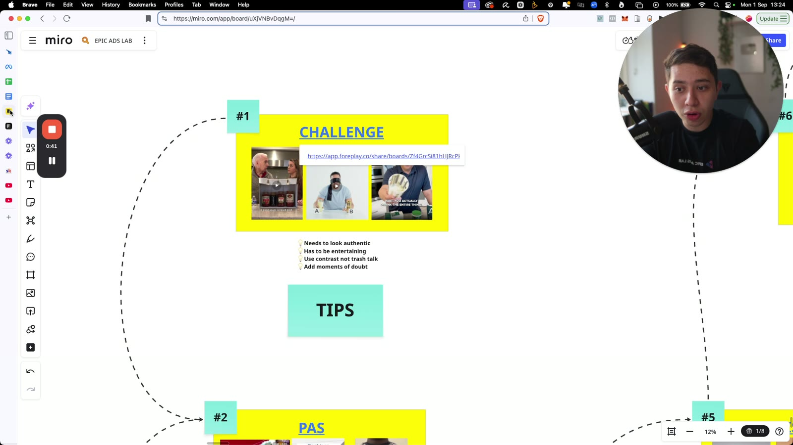
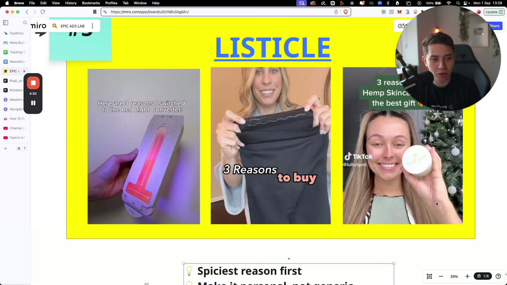

# 106. UGC Concepts That PRINT
> Eight human-shot UGC concepts the agency says brands pay most for (challenge, PAS, educational, us vs them, listicle, story, testimonial, founder), each with the execution tips that make it work; use it to pick a concept and brief a creator.

## 🤖 Agent use
- **Use when:** choosing the concept for a creator brief, or reviewing a UGC script against a concept type.
- **Inputs → outputs:** product + angle → one of eight concepts with its tip list → concept line in the brief ([103 template](103-video-editors.md)).
- **Rules:**
  - **DO** pick concepts that show a real process or reaction; "these are not really types of videos that AI can produce" [00:00] (instructor claim).
  - **DO** pair each concept with swipe examples (the board links a Foreplay board per concept; not in the course files) [00:00].
  - **DO** give the creator at least one to five versions of each concept to build a portfolio [00:00].
  - **DON'T** rig a challenge so the brand's product obviously wins; add stakes and doubt [00:54].
  - **DON'T** attack in us-vs-them; educate. "I heard a crack when I sound it" beats "this feels cheap" [03:33 area].
  - **DON'T** use testimonial unless the creator genuinely used the product (case study, e.g. one week of a meal-prep service) [05:00].
  - **IF** the concept is educational **THEN** use a breakthrough narrative and a curiosity loop ([105](105-make-ugc-scripts-that-scale.md)) [02:38].
- **See also:** [UGC script writing](../../../../playbooks/ugc-script-writing.md) · [Creator brief](../../../../playbooks/creator-brief.md) · [UGC script checklist](../../../../rubrics/ugc-script-checklist.md) · [write-ugc-script skill](../../../../../../.claude/skills/write-ugc-script/SKILL.md) · [Skeptic format](../../../../frameworks/skeptic-format.md)

## Key ideas
### Why these eight [00:00]
Brands "are actively paying for right now" and "convert like crazy"; the agency pays for these too. More concepts are "in other videos" (not in this lesson) [00:00, 05:56].

### The eight concepts
| # | Concept | What it is | Execution tips (as taught) | Source |
|---|---|---|---|---|
| 1 | Challenge | Compare products or run a street/taste challenge ("try this vs this") | Look authentic; entertaining; add stakes and moments of doubt; contrast, not trash talk (board: "Needs to look authentic / Has to be entertaining / Use contrast not trash talk / Add moments of doubt") | [00:00–01:42] |
| 2 | PAS (problem, agitate, solution) | Show the problem, agitate, resolve | Show, don't tell; every problem visible; AI can't show real skin or digestion issues without stock footage; board: "Build tension before product / Show Not Tell" | [01:42] |
| 3 | Educational | Use articles and science to explain why the product works; "a little bit of an explainer, a little bit of a scientist" | Curiosity loop; breakthrough narrative ("I used to believe X... after reading articles, what I thought was bad is actually good") | [01:42–02:38] |
| 4 | Us vs Them (video) | "I've tried this, here's the other thing; what's the comparison" | Bottom of funnel; educate, not attack; show visually and in depth | [02:38–03:33] |
| 5 | Listicle | Reasons / lies / mistakes / signs, but demonstrated | Replace "3 reasons why" with "3 lies you've been told", "3 mistakes people make", "3 signs you need this"; act out each (apple cider vinegar: show taking it as a shot, mixing it wrong; jacket: show the bad fit, wrong length); board: "Spiciest reason first / Make it personal, not generic" | [03:33–04:17] |
| 6 | Story ad | Like a FaceTime call to a friend ("you never guess what happened") | Use your natural storytelling pace; start mid-drama; visuals and text cues (editor); make it a transformation | [04:17–05:00] |
| 7 | Testimonial | Only in product seeding | Be legit; real case study, not "I've started using the meal prep service and it's really good and it really works" | [05:00] |
| 8 | Founder style | Be (or pretend to be) the founder: mission, reasons, culture | Rally people to a vision | [05:56] |

## Steps / framework
1. Pick the concept by funnel stage (derived): challenge, PAS, educational at the top; us-vs-them at the bottom ([03:33]: "very good for the bottom of the funnel").
2. Write the concept line plus its tip list into the brief.
3. Attach swipe examples.
4. Have the creator shoot 1-5 versions.

## Examples
- Challenge board examples: a durability test (insoles), a taste challenge, a blind greens-powder test, a street comparison (frames [00:26–00:42]). Brand names on screen are not recorded here; copy the mechanism, not the asset.
- Listicle board: "Here are 3 reasons I switched to...", "3 Reasons to buy", "3 reasons [product] is the best gift" (frame [04:31]).

## Structured units
### Rules
- **DO** make the challenge entertaining and contrastive [00:54].
- **DO** show every problem in a PAS; "show and not tell" [01:42].
- **DON'T** say "this sucks"; show the failure (the crack, the poor fit) [03:33].
- **IF** testimonial **THEN** only after real use; otherwise skip [05:00].
- **IF** you pretend to be the founder **THEN** see compliance below.

### Concept to angle mapping (derived)
| Concept | Works with | Source |
|---|---|---|
| Challenge | Comparison, curiosity | [00:54] |
| Educational | Problem-aware, skeptical | [02:38] |
| Us vs Them | Solution/product-aware, bottom funnel | [03:33] |

## Prompts / templates (verbatim)
Board text visible in frames:
```text
#1 CHALLENGE: Needs to look authentic / Has to be entertaining / Use contrast not trash talk / Add moments of doubt
#2 PAS: Build tension before product / Show Not Tell
#5 LISTICLE: Spiciest reason first / Make it personal, not generic
```
Other tip boxes on the board (#3, #4, #6-#8) are not legible in the extracted frames.

## Screenshots

*Miro card #1 CHALLENGE with swipe examples and the four tips; #2 PAS and #5 beside it. [00:42]*


*Listicle examples ("3 reasons") and the tip "Spiciest reason first / Make it personal, not generic". [04:31]*

## How to apply
- [ ] Choose a concept per creator; avoid giving all eight at once.
- [ ] Write the tips into the brief as DO/DON'T.
- [ ] Review the first cut against the tips ([104 rubric](104-bad-ugc.md)).

## Related
- Previous: [105](105-make-ugc-scripts-that-scale.md) · Next: [107. How to get UGC creators yourself](107-how-to-get-ugc-creators-yourself.md)

## Sources and limitations
- [Transcript](<../../../../../raw/ad-creators-lab/ai-ads-ugc-animations/_transcripts/Ad Creators Lab - Create Viral AI Ads, UGC & Animations That Convert Into Sales(September 2026)/8. Hiring Talent/1. UGC/4. UGC Concepts That PRINT.txt>) (Whisper; full 6:36). [Lesson page](<../../../../../raw/ad-creators-lab/ai-ads-ugc-animations/_extracted/Ad Creators Lab - Create Viral AI Ads, UGC & Animations That Convert Into Sales(September 2026)/8. Hiring Talent/1. UGC/4. UGC Concepts That PRINT.htm.md>) is only the Miro board link and a sentence: "If you hire a UGC creator, give them this." The Miro board and the Foreplay swipe boards are not in the course files.
- The lesson states "action items below" for the creator; none are in the files. "Other concepts" are promised for another video.
- Compliance: "pretend to be the founder" is a fake-identity format; use a real founder or a clearly labelled actor. Testimonials must come from real use. Don't copy a competitor's ad 1:1: copy the mechanism, not the asset. Challenge results must be real (no staged "blind" wins presented as independent).
