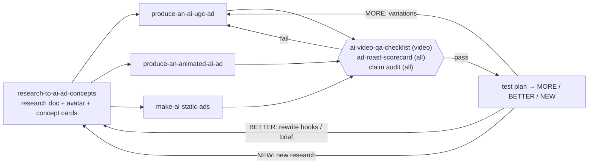

# Ad Creators Lab playbooks hub
> Four end-to-end procedures for making AI-produced ad creative for our own DTC brands with this course's methods: research → concepts, then one of three production lines (AI UGC, animated AI, AI statics), then two quality gates and a test plan. Each playbook lists the inputs it needs up front and ends with a deliverables template.

## 🤖 Agent use
- **Use when:** you are asked to make an AI UGC video, an animated AI ad (skeleton, crochet, claymation, talking object, "Zack D" style, song), or AI-assisted statics, or to find concepts for them.
- **Inputs → outputs:** a product + offer + audience + real customer language → the right playbook → script, prompt pack, reference list, shot QA log, test plan.
- **Rules:**
  - **DO** start at research when there is no research doc: "what they want, what words they use, what desires, problems" go into one document [L94 00:00](../lessons/094-research-protocol-start-here.md).
  - **DO** write the script before the visuals: visuals "are not the crux of your ad" [L91 43:53](../lessons/091-special-guest-recordings-ai-office-hours-david.md); the voiceover is "the main drive of what our ad will become" [L90 05:06](../lessons/090-ai-editing-2026-08-18.md).
  - **DO** run the [RMBC claim audit](../../../stefan-georgi/rmbc-ii/rubrics/llm-output-claim-audit.md) on every model-written script, prompt pack and static copy set.
  - **DON'T** execute the course's rule-breaking tactics (stranger photos as AI creators, cloned real voices, AI "customers" with results, fake comment overlays, invented urgency, 1:1 competitor recreations). Each playbook marks them **don't execute** and gives the compliant version; the full list is [AI creator compliance](../concepts/ai-creator-compliance.md).
  - **DO** upload every ad PAUSED and keep a human final yes/no [L93 50:59–52:27](../lessons/093-special-guest-recordings-mr-paid-social-guest-talk.md).
  - **IF** a tool, model, price or limit matters **THEN** treat it as "at recording (Aug–Sep 2026)" and check [tool settings](../libraries/tool-settings.md) and the live tool.
- **See also:** [Rubrics hub](../rubrics/README.md) · [Shared playbooks hub](../../../../playbooks/README.md) · [write-ugc-script skill](../../../../../../.claude/skills/write-ugc-script/SKILL.md) · [write-landing-page skill](../../../../../../.claude/skills/write-landing-page/SKILL.md) · [AI ad format catalog](../concepts/ai-ad-format-catalog.md)

## Pipeline

Text version: research → concept card → (AI UGC | animated | static) → QA gates → paused upload → test → MORE (variations), BETTER (hooks and brief) or NEW (back to research). The loop is the course's research protocol [L94 01:30](../lessons/094-research-protocol-start-here.md).

## Which playbook
| Playbook | Use when | Needs up front | Produces | Gates |
|---|---|---|---|---|
| [Research to AI ad concepts](research-to-ai-ad-concepts.md) | New brand, new batch, or ideas exhausted | Product facts, brand info, access to reviews / Reddit / TikTok comments, an ad-spy tool | Research doc, one avatar, awareness map, spend-ranked ad shortlist, teardown cards, 5–10 concept cards | Source-truth check, claim audit |
| [Produce an AI UGC ad](produce-an-ai-ugc-ad.md) | Concept calls for a person talking to camera, podcast, street interview, or voiceover + B-roll with a human look | Concept card, product facts, offer, real customer language, product photos, a lawful creator identity | Script + 3 hooks, director's brief, prompt pack, reference list, clips, edit, QA log, test plan | Claim audit, [AI video QA](../rubrics/ai-video-qa-checklist.md), [roast scorecard](../rubrics/ad-roast-scorecard.md) |
| [Produce an animated AI ad](produce-an-animated-ai-ad.md) | Concept fits a stylised format (skeleton, crochet, claymation, talking object, 3D explainer, song) | Concept card, product facts, product photos, research avatar | Script, per-line visual table, character bible, keyframes, video prompts, voice or song, edit, QA log, test plan | Same three gates |
| [Make AI static ads](make-ai-static-ads.md) | Message test, cheap volume, or a winning video angle to restate as images | Research doc, avatar, product photos (several angles), brand colours/fonts, template pack | Angle bank, headline bank, 10 template concepts, AI product images, finished statics, test plan | Claim audit, roast scorecard (statics) |

## Rules shared by all four playbooks
| Gate | Rule | Source |
|---|---|---|
| Inputs | List missing inputs instead of guessing; bracket unverified product facts | Repo rule ([AGENTS.md](../../../../../../AGENTS.md)) |
| Proof | No invented reviews, quotes, counts, experts, results, comments or scarcity; AI characters never claim personal results | Repo rule; [L80 09:55](../lessons/080-supplement-brand-70k-winning-ad-breakdown.md) |
| Likeness and voice | No real person's face or voice without written rights; no named-person or celebrity prompts | [AI creator compliance](../concepts/ai-creator-compliance.md); [L29 04:07](../lessons/029-make-ai-creators-talk.md) |
| Disclosure | "Meta won't flag it" is not permission to deceive; disclosure and non-deception rules still apply | [L93 56:54–58:18](../lessons/093-special-guest-recordings-mr-paid-social-guest-talk.md) |
| Competitors | Copy the mechanism, not the asset | [L91 18:21–36:26](../lessons/091-special-guest-recordings-ai-office-hours-david.md); [L69 00:00](../lessons/069-static-ads-intro.md) |
| Cost | Estimate cost, smoke-test one output, then batch (about 10 at a time) | [L93 36:11–38:40](../lessons/093-special-guest-recordings-mr-paid-social-guest-talk.md) |
| Launch | Upload PAUSED; separate QA pass; human final yes/no | [L93 50:59–52:27](../lessons/093-special-guest-recordings-mr-paid-social-guest-talk.md) |

## How these relate to other courses' playbooks
- Tether Lab shared pipeline: [competitor ad teardown](../../../../playbooks/competitor-ad-teardown.md), [angle remix](../../../../playbooks/angle-remix.md), [UGC script writing](../../../../playbooks/ugc-script-writing.md), [creator brief](../../../../playbooks/creator-brief.md), [static ad creation](../../../../playbooks/static-ad-creation.md), [test and iterate](../../../../playbooks/test-and-iterate.md). These playbooks add the **AI production layer** (references, models, keyframes, voice, AI realism, AI QA) on top of them; script craft stays with the shared skill and pages.
- Evolve Start Here: [research to first concepts](../../../evolve/start-here/playbooks/research-to-first-concepts.md) is deeper research; this course's research protocol is a ~30-minute to 1-hour version ([L97](../lessons/097-customer-research-protocol-1.md), [L70 06:02](../lessons/070-full-static-ads-creation-process.md)).
- Evolve Copywriting: [write a video ad script](../../../evolve/copywriting/playbooks/write-a-video-ad-script.md), [write static image ads](../../../evolve/copywriting/playbooks/write-static-image-ads.md), [iterate on test results](../../../evolve/copywriting/playbooks/iterate-on-test-results.md).
